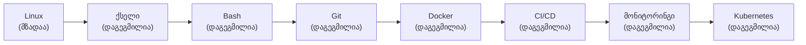

# Academy

სასწავლო მოდულები DevOps-ის საფუძვლებიდან პრაქტიკამდე. თითოეული გაკვეთილი დამოუკიდებელია, მაგრამ მოდულები თანმიმდევრულადაა აგებული.

**თქვენი პროგრესი:** ამ ბრაუზერში დასრულებული გაკვეთილების რაოდენობა გამოჩნდება აქ (საჭიროა JavaScript; მონაცემები მხოლოდ თქვენს ბრაუზერში ინახება).

## სწავლის გზა

## მოდულები

| მოდული | სტატუსი | არსებული მასალა |
|---|---|---|
| **[Linux](linux/index.md)** | ✅ მზადაა (6 გაკვეთილი) | [FHS](../linux/filesystem-hierarchy.md), [Cheat Sheet](../linux/cheatsheet.md), ქვიზი: Linux |
| ქსელი | 🗓️ დაგეგმილია | [Task 2](../tasks/task2.md), [Task 3](../tasks/task3.md), [Task 22](../tasks/task22.md), ქვიზი: ქსელი |
| Bash | 🗓️ დაგეგმილია | [Task 11](../tasks/task11.md), [Task 12](../tasks/task12.md), ქვიზი: Bash |
| Git | 🗓️ დაგეგმილია | [Task 18](../tasks/task18.md), ქვიზი: Git |
| Docker | 🗓️ დაგეგმილია | [Task 14](../tasks/task14.md), [Task 15](../tasks/task15.md), ქვიზი: Docker |
| CI/CD | 🗓️ დაგეგმილია | [Task 19](../tasks/task19.md), ქვიზი: CI/CD |
| მონიტორინგი | 🗓️ დაგეგმილია | [Task 13](../tasks/task13.md), [Task 20](../tasks/task20.md) |
| Kubernetes | 🗓️ დაგეგმილია | ქვიზი: Kubernetes |

!!! note "რას ნიშნავს „დაგეგმილია“"
    ცალკე გაკვეთილები ამ მოდულებისთვის ჯერ არ არსებობს. ბმულები მიუთითებს **უკვე არსებულ** ამოცანებსა და ქვიზებზე, რომლებიც თემას ნაწილობრივ ფარავს.

## დაკავშირებული

- [ქვიზები](../quiz.md): 10 თემა და შერეული ტესტი
- [Production: ლაბორატორიული არქიტექტურა](../production/index.md)
- [სასწავლო რესურსები და სერტიფიკაციები](../resources.md)
