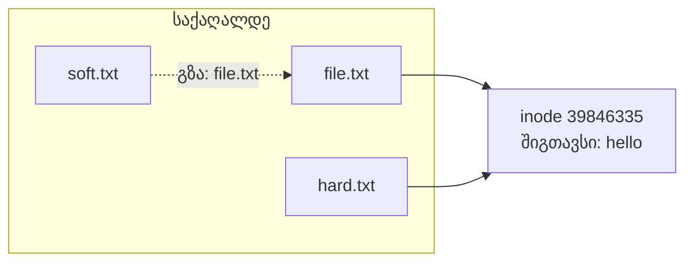

# ფაილური სისტემა: ფაილებთან მუშაობა, ბმულები და ძებნა

!!! info "კავშირი არსებულ მასალასთან"
    დირექტორიების **სტრუქტურა** (`/etc`, `/var`, `/usr` ...) უკვე აღწერილია გვერდზე [ფაილური სისტემის იერარქია (FHS)](../../linux/filesystem-hierarchy.md). აქ არ ვიმეორებთ: ვსწავლობთ, **როგორ ვმართოთ** ფაილები და საქაღალდეები. გამოტანები რეალური გაშვებიდანაა (მაგალითი, მფლობელი `student`).

## 1. სასწავლო მიზნები

- შექმნათ, დააკოპიროთ, გადაიტანოთ და წაშალოთ ფაილები და საქაღალდეები (`mkdir`, `cp`, `mv`, `rm`);
- გამოიყენოთ wildcard-ები (`*`, `?`, `{}`);
- განასხვავოთ **hard link** და **symbolic link**, და გაიგოთ **inode**;
- მოძებნოთ ფაილები `find`-ით და ტექსტი `grep`-ით;
- შეამოწმოთ დისკის სივრცე `df`-ით და `du`-ით.

## 2. შესავალი

Linux-ში "ყველაფერი ფაილია": ჩვეულებრივი დოკუმენტი, საქაღალდე, მოწყობილობა, პროცესის ინფორმაცია (`/proc`). ამიტომ ფაილებთან უსაფრთხო და ზუსტი მუშაობა არის ყოველდღიური DevOps უნარი: კონფიგურაციის კოპირება, ლოგების ძებნა, ბექაფის გადატანა.

## 3. თეორიული ახსნა

### Inode და სახელი

ფაილის **შიგთავსი** და **მეტამონაცემები** (ზომა, მფლობელი, უფლებები, დრო) ინახება **inode**-ში. **სახელი** არის უბრალოდ ჩანაწერი საქაღალდეში, რომელიც inode-ს მიუთითებს. ამიტომ ერთ inode-ს შეიძლება რამდენიმე სახელი ჰქონდეს.



| ტიპი | შექმნა | რას უთითებს | თუ ორიგინალს წავშლით |
|---|---|---|---|
| **Hard link** | `ln ორიგინალი ახალი` | იმავე inode-ს | მონაცემები რჩება (inode წაიშლება ბოლო სახელის წაშლისას) |
| **Symbolic (soft) link** | `ln -s ორიგინალი ახალი` | გზას (სახელს) | ბმული "გატეხილი" ხდება (dangling) |

Hard link არ შეიძლება საქაღალდეზე და სხვა ფაილურ სისტემაზე; symbolic link შეიძლება.

### Wildcard-ები (globbing)

Shell თავად აფართოებს შაბლონს, **ბრძანების გაშვებამდე**:

| შაბლონი | ნიშნავს |
|---|---|
| `*` | ნებისმიერი სიმბოლოები: `*.log` |
| `?` | ზუსტად ერთი სიმბოლო: `file?.txt` |
| `[abc]` | ერთი სიმბოლო სიიდან |
| `{a,b}` | ვარიანტები: `mkdir -p proj/{src,docs}` |

## 4. ტექნიკური მაგალითები

```bash
mkdir -p projects/demo/{src,docs}     # ჩადგმული საქაღალდეები ერთად
cp file.txt backup.txt                # კოპირება
cp -r demo demo-copy                  # საქაღალდის კოპირება (-r რეკურსიულად)
mv backup.txt archive/                # გადატანა (ან გადარქმევა)
rm file.txt                           # ფაილის წაშლა
rm -r demo-copy                       # საქაღალდის წაშლა
```

!!! danger "rm-ს ნაგვის ყუთი არ აქვს"
    `rm` წაშლას უკან ვერ დააბრუნებთ. არასდროს გაუშვათ `rm -rf` შაბლონით, რომელიც ბოლომდე არ გაქვთ გადამოწმებული. ჯერ ნახეთ, რა დაემთხვევა: `ls შაბლონი`. ინტერაქტიულად: `rm -i`.

### ძებნა

```bash
find ~/projects -name "*.sh"                 # სახელით
find /var/log -type f -size +10M             # 10 MB-ზე დიდი ფაილები
find . -type f -mtime -1                     # ბოლო 24 საათში შეცვლილი
grep -rn "ERROR" /var/log/myapp/             # ტექსტი ფაილებში (რეკურსიულად, ხაზის ნომრით)
```

## 5. ბრძანებები და კოდი

| ბრძანება | რას აკეთებს | რატომ |
|---|---|---|
| `cp -a წყარო დანიშნულება` | კოპირება უფლებების და დროის შენარჩუნებით | ბექაფისთვის |
| `mv ძველი ახალი` | გადატანა/გადარქმევა | სტრუქტურის შეცვლა |
| `rm -i`, `rmdir` | დადასტურებით წაშლა, ცარიელი საქაღალდის წაშლა | უსაფრთხოება |
| `ln`, `ln -s` | hard / symbolic link | ერთი ფაილი რამდენიმე ადგილას |
| `stat ფაილი` | inode, უფლებები, დროები | ზუსტი ინფორმაცია |
| `file ფაილი` | ფაილის ტიპის დადგენა | გაფართოებას არ ეყრდნობა |
| `find`, `grep -rn` | ფაილის / ტექსტის ძებნა | ლოგების და კონფიგის დიაგნოსტიკა |
| `df -h` | დისკის თავისუფალი ადგილი ფაილურ სისტემებზე | "დისკი სავსეა?" |
| `du -sh საქაღალდე` | საქაღალდის ზომა | რა იკავებს ადგილს |
| `head`, `tail -n 20`, `tail -f` | ფაილის დასაწყისი / ბოლო / ცოცხალი თვალყურის დევნა | ლოგები |

## 6. პრაქტიკული სავარჯიშოები

**სავარჯიშო 1: ბმულები.**

```bash
cd ~/projects/demo
echo "hello" > file.txt
ln file.txt hard.txt
ln -s file.txt soft.txt
ls -li
stat -c '%n inode=%i links=%h' file.txt hard.txt soft.txt
rm file.txt
cat hard.txt
cat soft.txt
ls -l soft.txt
```

**სავარჯიშო 2:** შექმენით `logs/` საქაღალდე, ჩადეთ მასში `a.log`, `b.log`, `c.txt` და ერთი ბრძანებით დააკოპირეთ მხოლოდ `.log` ფაილები `backup/`-ში (`cp logs/*.log backup/`).

**სავარჯიშო 3:** იპოვეთ თქვენს home-ში ყველა `.sh` ფაილი და დათვალეთ `find ... | wc -l`-ით.

**სავარჯიშო 4:** დაადგინეთ, რომელი 5 საქაღალდე იკავებს ყველაზე მეტ ადგილს `/var`-ში (საჭიროა `sudo`): `sudo du -h --max-depth=1 /var 2>/dev/null | sort -rh | head -n 5`.

## 7. მოსალოდნელი შედეგი

სავარჯიშო 1 (რეალური გაშვება; inode-ის ნომრები თქვენთან სხვა იქნება):

```text
39846335 -rw-rw-r-- 2 student student    6 Nov 17 12:22 file.txt
39846335 -rw-rw-r-- 2 student student    6 Nov 17 12:22 hard.txt
39846336 lrwxrwxrwx 1 student student    8 Nov 17 12:22 soft.txt -> file.txt
file.txt inode=39846335 links=2
hard.txt inode=39846335 links=2
soft.txt inode=39846336 links=1
```

`file.txt` და `hard.txt` **ერთი inode-ია** (`links=2`); `soft.txt` ცალკე inode-ია. `file.txt`-ის წაშლის შემდეგ:

```text
hello                                   # cat hard.txt: მონაცემი ცოცხალია
cat: soft.txt: No such file or directory  # soft link გატეხილია
lrwxrwxrwx 1 student student 8 ... soft.txt -> file.txt
```

## 8. პრობლემების მოგვარება

| სიმპტომი | მიზეზი | გამოსწორება |
|---|---|---|
| `cp: -r not specified; omitting directory` | საქაღალდეს `-r` სჭირდება | `cp -r` ან `cp -a` |
| `No space left on device` | დისკი ან inode-ები ამოიწურა | `df -h` და `df -i`; `du`-ით იპოვეთ დიდი საქაღალდეები |
| `ln: failed to create hard link ... Invalid cross-device link` | hard link სხვა ფაილურ სისტემაზე | გამოიყენეთ `ln -s` |
| ბმული წითლად ჩანს / `No such file` | symbolic link გატეხილია | `ls -l`-ით ნახეთ სამიზნე, აღადგინეთ ორიგინალი |
| `find: Permission denied` | უფლება არ გაქვთ ზოგ საქაღალდეზე | `2>/dev/null` ხმაურის დასამალად ან `sudo` |
| შაბლონი არ მუშაობს ბრჭყალებში | `"*.log"` shell-ს არ ფართოვდება | `find -name "*.log"` ბრჭყალებს საჭიროებს, `cp *.log` არა |

## 9. ცოდნის შემოწმება

??? question "1. რა მოხდება hard link-ის ორიგინალის წაშლისას?"
    მონაცემები რჩება, რადგან inode-ს სხვა სახელიც უთითებს. inode წაიშლება მხოლოდ მაშინ, როცა ბოლო სახელიც წაიშლება.

??? question "2. რატომ ხდება symbolic link გატეხილი?"
    ის inode-ს კი არა, **გზას** ინახავს. თუ სამიზნე ფაილი წაიშალა ან გადაიტანეს, გზა აღარაფერს უთითებს.

??? question "3. რით განსხვავდება `cp` და `cp -r`?"
    `-r` საჭიროა საქაღალდეებისთვის (რეკურსიულად).

??? question "4. რა იპოვის `find /var/log -type f -size +10M`?"
    `/var/log`-ში ყველა ჩვეულებრივ ფაილს, რომელიც 10 მეგაბაიტზე დიდია.

??? question "5. რატომ შეიძლება `df -h` თავისუფალ ადგილს აჩვენებდეს, მაგრამ ფაილის შექმნა მაინც ვერ მოხერხდეს?"
    შესაძლოა ამოიწურა **inode-ები**: შეამოწმეთ `df -i`.

## 10. შეჯამება

- ფაილის სახელი inode-ს უთითებს; hard link იგივე inode-ია, symbolic link ცალკე ფაილია, რომელიც გზას ინახავს.
- `cp`, `mv`, `rm` ძლიერია და `rm` შეუქცევადია: ჯერ შეამოწმეთ შაბლონი.
- `find` და `grep -rn` გამოიყენეთ ძებნისთვის, `df` და `du` ადგილის დიაგნოსტიკისთვის.

**წინა:** [Linux საფუძვლები](fundamentals.md) · **შემდეგი:** [უფლებები](permissions.md).
