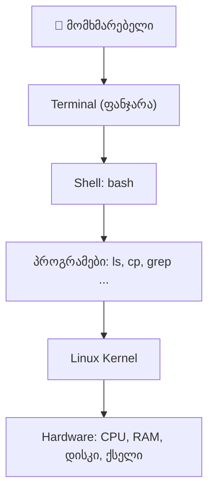
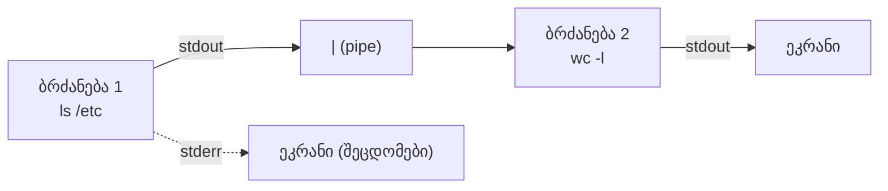

# Linux საფუძვლები: სისტემა, shell და პირველი ბრძანებები

!!! info "გარემო"
    გაკვეთილი ეყრდნობა **Ubuntu Server 24.04 LTS**-ს და ჩვეულებრივ მომხმარებელს (ქვემოთ მაგალითებში `student`). გამოტანები მონიშნულია, როგორც **მაგალითი**: თქვენი ვერსიები, თარიღები და ზომები განსხვავდება. ფაილებისა და საქაღალდეების სავარჯიშოების გამოტანები რეალური გაშვებიდანაა (Ubuntu 24.04-ზე დაფუძნებული სისტემა); სისტემის ვერსიების შესახებ გამოტანები არ არის გადაწერილი და თქვენთან სხვა იქნება.

## 1. სასწავლო მიზნები

ამ გაკვეთილის ბოლოს შეძლებთ:

- განმარტოთ განსხვავება **kernel**-სა, **distribution**-სა და **shell**-ს შორის;
- ტერმინალში ორიენტირება `pwd`, `ls`, `cd` ბრძანებებით და გამოიყენოთ აბსოლუტური და ფარდობითი გზები;
- წაიკითხოთ ბრძანების ჩანაწერი (`ბრძანება [პარამეტრები] [არგუმენტები]`);
- დახმარება მოძებნოთ `--help`, `man`, `type`, `which` ბრძანებებით;
- გამოიყენოთ `|` (pipe) და `>` (redirect) და გაიგოთ, რას ნიშნავს stdin, stdout, stderr.

## 2. შესავალი

DevOps-ში სერვერების უმეტესობა Linux-ზე მუშაობს და მათთან ურთიერთობა ძირითადად ტერმინალიდან (SSH-ით) ხდება: გრაფიკული ინტერფეისი ხშირად საერთოდ არ არის. ამიტომ Linux-ის გამართული ცოდნა არის ყველა დანარჩენი თემის (Docker, CI/CD, monitoring) საფუძველი.

ეს გაკვეთილი არის **სტარტის წერტილი**: ვიგებთ, რისგან შედგება სისტემა და როგორ ვესაუბროთ მას.

## 3. თეორიული ახსნა

### Kernel, distribution, shell

| ცნება | რა არის | მაგალითი |
|---|---|---|
| **Kernel** | სისტემის ბირთვი: მართავს hardware-ს, მეხსიერებას, პროცესებს, ფაილებს | Linux kernel |
| **Distribution** | kernel + პროგრამების, პაკეტების მენეჯერისა და კონფიგურაციის ნაკრები | Ubuntu, Debian, Rocky Linux |
| **Shell** | პროგრამა, რომელიც თქვენს ბრძანებებს კითხულობს და სისტემას გადასცემს | `bash` |
| **Terminal** | ფანჯარა, რომელშიც shell ეშვება | GNOME Terminal, SSH კლიენტი |



**რატომ არის ეს მნიშვნელოვანი?** როცა ხედავთ `bash: foo: command not found`, ეს **shell**-ის შეტყობინებაა (მან ვერ იპოვა პროგრამა), და არა kernel-ის ან დისტრიბუციის პრობლემა. შრეების გარჩევა პრობლემის ძებნას ამარტივებს.

### ბრძანების აგებულება

```text
ls   -l   -a   /etc
│    │    │    └── არგუმენტი (რაზე მოქმედებს)
│    └────┴─────── პარამეტრები / options (როგორ მოქმედებს)
└───────────────── ბრძანება (რას აკეთებს)
```

მოკლე პარამეტრები შეიძლება გაერთიანდეს: `ls -la` იგივეა, რაც `ls -l -a`. გრძელი პარამეტრები ორი ტირეთი იწყება: `ls --all`.

### გზები (paths)

- **აბსოლუტური** გზა `/`-ით იწყება და ყოველთვის ერთსა და იმავე ადგილს ეხება: `/etc/hostname`.
- **ფარდობითი** გზა მიმდინარე საქაღალდიდან ითვლება: `docs/readme.txt`.
- `.` არის მიმდინარე საქაღალდე, `..` არის მშობელი, `~` არის თქვენი home საქაღალდე.

### stdin, stdout, stderr და pipe

ყოველ პროგრამას აქვს სამი "არხი": **stdin** (შესასვლელი), **stdout** (ჩვეულებრივი გამოტანა), **stderr** (შეცდომები).



- `>` stdout-ს ფაილში წერს (ფაილს თავიდან ქმნის), `>>` ბოლოში უმატებს;
- `2>` stderr-ს ცალკე ფაილში წერს;
- `|` პირველის stdout-ს მეორის stdin-ად გადასცემს.

## 4. ტექნიკური მაგალითები

### 4.1. სად ვარ და რა არის აქ

```bash
pwd
ls
ls -l
ls -la
```

- `pwd` გვიჩვენებს მიმდინარე საქაღალდეს;
- `ls -l` აჩვენებს დეტალებს (უფლებები, მფლობელი, ზომა, დრო);
- `-a` აჩვენებს დამალულ ფაილებსაც (სახელი წერტილით იწყება).

### 4.2. გადაადგილება

```bash
cd /etc          # აბსოლუტური გზა
cd ..            # ერთი დონით ზევით
cd ~             # home საქაღალდე
cd -             # წინა საქაღალდე
```

### 4.3. დახმარება

```bash
ls --help | head -n 5
man ls
type cd
type ls
command -v bash
```

`type` გვიჩვენებს, რა სახის ბრძანებაა (shell-ის ჩაშენებული, ფაილი თუ alias), ხოლო `command -v` ბილიკს.

## 5. ბრძანებები და კოდი

| ბრძანება | რას აკეთებს | რატომ გვჭირდება |
|---|---|---|
| `pwd` | მიმდინარე საქაღალდე | ორიენტაცია |
| `ls -la` | სრული სია დამალულებითურთ | ფაილების და უფლებების ნახვა |
| `cd გზა` | საქაღალდის შეცვლა | გადაადგილება |
| `mkdir -p a/b` | საქაღალდის შექმნა (ჩადგმულიც) | სამუშაო სტრუქტურის აგება |
| `touch ფაილი` | ცარიელი ფაილის შექმნა | ტესტისთვის |
| `echo "ტექსტი"` | ტექსტის გამოტანა | ცვლადების და redirect-ის შესამოწმებლად |
| `cat ფაილი` | ფაილის შიგთავსი | მცირე ფაილის წაკითხვა |
| `less ფაილი` | გვერდ-გვერდ ნახვა (`q` გასასვლელად) | დიდი ფაილისთვის |
| `man ბრძანება` | სრული ინსტრუქცია | ზუსტი პარამეტრების დასადგენად |
| `history` | ბრძანებების ისტორია | წინა ბრძანების გამეორება |
| `clear` ან `Ctrl+L` | ეკრანის გასუფთავება | სიცხადე |
| `uname -r` | kernel-ის ვერსია | სისტემის იდენტიფიცირება |
| `cat /etc/os-release` | დისტრიბუციის ინფორმაცია | რომელ OS-ზე ვმუშაობთ |

!!! tip "კლავიატურის გამოსავალი"
    `Tab` აავსებს სახელს, `↑` წინა ბრძანებას აბრუნებს, `Ctrl+C` აჩერებს გაშვებულ ბრძანებას, `Ctrl+R` ეძებს ისტორიაში, `Ctrl+D` ხურავს სესიას.

## 6. პრაქტიკული სავარჯიშოები

**სავარჯიშო 1.** გაარკვიეთ სისტემა: `cat /etc/os-release`, `uname -r`, `whoami`, `hostname`.

**სავარჯიშო 2.** შექმენით სამუშაო სტრუქტურა და გადადით მასში:

```bash
cd ~
mkdir -p projects/demo/{src,docs}
cd projects
pwd
ls -la demo
```

**სავარჯიშო 3.** შექმენით ფაილები და ჩამოთვალეთ რეკურსიულად:

```bash
touch demo/src/app.sh demo/docs/readme.txt
ls -R demo
find demo | sort
```

**სავარჯიშო 4.** pipe და redirect:

```bash
ls /etc | wc -l                 # რამდენი ჩანაწერია /etc-ში
ls /etc > /tmp/etc-list.txt     # შედეგი ფაილში
ls /არარსებული 2> /tmp/errors.txt
cat /tmp/errors.txt
```

**სავარჯიშო 5.** ისტორია: გაუშვით რამდენიმე ბრძანება, მერე `history | tail -n 5`, და გაიმეორეთ ბოლო ბრძანება `!!`-ით.

## 7. მოსალოდნელი შედეგი

სავარჯიშო 2 და 3 (მაგალითი, რეალური გაშვებიდან; თქვენი თარიღები და მფლობელი განსხვავდება):

```text
/home/student/projects
total 16
drwxrwxr-x 4 student student 4096 Nov 17 12:22 .
drwxrwxr-x 3 student student 4096 Nov 17 12:22 ..
drwxrwxr-x 2 student student 4096 Nov 17 12:22 docs
drwxrwxr-x 2 student student 4096 Nov 17 12:22 src
```

```text
demo
demo/docs
demo/docs/readme.txt
demo/src
demo/src/app.sh
```

სავარჯიშო 4: `cat /tmp/errors.txt` გამოიტანს `ls: cannot access '/არარსებული': No such file or directory`: შეცდომა მოხვდა ფაილში, რადგან გადავამისამართეთ **stderr** (`2>`).

## 8. პრობლემების მოგვარება

| სიმპტომი | მიზეზი | გამოსწორება |
|---|---|---|
| `command not found` | ბრძანების სახელი შეცდომითაა, ან პროგრამა დაყენებული არ არის | შეამოწმეთ ორთოგრაფია, `command -v სახელი`, საჭიროების შემთხვევაში დააყენეთ პაკეტი |
| `No such file or directory` | გზა არასწორია | `pwd`, `ls`; შეამოწმეთ დიდი/პატარა ასოები (Linux case-sensitive-ა) |
| `Permission denied` | უფლება არ გაქვთ | იხილეთ გაკვეთილი [უფლებები](permissions.md) |
| ტერმინალი "გაიყინა" | შეიძლება `Ctrl+S` დაგჭირეთ | `Ctrl+Q` განაახლებს გამოტანას |
| ბრძანება არ მთავრდება | პროგრამა ელოდება შეყვანას ან მუშაობს | `Ctrl+C` (გაჩერება) |

## 9. ცოდნის შემოწმება

??? question "1. რით განსხვავდება kernel და distribution?"
    Kernel არის სისტემის ბირთვი (hardware-ის, პროცესების, მეხსიერების მართვა). Distribution არის kernel + პროგრამების, პაკეტების მენეჯერისა და კონფიგურაციის სრული ნაკრები (მაგ. Ubuntu).

??? question "2. რით განსხვავდება აბსოლუტური და ფარდობითი გზა?"
    აბსოლუტური `/`-ით იწყება და ყოველთვის ერთსა და იმავე ადგილს ეხება; ფარდობითი მიმდინარე საქაღალდიდან ითვლება.

??? question "3. რას აკეთებს `ls -la /etc`?"
    აჩვენებს `/etc`-ის შიგთავსს დეტალურად (`-l`) და დამალული ფაილებითურთ (`-a`).

??? question "4. რა განსხვავებაა `>` და `>>` შორის?"
    `>` ფაილს თავიდან წერს (არსებულს ანულებს), `>>` ბოლოში უმატებს.

??? question "5. როგორ გადაამისამართებთ მხოლოდ შეცდომებს ფაილში?"
    `ბრძანება 2> errors.txt` (stderr არის დესკრიპტორი 2).

??? question "6. როგორ გაიგებთ, რა არის `cd` — პროგრამა თუ shell-ის ჩაშენებული ბრძანება?"
    `type cd`. ჩაშენებული ბრძანებაა, ამიტომ საქაღალდეს თავად shell-ში ცვლის.

## 10. შეჯამება

- Linux სისტემა შრეებისგან შედგება: hardware → kernel → shell/პროგრამები → მომხმარებელი.
- ბრძანება = სახელი + პარამეტრები + არგუმენტები; დახმარებისთვის გამოიყენეთ `--help`, `man`, `type`.
- გზა შეიძლება იყოს აბსოლუტური ან ფარდობითი; `.`, `..`, `~` არის მნიშვნელოვანი მალსახმობები.
- stdout/stderr ცალკე არხებია; `|`, `>`, `>>`, `2>` გვაძლევს მათ მართვას. ეს არის ავტომატიზაციის საფუძველი.

**შემდეგი გაკვეთილი:** [ფაილური სისტემა](filesystem.md).
