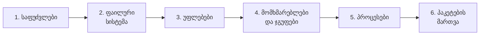

# Academy: Linux

Linux-ის საფუძვლების მოდული: ექვსი თანმიმდევრული გაკვეთილი. თითოეული გაკვეთილი ერთი ფორმატითაა: მიზნები, შესავალი, თეორია, მაგალითები, ბრძანებები, სავარჯიშოები, მოსალოდნელი შედეგი, პრობლემების მოგვარება, ცოდნის შემოწმება, შეჯამება.

| # | გაკვეთილი | რას ისწავლით |
|---|---|---|
| 1 | [Linux საფუძვლები](fundamentals.md) | kernel, distribution, shell, პირველი ბრძანებები |
| 2 | [ფაილური სისტემა](filesystem.md) | ფაილების მართვა, ბმულები, ძებნა |
| 3 | [უფლებები](permissions.md) | `chmod`, `chown`, `umask` |
| 4 | [მომხმარებლები და ჯგუფები](users-groups.md) | UID/GID, `/etc/passwd`, `sudo` |
| 5 | [პროცესები](processes.md) | `ps`, `kill`, სიგნალები |
| 6 | [პაკეტების მართვა](package-management.md) | `apt`, `dpkg` |

**დაკავშირებული მასალა:** [FHS: ფაილური სისტემის იერარქია](../../linux/filesystem-hierarchy.md) · [Linux Cheat Sheet](../../linux/cheatsheet.md) · [ქვიზები](../../quiz.md) · [ბრძანებების ცნობარი](../../commands.md)
