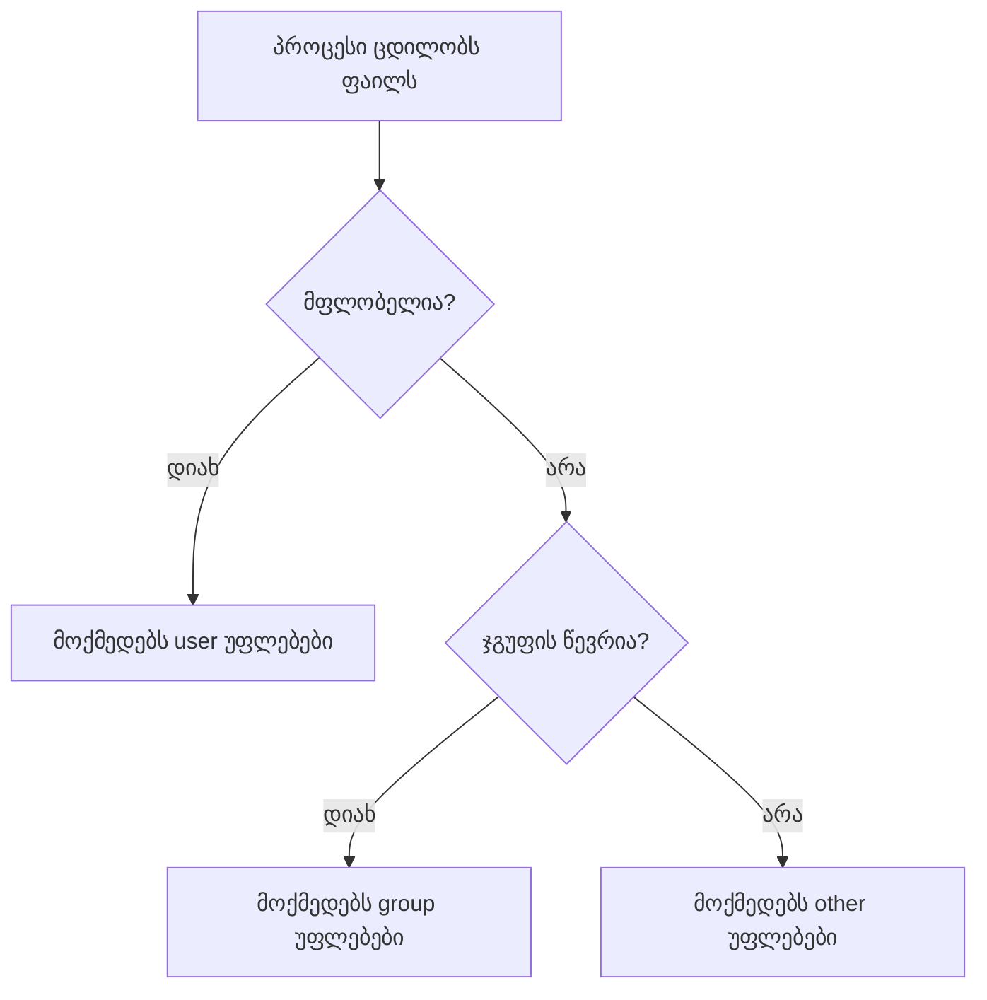

# უფლებები: მფლობელი, ჯგუფი, chmod და umask

!!! info "გარემო"
    გამოტანები რეალური გაშვებიდანაა (Ubuntu-ზე დაფუძნებული სისტემა, მფლობელი `student`). თარიღები ჩანაცვლებულია `DATE`-ით.

## 1. სასწავლო მიზნები

- წაიკითხოთ `ls -l`-ის უფლებების სტრიქონი (`-rwxr-xr--`);
- შეცვალოთ უფლებები `chmod`-ით სიმბოლურად (`u+x`) და რიცხვით (`640`);
- გამოიყენოთ `chown`/`chgrp` და გაიგოთ `umask`;
- გაიგოთ, რას ნიშნავს `r`, `w`, `x` **საქაღალდეზე**.

## 2. შესავალი

Linux მრავალმომხმარებლიანი სისტემაა: ფაილზე წვდომას უფლებები განსაზღვრავს. ბევრი რეალური ინციდენტი (ღია საიდუმლო ფაილი, ან სერვისი, რომელსაც ფაილის წაკითხვა არ შეუძლია) უფლებების არასწორი დაყენებიდან მოდის.

## 3. თეორიული ახსნა

```text
-rwxr-x---  1  student  developers  25  DATE  run.sh
│└┬┘└┬┘└┬┘     └──┬──┘  └────┬────┘
│ │  │  │         │          └── ჯგუფი
│ │  │  │         └── მფლობელი
│ │  │  └── სხვები (other)
│ │  └── ჯგუფი (group)
│ └── მფლობელი (user)
└── ტიპი: - ფაილი, d საქაღალდე, l symbolic link
```

| უფლება | ფაილზე | საქაღალდეზე | რიცხვი |
|---|---|---|---|
| `r` | წაკითხვა | შიგთავსის სია (`ls`) | 4 |
| `w` | ჩაწერა/შეცვლა | ფაილების შექმნა/წაშლა მასში | 2 |
| `x` | გაშვება | შიგ შესვლა (`cd`) და ფაილებზე წვდომა | 1 |

რიცხვები იკრიბება: `rwx` = 4+2+1 = **7**, `rw-` = **6**, `r--` = **4**. ამიტომ `640` ნიშნავს: მფლობელი `rw-`, ჯგუფი `r--`, სხვები `---`.



სისტემა ამოწმებს პირველ დამთხვევას (მფლობელი → ჯგუფი → სხვები) და **არ აგრძელებს**. `root` უფლებების უმეტეს შემოწმებას უგულებელყოფს.

### umask

`umask` განსაზღვრავს, რა უფლებები **ამოიღება** ახალი ფაილებიდან. ფაილი იწყება `666`-ით, საქაღალდე `777`-ით. Ubuntu-ზე ჩვეულებრივ მომხმარებელს `umask 0002` აქვს: ახალი ფაილი `664`, საქაღალდე `775` (იხ. ქვემოთ).

## 4. ტექნიკური მაგალითები

```bash
chmod u+x run.sh          # მფლობელს გაშვების უფლება
chmod g+w,o-r file        # ჯგუფს ჩაწერა, სხვებს წაკითხვა ამოერთვას
chmod 640 secrets.env     # rw-r-----
chmod -R 750 ~/scripts    # რეკურსიულად
sudo chown student:developers file
sudo chown -R www-data: /var/www/site    # მფლობელი, ჯგუფი = ამ მომხმარებლის ჯგუფი
```

## 5. ბრძანებები და კოდი

| ბრძანება | რას აკეთებს | რატომ |
|---|---|---|
| `ls -l`, `stat -c '%A %a %n' ფაილი` | უფლებები ტექსტით და რიცხვით | ზუსტად ვხედავთ |
| `chmod` | უფლებების შეცვლა | წვდომის მართვა |
| `chown`, `chgrp` | მფლობელის/ჯგუფის შეცვლა (`sudo`) | სერვისისთვის სწორი მფლობელი |
| `umask` | ახალი ფაილების ნაგულისხმევი უფლებები | უსაფრთხო default |
| `id` | თქვენი UID, GID, ჯგუფები | რა უფლებებით ვმუშაობთ |
| `namei -l /გზა/ფაილამდე` | უფლებები გზის ყველა კომპონენტზე | "რატომ ვერ ვაღწევ?" |

!!! warning "არასდროს `chmod 777`"
    `777` ყველას ყველაფერს აძლევს. ის პრობლემას ფარავს და არ ხსნის. ჯერ დაადგინეთ, **ვის** რა სჭირდება (`namei -l`, `id`) და მხოლოდ ის მიეცით.

## 6. პრაქტიკული სავარჯიშოები

```bash
cd ~/projects/demo
echo 'echo "hello from script"' > run.sh
ls -l run.sh
./run.sh                      # რა მოხდება?
chmod u+x run.sh
ls -l run.sh
./run.sh

touch file2
chmod 640 file2 && stat -c '%A %a %n' file2
chmod g+w,o-r file2 && stat -c '%A %a %n' file2
chmod 000 file2
cat file2                     # რა მოხდება?
chmod 600 file2               # აღდგენა

umask
touch umask_file; mkdir umask_dir
stat -c '%A %a %n' umask_file umask_dir
```

## 7. მოსალოდნელი შედეგი

რეალური გაშვება (ზოგი ხაზი შემოკლებულია):

```text
-rw-rw-r-- 1 student student 25 DATE run.sh
bash: ./run.sh: Permission denied
-rwxrw-r-- 1 student student 25 DATE run.sh
hello from script
-rw-r----- 640 file2
-rw-rw---- 660 file2
cat: file2: Permission denied
0002
-rw-rw-r-- 664 umask_file
drwxrwxr-x 775 umask_dir
```

პირველად `./run.sh` ვერ გაეშვა, რადგან `x` არ ჰქონდა; `chmod u+x`-ის შემდეგ გაეშვა. `chmod 000`-ის შემდეგ **თავად მფლობელსაც** ვერ წაიკითხავს (უფლებები მფლობელზეც ვრცელდება).

## 8. პრობლემების მოგვარება

| სიმპტომი | მიზეზი | გამოსწორება |
|---|---|---|
| `Permission denied` სკრიპტზე | არ აქვს `x` | `chmod u+x`; ან გაუშვით `bash run.sh` |
| `Permission denied` ფაილზე, თუმცა ფაილს `r` აქვს | გზის რომელიმე საქაღალდეს არ აქვს `x` | `namei -l /სრული/გზა` |
| nginx ვერ კითხულობს საიტის ფაილებს | მფლობელი/ჯგუფი ან `o` უფლება არასწორია | ფაილებს `644`, საქაღალდეებს `755`, საჭიროებისას `chown :www-data` |
| `chown: Operation not permitted` | მფლობელის შეცვლა მხოლოდ root-ს შეუძლია | `sudo chown ...` |
| `chmod -R 644 საქაღალდე` ჩაკეტა საქაღალდეები | საქაღალდეს `x` სჭირდება | `chmod -R u+rwX,go+rX` (დიდი `X` მხოლოდ საქაღალდეებზე და უკვე გამშვებ ფაილებზე) |

## 9. ცოდნის შემოწმება

??? question "1. რას ნიშნავს `rwxr-x---`?"
    მფლობელი: `rwx` (7), ჯგუფი: `r-x` (5), სხვები: `---` (0), ანუ `750`.

??? question "2. რა სჭირდება საქაღალდეში ფაილის წასაშლელად?"
    **საქაღალდის** `w` და `x` უფლება (ფაილის უფლება არ არის გადამწყვეტი).

??? question "3. რა უფლებებს მიიღებს ახალი ფაილი `umask 0022`-ის დროს?"
    `666 − 022 = 644` (`rw-r--r--`); საქაღალდე: `777 − 022 = 755`.

??? question "4. რატომ არის `chmod 777` ცუდი პრაქტიკა?"
    ის ყველა მომხმარებელს ათავისუფლებს შეზღუდვებისგან და ფარავს ნამდვილ მიზეზს; უნდა მიეცეს მხოლოდ საჭირო უფლება.

??? question "5. როგორ ნახავთ, რომელი საქაღალდე ბლოკავს წვდომას?"
    `namei -l /სრული/გზა/ფაილამდე`.

## 10. შეჯამება

- უფლებები სამი ჯგუფისთვის განისაზღვრება: მფლობელი, ჯგუფი, სხვები; თითოეულს `r`, `w`, `x`.
- `chmod` (უფლებები), `chown` (მფლობელი), `umask` (ნაგულისხმევი).
- საქაღალდეზე `x` ნიშნავს "შიგ შესვლას"; ფაილზე ხელმისაწვდომობა მთელ გზაზეა დამოკიდებული.
- მიეცით **მინიმალური საჭირო** უფლება.

**წინა:** [ფაილური სისტემა](filesystem.md) · **შემდეგი:** [მომხმარებლები და ჯგუფები](users-groups.md).
