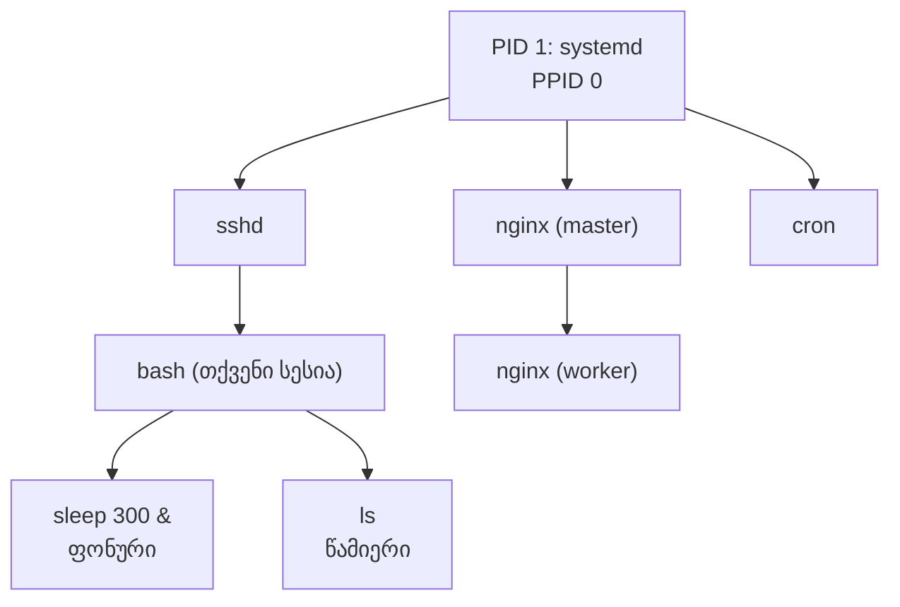

# პროცესები: ხედვა, მართვა და სიგნალები

!!! info "გარემო"
    გამოტანები რეალური გაშვებიდანაა (Ubuntu 24.04-ზე დაფუძნებული სისტემა, მომხმარებელი `student`). PID-ები, დრო და დატვირთვა თქვენთან განსხვავდება; გამოტანებში ის ნაწილი, რაც მუდმივია (მაგ. PID 1 არის `systemd`), ასეა დატოვებული.

## 1. სასწავლო მიზნები

- განმარტოთ, რა არის **პროცესი**, **PID**, **PPID** და მშობელ-შვილის კავშირი;
- ნახოთ პროცესები `ps`-ით და რეალურ დროში `top`/`htop`-ით;
- გავუშვათ ფონზე (`&`, `jobs`, `fg`, `bg`);
- შევწყვიტოთ პროცესი სწორი **სიგნალით** (`SIGTERM` vs `SIGKILL`);
- გავიგოთ პროცესის მდგომარეობა (`STAT`).

## 2. შესავალი

გაშვებული პროგრამა არის **პროცესი**. სერვერზე ხშირად გვჭირდება პასუხი: რა მუშაობს? რა ჭამს CPU-ს/მეხსიერებას? როგორ გავაჩეროთ გაჭედილი პროგრამა დანაკარგის გარეშე? ეს თემა ამას პასუხობს და უკავშირდება სერვისების მართვას (`systemctl`) და მონიტორინგს.

## 3. თეორიული ახსნა

### PID და ხე

ყოველ პროცესს აქვს უნიკალური **PID** და მშობელი **PPID**. ყველაფერი იწყება PID **1**-ით (ჩვენს სისტემაზე `systemd`), რომლის PPID არის `0`. პროცესები ქმნიან ხეს.



**რატომ არის მნიშვნელოვანი:** როცა მშობელს აჩერებთ, შვილებიც ხშირად ჩერდება. ხეს `ps -ef --forest` ან `pstree`-ით ვხედავთ.

### სიგნალები

პროცესს ვუგზავნით **სიგნალს** და ის (ან ბირთვი) რეაგირებს:

| სიგნალი | ნომერი | მნიშვნელობა | გამოყენება |
|---|---|---|---|
| `SIGHUP` | 1 | ტერმინალი დაიხურა / კონფიგის გადატვირთვა | ზოგი სერვისი ხელახლა კითხულობს კონფიგს |
| `SIGINT` | 2 | შეწყვეტა (`Ctrl+C`) | ინტერაქტიული შეწყვეტა |
| `SIGTERM` | 15 | **თავაზიანი** დასრულება | ნაგულისხმევი `kill`: პროცესი ასუფთავებს და ხურავს |
| `SIGKILL` | 9 | **ძალით** მოკვლა | პროცესი ვერ დაიჭერს; გასუფთავება არ ხდება |

**წესი:** ჯერ `kill PID` (`SIGTERM`), მხოლოდ თუ არ მოქმედებს, `kill -9 PID`. `SIGKILL` შეიძლება დატოვოს დაუსრულებელი ფაილები და lock-ები.

### STAT მდგომარეობა

| კოდი | მნიშვნელობა |
|---|---|
| `R` | გაშვებულია |
| `S` | ელოდება (ძილი): ყველაზე ხშირი |
| `D` | გაუწყვეტელი ლოდინი (I/O) |
| `T` | შეჩერებულია |
| `Z` | zombie: დასრულდა, მშობელმა შედეგი არ აიღო |
| `s` (ბოლოში) | სესიის ლიდერი |

## 4. ტექნიკური მაგალითები

```bash
sleep 300 &
jobs
kill %1
ps -eo pid,ppid,stat,comm --sort=pid | head -4
kill -l | head -3
```

რეალური გამოტანა (ზოგი ხაზი შემოკლებულია):

```text
[1]+  Running                 sleep 300 &
Terminated
    PID    PPID STAT COMMAND
      1       0 Ss   systemd
      2       0 S    kthreadd
      3       2 S    pool_workqueue_release
 1) SIGHUP	 2) SIGINT	 3) SIGQUIT	 4) SIGILL	 5) SIGTRAP
 6) SIGABRT	 7) SIGBUS	 8) SIGFPE	 9) SIGKILL	10) SIGUSR1
11) SIGSEGV	12) SIGUSR2	13) SIGPIPE	14) SIGALRM	15) SIGTERM
```

აქ ჩანს: PID 1 → `systemd` (PPID 0), `kthreadd` არის ბირთვის ნაკადების მშობელი (PID 2).

## 5. ბრძანებები და კოდი

| ბრძანება | რას აკეთებს | რატომ |
|---|---|---|
| `ps aux` | ყველა პროცესი, მფლობელი, CPU/MEM | ზოგადი სურათი |
| `ps -eo pid,ppid,stat,comm --sort=pid` | არჩეული სვეტები | სუფთა, წასაკითხი გამოტანა |
| `ps -ef --forest` / `pstree` | პროცესების ხე | მშობელ-შვილის კავშირი |
| `top`, `htop` | რეალურ დროში | რა ჭამს რესურსს |
| `pgrep -a სახელი` | PID სახელით | grep-ით ძებნაზე უფრო სუფთაა |
| `kill PID`, `kill -9 PID` | სიგნალის გაგზავნა | გაჩერება |
| `pkill სახელი` | სახელით გაჩერება | რამდენიმე ეგზემპლარი |
| `command &`, `jobs`, `fg`, `bg` | ფონური სამუშაოები | ტერმინალის გათავისუფლება |
| `nohup command &` | ტერმინალის დახურვის შემდეგაც | გრძელი სამუშაო |
| `systemctl status სერვისი` | სერვისის მდგომარეობა | პროცესი როგორც სერვისი |

!!! warning "`kill -9` ბოლო საშუალებაა"
    ის გასუფთავების შესაძლებლობას არ აძლევს პროცესს. ჯერ `SIGTERM`, დაელოდეთ რამდენიმე წამს.

## 6. პრაქტიკული სავარჯიშოები

```bash
# 1. ფონური პროცესი
sleep 300 &
jobs
ps -o pid,ppid,stat,comm -p $!

# 2. შეჩერება და გაგრძელება
fg                  # წინა პლანზე (შემდეგ Ctrl+Z შეაჩერებს)
bg                  # გააგრძელოს ფონზე

# 3. გაჩერება
kill %1
jobs

# 4. ხე
ps -eo pid,ppid,stat,comm --sort=pid | head -5
pstree -p $$ | head -3
```

## 7. მოსალოდნელი შედეგი

```text
[1]+  Running                 sleep 300 &
    PID    PPID STAT COMMAND
  12345   12000 S    sleep          # PID განსხვავდება
Terminated
```

`kill %1`-ის შემდეგ `jobs` აღარ აჩვენებს სამუშაოს, ხოლო ჩვენება `Terminated` ნიშნავს, რომ `SIGTERM` მიიღო და დასრულდა. PID-ები თქვენთან სხვა იქნება.

## 8. პრობლემების მოგვარება

| სიმპტომი | მიზეზი | გამოსწორება |
|---|---|---|
| `kill` არ ჩერდებს პროცესს | პროცესი `SIGTERM`-ს უგულებელყოფს ან `D` მდგომარეობაშია | `kill -9 PID` (ბოლო საშუალება); `D` ხშირად I/O-ს ელოდება |
| `kill: (PID) - Operation not permitted` | სხვა მომხმარებლის პროცესია | `sudo kill PID` |
| `No such process` | PID არასწორია ან უკვე დასრულდა | `pgrep -a სახელი`, შეამოწმეთ PID |
| `Z` (zombie) პროცესები გროვდება | მშობელი შედეგს არ კითხულობს | zombie-ს `kill` არ ჭირდება: გადატვირთეთ **მშობელი** |
| ტერმინალის დახურვისას პროცესი ჩერდება | `SIGHUP` | `nohup`, `tmux` ან `systemd` სერვისი |
| `ps aux`-ში საკუთარი `ps` მაღალ %CPU-ს აჩვენებს | გაზომვის არტეფაქტი (ახლახან დაიწყო) | უგულებელყავით; იხ. ჩვენი [მონიტორინგის Task](../../tasks/task20.md) |

## 9. ცოდნის შემოწმება

??? question "1. რა არის PID 1 და რა PPID აქვს?"
    მის PID-ს აქვს `1`, ჩვენს სისტემაზე ეს არის `systemd`, მისი PPID არის `0`. ყველა სხვა პროცესი მისი შთამომავალია.

??? question "2. რა განსხვავებაა `SIGTERM`-სა და `SIGKILL`-ს შორის?"
    `SIGTERM` (15) თავაზიანია: პროცესი შეიძლება დაიჭიროს და გაასუფთავოს. `SIGKILL` (9) ძალითაა და ვერ ჭერდება.

??? question "3. როგორ გავუშვათ ბრძანება ფონზე და ვნახოთ სია?"
    ბრძანების ბოლოს `&` (`sleep 300 &`), სია: `jobs`.

??? question "4. რას ნიშნავს `STAT` `Ss`?"
    `S` ძილშია (ელოდება), მცირე `s` სესიის ლიდერია.

??? question "5. როგორ ვუმკურნალოთ zombie პროცესს?"
    zombie-ს მოკვლა არ შეიძლება; მშობელი უნდა გადაიტვირთოს ან დასრულდეს, რომ შედეგი აიღოს.

## 10. შეჯამება

- პროცესს აქვს PID და PPID; PID 1 (`systemd`) ხის ფესვია.
- `ps`, `top`, `htop`, `pstree` ხედავენ; `kill`/`pkill` აჩერებენ.
- ჯერ `SIGTERM`, ბოლო საშუალებად `SIGKILL`.
- ფონზე: `&`, `jobs`, `fg`, `bg`; გრძელი სამუშაოსთვის `nohup`/`tmux`/`systemd`.

**წინა:** [მომხმარებლები და ჯგუფები](users-groups.md) · **შემდეგი:** [პაკეტების მართვა](package-management.md).
