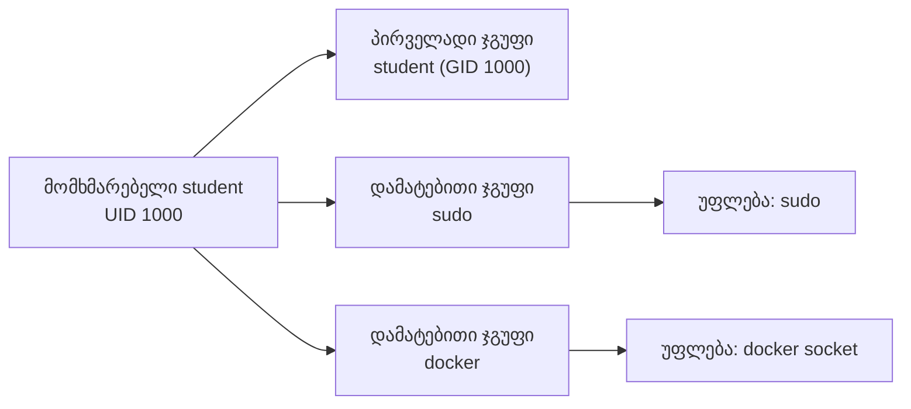

# მომხმარებლები და ჯგუფები

!!! info "გარემო"
    გამოტანები **ორი სახისაა**: წაკითხვადი (მხოლოდ კითხვის) ბრძანებების გამოტანა რეალური გაშვებიდანაა (Ubuntu 24.04-ზე დაფუძნებული სისტემა, მომხმარებელი `student`). ბრძანებები, რომლებიც `sudo`-ს მოითხოვს (`useradd`, `usermod`, `userdel`), ამ სამუშაო გარემოში ვერ გაიშვა, ამიტომ მათი გამოტანა მონიშნულია, როგორც **მაგალითი**.

## 1. სასწავლო მიზნები

- განმარტოთ, რა არის **UID**, **GID** და რატომ არის `root` განსაკუთრებული;
- წაიკითხოთ `/etc/passwd`, `/etc/group` და `/etc/shadow` და გაიგოთ ველები;
- შექმნათ, შეცვალოთ და წაშალოთ მომხმარებელი და ჯგუფი (`useradd`, `usermod`, `userdel`, `groupadd`);
- გამოიყენოთ `sudo` სწორად და გაიგოთ `sudo` ჯგუფის როლი;
- გაიგოთ, რატომ მოითხოვს `usermod -G` სიფრთხილეს (`-aG`).

## 2. შესავალი

Linux-ში თითოეულ პროცესს და ფაილს ჰყავს მფლობელი. **ვინ** ვართ, განსაზღვრავს **რას** შეგვიძლია (იხ. [უფლებები](permissions.md)). სერვერზე ხშირად გვჭირდება ცალკე მომხმარებლები: ადამიანებისთვის, სერვისებისთვის (`www-data`, `postgres`) და ავტომატიზაციისთვის (deploy). არასწორი მართვა ან ზედმეტი უფლებები უსაფრთხოების ერთ-ერთი მთავარი რისკია.

## 3. თეორიული ახსნა

### UID და GID

სისტემა მომხმარებელს **სახელით** კი არა, **რიცხვით** (UID) იცნობს. სახელი მხოლოდ ადამიანისთვისაა.

| UID | ვინ არის |
|---|---|
| `0` | `root`: სრული უფლებები |
| `1`–`999` | სისტემური/სერვისის მომხმარებლები (`daemon`, `www-data`...), ჩვეულებრივ ინტერაქტიულად არ შედიან |
| `1000`–`60000` | ჩვეულებრივი მომხმარებლები (`UID_MIN`/`UID_MAX` `/etc/login.defs`-დან) |

ყოველ მომხმარებელს აქვს **პირველადი ჯგუფი** (GID) და შეიძლება ჰქონდეს **დამატებითი ჯგუფები**.



### სამი ფაილი

| ფაილი | შიგთავსი | უფლებები |
|---|---|---|
| `/etc/passwd` | ანგარიშები: სახელი, UID, GID, home, shell | `644` `root:root` (ყველას შეუძლია წაკითხვა) |
| `/etc/group` | ჯგუფები და წევრები | `644` `root:root` |
| `/etc/shadow` | პაროლის **ჰეშები** | `640` `root:shadow` (ჩვეულებრივ მომხმარებელს არ შეუძლია წაკითხვა) |

**რატომ არის პაროლის ჰეში ცალკე ფაილში:** `/etc/passwd` ყველასთვის წასაკითხია (პროგრამებს სახელის UID-ზე გადასაყვანად სჭირდებათ). თუ ჰეშებიც მასში იქნებოდა, ნებისმიერი მომხმარებელი მათ გადაიწერდა და გატეხვას სცდიდა. ამიტომ ჰეშები `shadow`-შია, რომელსაც მხოლოდ root და ჯგუფი `shadow` კითხულობს.

`/etc/passwd`-ის ჩანაწერი (7 ველი, `:`-ით გაყოფილი):

```text
root:x:0:0:root:/root:/bin/bash
│    │ │ │ │    │     └── shell
│    │ │ │ │    └── home
│    │ │ │ └── კომენტარი (GECOS)
│    │ │ └── პირველადი GID
│    │ └── UID
│    └── `x` = პაროლი /etc/shadow-შია
└── სახელი
```

### sudo

`sudo` ბრძანებას root-ის უფლებით ასრულებს. Ubuntu-ზე ეს ნებართვა აქვს ჯგუფ `sudo`-ს წევრებს. ამიტომ ადმინისტრატორის მიცემა = მომხმარებლის `sudo` ჯგუფში დამატება.

## 4. ტექნიკური მაგალითები

წაკითხვადი ბრძანებები (რეალური გამოტანა):

```bash
getent passwd root
ls -l /etc/passwd /etc/shadow /etc/group
getent group sudo
grep -E '^(UID_MIN|UID_MAX|UMASK)' /etc/login.defs
```

```text
root:x:0:0:root:/root:/bin/bash
-rw-r--r-- 1 root root   ... /etc/group
-rw-r--r-- 1 root root   ... /etc/passwd
-rw-r----- 1 root shadow ... /etc/shadow
sudo:x:27:<user>
UMASK		022
UID_MIN			 1000
UID_MAX			60000
```

(`<user>` ჩანაცვლებულია; თქვენთან `sudo` ჯგუფში თქვენი სახელი იქნება.)

მართვა (**მაგალითი**, საჭიროებს `sudo`-ს):

```bash
sudo useradd -m -s /bin/bash lab1        # ახალი მომხმარებელი home-ით
sudo passwd lab1                         # პაროლის დაყენება
sudo groupadd labteam                    # ახალი ჯგუფი
sudo usermod -aG labteam lab1            # ჯგუფში დამატება
id lab1                                  # შემოწმება
```

```text
uid=1001(lab1) gid=1001(lab1) groups=1001(lab1),1002(labteam)
```

## 5. ბრძანებები და კოდი

| ბრძანება | რას აკეთებს | რატომ |
|---|---|---|
| `id`, `id მომხმარებელი` | UID, GID, ჯგუფები | ვხედავთ ეფექტურ უფლებებს |
| `whoami`, `groups` | სახელი / ჯგუფების სია | სწრაფი შემოწმება |
| `getent passwd სახელი` | ჩანაწერი ყველა წყაროდან (ფაილი, LDAP...) | უფრო საიმედოა, ვიდრე `grep /etc/passwd` |
| `useradd -m -s /bin/bash სახელი` | მომხმარებლის შექმნა | `-m` ქმნის home-ს, `-s` ადგენს shell-ს |
| `passwd სახელი` | პაროლის შეცვლა | შესვლის შესაძლებლობა |
| `usermod -aG ჯგუფი სახელი` | ჯგუფში **დამატება** | `-a` ინახავს არსებულ ჯგუფებს |
| `userdel -r სახელი` | მომხმარებლისა და home-ის წაშლა | სუფთა გასუფთავება |
| `groupadd`, `groupdel` | ჯგუფის შექმნა/წაშლა | წვდომის ორგანიზება |
| `last`, `who`, `w` | ვინ შემოვიდა / ვინ არის ახლა | აუდიტი |

!!! danger "`usermod -G` ≠ `usermod -aG`"
    `-a`-ს გარეშე `-G` მომხმარებელს **ანაცვლებს** ჯგუფების სიას: ის ამოვარდება `sudo`-დან და სხვა ჯგუფებიდან. ყოველთვის `-aG`.

## 6. პრაქტიკული სავარჯიშოები

ნაწილი A: კითხვა (უსაფრთხოა ყველგან):

```bash
id
getent passwd $(whoami)
cut -d: -f1,3,7 /etc/passwd | head -5
getent group sudo
```

ნაწილი B: ლაბორატორიული მომხმარებელი (**მხოლოდ სალაბორატორიო VM-ზე**, საჭიროებს `sudo`):

```bash
sudo useradd -m -s /bin/bash lab1
sudo groupadd labteam
sudo usermod -aG labteam lab1
id lab1
# გასუფთავება:
sudo userdel -r lab1
sudo groupdel labteam
```

!!! warning "ნუ გააკეთებთ პროდაქშენში"
    სავარჯიშოები ქმნის და შლის ანგარიშებს. რეალურ სერვერზე `userdel -r` მომხმარებლის მონაცემებს აუქმებს. ყოველთვის დაასრულეთ გასუფთავებით ლაბში.

## 7. მოსალოდნელი შედეგი

ნაწილი A (რეალური გამოტანის ფორმა, ზოგი მნიშვნელობა განსხვავდება):

```text
uid=1000(student) gid=1000(student) groups=1000(student),27(sudo)
student:x:1000:1000:student:/home/student:/bin/bash
root:0:/bin/bash
daemon:1:/usr/sbin/nologin
bin:2:/usr/sbin/nologin
sudo:x:27:student
```

ხაზები `daemon`, `bin` არის სისტემური მომხმარებლები `nologin` shell-ით: მათზე პირდაპირი შესვლა შეუძლებელია. ნაწილი B-ს გამოტანა **მაგალითია** (იხ. §4).

## 8. პრობლემების მოგვარება

| სიმპტომი | მიზეზი | გამოსწორება |
|---|---|---|
| `useradd: Permission denied` | root უფლება არ გაქვთ | `sudo useradd ...` |
| ჯგუფში დამატების შემდეგ მაინც არ მუშაობს | ჯგუფები ახალ სესიაში იტვირთება | გამოდით და შედით, ან `newgrp ჯგუფი` |
| `usermod`-ის შემდეგ `sudo` გაქრა | გამოყენებული იყო `-G` და არა `-aG` | `sudo usermod -aG sudo სახელი` (სხვა ადმინით) |
| `userdel: user is currently used by process` | მომხმარებლის პროცესი გაშვებულია | დახურეთ სესია/პროცესი, შემდეგ `userdel` |
| შესვლა ვერ ხერხდება `nologin`-ის გამო | shell არის `/usr/sbin/nologin` | ეს სისტემური ანგარიშია; ან `usermod -s /bin/bash` ადამიანისთვის |

## 9. ცოდნის შემოწმება

??? question "1. რატომ არ არის პაროლის ჰეში `/etc/passwd`-ში?"
    რადგან `/etc/passwd` ყველასთვის წასაკითხია; ჰეშები `/etc/shadow`-შია (`640 root:shadow`), რომ ჩვეულებრივმა მომხმარებელმა ვერ გადაიწეროს და ვერ გატეხოს.

??? question "2. რა UID-ები აქვს ჩვეულებრივ მომხმარებლებს Ubuntu-ზე?"
    `1000`-დან `60000`-მდე (`UID_MIN`/`UID_MAX` `/etc/login.defs`-ში); `0` არის root.

??? question "3. როგორ დავამატოთ `lab1` ჯგუფში `labteam` ისე, რომ სხვა ჯგუფები არ დაიკარგოს?"
    `sudo usermod -aG labteam lab1`. `-a` ინახავს არსებულს.

??? question "4. რას ნიშნავს `x` ველში `root:x:0:0:...`?"
    პაროლი `/etc/shadow`-ში ინახება.

??? question "5. როგორ გავხდეთ ადმინისტრატორი Ubuntu-ზე?"
    მომხმარებელი უნდა იყოს ჯგუფ `sudo`-ში (`sudo usermod -aG sudo სახელი`).

## 10. შეჯამება

- ვინ ხარ = UID/GID + ჯგუფები; `root` = UID 0.
- `/etc/passwd` (ანგარიშები), `/etc/group` (ჯგუფები), `/etc/shadow` (ჰეშები, შეზღუდული).
- `useradd -m`, `usermod -aG`, `userdel -r`: მართვა; `-aG` ყოველთვის `-a`-თი.
- `sudo` = root-ის უფლება `sudo` ჯგუფის წევრებისთვის; მიეცით მინიმუმი.

**წინა:** [უფლებები](permissions.md) · **შემდეგი:** [პროცესები](processes.md).
