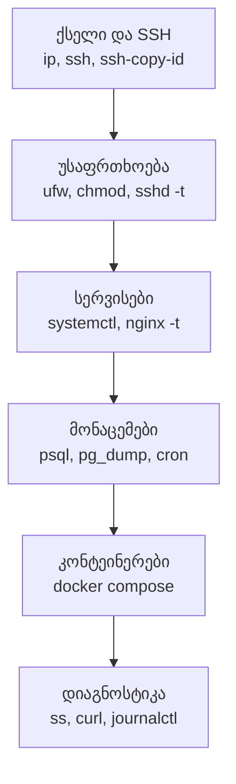

# ბრძანებების ცნობარი

ყველა მნიშვნელოვანი ბრძანება, რომელიც Task 1-17-ში გამოვიყენეთ: **რას აკეთებს** და **რატომ გვჭირდებოდა**. ბრძანებები დაჯგუფებულია თემატურად. ბოლოში მოცემულია დიაგნოსტიკის სქემა: სიმპტომიდან პირველ ბრძანებამდე.

## 1. ქსელი და დაკავშირება

| ბრძანება | რას აკეთებს | რატომ |
|----------|-------------|-------|
| `ip -4 a show enp0s8` | აჩვენებს მხოლოდ IPv4 მისამართს ერთი ინტერფეისისთვის | ვამოწმებთ, რომ Host-Only ინტერფეისმა სტატიკური `192.168.56.10` მიიღო |
| `ip a` | ყველა ინტერფეისი და მისამართი | პირველი ნაბიჯი ქსელის პრობლემისას: რომელი ინტერფეისია ჩართული |
| `VBoxManage list hostonlyifs` | ჰოსტზე Host-Only ქსელების სია | გავიგეთ, რომ `vboxnet0` არის `192.168.56.1/24` |
| `sudo netplan try` / `sudo netplan apply` | `try` დროებით იყენებს კონფიგს და თუ არ დაადასტურე, უკან აბრუნებს; `apply` მუდმივად | `try` გვიცავს გამოკეტვისგან, თუ YAML არასწორია |
| `ping 192.168.56.10` | ამოწმებს ხელმისაწვდომობას | ჰოსტი ხედავს თუ არა VM-ს |
| `ssh k@192.168.56.10` | დაკავშირება VM-თან | ყოველდღიური წვდომა |
| `ssh -v k@...` | დეტალური ლოგი | აჩვენებს, რომელ key-ს ცდის და რატომ ითხოვს პაროლს |
| `ssh-keygen -t ed25519 -C "k@k-M4700"` | თანამედროვე key-ის წყვილის შექმნა | პაროლის გარეშე უსაფრთხო შესვლისთვის |
| `ssh-copy-id k@192.168.56.10` | public key-ს სერვერის `authorized_keys`-ში წერს | ხელით კოპირების შეცდომების გარეშე |

## 2. უსაფრთხოება და უფლებები

| ბრძანება | რას აკეთებს | რატომ |
|----------|-------------|-------|
| `sudo sshd -t` | SSH კონფიგის სინტაქსის შემოწმება რესტარტის გარეშე | შეცდომიანი კონფიგით რესტარტი გამოგკეტავს სერვერიდან |
| `sudo systemctl restart ssh` | SSH-ის გადატვირთვა | ახალი წესები (`PasswordAuthentication no`) ამოქმედდეს |
| `chmod 700 ~/.ssh` | მხოლოდ მფლობელს აძლევს წვდომას საქაღალდეზე | SSH უარს ამბობს key-ზე, თუ უფლებები ზედმეტად ღიაა |
| `chmod 600 ფაილი` | მხოლოდ მფლობელი კითხულობს/წერს | `authorized_keys`, `~/.pgpass`, `selfsigned.key` |
| `sudo ufw allow 22` / `80` / `443` | ფაირვოლის წესი | მხოლოდ საჭირო პორტები უნდა იყოს ღია |
| `sudo ufw status numbered` | წესები ნომრებით | წესის წასაშლელად: `sudo ufw delete N` |
| `sudo ufw status verbose` | ნაგულისხმევი პოლიტიკა (`deny incoming`) | ვამოწმებთ, რომ დახურულია ყველაფერი, რაც არ გვინდა |

!!! warning "Docker და UFW"
    Docker-ის გამოქვეყნებული პორტი UFW-ს გვერდს უვლის. ერთადერთი სწორი გზა `127.0.0.1:8080:80` მიბმაა (Task 15/16).

## 3. სერვისები და Nginx

| ბრძანება | რას აკეთებს | რატომ |
|----------|-------------|-------|
| `systemctl status nginx` | სერვისის მდგომარეობა და ბოლო ლოგები | ჩართულია თუ არა და რა შეცდომა დაიწერა |
| `sudo systemctl enable --now nginx` | ჩართვა ახლავე და ჩატვირთვისას | სერვერის რესტარტის შემდეგაც იმუშავოს |
| `sudo nginx -t` | კონფიგის სინტაქსის შემოწმება | **ყოველთვის** reload-მდე: შეცდომა მუშა საიტს არ დაგვიზიანებს |
| `sudo systemctl reload nginx` | კონფიგის ხელახლა წაკითხვა კავშირების გაწყვეტის გარეშე | restart-ისგან განსხვავებით მომხმარებლებს არ აწყვეტს |
| `sudo nginx -T` | აჩვენებს **ამოქმედებულ სრულ** კონფიგს ყველა ფაილიდან | გამოავლინა, რომ `app.test`-ის ბლოკი სინამდვილეში არ იყო ჩართული |
| `ln -s sites-available/X sites-enabled/` | საიტის ჩართვა | `sites-available` არის საწყობი, `sites-enabled` არის აქტიური |
| <code>sudo ss -tlnp &#124; grep :443</code> | ვინ უსმენს პორტს | `nginx -t` OK-ს გვეუბნება, მაგრამ ეს ამოწმებს, რომ პორტი რეალურად ღიაა |
| `curl -I http://localhost/` | მხოლოდ HTTP სათაურები | სწრაფი შემოწმება: სტატუსი, ზომა, სერვერი |
| `curl -I -H "Host: app.test" http://localhost/` | ხელით Host სათაური | virtual host-ის ტესტი DNS/hosts-ის გარეშე |
| <code>curl -s URL &#124; grep -i "&lt;title&gt;"</code> | გვერდის სათაურს იღებს | განასხვავებს ორ საიტს, როცა `200 OK` ორივეზე ერთია |
| `curl -kI https://localhost/` | `-k` სერტიფიკატის ნდობას არ ამოწმებს | self-signed სერტიფიკატთან მუშაობისას |
| <code>curl -vk https://... 2&gt;&amp;1 &#124; grep ...</code> | TLS დეტალები (ვერსია, subject, ვადა) | `2>&1` აუცილებელია, რადგან `-v` stderr-ზე წერს |

!!! tip "ჩვენი გაკვეთილი"
    `curl -I` სტატუსს გვიჩვენებდა, მაგრამ ორ სხვადასხვა საიტს ვერ განასხვავებდა. `Content-Length` და `<title>` გვითხრა სიმართლე. რთულ შემთხვევაში `nginx -T` ამოქმედებულ ფაილს აჩვენებს და არა იმას, რასაც ვფიქრობთ, რომ ვწერთ.

## 4. ფაილების მართვა (სწრაფი ცვლილებები)

| ბრძანება | რას აკეთებს | რატომ |
|----------|-------------|-------|
| <code>sed -i 's&#124;"8080:80"&#124;"127.0.0.1:8080:80"&#124;' ფაილი</code> | ტექსტის ჩანაცვლება ფაილში | nano-ში ძებნის გარეშე ერთი ბრძანებით; <code>&#124;</code> გამყოფია, რომ `/` არ დაგვჭირდეს |
| `sudo sed -i '44,$d' ფაილი` | 44-ე ხაზიდან ბოლომდე წაშლა | ფაილში შემთხვევით მოხვედრილი ნარჩენების მოსაშორებლად |
| `cat -n ფაილი` | ხაზების ნომრებით | შეცდომის ხაზი (`mgawm:44`) უშუალოდ პოულობ |
| `grep -n 'ტექსტი' ფაილი` | ძებნა ხაზის ნომრით | ვამოწმებთ, რომ ცვლილება ჩაიწერა |
| `sudo tee ფაილი > /dev/null <<'EOF' ... EOF` | ტექსტის ჩაწერა root-ის ფაილში | `sudo` არ მუშაობს `>`-ზე, `tee` კი root-ით წერს; `'EOF'` ბრჭყალებით `$` ცვლადებს არ ანაცვლებს |

!!! warning "ხშირი შეცდომა"
    `sudo tee ... <<EOF` ტერმინალში უნდა გაეშვას და **არა** nano-ში. nano-ში მხოლოდ ფაილის შიგთავსი იწერება, წინააღმდეგ შემთხვევაში ბრძანება ტექსტად მოხვდება ფაილში (`unknown directive "sudo"`).

### Tailscale (კერძო ქსელი მოწყობილობებს შორის)

| ბრძანება | რას აკეთებს | რატომ |
|----------|-------------|-------|
| <code>curl -fsSL https://tailscale.com/install.sh &#124; sh</code> | აყენებს Tailscale-ს | VM ხდება tailnet-ის წევრი |
| `sudo tailscale up` | აკავშირებს ანგარიშთან (ბმულით ავტორიზაცია) | ტელეფონი VM-ს პირდაპირ ხედავს |
| `sudo tailscale up --ssh` | Tailscale SSH: შესვლა tailnet-ის იდენტობით, key-ების გარეშე (არჩეული არ არის, `keys-only` წესებს უვლის გვერდს) | ალტერნატივა key-ზე დაფუძნებულ შესვლას |
| `tailscale ip -4` | მოწყობილობის `100.x.y.z` მისამართი | ამ IP-ს ვუთითებთ Nginx-ის `server_name`-ში |

!!! info "ტელეფონიდან წვდომა"
    სრული ინსტრუქცია Electerm-ის sync-ით და პრობლემებით: [ტელეფონიდან წვდომა](setup/phone-access.md).

## 5. PostgreSQL, backup და cron

| ბრძანება | რას აკეთებს | რატომ |
|----------|-------------|-------|
| `sudo -u postgres psql` | შესვლა DB-ში postgres-ის სახით | პირველადი დაყენება, როლებისა და DB-ს შექმნა |
| `\du`, `\l`, `\dt` | როლები, ბაზები, ცხრილები | psql-ის შიდა ბრძანებები: ვამოწმებთ, რა შევქმენით |
| `psql -h localhost -U appuser app_db` | შესვლა აპლიკაციის იუზერით | ვამოწმებთ პაროლით ავტორიზაციას |
| `~/.pgpass` (`chmod 600`) | პაროლის შენახვა ფაილში | სკრიპტი პაროლს არ ითხოვს და ბრძანების ხაზში არ ჩანს |
| `pg_dump -w` | ბაზის ასლი, `-w` პაროლს არასოდეს ითხოვს | cron-ს არავინ ჰყავს პაროლის ჩასაწერად, ამიტომ `.pgpass` გვჭირდება |
| `tar -czf` / `tar -tzf` | დაარქივება / შიგთავსის ნახვა | backup-ის შეკუმშვა და შემოწმება აღდგენამდე |
| `crontab -e` / `crontab -l` | cron ამოცანების რედაქტირება / ნახვა | ავტომატური backup |
| `0 3 * * * ...` | ყოველდღე 03:00-ზე | წუთი საათი დღე თვე კვირის-დღე; ღამით დატვირთვა დაბალია |
| `>> log 2>&1` | stdout და stderr ლოგში ემატება | cron-ის შეცდომა თორემ უხილავია |
| `timedatectl` | დროის სარტყელი | cron სისტემის დროით მუშაობს (`Asia/Tbilisi`) |
| `flock -n lock ბრძანება` | ერთდროულ გაშვებას ბლოკავს | auto-deploy სკრიპტი ორჯერ არ გაეშვება |

## 6. ლოგები და მონიტორინგი

| ბრძანება | რას აკეთებს | რატომ |
|----------|-------------|-------|
| `journalctl -u ssh` | SSH სერვისის ლოგები | ახალ Ubuntu-ზე პროცესი `sshd-session`-ია, ამიტომ `_COMM=sshd` ცარიელს აბრუნებს |
| `journalctl _COMM=sudo` | ყველა `sudo` გამოყენება | აუდიტი: ვინ რა გაუშვა |
| `journalctl -u nginx -n 50 --no-pager` | ბოლო 50 ხაზი | სერვისის ჩავარდნის მიზეზი |
| `sudo tail -f /var/log/auth.log` | ლოგის ცოცხალი ნახვა | შესვლის მცდელობები რეალურ დროში |
| `last -n 10` | ბოლო შესვლები | ვინ და საიდან შემოვიდა (`wtmpdb`-ზე დაფუძნებული) |
| `grep "Failed password" /var/log/auth.log` | წარუმატებელი მცდელობები | brute-force-ის ნიშანი |

## 6a. რესურსების მონიტორინგი

| ბრძანება | რას აკეთებს | რატომ |
|----------|-------------|-------|
| `uptime` | მუშაობის დრო და load average (1/5/15 წთ) | სწრაფი შეფასება: CPU ბირთვების რაოდენობასთან შედარებით (`nproc`) |
| `free -h` | მეხსიერება ადამიანის ენაზე | `available` სვეტი გვიჩვენებს რეალურად თავისუფალს |
| `df -h /` | დისკის გამოყენება | ივსება თუ არა დისკი |
| <code>ps aux --sort=-%cpu &#124; head</code> | პროცესები CPU-ს მიხედვით | Top მომხმარებლები (`ps` თავადაც ჩანს, მისი პროცენტი არტეფაქტია) |
| <code>ps aux --sort=-%mem &#124; head</code> | პროცესები RAM-ის მიხედვით | ვინ ჭამს მეხსიერებას |
| `htop` | ინტერაქტიული მონიტორი (F6 სორტი, F5 ხე, F4 ფილტრი) | ცოცხალი ხედი და პროცესის გაჩერება |
| `docker stats --no-stream` | კონტეინერების CPU/RAM/ქსელი/დისკი | `htop` კონტეინერებს ერთ პროცესად აჩვენებს |
| `iostat -x 1 3` | დისკის დეტალური სტატისტიკა, 3 ნიმუში | `%iowait` და `%util` ამოწმებს დისკის დატვირთვას; პირველი ბლოკი საშუალოა |
| `sudo iotop -oPa -b -n 3 -d 1` | დისკის გამოყენება პროცესების მიხედვით | ვინ წერს/კითხულობს (მხოლოდ აქტიურები) |
| `yes > /dev/null &` / `kill %1` | ერთი ბირთვის ხელოვნური დატვირთვა და გაჩერება | მონიტორინგის ხელსაწყოს ტესტი |
| `nproc` | CPU ბირთვების რაოდენობა | load average-ის სწორად წასაკითხად |

## 6b. დისკის მართვა

| ბრძანება | რას აკეთებს | რატომ |
|----------|-------------|-------|
| `df -h` / `df -i /` | ადგილი / inode-ები | დისკი შეიძლება ივსებოდეს ფაილების რაოდენობითაც |
| <code>sudo du -xh / --max-depth=1 &#124; sort -rh &#124; head</code> | პირველი დონის საქაღალდეები ზომით | პოულობს ყველაზე დიდს; `-x` სხვა დისკებს არ ეხება, `sort -rh` ახარისხებს `4.3G`-ისნაირ ზომებს |
| `sudo find / -xdev -type f -size +50M` | 50 MB-ზე დიდი ფაილები | ერთი კონკრეტული დიდი ფაილის მოსაძებნად |
| `find DIR -type f -mtime +30 -print` | 30 დღეზე ძველი ფაილების **ჩვენება** | წაშლამდე ვამოწმებთ, რა მოხვდება |
| `find DIR -type f -mtime +30 -delete` | იგივე ფილტრით წაშლა | `-print` უკვე ნანახი სიის წასაშლელად; სახელის ნიმუში (`-name`) ზღუდავს რისკს |
| `touch -d "45 days ago" ფაილი` | ფაილის თარიღის ხელოვნური გაძველება | წაშლის ბრძანების უსაფრთხო ტესტი |
| `journalctl --disk-usage` / `sudo journalctl --vacuum-time=30d` | journal-ის ზომა / 30 დღეზე ძველის წაშლა | systemd-ის ლოგების გაწმენდა |
| `sudo apt clean` | ჩამოტვირთული პაკეტების ქეშის წაშლა | ჩვენთან ~200 MB |
| `sudo apt autoremove --dry-run` | ზედმეტი პაკეტების ჩვენება | `--dry-run` არაფერს შლის |
| `docker system df` | Docker-ის ადგილის გამოყენება | `RECLAIMABLE` ხშირად მაღალია იმიჯების გაზიარების გამო |
| `docker rmi სახელი` | კონკრეტული იმიჯის წაშლა | `prune -a`-ზე უსაფრთხოა: DB-ს volume-ს არ ეხება |
| `sudo logrotate -d /etc/logrotate.d/FILE` | ლოგების ბრუნვის კონფიგის შემოწმება | `-d` debug, არაფერს ცვლის |
| `sudo logrotate -v ...` | ბრუნვის ნამდვილი გაშვება ლოგირებით | კონფიგის შემოწმების შემდეგ |

## 6c. ქსელის დიაგნოსტიკა

| ბრძანება | რას აკეთებს | რატომ |
|----------|-------------|-------|
| `sudo ss -tulnp` | ყველა მოსასმენი TCP/UDP პორტი პროცესით | ვინ რას უსმენს; `0.0.0.0` გარედან ჩანს, `127.0.0.1` მხოლოდ შიგნით |
| `sudo ss -tlnp 'sport = :80'` | ერთი კონკრეტული პორტი | რომელი პროცესი უჭირავს |
| `ss -tn state established` | დამყარებული TCP კავშირები | ვინ არის ახლა დაკავშირებული (SSH სესიები, გარე HTTPS) |
| `ss -s` | სოკეტების შეჯამება | სწრაფი სურათი: რამდენი კავშირია |
| `nc -zv -w 2 HOST PORT...` | პორტის ხელმისაწვდომობა სკანირებით | `-z` მონაცემების გარეშე, `-w 2` ლოდინი. **refused** = არავინ უსმენს, **timeout** = firewall აგდებს |
| `ip -br a` | ინტერფეისები მოკლედ | რომელ ქსელს რა IP აქვს (NAT, Host-Only, Tailscale, Docker) |
| `ip route` | მარშრუტიზაციის ცხრილი | `default via ...` არის გასასვლელი ინტერნეტისკენ |
| `ping -c 3 1.1.1.1` | ინტერნეტი სახელის გარეშე | მარშრუტი და NAT მუშაობს თუ არა |
| `ping -c 3 ubuntu.com` | ინტერნეტი სახელით | DNS მუშაობს თუ არა |
| `resolvectl status` | DNS სერვერები ინტერფეისების მიხედვით | რომელ DNS-ს მიმართავს სისტემა (`10.0.2.3` VirtualBox NAT-ში) |
| `sudo ufw status numbered` | firewall-ის წესები ნომრებით | შედარება `ss`-ის სიასთან: ყველა ღია პორტი ufw-შია დაშვებული |

## 6d. უსაფრთხოების აუდიტი

| ბრძანება | რას აკეთებს | რატომ |
|----------|-------------|-------|
| `awk -F: '$3 >= 1000 && $3 < 65534 {print $1}' /etc/passwd` | ნამდვილი (არასისტემური) მომხმარებლები | UID 1000+ ადამიანებია |
| <code>grep -vE '/(nologin&#124;false)$' /etc/passwd</code> | ვისაც რეალური shell აქვს | ვინ შეიძლება შევიდეს ტერმინალში |
| `sudo passwd -S root` | root-ის პაროლის სტატუსი | `L` = დაბლოკილია |
| `getent group sudo` | `sudo` ჯგუფის წევრები | ვის აქვს root უფლებები |
| <code>sudo grep -rvE '^\s*(#&#124;$)' /etc/sudoers /etc/sudoers.d/</code> | `sudoers` კომენტარების გარეშე | `NOPASSWD` ხაზის მოსაძებნად |
| `sudo -l` | რა უფლებები მაქვს მე | საკუთარი უფლებების შემოწმება |
| `sudo sshd -T` | ამოქმედებული SSH კონფიგი ყველა ფაილიდან | ფაილზე უკეთესია: `sshd_config.d/`-ის გადაფარვასაც ითვალისწინებს |
| <code>sudo sshd -t &amp;&amp; sudo systemctl restart ssh</code> | კონფიგის შემოწმება და გადატვირთვა | შეცდომიანი კონფიგით გადატვირთვა გამოგკეტავდა |
| `sudo lastb -n 5` | წარუმატებელი შესვლები | ახალ Ubuntu-ზე შეიძლება არ იყოს; ალტერნატივა: `grep -c "Failed password" /var/log/auth.log` |
| `sudo ufw status verbose` | firewall-ის სტატუსი და ნაგულისხმევი პოლიტიკა | `deny (incoming)` უნდა იყოს |
| `systemctl is-active fail2ban` | ჩართულია თუ არა სერვისი | სწრაფი შემოწმება |
| `sudo fail2ban-client status` / `status sshd` | jail-ების სია / კონკრეტული jail | `Total failed` ამოწმებს, რომ `fail2ban` რეალურად ხედავს შეცდომებს |
| `sudo fail2ban-client set sshd unbanip IP` | IP-ის განბლოკვა | თუ საკუთარი თავი დაიბლოკა |
| `ssh -o PubkeyAuthentication=no -o BatchMode=yes fakeuser@HOST` | განზრახ წარუმატებელი ცდა | `fail2ban`-ის ტესტი (5-ზე ნაკლები, რომ არ დაიბლოკო) |
| `systemctl is-enabled unattended-upgrades` | ავტომატური უსაფრთხოების განახლებები | პატჩები დროულად ინსტალირდება |
| `grep -n restart docker-compose.yml` | რომელ სერვისებს აქვს `restart:` პოლიტიკა | გადატვირთვის წინ ვამოწმებთ, რომ კონტეინერები თავისით აიწევს (`unless-stopped`) |
| <code>docker ps --format 'table {{.Names}}\t{{.Status}}\t{{.Ports}}'</code> | კონტეინერები მოკლე ცხრილით | `Up 3 minutes (healthy)` ამოწმებს, რომ სერვისი ახლად ამოვიდა |
| <code>systemctl is-active nginx postgresql fail2ban docker</code> | რამდენიმე სერვისის სტატუსი ერთად | გადატვირთვის შემდეგ ყველა `active` უნდა იყოს |
| `sudo reboot` | VM-ის გადატვირთვა | განახლებული ბიბლიოთეკებისა და გადადებული რესტარტების ერთბაშად გამოსაყენებლად |
| `sudo gpasswd -d USER sudo` | მომხმარებლის ამოღება `sudo` ჯგუფიდან | უმცირესი უფლებების პრინციპი; მომხმარებელი რჩება |
| `sudo fail2ban-client get sshd ignoreip` | `fail2ban`-ის გამონაკლისი მისამართები | ვამოწმებთ, რომ საკუთარი ქსელები დაცულია ბლოკისგან |
| <code>sudo tee /etc/ssh/sshd_config.d/10-hardening.conf</code> | SSH-ის გამაგრება ცალკე ფაილით | პაკეტის განახლება არ გადააწერს; ჯერ `sshd -t` |
| `sudo apt update && sudo apt upgrade -y` | ინდექსის და პაკეტების განახლება | `unattended-upgrades` საკეტს თუ უჭირავს, ელოდება; `needrestart` გვეუბნება, რა სერვისები სჭირდება რესტარტი |

## 6e. დრო და სინქრონიზაცია

| ბრძანება | რას აკეთებს | რატომ |
|----------|-------------|-------|
| `timedatectl` | ადგილობრივი და UTC დრო, სარტყელი, `System clock synchronized` | პირველი ბრძანება, თუ `apt`-ი ან TLS უცნაურად ვარდება |
| `chronyc tracking` | NTP-სთან გადახრა (`System time ... seconds slow`) | ზუსტად აჩვენებს, რამდენით ჩამორჩება VM (ჩვენთან 38032 წმ ≈ 10.5 სთ) |
| `sudo chronyc makestep` | საათის **ახლავე** გასწორება | `chronyd` დიდ გადახრას ნელა ასწორებს (დღეები); ეს ერთბაშად |
| <code>echo "makestep 1 -1" &#124; sudo tee /etc/chrony/conf.d/makestep.conf</code> | მუდმივი წესი: 1 წამზე მეტი გადახრა ყოველთვის ახლავე გასწორდეს | VM-ები ჩერდება; ნაგულისხმევი `makestep 1 3` მხოლოდ პირველ 3 განახლებას ითვალისწინებს |
| `date` | მიმდინარე დრო | სწრაფი შემოწმება |

!!! warning "ეს გამოგადგებათ ხშირად"
    ლეპტოპის ძილის ან VM-ის პაუზის შემდეგ საათი ჩამორჩება და `apt update` წერს `Release file ... is not valid yet`. დეტალები: [პრობლემების ცნობარი](troubleshooting.md).

## 6f. ფაილური სისტემის კვლევა

დეტალური ახსნა: [Linux-ის ფაილური სისტემის იერარქია](linux/filesystem-hierarchy.md).

| ბრძანება | რას აკეთებს | რატომ |
|----------|-------------|-------|
| `ls -la /` | ძირის შიგთავსი უფლებებით და სიმბოლური ბმულებით | პირველი სიმბოლო ტიპია (`d`, `l`, `-`), `bin -> usr/bin` ავლენს usr-merge-ს |
| `tree -L 2 /` | ხე 2 დონემდე | სტრუქტურის სწრაფი გადახედვა (`sudo apt install tree`) |
| `findmnt` | mount-ების ხე | რა, სად და რომელი ფაილური სისტემით არის მიერთებული |
| `findmnt -t proc,sysfs,devtmpfs` | მხოლოდ ვირტუალური ფაილური სისტემები | `-t` ფილტრავს ტიპით |
| `findmnt --verify` | `/etc/fstab`-ის შემოწმება | შეცდომიანი `fstab` ჩატვირთვას აჩერებს |
| `stat /` | მფლობელი, უფლებები, ზომა, დროები, inode | ფაილის სრული მეტამონაცემები |
| `stat -c '%F %n' ფაილი...` | ფაილის ტიპი სიტყვიერად | `regular file`, `directory`, `symbolic link`, `socket`... |
| `file -L /bin/ls` | ფაილის შიგთავსის ტიპი, ბმულს მიჰყვება | გვაჩვენებს, რომ პროგრამა ELF ბინარია და რომელ ჩამტვირთველს იყენებს |
| `readlink -f /bin` | სიმბოლური ბმულის საბოლოო სამიზნე | `/bin` -> `/usr/bin` |
| `namei -l /var/run` | გზის ყველა კომპონენტი უფლებებით | აჩვენებს ბმულებს და სად წყდება წვდომა |
| `mount` | მიერთებული ფაილური სისტემები | `findmnt` უფრო წასაკითხია |
| `lsblk` | დისკები და partition-ები ხის სახით | ფიზიკური მოწყობილობები და სად მიუერთდა |
| `find /run -maxdepth 2 -type s` | სოკეტების ძებნა | `-type`: `f`, `d`, `l`, `s`, `b`, `c`, `p` |
| `man hier` / `man file-hierarchy` | იერარქიის ოფიციალური აღწერა | ადგილობრივი, ამ სისტემისთვის ზუსტი |

## 7. Docker და Compose

| ბრძანება | რას აკეთებს | რატომ |
|----------|-------------|-------|
| `docker compose up -d` | აშენებს/ჩართავს ყველა სერვისს ფონზე | ერთი ბრძანება მთელი სტეკისთვის; ცვლილებისას მხოლოდ შეცვლილს ხელახლა ქმნის |
| `docker compose ps` | კონტეინერები, სტატუსი და პორტები | `127.0.0.1:8080->80/tcp` ამოწმებს, რომ პორტი მხოლოდ ლოკალურია |
| `docker compose logs -f web` | სერვისის ლოგები | კონტეინერი რატომ ვარდება |
| `docker compose down` | ჩამოხსნა, მონაცემები (volume) რჩება | უსაფრთხო გაჩერება |
| `docker compose down -v` | ჩამოხსნა + volume-ის წაშლა | **წაშლის DB-ს**: გამოვიყენეთ პაროლის პრობლემის გადასაჭრელად, როცა მონაცემები არ გვენანებოდა |
| `docker compose exec db psql -U appuser` | ბრძანება მუშა კონტეინერში | DB-ში შესვლა პორტის გამოქვეყნების გარეშე |
| `docker compose -f ფაილი up -d` | კონკრეტული compose ფაილი | როცა `~/docker-app`-ში არ ხარ (`no configuration file provided`) |
| `docker ps` / `docker images` | კონტეინერები / იმიჯები | ზოგადი მდგომარეობა |
| `healthcheck` + `depends_on: service_healthy` | web ელოდება DB-ს მზადყოფნას | DB-ს ჩართვა არ ნიშნავს, რომ მზადაა |

!!! info "Postgres-ის პაროლი"
    `POSTGRES_PASSWORD` მხოლოდ volume-ის პირველად ინიციალიზაციაზე მოქმედებს. ცვლილების შემდეგ ან `ALTER USER`, ან `down -v` (მონაცემები იკარგება).

## 8. SSL / TLS

| ბრძანება | რას აკეთებს | რატომ |
|----------|-------------|-------|
| `openssl req -x509 -nodes -days 365 -newkey rsa:2048 ...` | საკუთარი სერტიფიკატი და გასაღები ერთი ბრძანებით | ლოკალური HTTPS ტესტი, CA-ს გარეშე |
| `-addext "subjectAltName=IP:...,DNS:..."` | IP და hostname სერტიფიკატში | browser-ები `CN`-ს მხოლოდ აღარ ეყრდნობიან |
| `openssl x509 -in selfsigned.crt -noout -dates -subject` | სერტიფიკატის ვადა და subject | ვამოწმებთ, რა გავცეთ |
| `ssl_protocols TLSv1.2 TLSv1.3;` | Nginx-ში ძველი პროტოკოლების გამორთვა | SSLv3 და TLS 1.0/1.1 დაუცველია |

## 9. Git და დოკუმენტაცია

| ბრძანება | რას აკეთებს | რატომ |
|----------|-------------|-------|
| `git fetch` | იღებს ცვლილებებს ფაილების შეცვლის გარეშე | auto-deploy-ში ჯერ ვამოწმებთ, არის თუ არა სიახლე |
| `git reset --hard origin/main` | ლოკალურს რეპოსთან ზუსტად ათანაბრებს | სერვერზე ხელით ცვლილებები არ უნდა დარჩეს (merge-ის კონფლიქტი აღარ იქნება) |
| `git -c user.name=... -c user.email=... commit` | ავტორი მხოლოდ ამ ბრძანებისთვის | გლობალურ კონფიგს არ ვცვლით |
| `mkdocs serve -a 127.0.0.1:8001` | ლოკალური გადახედვა | გამოქვეყნებამდე ვამოწმებთ დიაგრამებს |
| `mkdocs gh-deploy --force` | აგებს და `gh-pages`-ზე ტვირთავს | GitHub Actions workflow ამას თავისით აკეთებს push-ზე |
| `git init` | ქმნის ახალ რეპოს მიმდინარე საქაღალდეში | ვერსიების კონტროლის დაწყება (`.git/`) |
| `git config --global user.name/user.email` | commit-ის ავტორი ყველა რეპოსთვის | უამისოდ `Author identity unknown`. email-ად GitHub noreply გამოიყენე |
| `git config --global init.defaultBranch main` | ახალი რეპოს ბრენჩი `main` იქნება | მხოლოდ **შემდეგ** `git init`-ებზე მოქმედებს |
| `git branch -m main` | ბრენჩის სახელის შეცვლა | როცა `master` გამოვიდა |
| `git add .` / `git status` | ფაილების staging / მდგომარეობა | commit-მდე ვამოწმებთ, რა მოხვდება (`.env` არ უნდა ჩანდეს) |
| `git check-ignore -v .env` | აჩვენებს, რომელი წესი იგნორირებს ფაილს | ადასტურებს, რომ საიდუმლო ფაილი რეალურად დაცულია |
| `git ls-files` | Git-ის მიერ თვალყურდევნებული ფაილები | საბოლოო შემოწმება: პაროლიანი ფაილი არ არის |
| `git commit -m "..."` / `git log --oneline` | snapshot-ის შენახვა / ისტორია | ცვლილების ჩაწერა და შემოწმება |
| `git status -sb` | მოკლე სტატუსი ბრენჩით | ერთი ხაზით ჩანს `## main` |
| `git pull --ff-only origin main` | მხოლოდ სწორხაზოვანი განახლება | კონფლიქტის შემთხვევაში deploy ჩერდება და ფაილებს არ აფუჭებს |
| `git rev-parse HEAD` | მიმდინარე commit-ის სრული hash | deploy-მდე/შემდეგ შესადარებლად |
| `git diff --name-only OLD NEW` | ორ commit-ს შორის შეცვლილი ფაილების სია | გადავწყვიტოთ, `web` უნდა გადაიტვირთოს თუ არა |
| `ssh-keygen -t ed25519 -f ~/.ssh/github_docker_app -N ""` | ცალკე გასაღები კონკრეტული repo-სთვის (deploy key) | ტოკენზე უსაფრთხოა: გაჟონვისას მხოლოდ ეს repo დაზარალდება |
| `ssh -T git@github-docker-app` | ამოწმებს GitHub-თან SSH წვდომას | `Hi ezdanapak/docker-app! You've successfully authenticated` |
| `git remote add origin ...` / `git push -u origin main` | remote-ის მიბმა და პირველი ატვირთვა | `-u` იმახსოვრებს `main → origin/main` კავშირს |
| `docker compose up -d --build --remove-orphans` | მხოლოდ შეცვლილი სერვისები თავიდან იქმნება, წაშლილი სერვისები იწმინდება | deploy ჩამოხსნის გარეშე, საიტი არ იკეტება |
| `docker compose restart web` | ერთი სერვისის გადატვირთვა | bind-mount ფაილის ცვლილება `up -d`-ით არ ჩანს |
| `curl -s -o /dev/null -w '%{http_code}' URL` | მხოლოდ HTTP კოდს ბეჭდავს | სკრიპტში health check |
| `exec 9>lock; flock -n 9` | სკრიპტის ერთდროული გაშვების დაბლოკვა | ორი deploy ერთმანეთს არ ეჯახება |
| `set -euo pipefail` | bash სკრიპტი შეცდომაზე ჩერდება | ცუდი `pull`-ის შემდეგ rebuild არ გაეშვება |

## ხშირი დიაგნოსტიკა: სიმპტომი → პირველი ბრძანება

| სიმპტომი | პირველი ბრძანება |
|----------|------------------|
| საიტი არ იხსნება | `curl -I localhost` VM-ში, შემდეგ <code>sudo ss -tlnp &#124; grep :80</code> |
| 443 არ მუშაობს | <code>sudo ss -tlnp &#124; grep :443</code>, შემდეგ <code>sudo nginx -T &#124; grep listen</code> |
| `nginx -t` ჩავარდა | შეცდომის ხაზი, შემდეგ `cat -n` იმ ფაილზე |
| არასწორი საიტი ჩანს | <code>curl -s ... &#124; grep -i "&lt;title&gt;"</code> და <code>sudo nginx -T &#124; grep server_name</code> |
| SSH პაროლს ითხოვს | `ssh -v`, შემდეგ `ls -ld ~/.ssh` და `ls -l ~/.ssh/authorized_keys` |
| კონტეინერი ვარდება | `docker compose ps`, შემდეგ `docker compose logs სერვისი` |
| cron არ მუშაობს | `crontab -l`, შემდეგ cron-ის ლოგი (`>> ... 2>&1`) |
| პორტი გარედან ჩანს, არ უნდა | `sudo ss -tlnp` (მისამართი `0.0.0.0` თუ `127.0.0.1`) |
