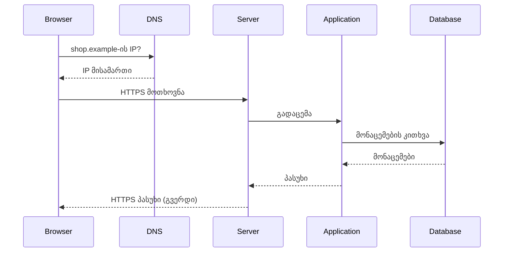

# დღე 1: შესვლა და გარემოს გაცნობა

## Task 01: პირველი შესვლა
```bash
ssh <user>@<vm-ip>
whoami; hostname; pwd; echo ~
cat /etc/os-release
uname -r
```
- ✅ ექვსივე ინფორმაცია მივიღეთ (მომხმარებელი, hostname, მიმდინარე დირექტორია, home, დისტრიბუცია, kernel). ჩვენს ლაბში: Ubuntu 26.04.1 LTS, kernel `7.0.0-43-generic`.
- 💡 **ახსნა:** კლიენტი არის ჩემი კომპიუტერი (ტერმინალი), სერვერი არის VM. ბრძანება **სერვერზე სრულდება**, კლიენტს მხოლოდ შედეგი ბრუნდება.

## Task 02: გასაღებით შესვლა
```bash
ssh-keygen -t ed25519 -f ~/.ssh/linuxlab_ed25519 -C "linux-week1-lab"
ssh-copy-id -i ~/.ssh/linuxlab_ed25519.pub <user>@<vm-ip>
ssh -i ~/.ssh/linuxlab_ed25519 <user>@<vm-ip>
```
კლიენტზე `~/.ssh/config`-ში **ბოლოში დამატება** (ჯერ ასლი!):
```bash
cp ~/.ssh/config ~/.ssh/config.bak
cat >> ~/.ssh/config <<'EOF'

# linux-week1 lab VM
Host linuxlab
    HostName <vm-ip>
    User <user>
    IdentityFile ~/.ssh/linuxlab_ed25519
    IdentitiesOnly yes
EOF
ssh linuxlab
```
fingerprint-ის შედარება:
```bash
ssh-keygen -lf ~/.ssh/linuxlab_ed25519.pub     # კლიენტზე
ssh-keygen -lf ~/.ssh/authorized_keys           # სერვერზე: უნდა ემთხვეოდეს
```
- ✅ ორივე fingerprint ერთნაირია; `ssh linuxlab` პაროლის გარეშე (passphrase-ით) შეგვიყვანა; მეორე ტერმინალითაც შევედით.
- 💡 **ახსნა:** *პირადი გასაღები* რჩება **ჩემს (კლიენტის) კომპიუტერზე** და **არავის ეძლევა**. *საჯარო გასაღები* სერვერზე დევს (`authorized_keys`). სერვერი გამოწვევას უგზავნის, კლიენტი პირადი გასაღებით ხელს აწერს და სერვერი საჯაროთი ამოწმებს. პირადი გასაღები გზაში არ გადის.
- ⚠️ `>>` ორჯერ გავუშვით და `Host linuxlab` ორჯერ ჩაიწერა. გამოვასწორეთ `cp config.bak config` და ერთხელ დამატებით. `>>` **ყოველ გაშვებაზე ამატებს**.
- ⚠️ `~/.ssh/` ორივე კომპიუტერზე არსებობს, მაგრამ `config` მხოლოდ კლიენტზეა.

## Task 03: ორი სესია
```bash
mkdir linux-week1 && cd linux-week1
echo "hello from linux-week1" > hello.txt
# მეორე სესიიდან:
cat ~/linux-week1/hello.txt
```
- ✅ მეორე სესიიდან წაიკითხა; ერთის `exit`-ის შემდეგ ფაილი დარჩა.
- 💡 **ახსნა:** სესია არის *კავშირი + shell პროცესი*. ფაილი **დისკზეა**, ამიტომ ორივე სესია ერთსა და იმავე ფაილურ სისტემას ხედავს და სესიის დახურვა ფაილს არ შლის.
- 💡 `>` ამ შემთხვევაში ფაილს ქმნის (თუ არ არსებობს). `touch` ზედმეტი იყო.

## Task 04: სისტემის მდგომარეობა
```bash
cd ~/linux-week1
echo "== User ==" > system-info.txt;  whoami >> system-info.txt
echo "== Hostname ==" >> system-info.txt; hostname >> system-info.txt
echo "== OS ==" >> system-info.txt; cat /etc/os-release >> system-info.txt
echo "== Kernel ==" >> system-info.txt; uname -r >> system-info.txt
echo "== Disk free ==" >> system-info.txt; df -h >> system-info.txt
echo "== Folder size ==" >> system-info.txt; du -sh ~/linux-week1 >> system-info.txt
ps aux | grep bash
echo $$
```
- ✅ ფაილში ექვსივე სათაური + შედეგი; `echo $$` გვაძლევს ჩვენი shell-ის PID-ს, რომელიც `ps`-ში ჩანს.
- 💡 **ახსნა:** *თავისუფალი ადგილი* = დისკზე დარჩენილი სივრცე (ჩვენს ლაბში `/dev/sda2`: 25G სულ, 16G თავისუფალი). *საქაღალდის ზომა* = რამდენს იკავებს ეს საქაღალდე. *პროცესი* = გაშვებული პროგრამა (საკუთარი PID-ით); ყოველ SSH სესიას თავისი `bash` პროცესი აქვს.
- ⚠️ `ps aux | grep bash` თვითონ `grep`-საც აჩვენებს.

## Task 05: ფაილური სისტემის დათვალიერება
```bash
cd /; pwd; ls
cd /etc; pwd; ls
cd /var; pwd; ls
cd /tmp; pwd; ls
cd /usr; pwd; ls
cd /home; pwd; ls
```
| დირექტორია | დანიშნულება |
|---|---|
| 🔴 `/etc` | **სისტემური კონფიგურაცია** (მაგ. `/etc/nginx/`) |
| 🔴 `/var` | **ცვალებადი მონაცემები**: ლოგები (`/var/log`), ბაზები |
| 🔴 `/tmp` | დროებითი ფაილები (იწმინდება) |
| 🔴 `/usr` | **დაყენებული პროგრამები**, ბიბლიოთეკები (`/usr/bin`) |
| 🔴 `/home` | მომხმარებლის პირადი ფაილები (`~`) |
- 💡 **რატომ ვმუშაობთ საკუთარ home-ში:** იქ **მე ვარ მფლობელი**, ამიტომ `sudo` არ მჭირდება და სისტემას ვერ დავაზიანებ.
- ✅ ყველა დირექტორია უპრობლემოდ დავათვალიერეთ, წვდომის პრობლემა არ გვქონია.

## Task 06: ონლაინ მაღაზიის სქემა (`system-map.txt`)

- 🔴 **DNS** თარგმნის დომენს IP მისამართად. **ცალკე მოთხოვნაა** (browser ჯერ DNS-ს ეკითხება, მერე უკავშირდება სერვერს).
- 🔴 **HTTP** არის მოთხოვნა-პასუხის პროტოკოლი (დაუშიფრავი). **HTTPS** იგივეა, **დაშიფრული** (TLS) და სერტიფიკატით ამოწმებს სერვერის ვინაობას.
- 🔴 **Development** ქმნის აპლიკაციას, **Operations** უზრუნველყოფს მის გაშვებას და მუშაობას, **DevOps** მათ ათანამშრომლებს და ავტომატიზაციას (CI/CD) ამატებს: უწყვეტი ციკლია.
- 🔴 **რატომ არ ნიშნავს SSH-ის შესვლა, რომ საიტი მუშაობს:** SSH ამოწმებს მხოლოდ იმას, რომ სერვერი ჩართულია და შესვლა შემიძლია. საიტი კი დამოკიდებულია web სერვერზე, აპლიკაციაზე, ბაზაზე, firewall-ზე, DNS-ზე, სერტიფიკატზე. მაგ.: SSH მუშაობს, მაგრამ Nginx გაჩერებულია: საიტი არ იხსნება.

---

**წინა:** [ბრძანებების ცნობარი](commands.md) · **შემდეგი:** [დღე 2](day2.md)
