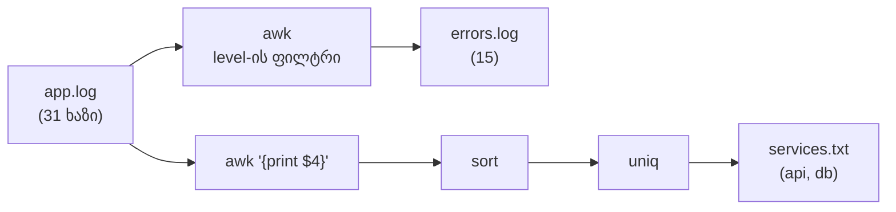

# დღე 4: ლოგები



ლოგის ფორმატი: `დრო LEVEL გარემო service message` (ველები გამოტოვებით, message-ში `_`):
```
2026-11-22T10:00:03 WARN dev db request_3_processed
```

## Task 19: სასწავლო ლოგები
```bash
cd ~/linux-week1/environments
for env in dev staging prod; do
  for i in $(seq 1 30); do
    s=$(printf "%02d" $i)
    case $((i % 6)) in 0) lvl=ERROR;; 3) lvl=WARN;; *) lvl=INFO;; esac
    case $((i % 2)) in 0) svc=api;; 1) svc=db;; esac
    echo "2026-11-22T10:00:$s $lvl $env $svc request_${i}_processed"
  done > $env/logs/app.log
  echo "2026-11-22T10:01:00 INFO $env api ERROR_codes_checked_none_found" >> $env/logs/app.log
done
wc -l */logs/app.log          # 31 თითო
grep -c ERROR dev/logs/app.log  # 6, მაგრამ ნამდვილი ERROR level მხოლოდ 5
```
- 💡 **ველები პრობლემის ძებნისას:** *დრო* = როდის; *level* = რამდენად სერიოზული (INFO/WARN/ERROR); *გარემო* = dev/staging/prod; *service* = რომელმა კომპონენტმა; *message* = რა მოხდა.
- ⚠️ ერთი INFO ხაზის message-ში სიტყვა `ERROR` წერია განზრახ: ეს Task 21-ის ხაფანგია.

## Task 20: დათვალიერება
```bash
head -5 dev/logs/app.log
tail -5 dev/logs/app.log
less dev/logs/app.log         # /request_17_  ძებნა, q გასვლა
wc -l dev/logs/app.log staging/logs/app.log prod/logs/app.log   # 31, 31, 31, ჯამი 93
```
- 💡 **ნაწილი** (`head`, `tail`): დიდი ფაილი, მხოლოდ დასაწყისი/ბოლო გვაინტერესებს. **მთელი** (`cat`, `less`): პატარა ფაილი ან დეტალური კონტექსტი.

## Task 21: ნამდვილი შეცდომები
```bash
cd ~/linux-week1
awk '$2=="ERROR"' environments/dev/logs/app.log environments/staging/logs/app.log environments/prod/logs/app.log > reports/errors.log
awk '$2=="ERROR"' environments/prod/logs/app.log > reports/prod-errors.log
wc -l reports/errors.log reports/prod-errors.log       # 15 და 5
grep -c " INFO " reports/errors.log                     # 0
```
- 🔴 `$2=="ERROR"` ამოწმებს **level-ს** (მეორე ველს). უბრალო `grep ERROR` INFO-ს ხაზსაც დაიჭერდა, რადგან მის message-ში `ERROR` წერია.

## Task 22: სტატისტიკა
```bash
L="environments/dev/logs/app.log environments/staging/logs/app.log environments/prod/logs/app.log"
echo "== Level counts ==" > reports/log-summary.txt
awk '{c[$2]++} END{for(l in c) print l, c[l]}' $L >> reports/log-summary.txt
echo "== ERROR per environment ==" >> reports/log-summary.txt
awk '$2=="ERROR"{c[$3]++} END{for(e in c) print e, c[e]}' $L >> reports/log-summary.txt
echo "== ERROR time and service ==" >> reports/log-summary.txt
awk '$2=="ERROR"{print $1, $4}' $L >> reports/log-summary.txt
```
- ✅ ჩვენს ლაბში: INFO 63 + WARN 15 + ERROR 15 = **93** = სამი ფაილის სრული ხაზების რაოდენობა. ERROR თითო გარემოში 5.
- 💡 ვითვლით **მხოლოდ სამ საწყის `app.log`-ს**: `reports` ფაილები იგივე ჩანაწერების ასლებია და ორჯერ დაითვლებოდა.

## Task 23: გაფილტვრა და დალაგება
```bash
awk '{print $4}' $L | sort | uniq > reports/services.txt        # api, db
awk '$2=="WARN" || $2=="ERROR"' $L > reports/warn-error.log     # 30 ხაზი
```
- 🔴 `|` ერთი ბრძანების **გამოტანას** მეორეს **შესატანად** გადასცემს: `awk` გამოყოფს ველს, `sort` ალაგებს, `uniq` დუბლიკატებს აშორებს.

## Task 24: ლოგის ცოცხლად ნახვა
```bash
# სესია A
cd ~/linux-week1/playground
echo "start" > live.log
tail -f live.log
# სესია B
cd ~/linux-week1/playground
echo "line 1" >> live.log      # ... line 5
# სესია A: Ctrl+C, შემდეგ
cat live.log                   # start + 5 ხაზი
```
| მოქმედება | რას აკეთებს |
|---|---|
| `>>` | ბოლოში ამატებს, ძველი რჩება |
| `>` | ზედმიწერს, ძველი იკარგება |
| `Ctrl+C` | `tail`-ს ჩერდება; **ფაილი უცვლელია** |

---

**წინა:** [დღე 3](day3.md) · **შემდეგი:** [დღე 5](day5.md)
