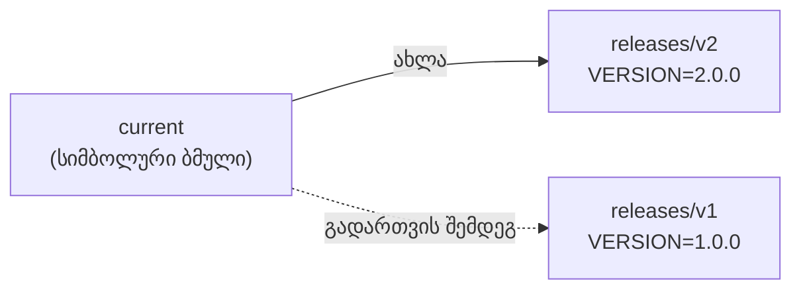

# დღე 6: რელიზები, ბმულები, backup



## Task 31: ორი ვერსია
```bash
cd ~/linux-week1
mkdir -p releases/v1/site releases/v2/site
echo "1.0.0" > releases/v1/VERSION.txt
echo "<h1>Demo Shop 1.0.0</h1>" > releases/v1/site/index.html
echo "2.0.0" > releases/v2/VERSION.txt
echo "<h1>Demo Shop 2.0.0 - new design</h1>" > releases/v2/site/index.html
```
- 💡 ძველ ვერსიას **უკან დასაბრუნებლად** ვინახავთ. პირდაპირი გადაწერით ის სამუდამოდ დაიკარგებოდა.

## Task 32: მიმდინარე რელიზი (სიმბოლური ბმული)
```bash
ln -s releases/v1 current
ls -l current                                  # current -> releases/v1
cat current/VERSION.txt current/site/index.html
ln -sfn releases/v2 current                    # გადართვა
ln -sfn releases/v1 current                    # უკან
```
- 🔴 **სიმბოლური ბმული** არის გზამკვლევი სხვა ფაილზე/საქაღალდეზე. `ls -l`-ში იწყება `l`-ით და ჩანს `current -> releases/v1`. **შეფარდებითი სამიზნე** (`releases/v1`) ითვლება ბმულის მდებარეობიდან.
- 💡 ბმული ასლისგან განსხვავდება: **მიუთითებს** ორიგინალზე და არ ქმნის ახალ ფაილს. გადართვისას **ვცვლით მხოლოდ სამიზნეს**; რელიზის ფაილები უცვლელია.

## Task 33: გაფუჭებული ბმული
```bash
ln -sfn releases/v9 current
cat current/VERSION.txt          # No such file or directory
ls releases                      # v1 v2 : ნამდვილი რელიზები სუფთაა
ln -sfn releases/v1 current      # გასწორება
```
- 💡 ბმულის არსებობა **არ ამტკიცებს სამიზნის არსებობას**: ბმული მხოლოდ გზაა და არ ამოწმებს.

## Task 34: არქივი
```bash
cd ~/linux-week1
tar -czf backups/week1-backup.tar.gz environments documents releases current
ls -l backups/week1-backup.tar.gz
tar -tzf backups/week1-backup.tar.gz | head
tar -tvzf backups/week1-backup.tar.gz | grep current     # l... current -> releases/v1
```
- 🔴 `-c` შექმნა, `-z` gzip, `-f` ფაილი; `-t` შემადგენლობა **ამოღების გარეშე**; `-x` ამოღება.
- 💡 **რა შევინახეთ:** `environments` (`.env`-ებით), `documents`, `releases`, `current` (ბმულად). **რა გამოვტოვეთ:** `backups` (არქივი თავის თავს არ უნდა შეიცავდეს), `incoming`, `reports`, `playground`: სამუშაო/დროებითი ფაილებია.

## Task 35: აღდგენა
```bash
cd ~/linux-week1
mkdir -p restore/test
tar -xzf backups/week1-backup.tar.gz -C restore/test
ls -la restore/test; ls -l restore/test/current
sha256sum releases/v1/site/index.html > playground/index.sha256
rm releases/v1/site/index.html
tar -xzf backups/week1-backup.tar.gz releases/v1/site/index.html    # მხოლოდ ეს ფაილი
sha256sum -c playground/index.sha256                                 # ...: OK
```
- 💡 **დამტკიცება:** წაშლამდე დავიმახსოვრეთ ფაილის კონტროლური ჯამი და აღდგენის შემდეგ `sha256sum -c` დაწერა `OK`: ანუ შიგთავსი **ბაიტ-ბაიტ** იგივეა. `tar -x` მხოლოდ ერთ ფაილს ამოიღებს და დანარჩენს არ ეხება.

## Task 36: ერთი ფაილის შეკუმშვა
```bash
cd ~/linux-week1 && mkdir -p playground/compress-test
cp environments/dev/logs/app.log playground/compress-test/app-copy.log
cd playground/compress-test
gzip -k app-copy.log            # ქმნის app-copy.log.gz; ორიგინალი რჩება
ls -l                            # ზომების შედარება
rm app-copy.log && gunzip app-copy.log.gz
cmp app-copy.log ~/linux-week1/environments/dev/logs/app.log && echo SAME
```
- 💡 **შეკუმშვა** ფაილს ამცირებს (`gzip`); **არქივი** ბევრ ფაილს ერთში აერთიანებს (`tar`); **backup** არის დაცული ასლი სხვა ადგილას, საიდანაც აღდგენა შეიძლება. ერთი ფაილის შეკუმშვა ასლი არ არის.

---

**წინა:** [დღე 5](day5.md) · **შემდეგი:** [დღე 7](day7.md)
