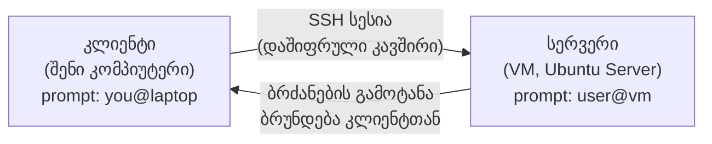

# Linux: პირველი სამუშაო კვირა (პრაქტიკა)

> **ვისთვისაა:** ვისაც Linux-ის ტერმინალი პირველად აქვს და უნდა შეასრულოს „Linux-ზე პირველი სამუშაო კვირა" (ლექციები 1-5, 42 თასქი).
> **როგორ გამოიყენო:** წაიკითხე ზევიდან ქვევით. თითო თასქს აქვს ბრძანება, **რატომ** და **როგორ შევამოწმეთ**. ბოლოს არის დაცვის კითხვები და თვითშემოწმება.

**ნიშნები ამ დოკუმენტში**

| ნიშანი | მნიშვნელობა |
|---|---|
| 🔴 | ზეპირად უნდა იცოდე |
| 💡 | რატომ ვაკეთებთ ამას |
| ✅ | როგორ შევამოწმეთ, რომ სწორია |
| ⚠️ | ტიპური შეცდომა (ჩვენც დაგვემართა) |

> **შენიშვნა მაგალითებზე.** ბრძანებების შედეგები, რომლებიც ამ გზამკვლევშია, **ჩვენს სასწავლო ლაბში მივიღეთ** (მაგ. 31 ხაზი, 15 ERROR). შენთან რიცხვები შეიძლება განსხვავდებოდეს, თუ სხვა მონაცემებს შექმნი. `<user>`, `<vm-ip>` და `FIRSTNAME-LASTNAME` შენი მნიშვნელობებით ჩაანაცვლე.

---

## სურათი ერთ გვერდზე

### 1.1 ორი კომპიუტერი



- **კლიენტი** იწყებს კავშირს და აკრეფს ბრძანებას. **სერვერი** ასრულებს მას და პასუხს უკან აბრუნებს.
- 🔴 **პირველი წესი:** ყოველი ბრძანების წინ `prompt`-ს შეხედე (`you@laptop` თუ `user@vm`). ჩვენი ყველაზე ხშირი შეცდომა ის იყო, რომ ბრძანება არასწორ კომპიუტერზე გავუშვით.
- 💡 `~/.ssh/config` და **პირადი გასაღები კლიენტზეა**. **საჯარო გასაღები სერვერზეა** (`~/.ssh/authorized_keys`). `linux-week1` სერვერზეა.

### 1.2 კვირის გეგმა

| დღე | თასქები | თემა |
|---|---|---|
| 1 | 01-06 | SSH-ით შესვლა, გარემოს გაცნობა, ფაილური სისტემა, სქემა |
| 2 | 07-12 | საქაღალდეები, გზები, ფაილები, დამალული ფაილები, ასლი |
| 3 | 13-18 | 30 დოკუმენტი, ძებნა, დალაგება, კოპირება/გადატანა, წაშლა |
| 4 | 19-24 | ლოგები: დათვალიერება, გაფილტვრა, დათვლა, <code>&#124;</code>, `tail -f` |
| 5 | 25-30 | კონფიგურაცია (`sed`), უფლებები (`chmod`) |
| 6 | 31-36 | რელიზები, სიმბოლური ბმული, `tar`, აღდგენა, `gzip` |
| 7 | 37-42 | `scp`, შეცდომების კითხვა, შემოწმება, გადაბარება, არქივი, დაცვა |

### 1.3 სამუშაო საქაღალდის სტრუქტურა

```text
linux-week1/
├── hello.txt  notes.txt  system-info.txt  system-map.txt  HANDOVER.txt
├── environments/
│   ├── dev/      app/ config/ logs/
│   ├── staging/  app/ config/ logs/
│   └── prod/     app/ config/ logs/
├── documents/    dev/ staging/ prod/        (30 დოკუმენტი, სახელი ID.txt)
├── incoming/     (დროებითი, ცარიელი ქვედირექტორიები წაიშალა)
├── releases/     v1/ v2/                    (VERSION.txt, site/index.html)
├── current  ->  releases/v2                 (სიმბოლური ბმული)
├── backups/      week1-backup.tar.gz, initial-environments/, initial-incoming/, config-before/
├── restore/      test/, returned/
├── reports/      paths.txt, inventory.txt, document-map.txt, errors.log, prod-errors.log,
│                 log-summary.txt, services.txt, warn-error.log, checklist.txt
├── transfer/     (აქ ბრუნდება არქივი Mint-იდან)
└── playground/   (საცდელი ექსპერიმენტები)
```

## გვერდები

| გვერდი | რა არის შიგნით |
|---|---|
| [ბრძანებების ცნობარი](commands.md) | 🔴 ზეპირად: ბრძანებების, ოპერატორების და უფლებების ცხრილები |
| [დღე 1](day1.md) - [დღე 7](day7.md) | 42 თასქი ბრძანებებით, მიზეზით და შემოწმებით |
| [შეცდომების კატალოგი](errors.md) | რა მოხდა სინამდვილეში და როგორ გავასწორეთ |
| [დაცვა](defense.md) | 12 თემა მოკლე პასუხებით და ჩაბარების სია |
| [თვითშემოწმება](self-check.md) | 24 კითხვა და პასუხები |
| [ქვიზი](../quiz.md) | ტესტი ამ მასალაზე (Quiz Hub) |

---

**შემდეგი:** [ბრძანებების ცნობარი](commands.md)
