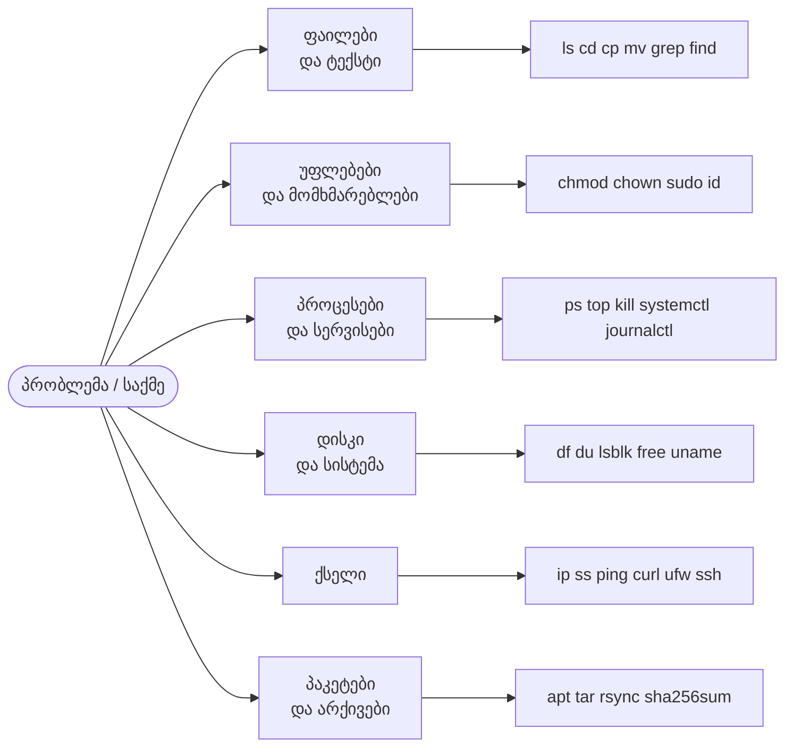

# Linux Cheat Sheet: ბრძანებები

სწრაფი ცნობარი: **ბრძანება → რას აკეთებს → მაგალითი**. ეს გვერდი ზოგადია; ჩვენი ამოცანების ბრძანებები (რა გავაკეთეთ და რატომ) ცალკეა: [ბრძანებების ცნობარი](../commands.md).

📄 **[ჩამოტვირთე PDF ვერსია](linux-cheatsheet.pdf)** (6 გვერდი, ბეჭდვისთვის).

!!! note "მაგალითების შესახებ"
    მაგალითები ტიპური გამოყენებაა. ბრძანებების რეალური გამოტანა, რომელიც ჩვენი VM-იდან გვაქვს, მოცემულია ამოცანების გვერდებზე.

## რუკა: რა ბრძანება რომელ საქმეს ემსახურება



**რატომ ეს დაყოფა:** პრაქტიკაში ბრძანებას ვეძებთ არა სახელით, არამედ საქმით ("რა იკავებს დისკს?"). ამიტომ გვერდი დაჯგუფებულია საქმის მიხედვით.

---

## 1. ნავიგაცია და ფაილები { #files }

| ბრძანება | რას აკეთებს | მაგალითი |
|----------|-------------|----------|
| `pwd` | მიმდინარე დირექტორია | `pwd` |
| `ls -la` | სია დეტალებით, დამალული ფაილებით | `ls -la /etc` |
| `cd` | დირექტორიის შეცვლა | `cd ~`, `cd -` (წინა ადგილას), `cd ..` |
| `mkdir -p` | დირექტორია (ჩადგმულიც) | `mkdir -p backups/2026` |
| `touch` | ცარიელი ფაილი ან დროის განახლება | `touch a.txt` |
| `cp -r` | კოპირება (`-r` დირექტორიისთვის) | `cp -r app app.bak` |
| `mv` | გადატანა ან სახელის შეცვლა | `mv old.txt new.txt` |
| `rm` / `rm -r` | წაშლა (**უკან დაბრუნება არ არის**) | `rm -r tmpdir` |
| `ln -s` | სიმბოლური ბმული | `ln -s /etc/nginx/sites-available/app /etc/nginx/sites-enabled/` |
| `tree -L 2` | ხე 2 დონემდე (`apt install tree`) | `tree -L 2 /etc` |
| `stat` | მფლობელი, უფლებები, ზომა, დროები | `stat file` |
| `file` | ფაილის ტიპი შიგთავსით | `file /bin/ls` |

**რატომ `-p` და `-r`:** `mkdir -p` არ ჩავარდება, თუ დირექტორია უკვე არსებობს; `cp -r` სჭირდება, რადგან დირექტორიას ჩვეულებრივი `cp` არ აკოპირებს.

## 2. ტექსტი, ძებნა, pipe { #text }

| ბრძანება | რას აკეთებს | მაგალითი |
|----------|-------------|----------|
| `cat` | ფაილის ჩვენება | `cat /etc/hostname` |
| `less` | გვერდ-გვერდ კითხვა (`q` გასასვლელად, `/` ძებნა) | `less /var/log/syslog` |
| `head -n` / `tail -n` | პირველი/ბოლო N ხაზი | `tail -n 50 app.log` |
| `tail -f` | ბოლო ხაზები რეალურ დროში | `tail -f /var/log/nginx/error.log` |
| `grep` | ტექსტის ძებნა | `grep -rn "error" /var/log` |
| `grep -i / -v / -c` | რეგისტრის გარეშე / გამორიცხვა / დათვლა | `grep -vc "^#" file` |
| `find` | ფაილების ძებნა | `find /var/log -name "*.log" -mtime +30` |
| `wc -l` | ხაზების დათვლა | `wc -l file` |
| `sort`, `uniq -c` | დალაგება, განმეორებების დათვლა | `sort file` |
| `cut -d: -f1` | სვეტის ამოღება | `cut -d: -f1 /etc/passwd` |
| `awk` | სვეტებით მუშაობა | `awk '{print $1}' access.log` |
| `sed -i` | ტექსტის ჩანაცვლება ფაილში | `sed -i 's/old/new/g' file` |

### Pipe და გადამისამართება

| სიმბოლო | მნიშვნელობა |
|---------|-------------|
| <code>cmd1 &#124; cmd2</code> | პირველის გამოტანა მეორის შესატანია |
| `>` | გამოტანა ფაილში (**ანაცვლებს**) |
| `>>` | გამოტანა ფაილის ბოლოში (ამატებს) |
| `2>` | შეცდომების ნაკადი (stderr) ფაილში |
| `2>&1` | stderr იმავე ადგილას, სადაც stdout |
| `&&` / `||` | შემდეგი მხოლოდ წარმატებისას / შეცდომისას |

```bash
# 10 ყველაზე ხშირი IP ლოგში (typical)
awk '{print $1}' access.log | sort | uniq -c | sort -rn | head
```

**რატომ ეს მაგალითი:** ის აჩვენებს pipe-ის ძალას: ხუთი მცირე ბრძანება ერთად აკეთებს ანალიზს.

## 3. უფლებები და მომხმარებლები { #perms }

| ბრძანება | რას აკეთებს | მაგალითი |
|----------|-------------|----------|
| `chmod` | უფლებები | `chmod 755 script.sh`, `chmod +x script.sh` |
| `chown` | მფლობელი | `sudo chown -R www-data:www-data /var/www/site` |
| `umask` | ახალი ფაილების ნაგულისხმევი უფლებები | `umask` |
| `sudo` | ბრძანება root-ის უფლებებით | `sudo systemctl restart nginx` |
| `id`, `groups`, `whoami` | ვინ ვარ და რომელ ჯგუფებში | `id` |
| `useradd -m -s /bin/bash` | მომხმარებლის შექმნა | `sudo useradd -m -s /bin/bash dev` |
| `usermod -aG` | ჯგუფში დამატება (`-a` აუცილებელია) | `sudo usermod -aG docker k` |
| `passwd` | პაროლის შეცვლა | `sudo passwd dev` |
| `userdel -r` | მომხმარებლის წაშლა სახლით | `sudo userdel -r dev` |

### chmod ციფრები

| ციფრი | უფლება | მნიშვნელობა |
|-------|--------|-------------|
| 4 | `r` | წაკითხვა |
| 2 | `w` | ჩაწერა |
| 1 | `x` | შესრულება |

ჯამი: `7 = rwx`, `6 = rw-`, `5 = r-x`, `4 = r--`. `755 = rwxr-xr-x` (მფლობელი / ჯგუფი / სხვები). გავრცელებული: `644` ჩვეულებრივი ფაილი, `600` საიდუმლო (SSH key, `.pgpass`), `700` პირადი დირექტორია.

!!! warning "usermod -aG"
    `-a`-ს გარეშე `usermod -G` მომხმარებელს **ყველა სხვა ჯგუფიდან ამოიღებს**.

## 4. პროცესები და სერვისები { #proc }

| ბრძანება | რას აკეთებს | მაგალითი |
|----------|-------------|----------|
| `ps aux` | ყველა პროცესი | `ps aux --sort=-%mem` თავში ყველაზე მძიმეები |
| `top` / `htop` | პროცესები რეალურ დროში | `top` (`q` გასასვლელად) |
| `kill PID` | პროცესისთვის სიგნალის გაგზავნა (`-15` თავაზიანად, `-9` ძალით) | `kill 1234` |
| `pkill` | კვლავ სახელით | `pkill -f myscript` |
| `systemctl status` | სერვისის მდგომარეობა | `systemctl status nginx` |
| `systemctl start/stop/restart/reload` | მართვა | `sudo systemctl reload nginx` |
| `systemctl enable --now` | ჩართვა ჩატვირთვაზე და ახლავე | `sudo systemctl enable --now fail2ban` |
| `systemctl list-units --failed` | ჩავარდნილი სერვისები | `systemctl list-units --failed` |
| `journalctl -u` | სერვისის ლოგი | `journalctl -u nginx -n 50 --no-pager` |
| `journalctl -f` | ლოგი რეალურ დროში | `journalctl -f` |
| `jobs`, `bg`, `fg` | ფონური სამუშაოები | `sleep 100 &` |
| `nohup cmd &` | ბრძანება ტერმინალის დახურვის შემდეგაც | `nohup ./run.sh &` |

**`reload` თუ `restart`:** `reload` კონფიგს ხელახლა კითხულობს კავშირების გაწყვეტის გარეშე; `restart` სერვისს ჩერდება და ახლიდან უშვებს.

## 5. დისკი და ფაილური სისტემა { #disk }

| ბრძანება | რას აკეთებს | მაგალითი |
|----------|-------------|----------|
| `df -h` | ფაილური სისტემების თავისუფალი ადგილი | `df -h /` |
| `du -sh` | დირექტორიის ზომა | `du -sh /var/log` |
| `lsblk` | დისკები და partition-ები | `lsblk` |
| `findmnt` | მიერთებული ფაილური სისტემები | `findmnt /` |
| `mount` | ყველა mount | `mount` |
| `free -h` | RAM და swap | `free -h` |
| `lsof +D` | ვინ იყენებს ფაილებს | `lsof +D /var/log` |

**`df` და `du` სხვაობა:** `df` ფაილური სისტემის დონეზე ითვლის, `du` ფაილების ჯამს. მათი განსხვავება ხშირად ნიშნავს, რომ წაშლილ ფაილს პროცესი ისევ ხსნის.

## 6. ქსელი { #net }

| ბრძანება | რას აკეთებს | მაგალითი |
|----------|-------------|----------|
| `ip a` | IP მისამართები | `ip a` |
| `ip r` | მარშრუტები | `ip r` |
| `ss -tlnp` | მოსმენილი TCP პორტები და პროცესები | `sudo ss -tlnp` |
| `ping -c 4` | მისაწვდომობა | `ping -c 4 8.8.8.8` |
| `curl -I` | მხოლოდ header-ები | `curl -I http://localhost` |
| `curl -s` | წყნარი რეჟიმი | `curl -s http://localhost/health` |
| `dig` / `nslookup` | DNS | `dig example.com +short` |
| `traceroute` | გზა მისამართამდე | `traceroute example.com` |
| `ufw status verbose` | firewall მდგომარეობა | `sudo ufw status verbose` |
| `ufw allow` | პორტის გახსნა | `sudo ufw allow 22/tcp` |
| `ssh` | დაკავშირება | `ssh -i ~/.ssh/key k@192.168.56.10` |
| `scp` | ფაილის გადაცემა | `scp file k@host:/tmp/` |
| `rsync -avz` | გამართული სინქრონიზაცია | `rsync -avz ./site/ k@host:/var/www/site/` |

!!! tip "curl 200 OK ყოველთვის საკმარისი არ არის"
    სწორი საიტის დასამტკიცებლად შეადარე `<title>` ან `Content-Length`. იხილე [Task 16](../tasks/task16.md).

## 7. პაკეტები (Debian/Ubuntu) { #pkg }

| ბრძანება | რას აკეთებს |
|----------|-------------|
| `sudo apt update` | პაკეტების სიის განახლება |
| `sudo apt upgrade` | დაყენებული პაკეტების განახლება |
| `sudo apt install პაკეტი` | დაყენება |
| `sudo apt remove` / `purge` | წაშლა / წაშლა კონფიგებითურთ |
| `sudo apt autoremove` | აღარ საჭირო დამოკიდებულებები |
| `apt search`, `apt show` | ძებნა, ინფორმაცია |
| `dpkg -l` | დაყენებული პაკეტები |
| `dpkg -L პაკეტი` | პაკეტის ფაილები |
| `snap list` | snap პაკეტები |

!!! warning "apt \"not valid yet\""
    თუ VM-ის საათი ჩამორჩა, `apt` უარს იტყვის: გამოსავალი `sudo chronyc makestep`. იხილე [პრობლემების ცნობარი](../troubleshooting.md).

## 8. არქივები და ბექაპი { #archive }

| ბრძანება | რას აკეთებს | მაგალითი |
|----------|-------------|----------|
| `tar -czf` | არქივის შექმნა (gzip) | `tar -czf site.tar.gz /var/www/site` |
| `tar -tzf` | არქივის შიგთავსის ნახვა | `tar -tzf site.tar.gz` |
| `tar -xzf -C` | გახსნა დირექტორიაში | `tar -xzf site.tar.gz -C /tmp` |
| `gzip` / `gunzip` | ერთი ფაილის შეკუმშვა | `gzip app.log` |
| `zip` / `unzip` | zip | `unzip a.zip` |
| `sha256sum` | კონტროლის ჯამი | `sha256sum -c file.sha256` |
| `gpg --symmetric` | პაროლით დაშიფვრა | `gpg --symmetric --cipher-algo AES256 a.tar.gz` |

**რატომ ჯამი და დაშიფვრა:** ჯამი ამტკიცებს, რომ არქივი არ დაზიანებულა; დაშიფვრა იცავს საიდუმლოს (key-ები, პაროლები), თუ არქივი გადაადგილდება.

## 9. სისტემის ინფორმაცია { #sysinfo }

| ბრძანება | რას აკეთებს |
|----------|-------------|
| `uname -a` | ბირთვი და არქიტექტურა |
| `cat /etc/os-release` | დისტრიბუცია და ვერსია |
| `hostnamectl` | hostname და სისტემა |
| `uptime` | მუშაობის დრო და დატვირთვა |
| `lscpu` | პროცესორი |
| `timedatectl` | დრო და სინქრონიზაცია |
| `date` | მიმდინარე დრო |
| `last`, `who`, `w` | ვინ შემოვიდა / ვინ არის ახლა |
| `history` | ბრძანებების ისტორია |

## 10. Bash და cron { #bash }

```bash
name="Giorgi"             # ცვლადი: = გარშემო space არ უნდა იყოს
echo "$name"              # ბრჭყალები: უსაფრთხო
today=$(date +%F)         # ბრძანების შედეგი ცვლადში

if [ -f "$file" ]; then   # -f ფაილია, -d დირექტორია, -e არსებობს, -z ცარიელია
  echo "არსებობს"
else
  echo "არ არსებობს"
fi

for f in *.log; do        # ციკლი
  gzip "$f"
done
```

| სპეციალური ცვლადი | მნიშვნელობა |
|-------------------|-------------|
| `$0` | სკრიპტის სახელი |
| `$1 $2` | არგუმენტები |
| `$#` | არგუმენტების რაოდენობა |
| `$@` | ყველა არგუმენტი |
| `$?` | წინა ბრძანების exit code (`0` = წარმატება) |

**უსაფრთხო სკრიპტის დასაწყისი:** `#!/usr/bin/env bash` და `set -euo pipefail`: სკრიპტი ჩერდება შეცდომაზე, გაუცხადებელ ცვლადზე და pipe-ის შეცდომაზე.

### cron

```text
┌ წუთი (0-59)
│ ┌ საათი (0-23)
│ │ ┌ დღე (1-31)
│ │ │ ┌ თვე (1-12)
│ │ │ │ ┌ კვირის დღე (0-6)
* * * * *  ბრძანება
```

| გამოსახულება | მნიშვნელობა |
|--------------|-------------|
| `*/5 * * * *` | ყოველ 5 წუთში |
| `0 2 * * *` | ყოველდღე 02:00-ზე |
| `0 2 * * 0` | კვირას 02:00-ზე |
| `0 9 1 * *` | თვის პირველ დღეს 09:00-ზე |

ბრძანებები: `crontab -e` (რედაქტირება), `crontab -l` (სია), `crontab -r` (**ყველაფრის წაშლა**). ყოველთვის გამოიყენე სრული ბილიკები და `>> /path/log 2>&1`, რადგან cron-ს მინიმალური გარემო აქვს.

## 11. რედაქტორები და ტერმინალის კლავიშები { #keys }

### nano

| კლავიში | მოქმედება |
|---------|-----------|
| `Ctrl+O`, `Enter` | შენახვა |
| `Ctrl+X` | გასვლა |
| `Ctrl+W` | ძებნა |
| `Ctrl+K` / `Ctrl+U` | ხაზის ამოჭრა / ჩასმა |

### vim (მინიმუმი)

| კლავიში | მოქმედება |
|---------|-----------|
| `i` | ჩასწორების რეჟიმი |
| `Esc` | ბრძანების რეჟიმი |
| `:wq` | შენახვა და გასვლა |
| `:q!` | გასვლა შენახვის გარეშე |
| `/ტექსტი` | ძებნა |

### ტერმინალი

| კლავიში | მოქმედება |
|---------|-----------|
| `Tab` | ავტოდასრულება |
| `Ctrl+C` | მიმდინარე ბრძანების შეწყვეტა |
| `Ctrl+R` | ისტორიაში ძებნა |
| `Ctrl+L` | ეკრანის გასუფთავება |
| `Ctrl+A` / `Ctrl+E` | ხაზის დასაწყისი / ბოლო |
| `!!` | წინა ბრძანების გამეორება (`sudo !!` sudo-თი) |

---

## სიტუაცია → ბრძანება { #situations }

| სიტუაცია | ბრძანება |
|----------|----------|
| რა იკავებს დისკს? | <code>sudo du -h --max-depth=1 / &#124; sort -h</code> |
| ვინ უსმენს 80 პორტს? | <code>sudo ss -tlnp &#124; grep :80</code> |
| რომელი პროცესი ჭამს RAM-ს? | `ps aux --sort=-%mem` პლუს `head` |
| სერვისი არ ამოდის, რატომ? | `systemctl status X` და `journalctl -u X -n 50` |
| ფაილი სად არის? | `find / -name "ფაილი" 2>/dev/null` |
| სად წერია ტექსტი კონფიგებში? | `grep -rn "ტექსტი" /etc` |
| მფლობელი/უფლება ცუდია? | `ls -l`, `namei -l /გზა` |
| საიტი ლოკალურად პასუხობს? | `curl -I http://localhost` |
| რა შეიცვალა ბოლო საათში? | `find /etc -mmin -60` |
| ვინ შემოვიდა SSH-ით? | `last`, `journalctl -u ssh` |
| ბექაპი მთლიანია? | `sha256sum -c` და `tar -tzf` |
| საათი არასწორია | `timedatectl`, `sudo chronyc makestep` |

## საშიში ბრძანებები { #danger }

| ბრძანება | რატომ ცუდია | უსაფრთხო ალტერნატივა |
|----------|-------------|----------------------|
| `rm -rf /გზა` | უკან დაბრუნება არ არის; გზაში space ან ცარიელი ცვლადი ყველაფერს წაშლის | ჯერ `ls` იგივე გზაზე; `rm -ri`; `trash-cli` |
| `chmod -R 777` | ყველას აძლევს ყველაფერს | კონკრეტული `chmod`/`chown` |
| `dd of=/dev/...` | დისკის გადაწერა | ჯერ `lsblk`, გადაამოწმე სამიზნე |
| `crontab -r` | ყველა cron სამუშაო წაიშლება | `crontab -l > backup.cron` ჯერ |
| `> file` | ფაილს ანულებს | `>>` ან ჯერ ბექაპი |
| `kill -9` | პროცესი ვერ გაასუფთავებს | ჯერ `kill -15` |
| `sudo` გაუგებარ სკრიპტზე | root-ით მავნე ბრძანება | ჯერ წაიკითხე სკრიპტი |

!!! danger "წესი"
    დესტრუქციული ბრძანების წინ ჯერ იგივე გზაზე გაუშვი უსაფრთხო ვარიანტი (`ls`, `echo`, `--dry-run`), შემდეგ რეალური.

## გამოცადე ცოდნა

[ბრძანებების ქვიზი](../quiz.md) ასევე ამოწმებს ამ გვერდის თემებს.
