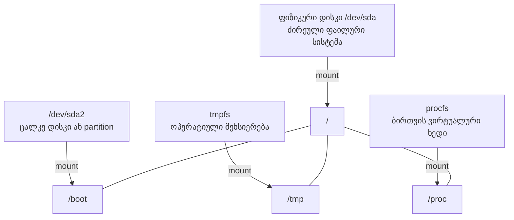
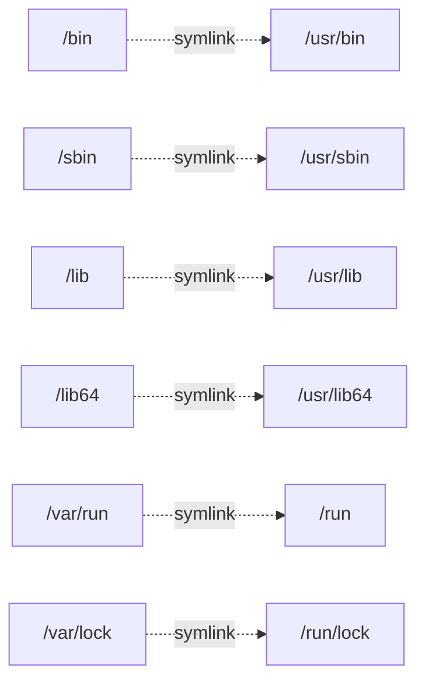
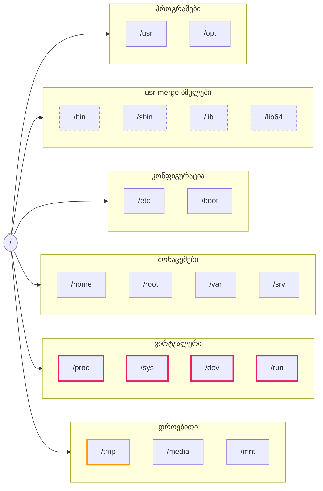
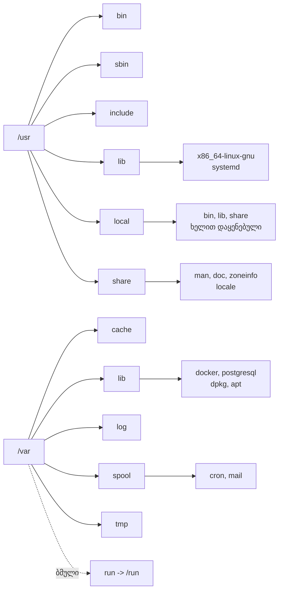
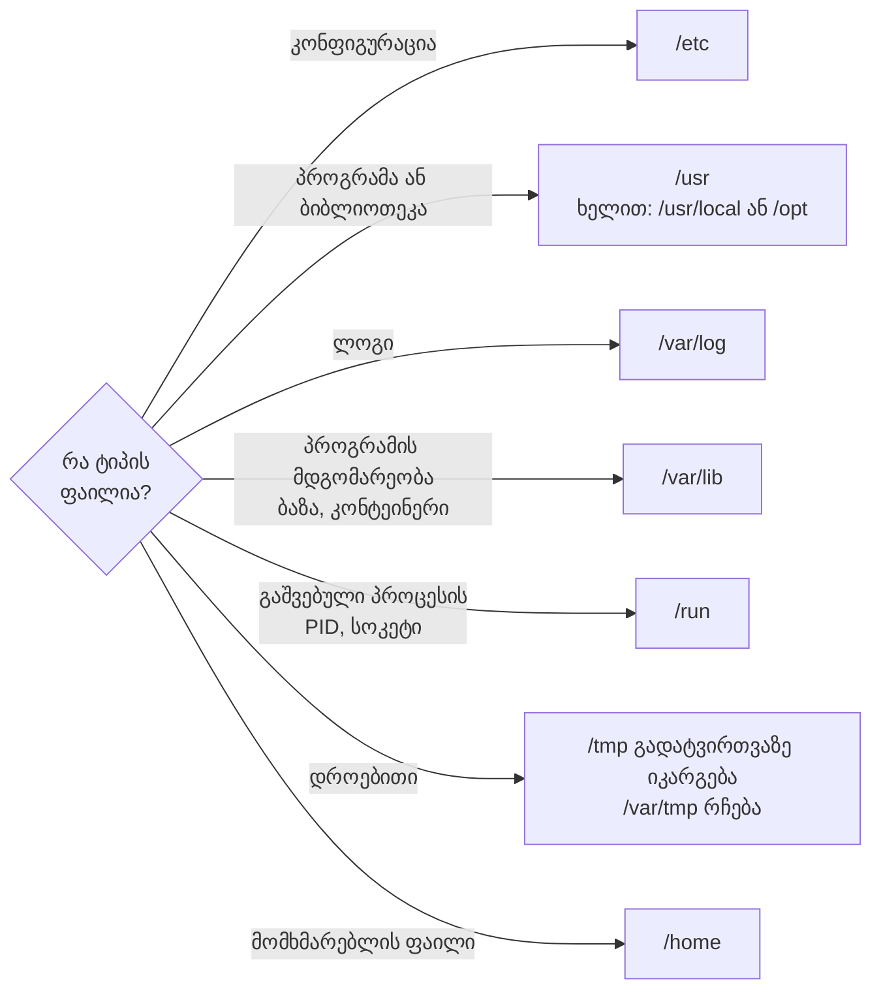

# Linux-ის ფაილური სისტემის იერარქია (FHS)

ეს გვერდი განმარტავს, **სად რა ინახება** Linux-ში და რატომ. DevOps-ში ამის ცოდნა ყოველდღე გვჭირდება: ლოგების, კონფიგურაციის, მონაცემებისა და დროებითი ფაილების მოსაძებნად, backup-ის დასაგეგმად და პრობლემების დიაგნოსტიკისთვის. მაგალითებში ვიყენებთ ჩვენს VM-ს (Ubuntu Server, `myubuntuserver`) და მასზე შესრულებულ ამოცანებს.

!!! info "როგორ ვკითხულობთ ამ გვერდს"
    **„ტიპური გამოტანა“** ნიშნავს წარმოდგენას, როგორ გამოიყურება შედეგი უმეტეს Debian/Ubuntu-ისებრ სისტემაზე. **„ჩვენი VM-იდან“** ან **„ჰოსტიდან“** კი რეალურად გაშვებული ბრძანების შედეგია (ჰოსტი ამ გვერდის დაწერისას Linux Mint-ია). რეალური გამოტანები Task 20-23-იდან არის აღებული.

## 1. შესავალი

### რა არის Linux-ის ფაილური სისტემის იერარქია
Linux-ში ყველაფერი ერთ **საქაღალდეების ხეშია** (directory tree). ხის ძირი არის `/` (root directory, „ძირეული საქაღალდე“), ყველა დანარჩენი ფაილი და საქაღალდე მის ქვეშაა. Windows-ისგან განსხვავებით აქ არ არის ცალკე დისკები (`C:`, `D:`): მეორე დისკი, ფლეშკა ან ქსელური საქაღალდე უბრალოდ რომელიმე საქაღალდეზე **მიერთდება** (mount) და ამ ხის ნაწილი ხდება.


ჩვენს VM-ში `/boot` სხვა partition-ია (`/dev/sda2`), `/tmp` კი ოპერატიულ მეხსიერებაში მყოფი `tmpfs`. მომხმარებლისთვის ყველაფერი ერთი ხის ნაწილია. უპირატესობა ისაა, რომ დისკის დამატება ან ჩანაცვლება პროგრამებს არ ცვლის: ისინი გზებს (`/var/lib/...`) იყენებენ და არ აინტერესებთ, რომელ დისკზეა.

### რა არის FHS
**FHS (Filesystem Hierarchy Standard)** არის სტანდარტი, რომელიც აღწერს, **რომელ საქაღალდეში რა ტიპის ფაილები უნდა იყოს**. მას Linux Foundation ინახავს (მიმდინარე ვერსია 3.0, 2015 წლიდან). მიზანი ერთგვაროვნებაა: ადმინისტრატორმა, პროგრამამ და პაკეტების მენეჯერმა წინასწარ იცოდეს, რომ კონფიგურაცია `/etc`-შია, ლოგები `/var/log`-ში და ა.შ., დისტრიბუტივის მიუხედავად. FHS **რეკომენდაციაა**, და დისტრიბუტივები მას მცირე განსხვავებებით იცავენ (იხილე [ქვემოთ](#fhs-tree)). ადგილობრივი დოკუმენტაცია: `man hier` და `man file-hierarchy` (systemd-ის აღწერა).

### `/` და `/root` ერთი და იგივე არ არის
| | `/` | `/root` |
|--|-----|---------|
| რა არის | მთელი ფაილური სისტემის **ძირი** (root directory) | **root მომხმარებლის** პირადი (home) საქაღალდე |
| გზა | `/` | `/root` |
| ვინ შედის | ყველა (წაკითხვის უფლებით) | მხოლოდ root (`drwx------`) |
| ანალოგი | `/home/k` არის `k` მომხმარებლის საქაღალდე | `/root` არის root-ის „home“, ხოლო მას `/home`-ში არ ათავსებენ |

`/root`-ს ცალკე ათავსებენ `/home`-ისგან, რათა root მუშაობდეს, თუნდაც `/home` სხვა დისკზე იყოს და ვერ ჩაიტვირთოს.

## 2. სრული ხე { #fhs-tree }

```text
/
├── bin  -> usr/bin          # სიმბოლური ბმული (usr-merge)
├── boot/                    # ბირთვი, initramfs, bootloader
├── dev/                     # მოწყობილობების ფაილები (devtmpfs)
├── etc/                     # სისტემის კონფიგურაცია
├── home/                    # მომხმარებლების საქაღალდეები
├── lib  -> usr/lib          # სიმბოლური ბმული (usr-merge)
├── lib64 -> usr/lib64       # სიმბოლური ბმული (usr-merge)
├── media/                   # მოხსნადი მედია (ავტომატური mount)
├── mnt/                     # დროებითი ხელით mount
├── opt/                     # დამატებითი (მესამე მხარის) პროგრამები
├── proc/                    # პროცესებისა და ბირთვის ინფორმაცია (procfs)
├── root/                    # root მომხმარებლის საქაღალდე
├── run/                     # გაშვებული სისტემის დროებითი მონაცემები (tmpfs)
├── sbin -> usr/sbin         # სიმბოლური ბმული (usr-merge)
├── srv/                     # ამ სისტემის მიერ მომსახურებული მონაცემები
├── sys/                     # ბირთვის ობიექტები (sysfs)
├── tmp/                     # დროებითი ფაილები
├── usr/                     # პროგრამები, ბიბლიოთეკები, საერთო მონაცემები
│   ├── bin/                 # ბრძანებები
│   ├── sbin/                # ადმინისტრაციული ბრძანებები
│   ├── include/             # C/C++ header ფაილები
│   ├── lib/                 # ბიბლიოთეკები და შიდა ბინარები
│   ├── local/               # ადმინისტრატორის ხელით დაყენებული პროგრამები
│   └── share/               # არქიტექტურისგან დამოუკიდებელი მონაცემები
└── var/                     # ცვალებადი მონაცემები
    ├── cache/               # გადაგენერირებადი ქეში
    ├── lib/                 # პროგრამების მდგომარეობა (state)
    ├── log/                 # ლოგები
    ├── spool/               # რიგები (cron, mail, print)
    └── tmp/                 # დროებითი ფაილები, რომლებიც გადატვირთვას გადაურჩება
```

!!! warning "ყველა დისტრიბუტივზე ზუსტად ასე არ არის"
    ხე **ტიპური** სურათია და არა უცვლელი წესი. რეალური სისტემა შეიძლება შეიცავდეს სხვა საქაღალდეებსაც, ან ზოგი აქ ჩამოთვლილი სხვაგვარად იყოს:

    - `/bin`, `/sbin`, `/lib`, `/lib64` სიმბოლური ბმულებია `/usr`-ის შიგნით საქაღალდეებზე, ეს **usr-merge**-ის შედეგია (იხილე [ქვემოთ](#usr-merge)). ძველ ან მცირე დისტრიბუტივებში ისინი ჩვეულებრივი საქაღალდეებია.
    - ჰოსტზე (Linux Mint 22) დამატებით არის `lib32 -> usr/lib32`, `cdrom`, `swapfile` და გარდამავალი საქაღალდეები `bin.usr-is-merged`, `sbin.usr-is-merged`, `lib.usr-is-merged`, რომლებიც Debian-ის usr-merge მიგრაციის ნაშთია. Ubuntu Server-ზე `swapfile`-ის ნაცვლად ხშირად `/swap.img` გვხვდება.
    - `lost+found/` (ext4-ის აღდგენილი ფაილები) ყოველ ext-ფაილურ სისტემას აქვს და FHS-ის ძირითად ხეში არ ჩანს.
    - **NixOS** და **Guix** ზოგადად FHS-ს არ იცავენ (პროგრამები `/nix/store`-შია). Arch და Fedora-ში `/usr/sbin` თვითონაც სიმბოლური ბმულია `/usr/bin`-ზე.

### usr-merge
<a id="usr-merge"></a>
ისტორიულად `/bin`, `/sbin` და `/lib` სისტემის ჩატვირთვისთვის აუცილებელ პროგრამებს შეიცავდა, ხოლო `/usr` ხშირად **ცალკე დისკზე** იყო და ჩატვირთვის დასაწყისში ჯერ არ იყო ხელმისაწვდომი. დღეს `initramfs` ამ პრობლემას წყვეტს და გამიჯვნა აზრს კარგავს. **usr-merge** ორივე ადგილს აერთიანებს: ძველი საქაღალდეები გადადის `/usr`-ში, ხოლო ძველი გზები (`/bin`, `/sbin`, `/lib`, `/lib64`) სიმბოლური ბმულებით რჩება თავსებადობისთვის. შედეგად `#!/bin/bash` სკრიპტები მუშაობს, ფაილები კი ერთ ადგილას (`/usr`) ინახება, რაც უადვილებს backup-ს, განახლებასა და read-only `/usr`-ს. დღეს ამას იყენებს დისტრიბუტივების უმრავლესობა (Debian 12+, Ubuntu, Fedora, Arch და სხვა).


ჰოსტზე რეალურად შემოწმებული: <br>
```text
$ readlink /bin /sbin /lib /lib64 /var/run
usr/bin
usr/sbin
usr/lib
usr/lib64
/run
$ readlink -f /bin
/usr/bin
```

## 3. დეტალური ცნობარი

ყოველი საქაღალდისთვის ერთი და იგივე ხუთი კითხვაა: **დანიშნულება**, **შიგთავსი**, **მაგალითები**, **მონაცემთა ტიპი** (მუდმივი, დროებითი ან ვირტუალური) და **ადმინისტრირების გასათვალისწინებელი**.

### `/` (root directory)
| | |
|--|--|
| დანიშნულება | მთელი ხის საწყისი წერტილი; ყველა დანარჩენი ფაილური სისტემა მასზე ან მის ქვეშაა მიერთებული |
| შიგთავსი | თითქმის მხოლოდ ზემოთ აღწერილი საქაღალდეები და mount-ის წერტილები; პირადი ფაილები აქ არ იდება |
| მაგალითები | `/etc`, `/var`, `/home`, `/usr`, `/boot` |
| ტიპი | მუდმივი (ფიზიკური ფაილური სისტემა, ჩვენს VM-ზე LVM: `/dev/mapper/ubuntu--vg-ubuntu--lv`, 12G) |
| ადმინისტრირება | ძირეული ფაილური სისტემა ჩატვირთვისას უნდა იყოს ხელმისაწვდომი; თუ ივსება, სისტემა ვერ მუშაობს (`df -h /`, Task 21); უფლებები `0755 root:root` |

### `/bin`
| | |
|--|--|
| დანიშნულება | ძირითადი ბრძანებები, რომლებიც ყველა მომხმარებელს სჭირდება (დაზუსტებით: ჩატვირთვისა და აღდგენისთვის აუცილებელი) |
| შიგთავსი | `ls`, `cp`, `mv`, `cat`, `bash`, `grep` |
| მაგალითები | `/bin/ls`, `/bin/bash` |
| ტიპი | მუდმივი; usr-merge-ზე სიმბოლური ბმულია `/usr/bin`-ზე |
| ადმინისტრირება | პროგრამებს პაკეტების მენეჯერი მართავს (`apt`), ხელით არ ვცვლით. `file -L /bin/ls` გვაჩვენებს, რომ ეს ELF 64-bit პროგრამაა |

### `/boot`
| | |
|--|--|
| დანიშნულება | ოპერაციული სისტემის ჩასატვირთად საჭირო ფაილები |
| შიგთავსი | Linux-ის ბირთვი (`vmlinuz-*`), `initrd.img-*` (initramfs), bootloader-ის (GRUB) კონფიგურაცია; UEFI სისტემებზე `/boot/efi` |
| მაგალითები | `/boot/vmlinuz-6.x.x-generic`, `/boot/grub/grub.cfg` |
| ტიპი | მუდმივი; ხშირად ცალკე partition (ჩვენს VM-ზე `/dev/sda2`, 2.0G, 6% გამოყენებული) |
| ადმინისტრირება | ბირთვის ძველი ვერსიები გროვდება და partition-ი ივსება: `sudo apt autoremove` ასუფთავებს; ფაილებს ხელით ნუ შლი, ჩატვირთვა შეიძლება დაგეკარგოს |

### `/dev`
| | |
|--|--|
| დანიშნულება | მოწყობილობების **ფაილური ინტერფეისი**: აპარატურა და ვირტუალური მოწყობილობები ფაილებად ჩანს |
| შიგთავსი | block მოწყობილობები (დისკები) და character მოწყობილობები (ტერმინალები, ფსევდო-მოწყობილობები) |
| მაგალითები | `/dev/sda` (დისკი), `/dev/sda2` (partition), `/dev/null` (ყველაფერს ყლაპავს), `/dev/zero` (ნულების ნაკადი), `/dev/random`, `/dev/tty`, `/dev/shm` (მეხსიერებაში მყოფი ფაილები) |
| ტიპი | **ვირტუალური**: `devtmpfs` ფაილური სისტემა, რომელსაც ბირთვი და `udev` ავსებს გაშვებისას; ბრძანებებით დისკზე არ ინახება |
| ადმინისტრირება | `/dev/sdX` ცვლადია (დისკების ჩატვირთვის რიგზე დამოკიდებული), `fstab`-ში უმჯობესია `UUID`; `dd of=/dev/sdX` **დისკს შლის** |

### `/etc`
| | |
|--|--|
| დანიშნულება | სისტემისა და სერვისების **კონფიგურაცია**, კონკრეტული ამ მანქანისთვის (host-specific) |
| შიგთავსი | ძირითადად ტექსტური კონფიგურაციის ფაილები, ბინარები არა |
| მაგალითები | ჩვენი ამოცანებიდან: `/etc/nginx/`, `/etc/ssh/sshd_config.d/10-hardening.conf`, `/etc/fail2ban/jail.local`, `/etc/netplan/`, `/etc/ssl/`, `/etc/chrony/conf.d/makestep.conf`, `/etc/logrotate.d/mydevops`, `/etc/fstab`, `/etc/hosts` |
| ტიპი | მუდმივი, ტექსტური |
| ადმინისტრირება | **ყველაზე მნიშვნელოვანი საქაღალდე backup-ისთვის** (Task 24). შეცვლამდე დაიმახსოვრე ძველი ვერსია; შეცვლის შემდეგ შეამოწმე სინტაქსი (`nginx -t`, `sshd -t`) და მხოლოდ მერე გადატვირთე. ცვლილებების ისტორიისთვის შეიძლება `etckeeper` |

### `/home`
| | |
|--|--|
| დანიშნულება | ჩვეულებრივი მომხმარებლების პირადი საქაღალდეები (`/home/<სახელი>`) |
| შიგთავსი | მომხმარებლის ფაილები, პროექტები, დამალული კონფიგურაცია (`.ssh/`, `.bashrc`, `.config/`) |
| მაგალითები | `/home/k` (ჩვენი სკრიპტები, `docker-app`, `backups`, `.ssh/authorized_keys`) |
| ტიპი | მუდმივი, ხშირად ცალკე partition |
| ადმინისტრირება | `~` ნიშნავს მიმდინარე მომხმარებლის საქაღალდეს; `~/.ssh`-ზე `700`, key-ებზე `600`; დისკის ამოწურვისას აქ ძირითადად ჩანს მომხმარებელთა მონაცემები (`du -sh /home/*`) |

### `/lib`
| | |
|--|--|
| დანიშნულება | `/bin` და `/sbin`-ის პროგრამებისთვის აუცილებელი **საერთო ბიბლიოთეკები** (shared libraries), ბირთვის მოდულები |
| შიგთავსი | `.so` ფაილები, `/lib/modules/<ბირთვის ვერსია>/` |
| მაგალითები | `/lib/modules/` (დრაივერები) |
| ტიპი | მუდმივი; usr-merge-ზე სიმბოლური ბმულია `/usr/lib`-ზე |
| ადმინისტრირება | ბიბლიოთეკების ხელით წაშლა პროგრამებს ჩაშლის; პაკეტების მენეჯერი უზრუნველყოფს თავსებადობას |

### `/lib64`
| | |
|--|--|
| დანიშნულება | 64-ბიტიანი ბიბლიოთეკები (FHS-ში `/lib<qual>` ალტერნატიული ფორმატებისთვის, x86-64-ზე ეს `lib64`-ია) |
| შიგთავსი | პირველ რიგში **დინამიკური ჩამტვირთველი** `ld-linux-x86-64.so.2` |
| მაგალითები | `/lib64/ld-linux-x86-64.so.2`; `file -L /bin/ls` გვაჩვენებს `interpreter /lib64/ld-linux-x86-64.so.2` |
| ტიპი | მუდმივი; usr-merge-ზე სიმბოლური ბმულია `/usr/lib64`-ზე |
| ადმინისტრირება | ზოგ დისტრიბუტივში (Debian/Ubuntu multiarch) ბიბლიოთეკები `/usr/lib/x86_64-linux-gnu/`-შია და `/lib64`-ში მხოლოდ ჩამტვირთველია; ყველა დისტრიბუტივზე ერთნაირი არ არის |

### `/media`
| | |
|--|--|
| დანიშნულება | **მოხსნადი მედიის** ავტომატური mount-ის ადგილი (USB, CD) |
| შიგთავსი | ქვესაქაღალდეები, რომლებსაც დესკტოპის გარემო/`udisks` ქმნის: `/media/<მომხმარებელი>/<LABEL>` |
| მაგალითები | `/media/k/USB_DISK` |
| ტიპი | დროებითი mount-ის წერტილები (სერვერზე ჩვეულებრივ ცარიელია) |
| ადმინისტრირება | უსაფრთხოდ ამოღებამდე `umount`; სერვერებზე ამას იშვიათად იყენებენ |

### `/mnt`
| | |
|--|--|
| დანიშნულება | **ადმინისტრატორის ხელით** დროებით მიერთებული ფაილური სისტემებისთვის |
| შიგთავსი | ჩვეულებრივ ცარიელი |
| მაგალითები | `sudo mount /dev/sdb1 /mnt`, ქსელური NFS/SMB |
| ტიპი | დროებითი mount-ის წერტილი |
| ადმინისტრირება | `/media`-სგან განსხვავება: `/media` ავტომატურია, `/mnt` ხელით; მუდმივი mount-ისთვის `/etc/fstab` და საკუთარი საქაღალდე უმჯობესია |

### `/opt`
| | |
|--|--|
| დანიშნულება | **დამოუკიდებელი დამატებითი პროგრამები** (add-on application software), რომლებსაც საკუთარი სტრუქტურა აქვთ |
| შიგთავსი | თითო პროგრამა ერთ საქაღალდეში: `/opt/<მწარმოებელი>/<პროგრამა>/` |
| მაგალითები | `/opt/google/chrome`, ჰოსტზე ისეთი პროგრამები, რომლებიც `.deb`-ით ან არქივით მოდის |
| ტიპი | მუდმივი |
| ადმინისტრირება | `/usr/local`-თან განსხვავება: `/opt` ერთ ადგილას ინახავს მთელ პროგრამას (bin, lib, data), `/usr/local` კი პროგრამებს სისტემის სტრუქტურაში (`bin/`, `lib/`) ანაწილებს. FHS-ის მიხედვით კონფიგურაცია `/etc/opt/`-შია, მონაცემები `/var/opt/`-ში. `PATH`-ს ხელით უნდა დაემატოს |

### `/proc`
| | |
|--|--|
| დანიშნულება | **ბირთვისა და პროცესების ვირტუალური ხედი** (procfs) |
| შიგთავსი | ციფრიანი საქაღალდეები (თითო პროცესი: `/proc/<PID>/`) და ბირთვის ინფორმაციის ფაილები |
| მაგალითები | `/proc/cpuinfo`, `/proc/meminfo`, `/proc/loadavg` (load average, Task 20), `/proc/uptime`, `/proc/mounts`, `/proc/<PID>/cmdline`, `/proc/self` (შენი პროცესი), `/proc/sys/` (ბირთვის პარამეტრები, `sysctl`) |
| ტიპი | **ვირტუალური**: დისკზე არ არის, ფაილები ზომით 0 და იკითხება მოთხოვნისას; ხელმისაწვდომია გაშვებულ სისტემაში |
| ადმინისტრირება | წაკითხვა უსაფრთხოა; `/proc/sys`-ში ჩაწერა ბირთვის ქცევას ცვლის (`sysctl`), ამიტომ ფრთხილად. `/proc/<PID>/` ქრება პროცესის დასრულებისას |

### `/root`
| | |
|--|--|
| დანიშნულება | **root მომხმარებლის** home საქაღალდე (არა ხის ძირი `/`) |
| შიგთავსი | root-ის პირადი ფაილები და კონფიგურაცია |
| მაგალითები | `/root/.bashrc`, `/root/.ssh/` |
| ტიპი | მუდმივი, უფლებები `drwx------` (მხოლოდ root) |
| ადმინისტრირება | ჩვენს VM-ზე root დაბლოკილია (`passwd -S root` → `L`) და სამუშაოდ `sudo` გამოიყენება; `/root` ცალკეა `/home`-ისგან, რომ root-ს ჩატვირთვისას საკუთარი საქაღალდე ჰქონდეს, თუნდაც `/home` ჯერ არ იყოს მიერთებული |

### `/run`
| | |
|--|--|
| დანიშნულება | **გაშვებული სისტემის** დროებითი მონაცემები ჩატვირთვის მომენტიდან: PID ფაილები, სოკეტები, საკეტები |
| შიგთავსი | `*.pid`, Unix სოკეტები, `/run/user/<UID>/`, `/run/lock/` |
| მაგალითები | `/run/docker.sock`, `/run/sshd.pid`, `/run/user/1000`, `/run/systemd/resolve/` |
| ტიპი | **დროებითი**: `tmpfs`, ოპერატიულ მეხსიერებაში, ყოველ ჩატვირთვაზე ცარიელდება |
| ადმინისტრირება | ძველად ამას `/var/run` ემსახურებოდა. FHS 3.0-მა `/run` ოფიციალურად შემოიტანა, ხოლო `/var/run` **თავსებადობის სიმბოლური ბმულია** `/run`-ზე (`/var/run -> /run`), `/var/lock -> /run/lock`. აქ არაფერი უნდა იყოს, რაც გადატვირთვას უნდა გადაურჩეს |

### `/sbin`
| | |
|--|--|
| დანიშნულება | **სისტემის ადმინისტრირების** ბრძანებები (ტრადიციულად root-ისთვის) |
| შიგთავსი | `fdisk`, `mkfs`, `ip`, `reboot`, `fsck`, `ufw` |
| მაგალითები | `/sbin/reboot`, `/usr/sbin/ufw` |
| ტიპი | მუდმივი; usr-merge-ზე სიმბოლური ბმულია `/usr/sbin`-ზე |
| ადმინისტრირება | ჩვეულებრივ მომხმარებლებს ხშირად `PATH`-ში არ აქვთ; ამიტომ `sudo` ან სრული გზა |

### `/srv`
| | |
|--|--|
| დანიშნულება | **ამ სისტემის მიერ მომსახურებული მონაცემები** (web, FTP, rsync, git) |
| შიგთავსი | სერვისების მონაცემები, მაგ. `/srv/www`, `/srv/ftp` |
| მაგალითები | `/srv/www/example.com` |
| ტიპი | მუდმივი |
| ადმინისტრირება | FHS ამას ვებ-ფაილებისთვის გვირჩევს, მაგრამ **Debian/Ubuntu-ზე Nginx და Apache `/var/www/`-ს იყენებენ**, ამიტომ ჩვენი საიტიც `/var/www/mgawm`-შია. ცარიელი `/srv` ნორმალურია |

### `/sys`
| | |
|--|--|
| დანიშნულება | **ბირთვის ობიექტების ვირტუალური ხედი** (sysfs): მოწყობილობები, დრაივერები, ქვესისტემები |
| შიგთავსი | იერარქიული საქაღალდეები, ფაილი = ერთი პარამეტრი |
| მაგალითები | `/sys/class/net/` (ქსელის ინტერფეისები), `/sys/block/` (დისკები), `/sys/class/power_supply/`, `/sys/devices/`, `/sys/fs/cgroup/` |
| ტიპი | **ვირტუალური**, დისკზე არ ინახება |
| ადმინისტრირება | წაკითხვა უსაფრთხოა; ზოგი ფაილი ჩაწერადია და აპარატურაზე მოქმედებს (მაგ. ეკრანის სიკაშკაშე, ინტერფეისის ჩართვა), ამიტომ ჩაწერა მხოლოდ გაგებით |

### `/tmp`
| | |
|--|--|
| დანიშნულება | **დროებითი ფაილები** ნებისმიერი პროგრამისა და მომხმარებლისთვის |
| შიგთავსი | სესიის დროებითი ფაილები, არქივის გახსნის ნაწილები, სოკეტები |
| მაგალითები | `/tmp/deploy-docker-app.lock` (ჩვენი `deploy.sh`-ის საკეტი) |
| ტიპი | **დროებითი**; ბევრ დისტრიბუტივში `tmpfs`, სხვაგან დისკზე და ჩატვირთვისას ან პერიოდულად იწმინდება |
| ადმინისტრირება | უფლებები `drwxrwxrwt` (**sticky bit**, `t`): ყველას შეუძლია ჩაწერა, მაგრამ სხვისი ფაილის წაშლა არა. ჩვენს Ubuntu VM-ზე `/tmp` `tmpfs`-ია (`3.6G`, `df -h`-ში ჩანს). **`/var/tmp`-თან განსხვავება:** `/tmp` გადატვირთვაზე შეიძლება წაიშალოს, `/var/tmp`-ში ფაილები გადატვირთვას უნდა გაუძლოს |

### `/usr`
| | |
|--|--|
| დანიშნულება | **პროგრამების, ბიბლიოთეკებისა და საერთო მონაცემების** მთავარი ადგილი: სისტემის ოპერაციული ნაწილის უმეტესობა (Unix System Resources) |
| შიგთავსი | ძირითადად **მხოლოდ წასაკითხი** (read-only) და ქსელზე გაზიარებადი მონაცემები: პროგრამები, ბიბლიოთეკები, დოკუმენტაცია |
| მაგალითები | `/usr/bin/`, `/usr/sbin/`, `/usr/lib/`, `/usr/include/`, `/usr/share/`, `/usr/local/` |
| ტიპი | მუდმივი; **ყველაზე დიდი** საქაღალდე (ჩვენს VM-ზე 3.0G, Task 21) |
| ადმინისტრირება | **`/usr` არ არის „მომხმარებლის მონაცემები“.** სახელი ისტორიულად user-იდან მოდის, მაგრამ დღეს ის სისტემის პროგრამებს ინახავს, რასაც `apt` მართავს. პირადი ფაილები `/home`-შია. ხელით ვწერთ მხოლოდ `/usr/local`-ში |

ძირითადი ქვესაქაღალდეები:

| ქვესაქაღალდე | შიგთავსი | შენიშვნა |
|--------------|----------|----------|
| `/usr/bin` | ძირითადი ბრძანებები (usr-merge-ის შემდეგ `/bin`-იც აქ არის) | `ls`, `git`, `python3`, `curl` |
| `/usr/sbin` | ადმინისტრაციული ბრძანებები | `ufw`, `nginx`, `sshd` |
| `/usr/include` | C/C++ header ფაილები | პროგრამების კომპილაციისთვის |
| `/usr/lib` | ბიბლიოთეკები და პროგრამების შიდა ბინარები | Debian/Ubuntu-ზე `/usr/lib/x86_64-linux-gnu/` (multiarch), `/usr/lib/systemd/` |
| `/usr/share` | არქიტექტურისგან დამოუკიდებელი მონაცემები | დოკუმენტაცია, `man` გვერდები, ლოკალიზაცია, `/usr/share/zoneinfo/` (დროის სარტყლები: ჩვენი `Asia/Tbilisi`) |
| `/usr/local` | **ადმინისტრატორის ხელით** დაყენებული პროგრამები (`/usr/local/bin`, `lib`, `share`) | პაკეტების მენეჯერი მას **არ ეხება**, ამიტომ განახლება მას არ გადაწერს. `PATH`-ში ჩვეულებრივ `/usr/bin`-მდეა |

### `/var`
| | |
|--|--|
| დანიშნულება | **ცვალებადი (variable) მონაცემები**: ის, რაც სისტემის მუშაობისას იზრდება და იცვლება |
| შიგთავსი | ლოგები, ბაზები, ქეში, რიგები, პროგრამების მდგომარეობა |
| ტიპი | ძირითადად მუდმივი (ზოგი ქვესაქაღალდე დროებითი ან გადაგენერირებადი) |
| ადმინისტრირება | დისკი ხშირად აქ ივსება (`/var/log`, `/var/lib/docker`), ამიტომ ეს პირველი ადგილია დისკის პრობლემის დიაგნოსტიკისას (Task 21); ხშირად ცალკე partition |

ძირითადი ქვესაქაღალდეები (ჩვენი VM-ის ზომებით, Task 21):

| ქვესაქაღალდე | დანიშნულება | მაგალითები | ზომა ჩვენს VM-ზე |
|--------------|-------------|------------|-------------------|
| `/var/log` | სისტემისა და სერვისების **ლოგები** | `syslog`, `auth.log`, `nginx/access.log`, `journal/` | 46M |
| `/var/lib` | პროგრამების **მდგომარეობა** (state), რომელიც გადატვირთვას უნდა გაუძლოს | `docker`, `containerd`, `postgresql`, `dpkg`, `apt/lists`, `tailscale` | 1.1G |
| `/var/cache` | **გადაგენერირებადი ქეში**: წაშლა უსაფრთხოა | `apt/archives` (`apt clean`) | 216M |
| `/var/spool` | **რიგები**: გამგზავნი/დასაგეგმი მონაცემები | `cron/crontabs/` (ჩვენი cron!), `mail`, `cups` | - |
| `/var/tmp` | დროებითი ფაილები, რომლებიც **გადატვირთვას უძლებს** | დიდი დროებითი მონაცემები | 52K |
| `/var/backups` | `dpkg`-ის სტატუსის ასლები (Debian) | `dpkg.status.*` | 1.2M |
| `/var/www` | ვებ-ფაილების ნაგულისხმევი ადგილი **Debian/Ubuntu**-ზე (FHS-ში არ არის) | `/var/www/html`, ჩვენი `/var/www/mgawm` | 408K |

!!! note "`/var/run` და `/var/lock`"
    ეს ორი სიმბოლური ბმულია (`/var/run -> /run`, `/var/lock -> /run/lock`) თავსებადობისთვის. ახალი ფაილები `/run`-ში იწერება.

## 4. მნიშვნელოვანი კონფიგურაციის ფაილები

!!! warning "წაკითხვა უსაფრთხოა, ცვლილება ფრთხილად"
    ქვემოთ ნაჩვენებია მხოლოდ **წასაკითხი** ბრძანებები. ამ ფაილებს ხელით ცვლიან იშვიათად და **შეცდომა სერვერიდან გამოკეტვას** ან ჩატვირთვის გაუქმებას იწვევს. დაიმახსოვრე ძველი ვერსია და შეამოწმე სინტაქსი ცვლილების წინ და მერე.

| ფაილი | დანიშნულება | რას ცვლის შეცდომა |
|-------|-------------|-------------------|
| `/etc/passwd` | მომხმარებლების სია | შეცდომა ვერ გაგიშვებს ან მომხმარებელს გააფუჭებს |
| `/etc/shadow` | პაროლების ჰეშები | პაროლით შესვლა |
| `/etc/group` | ჯგუფები და წევრობა | `sudo` უფლებები |
| `/etc/fstab` | რა და სად მიუერთდეს ჩატვირთვისას | **ჩატვირთვა შეიძლება გაჩერდეს** (emergency mode) |
| `/etc/hosts` | სახელი ↔ IP ლოკალურად | სახელების გადაწყვეტა |
| `/etc/hostname` | სისტემის სახელი | სახელი ცვალებადია, ლოგებში და ქსელში ჩანს |
| `/etc/resolv.conf` | DNS რეზოლვერის მითითება | სახელები არ ითარგმნება |
| `/etc/ssh/sshd_config` | SSH სერვერის კონფიგურაცია | **SSH-ით შესვლის დაკარგვა** |

### `/etc/passwd`
ყოველ ხაზზე ერთი ანგარიშია, ველები `:`-ით არის გამოყოფილი: `სახელი:x:UID:GID:კომენტარი:home:shell`. `x` ნიშნავს, რომ პაროლის ჰეში `/etc/shadow`-შია. ფაილი **ყველასთვის წასაკითხია** (`644`), რადგან პროგრამებს UID→სახელის თარგმნა სჭირდებათ. <br>
```bash
cut -d: -f1,3,7 /etc/passwd | tail -n 4
getent passwd k
```
```text
postgres:104:/bin/bash
k:1000:/bin/bash
developer:1001:/bin/bash
deploy:1002:/bin/bash
```
(ჩვენი VM-იდან, Task 23.) `getent` უკეთესია პირდაპირ კითხვაზე, რადგან LDAP-ს და სხვა წყაროებსაც ითვალისწინებს. ხელით რედაქტირების ნაცვლად გამოიყენე `useradd`, `usermod`, `userdel`.

### `/etc/shadow`
პაროლების **ჰეშებს** და პაროლის ვადებს შეიცავს. უფლებები შეზღუდულია (`640 root:shadow`): <br>
```bash
ls -l /etc/shadow
```
```text
-rw-r----- 1 root shadow 1287 ... /etc/shadow
```
შიგთავსი არ ვაჩვენოთ და არც გავაზიაროთ. პაროლს ცვლიან `passwd`-ით და არა ფაილის რედაქტირებით. ველში `!` ან `*` ნიშნავს, რომ პაროლით შესვლა დაბლოკილია (ჩვენი `root`: `passwd -S root` → `L`).

### `/etc/group`
ჯგუფები და წევრები: `სახელი:x:GID:წევრები`. <br>
```bash
getent group sudo
```
```text
sudo:x:27:k
```
(Task 23-ის შემდეგ `developer` ამოვიღეთ.) ჯგუფში დამატება `usermod -aG` ან `gpasswd`; **`-a` გარეშე `usermod -G` სხვა ჯგუფებიდან გაგიყვანს.**

### `/etc/fstab`
ჩატვირთვისას რა ფაილური სისტემა სად მიუერთდეს. ველები: `მოწყობილობა` (უმჯობესია `UUID=`), `mount-წერტილი`, `ტიპი`, `პარამეტრები`, `dump`, `pass`. <br>
```bash
cat /etc/fstab
findmnt --verify
```
`findmnt --verify` ამოწმებს ჩანაწერებს რედაქტირების შემდეგ. შეცდომიანმა ხაზმა შეიძლება ჩატვირთვა გააჩეროს, ამიტომ არაკრიტიკულ დისკს `nofail` პარამეტრი უნდა ჰქონდეს. ცვლილების შემდეგ `sudo mount -a` ამოწმებს მას გადატვირთვის გარეშე.

### `/etc/hosts` და `/etc/hostname`
`/etc/hosts` ლოკალური სახელები IP-ებთან (DNS-მდე მოწმდება): ჩვენ ჰოსტზე მასში `192.168.56.10 app.test` ჩავწერეთ (Task 16). `/etc/hostname` ერთხაზიანია. <br>
```bash
cat /etc/hosts
cat /etc/hostname
hostnamectl
```
სახელს ცვლიან `hostnamectl set-hostname`-ით.

### `/etc/resolv.conf`
DNS რეზოლვერის მითითება. თანამედროვე Ubuntu-ზე ის **სიმბოლური ბმულია** `systemd-resolved`-ის ფაილზე, რომელიც ლოკალურ რეზოლვერს (`127.0.0.53`) მიუთითებს, ამიტომ ხელით რედაქტირება გადაიწერება: <br>
```bash
readlink -f /etc/resolv.conf
resolvectl status | head -n 12
```
```text
/run/systemd/resolve/stub-resolv.conf
```
(`readlink` ჰოსტზე შემოწმებულია. ჩვენს VM-ზე `resolvectl status` უჩვენებდა `Current DNS Server: 10.0.2.3`, Task 22.) DNS-ის შესაცვლელად გამოიყენე `netplan` ან `resolvectl`, არა ფაილი.

### `/etc/ssh/sshd_config`
SSH სერვერის კონფიგურაცია. ფაილში არის ხაზი `Include /etc/ssh/sshd_config.d/*.conf` (ჰოსტზე დადასტურებულია), ამიტომ დამატებითი ფაილები (`10-hardening.conf`) ცალკეა და განახლება მათ არ გადაწერს. **`sshd`-ში თითო პარამეტრის პირველი მნიშვნელობა მოქმედებს**, ამიტომ `Include`-ის გამო `sshd_config.d`-ის ფაილები უპირატესია. <br>
```bash
sudo sshd -t                  # სინტაქსის შემოწმება, არაფერს ცვლის
sudo sshd -T | head -n 12     # რეალურად მოქმედი პარამეტრები
```
შეცდომიანი კონფიგურაციით SSH-ის გადატვირთვა **სერვერიდან გამოგკეტავს**. ამიტომ ჯერ `sshd -t`, მიმდინარე სესია ღია დატოვე და მხოლოდ მერე გადატვირთე (Task 23).

## 5. ვირტუალური ფაილური სისტემები

ფაილური სისტემა ყოველთვის დისკს არ ნიშნავს. **ვირტუალური** ფაილური სისტემა ბირთვის მიერ ფაილების სახით გამოჩენილი ინფორმაციაა: დისკზე არ ინახება, ფაილების ზომა ხშირად 0-ია და შიგთავსი **წაკითხვისას** გენერირდება.

| | procfs | sysfs | devtmpfs | tmpfs |
|--|--------|-------|----------|-------|
| mount-ის წერტილი | `/proc` | `/sys` | `/dev` | `/tmp`, `/run`, `/dev/shm` (დისტრიბუტივზე დამოკიდებული) |
| რას აჩვენებს | პროცესები და ბირთვის სტატისტიკა | მოწყობილობები, დრაივერები, ბირთვის ობიექტები | მოწყობილობების ფაილები | **რეალური ფაილები**, ოპერატიულ მეხსიერებაში (და swap-ში) |
| ვინ ავსებს | ბირთვი | ბირთვი | ბირთვი და `udev` | ნებისმიერი პროგრამა |
| გადატვირთვაზე | თავიდან აიგება | თავიდან აიგება | თავიდან აიგება | **შიგთავსი იკარგება** |
| ზომა | 0 | 0 | პატარა | შეზღუდულია (ნაგულისხმევად ოპერატიული მეხსიერების ~50%) |

**განსხვავება ფიზიკური საცავისგან:** ფიზიკურ ფაილურ სისტემას (ext4, XFS) დისკზე ბლოკები აქვს და მონაცემები ელფარვის გარეშე რჩება. ვირტუალური არ არსებობს გაჩერებულ სისტემაში, `tmpfs` კი სწრაფია, მაგრამ დროებითი. დისკის ადგილს ისინი არ იკავებენ (ჩვენს VM-ზე `tmpfs` ზომები ჩანს `df`-ში, მაგრამ ეს RAM-ის ლიმიტია, დისკის გამოყენებას არ ნიშნავს).

### procfs (`/proc`)
```bash
cat /proc/loadavg
head -n 3 /proc/meminfo
ls /proc/self | head
```
```text
1.54 1.35 1.05 1/1499 15512
MemTotal:       32761252 kB
MemFree:        22087568 kB
MemAvailable:   25489020 kB
```
(ჰოსტიდან.) `uptime` და `free` ამ ფაილებს კითხულობს: `free -h`-ის `available` სვეტი `/proc/meminfo`-ის `MemAvailable`-დან მოდის (Task 20). `/proc/loadavg`-ის პირველი სამი რიცხვი ზუსტად `uptime`-ის load average-ია.

### sysfs (`/sys`)
```bash
ls /sys/class/net
cat /sys/class/net/lo/operstate
ls /sys/block
```
`/sys/class/net/` ქსელის ინტერფეისებს ჩამოთვლის (ჩვენს VM-ზე `enp0s3`, `enp0s8`, `tailscale0`, `lo` და Docker-ის ხიდები), `/sys/block/` დისკებს. ერთი ფაილი = ერთი მნიშვნელობა.

### devtmpfs (`/dev`)
```bash
ls -l /dev/null /dev/zero /dev/random /dev/tty
```
```text
crw-rw-rw- 1 root root 1, 3 ... /dev/null
crw-rw-rw- 1 root root 1, 8 ... /dev/random
crw-rw-rw- 1 root tty  5, 0 ... /dev/tty
crw-rw-rw- 1 root root 1, 5 ... /dev/zero
```
`c` პირველ სიმბოლოში ნიშნავს **character** მოწყობილობას (`b` = block, ანუ დისკები); `1, 3` არის ბირთვის მოწყობილობის ნომრები (major, minor). `> /dev/null` ბრძანებებში გამოტანას გადააგდებს (მაგ. `yes > /dev/null` Task 20-ში).

### tmpfs
```bash
df -h -t tmpfs
findmnt -t tmpfs
```
```text
Filesystem      Size  Used Avail Use% Mounted on
tmpfs           1.5G  1.4M  1.5G   1% /run
tmpfs           3.6G  1.1M  3.6G   1% /dev/shm
tmpfs           3.6G     0  3.6G   0% /tmp
tmpfs           729M  8.0K  729M   1% /run/user/1000
```
(ჩვენი VM-იდან, Task 21.) `7.1 GiB` RAM-ზე `/tmp` და `/dev/shm` თითო ~50%-ია (3.6G), `/run` ~20% (1.5G). ეს მაქსიმუმია და არა დაკავებული ადგილი: მეხსიერება გამოიყენება მხოლოდ რეალური ფაილების ზომით.

## 6. პრაქტიკული ბრძანებები

| ბრძანება | რას აკეთებს |
|----------|-------------|
| `ls -la /` | ძირის შიგთავსი უფლებებით, საკუთრებით და სიმბოლური ბმულებით |
| `tree -L 2 /` | ხის სახით 2 დონემდე (`sudo apt install tree`) |
| `findmnt` | ყველა mount-ის ხე: რა, სად და რომელი ფაილური სისტემით არის მიერთებული |
| `df -h` | ადგილის გამოყენება ფაილურ სისტემებზე |
| `du -sh /var/log` | კონკრეტული საქაღალდის ჯამური ზომა |
| `pwd` | მიმდინარე საქაღალდე (სრული გზა) |
| `stat /` | დეტალები: ზომა, უფლებები, მფლობელი, დროები, inode |
| `file /bin/ls` | ფაილის ტიპი (`file -L` ბმულს მიჰყვება) |
| `readlink -f /bin` | სიმბოლური ბმულის საბოლოო სამიზნე |
| `mount` | მიერთებული ფაილური სისტემების სია (`findmnt` უფრო წასაკითხია) |

```bash
ls -la /
```
```text
lrwxrwxrwx   1 root root          7 ... bin -> usr/bin
drwxr-xr-x   4 root root       4096 ... boot
drwxr-xr-x  22 root root       4920 ... dev
drwxr-xr-x 159 root root      12288 ... etc
drwxr-xr-x   3 root root       4096 ... home
lrwxrwxrwx   1 root root          7 ... lib -> usr/lib
lrwxrwxrwx   1 root root          9 ... lib64 -> usr/lib64
drwx------   2 root root      16384 ... lost+found
dr-xr-xr-x 355 root root          0 ... proc
drwx------   8 root root       4096 ... root
drwxr-xr-x  40 root root       1120 ... run
lrwxrwxrwx   1 root root          8 ... sbin -> usr/sbin
dr-xr-xr-x  13 root root          0 ... sys
drwxrwxrwt  26 root root     110592 ... tmp
drwxr-xr-x  13 root root       4096 ... usr
drwxr-xr-x  11 root root       4096 ... var
```
(ჰოსტიდან, შემოკლებულია.) **როგორ წავიკითხოთ:** პირველი სიმბოლო ტიპია (`d` საქაღალდე, `l` სიმბოლური ბმული, `-` ჩვეულებრივი ფაილი); შემდეგი ცხრა უფლებებია; `proc` და `sys` ზომა `0` არის (ვირტუალური); `/root` `drwx------` (მხოლოდ root); `/tmp` `drwxrwxrwt` (sticky bit); `bin -> usr/bin` usr-merge-ია. <br>

```bash
df -h /
du -sh /var/log
readlink -f /bin
file -L /bin/ls
```
```text
Filesystem                         Size  Used Avail Use% Mounted on
/dev/mapper/ubuntu--vg-ubuntu--lv   12G  4.1G  6.6G  39% /

46M     /var/log

/usr/bin

/bin/ls: ELF 64-bit LSB pie executable, x86-64, version 1 (SYSV), dynamically linked, interpreter /lib64/ld-linux-x86-64.so.2, ...
```
(`df` და `du` ჩვენი VM-იდან; `readlink`, `file` ჰოსტიდან.) <br>

```bash
findmnt -t proc,sysfs,devtmpfs -o TARGET,SOURCE,FSTYPE
```
```text
TARGET     SOURCE FSTYPE
/sys       sysfs  sysfs
/proc      proc   proc
/dev       udev   devtmpfs
```
(ჰოსტიდან.) `findmnt` სვეტებს თავად ირჩევ (`-o`) და ფილტრავ ტიპით (`-t`); ეს `mount`-ზე უფრო მოსახერხებელია.

## 7. საქაღალდეთა კატეგორიები და ტიპები

### ფუნქციის მიხედვით

| კატეგორია | საქაღალდეები | რა არის საერთო |
|-----------|--------------|-----------------|
| **სისტემის ბინარები** | `/bin`, `/sbin`, `/usr/bin`, `/usr/sbin` | გასაშვები პროგრამები, პაკეტების მენეჯერის საკუთრებაა |
| **კონფიგურაცია** | `/etc`, `/etc/opt` | ტექსტური, მანქანისთვის სპეციფიკური წესები |
| **მომხმარებლის მონაცემები** | `/home`, `/root` | ადამიანის ფაილები: **ყველაზე ძვირფასი backup-ისთვის** |
| **საერთო ბიბლიოთეკები** | `/lib`, `/lib64`, `/usr/lib`, `/usr/lib64` | `.so` ფაილები, რომლებსაც პროგრამები იზიარებენ |
| **ვირტუალური ფაილური სისტემები** | `/proc`, `/sys`, `/dev` (+ `/dev/shm`, `/dev/pts`) | ბირთვის ხედი, დისკზე არ არის |
| **გაშვების დროის მონაცემები** | `/run`, `/var/run` -> `/run`, `/var/lock` -> `/run/lock` | ჩატვირთვის მომენტიდან; `tmpfs`; გადატვირთვაზე იკარგება |
| **დროებითი მონაცემები** | `/tmp`, `/var/tmp`, `/var/cache` | `/tmp` გადატვირთვაზე შეიძლება წაიშალოს, `/var/tmp` არა, `/var/cache` გადაგენერირდება |
| **აპლიკაციის მონაცემები** | `/var/lib`, `/srv`, `/opt`, `/usr/local`, `/var/www` | პროგრამების მდგომარეობა და მონაცემები (ბაზები, კონტეინერები, საიტები) |
| **სისტემის ლოგები** | `/var/log` (+ `journalctl`) | ცვალებადი, იზრდება, `logrotate`-ით იწმინდება |

**ძირითადი განსხვავებები:** `etc` სტატიკურია (ხელით იცვლება), `var` დინამიკურია (პროგრამა წერს), `usr` ძირითადად მხოლოდ წასაკითხია, `run`/`tmp` დროებითია, `proc`/`sys`/`dev` დისკზე არ არსებობს. ეს განსხვავება განსაზღვრავს, **რა გვჭირდება backup-ში** (`/etc`, `/home`, `/var/lib` პროგრამების მონაცემები) და **რის გაუქმება შეიძლება უსაფრთხოდ** (`/var/cache`, `/tmp`).

### 7.1 საქაღალდეთა ტიპები FHS-ის მიხედვით
FHS საქაღალდეებს ორი დამოუკიდებელი ნიშნით ჰყოფს, და თითოეული საქაღალდე ამ ორი ღერძის გადაკვეთაზე დგას:

| ნიშანი | ორი მნიშვნელობა | რას ნიშნავს |
|--------|-----------------|-------------|
| **გაზიარებადობა** | **shareable** / **unshareable** | შეიძლება თუ არა ფაილები ერთდროულად რამდენიმე კომპიუტერმა გამოიყენოს (მაგ. NFS-ით). unshareable ფაილები კონკრეტულ მანქანას ეკუთვნის |
| **ცვალებადობა** | **static** / **variable** | **static**: ადმინისტრატორის ჩარევის გარეშე არ იცვლება (პროგრამები, ბიბლიოთეკები, დოკუმენტაცია). **variable**: პროგრამები თვითონ წერენ და იცვლება |

| | **static** (არ იცვლება თავისით) | **variable** (იცვლება მუშაობისას) |
|--|--------------------------------|----------------------------------|
| **shareable** | `/usr`, `/opt` | `/var/mail`, `/var/spool/news` |
| **unshareable** | `/etc`, `/boot` | `/var/run` (ახლა `/run`), `/var/lock` |

(ეს FHS-ის თავად მოყვანილი მაგალითებია. ყველა საქაღალდე ამ ცხრილში არ ჩანს. ვირტუალური `/proc`, `/sys`, `/dev` ამ სქემის გარეთაა, რადგან დისკზე არ არსებობს, ხოლო `/home`-ის მიკუთვნება კონკრეტული სისტემის პოლიტიკაზეა დამოკიდებული.)

**რატომ აქვს ამას პრაქტიკული მნიშვნელობა:**

| ტიპი | პრაქტიკული შედეგი |
|------|-------------------|
| **static** | შეიძლება მხოლოდ წასაკითხად (`read-only`) მიერთება: `/usr`-ზე ასეთი წესი მავნე ან შემთხვევითი ცვლილებისგან იცავს. ასევე ადვილი აღსადგენია, რადგან `apt`-ით ხელახლა დაყენება შესაძლებელია |
| **variable** | ინტენსიურად იცვლება, ამიტომ ხშირი backup სჭირდება და დისკის ზრდას აკვირდებიან (`/var/log`, `/var/lib`) |
| **shareable** | შეიძლება ერთი `/usr` ან `/opt` გაუზიარო მრავალ მანქანას ქსელით, დისკის ადგილის დასაზოგად |
| **unshareable** | თითო მანქანას საკუთარი კონფიგურაცია (`/etc`) და მდგომარეობა აქვს, ამიტომ გაზიარება არ შეიძლება |

**ჩვენი VM-ის მაგალითები:** `/usr` (3.0G) static + shareable: მისი აღდგენა `apt`-ით შეიძლება და backup-ში არ ვაყოლებთ. `/etc` unshareable + static: კონფიგურაცია, რომელიც ხელით დავწერეთ, სწორედ ის არის, რაც backup-ში აუცილებლად უნდა მოხვდეს (Task 24). `/var/lib` variable + unshareable: ბაზები და Docker. გაშვებული ბაზის ფაილების პირდაპირი კოპირება სუფთა ასლს არ იძლევა (ფაილები ამ დროსაც იცვლება), ამიტომ `pg_dumpall`-ს ვიყენებთ.

### 7.2 ფაილების ტიპები
Linux-ში **ყველაფერი ფაილია**, მაგრამ ფაილები სხვადასხვა **ტიპისაა**. ტიპს `ls -l`-ის პირველი სიმბოლო აჩვენებს (ან `stat -c %F`-ით ვკითხულობთ სიტყვიერად):

| სიმბოლო | ტიპი | რა არის | მაგალითი | `stat`-ის შედეგი |
|---------|------|---------|----------|-------------------|
| `-` | ჩვეულებრივი ფაილი (regular file) | ტექსტი, ბინარი, მონაცემები | `/etc/passwd` | `regular file` |
| `d` | საქაღალდე (directory) | სხვა ფაილების სია | `/usr` | `directory` |
| `l` | სიმბოლური ბმული (symbolic link) | სხვა გზაზე მიმთითებელი | `/bin -> usr/bin` | `symbolic link` |
| `c` | character მოწყობილობა | მონაცემების ბაიტ-ნაკადი (ტერმინალები, `/dev/null`) | `/dev/null` | `character special file` |
| `b` | block მოწყობილობა | მონაცემები ბლოკებად (დისკები) | `/dev/sda` | `block special file` |
| `s` | სოკეტი (socket) | პროცესებს შორის კომუნიკაცია | `/run/docker.sock` | `socket` |
| `p` | named pipe (FIFO) | ერთი პროცესის გამოტანა მეორეს შესატანად | `mkfifo` | `fifo` |

```bash
stat -c '%F | %n' /etc/passwd /usr /bin /dev/null /dev/sda /run/docker.sock
```
```text
regular file | /etc/passwd
directory | /usr
symbolic link | /bin
character special file | /dev/null
block special file | /dev/sda
socket | /run/docker.sock
```
(ჰოსტიდან.) შესაბამისი `ls -l`: <br>
```text
-rw-r--r--  1 root root   2868 ... /etc/passwd
drwxr-xr-x 13 root root   4096 ... /usr
lrwxrwxrwx  1 root root      7 ... /bin -> usr/bin
crw-rw-rw-  1 root root   1, 3 ... /dev/null
brw-rw----  1 root disk   8, 0 ... /dev/sda
srw-rw----  1 root docker    0 ... /run/docker.sock
```
`/dev/null`-სა და `/dev/sda`-ში ზომის ადგილას ორი რიცხვია (`1, 3` და `8, 0`): ეს მოწყობილობის **major/minor ნომრებია** და არა ბაიტები. `/run/docker.sock` სოკეტია, ამიტომ `docker` ბრძანება მასთან ამ ფაილის გავლით ურთიერთობს, და მისი ჯგუფი `docker` ნიშნავს, რომ მხოლოდ ამ ჯგუფის წევრებს შეუძლიათ Docker-ის მართვა. <br>

**სასარგებლო ძებნა ტიპის მიხედვით:** <br>
```bash
find /run -maxdepth 2 -type s    # სოკეტები
find /etc -maxdepth 1 -type l    # სიმბოლური ბმულები
find /dev -maxdepth 1 -type b    # დისკები (block)
```
`find -type` ასოები იგივეა: `f` ჩვეულებრივი ფაილი, `d` საქაღალდე, `l` ბმული, `s` სოკეტი, `b`/`c` მოწყობილობები, `p` pipe. ეს Task 21-ის `find -mtime` ბრძანების გაგრძელებაა, ახლა ტიპით ვფილტრავთ.

## 8. არქიტექტურის დიაგრამები

### 8.1 მთავარი სტრუქტურა
`/` და მისი ძირითადი ტოტები ხუთ ჯგუფად. **ვირტუალური** ფაილური სისტემები (`/proc`, `/sys`, `/dev`, `/run`) წითელი ჩარჩოთია, **დროებითი** (`/tmp`) ნარინჯისფერი სქელი ჩარჩოთი, **სიმბოლური ბმულები** წყვეტილი ჩარჩოთი (usr-merge).



### 8.2 `/usr` და `/var` დეტალურად


### 8.3 რას მივაკუთვნოთ და რატომ


## 9. პრაქტიკული სცენარები

| რა მჭირდება | სად ვეძებ | ბრძანება |
|-------------|-----------|----------|
| **სისტემის ლოგები** (SSH, sudo, სერვისები) | `/var/log/`, `journalctl` | `journalctl -u ssh -n 20`, `sudo tail -f /var/log/auth.log`, `ls -la /var/log` (Task 13) |
| **Nginx-ის ლოგები** | `/var/log/nginx/access.log`, `error.log` | `sudo tail -n 20 /var/log/nginx/error.log` |
| **აპლიკაციის კონფიგურაცია** | `/etc/<სერვისი>/` (სისტემური), `~/.config/` (მომხმარებლის) | `ls /etc/nginx/`, `sudo nginx -T` (ამოქმედებული ყველა ფაილიდან) |
| **მომხმარებლის საქაღალდეები** | `/home/<სახელი>`, root: `/root` | `getent passwd k` (მეექვსე ველი = home), `echo ~` |
| **გაშვების დროის ინფორმაცია** | `/run`, `/proc` | `ls /run`, `cat /proc/loadavg`, `ls /proc/$$` (მიმდინარე shell-ის პროცესი) |
| **აპლიკაციის მუდმივი მდგომარეობა** | `/var/lib/<სერვისი>/` | `sudo du -sh /var/lib/*`: Docker, Postgres, `dpkg` (Task 21) |
| **გადაადგილებადი დისკების და mount-ების გარკვევა** | `findmnt`, `/proc/mounts` | `findmnt`, `lsblk`, `df -h` |
| **სიმბოლური ბმულის შემოწმება** | - | `ls -l /bin`, `readlink -f /var/run`, `namei -l /var/run` |
| **cron-ის ამოცანები** | `/var/spool/cron/crontabs/<მომხმარებელი>` (Debian/Ubuntu), `/etc/cron.d/` | `crontab -l` (პირდაპირ ფაილს არ ვცვლით) |
| **დისკი ივსება: ვინ იკავებს** | `/var/log`, `/var/lib/docker`, `/home` | `sudo du -xh / --max-depth=1 \| sort -rh \| head` (Task 21) |
| **backup-ში რა ჩავდოთ** | `/etc`, `/home`, `/var/lib` (ბაზები), `/var/www`, საკუთარი სკრიპტები | იხილე Task 24 |

**მაგალითი: „საიტი არ იხსნება“.** (1) კონფიგურაცია: `/etc/nginx/sites-enabled/` (მხოლოდ ბმულებია: `ls -l` აჩვენებს რა `sites-available`-ზე მიუთითებს). (2) ლოგი: `/var/log/nginx/error.log`. (3) პორტი უსმენს თუ არა: `ss -tlnp` (`/proc`-ის ინფორმაციაზე დაფუძნებული). (4) ფაილები: `/var/www/mgawm`. (5) დისკი ხომ არ გაივსო: `df -h /`. ეს ხუთი საქაღალდე იმავე FHS ლოგიკას მიჰყვება.

## შეჯამება
- **ერთი ხე, ძირი `/`**: დისკები მასში უერთდება (`mount`), ამიტომ დისკის გარეშე ფიქრობენ მხოლოდ გზებზე.
- **FHS რეკომენდაციაა**: ტიპური, მაგრამ დისტრიბუტივებს შორის განსხვავება არსებობს (usr-merge, `lib32`, `/swap.img`, NixOS).
- **კონფიგურაცია** `/etc`-ში, **ცვალებადი** `/var`-ში, **პროგრამები** `/usr`-ში, **პირადი ფაილები** `/home`-ში.
- **FHS-ის ტიპები:** static/variable და shareable/unshareable (`/usr` static, `/etc` unshareable, `/var` variable); **ფაილის ტიპები:** `-`, `d`, `l`, `c`, `b`, `s`, `p`.
- **ვირტუალური** (`/proc`, `/sys`, `/dev`) დისკზე არ არის, **დროებითი** (`/run`, `/tmp`) გადატვირთვას ვერ ინარჩუნებს.
- `/var/run` -> `/run`, `/bin` -> `/usr/bin`: სიმბოლური ბმულები თავსებადობისთვის.
