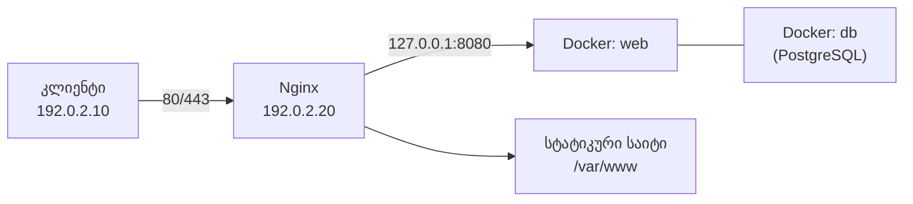

# არქიტექტურა

!!! warning "შენიშვნა"
    სასწავლო ლაბორატორიის აღწერაა და არა საჯარო production სისტემა (იხ. [მთავარი](index.md)). მისამართები: placeholder `192.0.2.x`.

## კომპონენტები და სტატუსი

| კომპონენტი | სტატუსი | წყარო |
|---|---|---|
| Ubuntu Server VM | 🧪 Lab | [Task 1](../tasks/task1.md) |
| SSH | 🧪 Lab | [Task 4](../tasks/task4.md) |
| ufw firewall | 🧪 Lab | [Task 7](../tasks/task7.md) |
| Nginx + საიტი | 🧪 Lab | [Task 8](../tasks/task8.md), [Task 9](../tasks/task9.md) |
| PostgreSQL | 🧪 Lab | [Task 10](../tasks/task10.md) |
| Docker app | 🧪 Lab | [Task 14](../tasks/task14.md), [Task 15](../tasks/task15.md) |
| Reverse proxy, self-signed TLS | 🧪 Lab | [Task 16](../tasks/task16.md), [Task 17](../tasks/task17.md) |
| Git და `deploy.sh` | 🧪 Lab | [Task 18](../tasks/task18.md), [Task 19](../tasks/task19.md) |
| Backup, cron, DR | 🧪 Lab | [Task 11](../tasks/task11.md), [Task 12](../tasks/task12.md), [Task 24](../tasks/task24.md) |
| Prometheus, Grafana | 🗓️ Planned | ჯერ არ გაკეთებულა |
| Ansible, certbot | 🗓️ Planned | ჯერ არ გაკეთებულა |

**რატომ ეს სქემა:** გარედან ხელმისაწვდომია მხოლოდ Nginx; აპლიკაცია `127.0.0.1`-ზეა მიბმული, ამიტომ პირდაპირ გარედან არ ჩანს. ეს არის უმარტივესი უსაფრთხო პრინციპი: ერთი შესასვლელი წერტილი.
