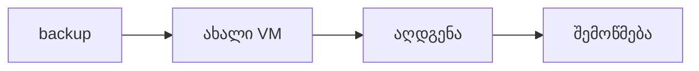

# Disaster Recovery

!!! warning "შენიშვნა"
    ლაბორატორიის აღწერა. იხ. [მთავარი](index.md).

| პრაქტიკა | სტატუსი | წყარო |
|---|---|---|
| `pg_dump`-ის აღდგენა ახალ VM-ზე | 🧪 Lab (Task 24-ის მიხედვით) | [Task 24](../tasks/task24.md) |
| ავტომატური DR ტესტები | 🗓️ Planned | ჯერ არ გაკეთებულა |

**რატომ ახალ VM-ზე:** მხოლოდ სუფთა გარემო ამოწმებს, რომ backup-ში ყველაფერია საჭირო.
