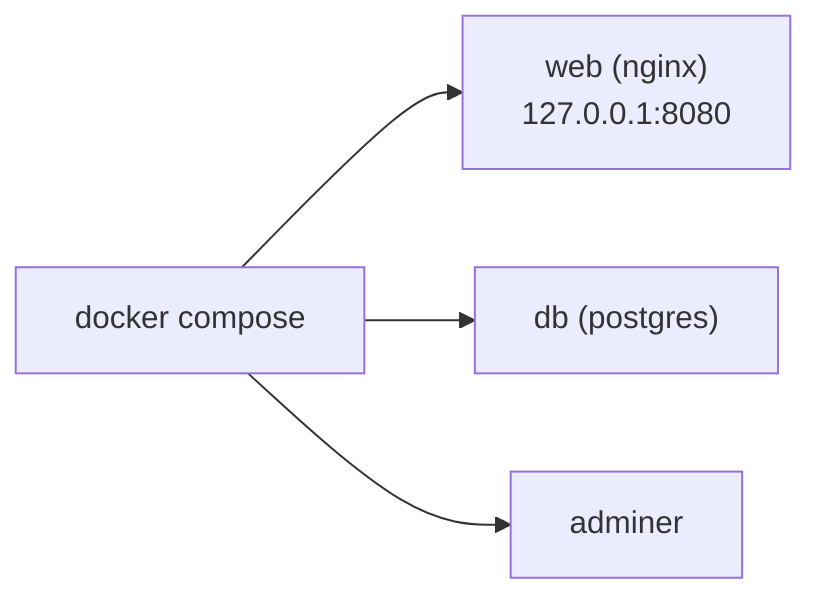

# Docker ინფრასტრუქტურა

!!! warning "შენიშვნა"
    ლაბორატორიის აღწერა; მისამართები placeholder. იხ. [მთავარი](index.md).

| პრაქტიკა | სტატუსი | წყარო |
|---|---|---|
| Docker ინსტალაცია | 🧪 Lab (Task 14) | [Task 14](../tasks/task14.md) |
| კონტეინერიზებული აპი (Compose) | 🧪 Lab (Task 15) | [Task 15](../tasks/task15.md) |
| `restart: unless-stopped` | 🧪 Lab (Task 15-ის მიხედვით) | [Task 15](../tasks/task15.md) |

**რატომ `127.0.0.1`:** პორტი მხოლოდ ლოკალურად ჩანს; გარედან წვდომა Nginx-ით არის კონტროლირებული.
