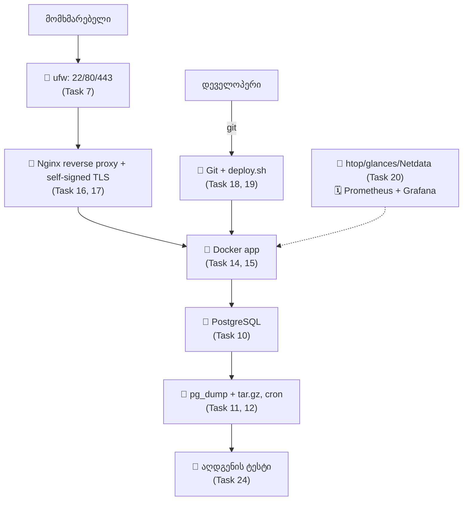

# Production არქიტექტურა (სასწავლო ლაბორატორია)

!!! warning "მნიშვნელოვანი შენიშვნა"
    ეს განყოფილება არის **სასწავლო ლაბორატორია და ცნობარი**. ის **არ ნიშნავს**, რომ რეალური საჯარო production სისტემა არის განთავსებული. ყველა მისამართი არის placeholder (`192.0.2.x`, `example.com`); ამ გვერდებზე არ არის საიდუმლო მონაცემები, გასაღებები ან ადმინისტრაციული ბმულები.

## სტატუსის აღნიშვნები

| ნიშანი | მნიშვნელობა |
|---|---|
| 🧪 **Lab (Task N)** | გაკეთდა ავტორის ლაბორატორიულ VM-ზე შესაბამისი Task-ის გვერდის მიხედვით. აქ ეწერია „Task N-ის მიხედვით“: ეს გვერდი VM-ს თავად არ ამოწმებს |
| 📘 **Documented example** | სახელმძღვანელო კონფიგურაცია, **არ არის განთავსებული** |
| 🗓️ **Planned** | დაგეგმილია, ჯერ არ გაკეთებულა |

## ზოგადი სქემა

## გვერდები

| გვერდი | თემა |
|---|---|
| [არქიტექტურა](architecture.md) | კომპონენტები და ნაკადები |
| [Linux სერვერი](linux-server.md) | ბაზა, მომხმარებლები, განახლებები |
| [ქსელი](networking.md) | მისამართები, firewall |
| [უსაფრთხოება](security.md) | SSH, fail2ban, აუდიტი |
| [Docker ინფრასტრუქტურა](docker-infrastructure.md) | კონტეინერები |
| [Nginx](nginx.md) | web server, reverse proxy, TLS |
| [CI/CD](cicd.md) | deploy სკრიპტი, pipeline |
| [მონიტორინგი](monitoring.md) | რესურსები |
| [ლოგირება](logging.md) | ლოგები |
| [Backup და აღდგენა](backup-recovery.md) | ბექაპი |
| [Disaster Recovery](disaster-recovery.md) | ავარიის ტესტი |
