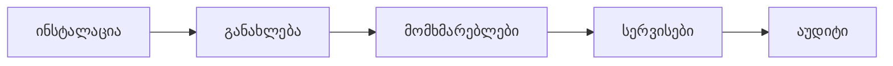

# Linux სერვერი

!!! warning "შენიშვნა"
    ლაბორატორიის აღწერა; მისამართები placeholder (`192.0.2.x`). იხ. [მთავარი](index.md).

| პრაქტიკა | სტატუსი | წყარო |
|---|---|---|
| Ubuntu Server ინსტალაცია | 🧪 Lab (Task 1) | [Task 1](../tasks/task1.md) |
| სისტემის განახლება | 🧪 Lab (Task 5) | [Task 5](../tasks/task5.md) |
| მომხმარებლები და უფლებები | 🧪 Lab (Task 6) | [Task 6](../tasks/task6.md) |
| დისკის მართვა | 🧪 Lab (Task 21) | [Task 21](../tasks/task21.md) |
| დროის სინქრონიზაცია (chrony) | 🧪 Lab (Task 23-ის მიხედვით) | [პრობლემების ცნობარი](../troubleshooting.md) |

**საფუძველი:** [Academy: Linux](../academy/linux/index.md).
