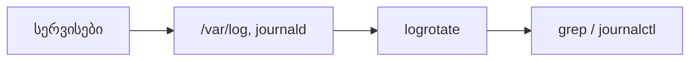

# ლოგირება

!!! warning "შენიშვნა"
    ლაბორატორიის აღწერა. იხ. [მთავარი](index.md).

| პრაქტიკა | სტატუსი | წყარო |
|---|---|---|
| ლოგების ანალიზი | 🧪 Lab (Task 13) | [Task 13](../tasks/task13.md) |
| logrotate | 🧪 Lab (Task 13/21-ის მიხედვით) | [Task 21](../tasks/task21.md) |

**საფუძველი:** [Cheat Sheet: ტექსტი და ძებნა](../linux/cheatsheet.md).
