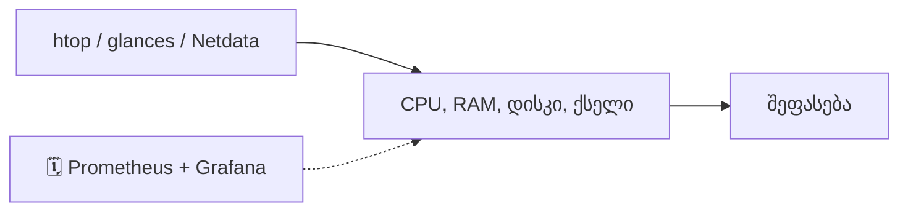

# მონიტორინგი

!!! warning "შენიშვნა"
    ლაბორატორიის აღწერა. იხ. [მთავარი](index.md).

| პრაქტიკა | სტატუსი | წყარო |
|---|---|---|
| htop, glances, Netdata | 🧪 Lab (Task 20) | [Task 20](../tasks/task20.md) |
| დისკის მონიტორინგი | 🧪 Lab (Task 21) | [Task 21](../tasks/task21.md) |
| Prometheus + Grafana | 🗓️ Planned | ჯერ არ გაკეთებულა |

