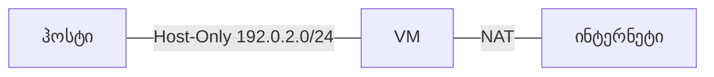

# ქსელი

!!! warning "შენიშვნა"
    ლაბორატორიის აღწერა; მისამართები placeholder (`192.0.2.x`). იხ. [მთავარი](index.md).

| პრაქტიკა | სტატუსი | წყარო |
|---|---|---|
| NAT + Host-Only ქსელი VirtualBox-ში | 🧪 Lab (Task 2) | [Task 2](../tasks/task2.md) |
| სტატიკური IP (netplan) | 🧪 Lab (Task 3) | [Task 3](../tasks/task3.md) |
| firewall (ufw) | 🧪 Lab (Task 7) | [Task 7](../tasks/task7.md) |
| ქსელის დიაგნოსტიკა | 🧪 Lab (Task 22) | [Task 22](../tasks/task22.md) |

**რატომ ორი ადაპტერი:** Host-Only იძლევა სტაბილურ მისამართს ჰოსტიდან SSH-ისთვის; NAT იძლევა ინტერნეტს განახლებებისთვის.
