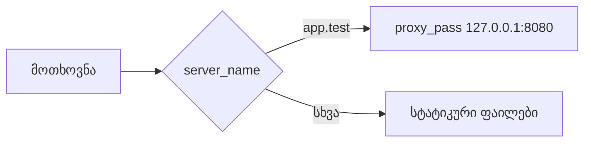

# Nginx

!!! warning "შენიშვნა"
    ლაბორატორიის აღწერა; `example.com` და `192.0.2.x` არის placeholder. იხ. [მთავარი](index.md).

| პრაქტიკა | სტატუსი | წყარო |
|---|---|---|
| Nginx ინსტალაცია | 🧪 Lab (Task 8) | [Task 8](../tasks/task8.md) |
| საიტის განთავსება | 🧪 Lab (Task 9) | [Task 9](../tasks/task9.md) |
| reverse proxy | 🧪 Lab (Task 16) | [Task 16](../tasks/task16.md) |
| TLS (`openssl req -x509`, self-signed) | 🧪 Lab (Task 17) | [Task 17](../tasks/task17.md) |
| HTTP→HTTPS redirect | 📘 Documented example | ქვემოთ |

```nginx
# 📘 დოკუმენტირებული მაგალითი (არ არის განთავსებული)
server {
    listen 80;
    server_name example.com;
    return 301 https://$host$request_uri;
}
```



**გაკვეთილი:** `curl -I` 200 OK არ ამტკიცებს სწორ საიტს; შეადარეთ `<title>` (იხ. Task 16).
