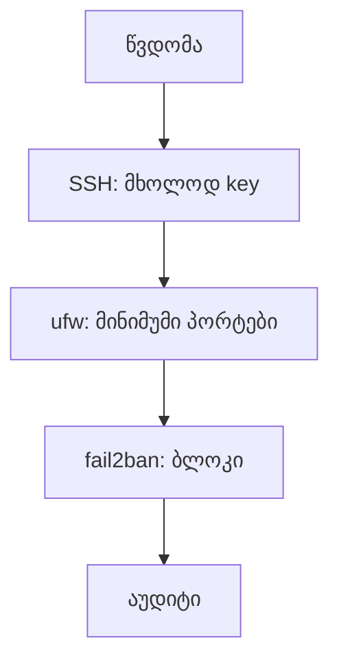

# უსაფრთხოება

!!! warning "შენიშვნა"
    ლაბორატორიის აღწერა. აქ არ არის გასაღებები, პაროლები ან ადმინისტრაციული მისამართები. იხ. [მთავარი](index.md).

| პრაქტიკა | სტატუსი | წყარო |
|---|---|---|
| SSH და key-ავტორიზაცია | 🧪 Lab (Task 4) | [Task 4](../tasks/task4.md) |
| ufw | 🧪 Lab (Task 7) | [Task 7](../tasks/task7.md) |
| უსაფრთხოების აუდიტი, fail2ban | 🧪 Lab (Task 23) | [Task 23](../tasks/task23.md) |
| TLS (self-signed) | 🧪 Lab (Task 17) | [Task 17](../tasks/task17.md) |
| Let's Encrypt / certbot | 🗓️ Planned | ჯერ არ გაკეთებულა |

**მთავარი გაკვეთილი:** ლოგებში მოცემული კონფიგი მტკიცებულება არ არის: `fail2ban` რეალურად გაიტესტა (იხ. Task 23).
