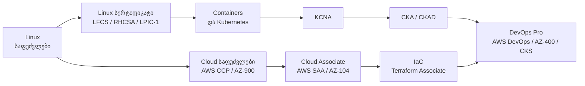

# სასწავლო რესურსები და სერტიფიკაციები

სად ვისწავლოთ DevOps/Linux/Cloud იაფად ან უფასოდ და რომელი სერტიფიკატები აღიარებულია საერთაშორისო ბაზარზე.

!!! warning "ფასების შესახებ"
    ფასები ხშირად იცვლება (აქციები, რეგიონული ფასი, კურსის ცვლილება). ქვემოთ მოცემული თანხები **მიახლოებითია** და 2026 წლის ღია წყაროებზეა დაფუძნებული; ზოგ ადგილას წყაროები ერთმანეთს ეწინააღმდეგება. გადახდამდე ყოველთვის გადაამოწმე ოფიციალურ გვერდზე.

## სწავლის გზა სერტიფიკაციამდე

**რატომ ეს თანმიმდევრობა:** ჯერ Linux და ქსელი (ჩვენი ამოცანები სწორედ ამას ფარავს), შემდეგ cloud და კონტეინერები, ბოლოს ავტომატიზაცია და სპეციალობა. ზედა დონის სერტიფიკატს ქვედა ცოდნა აქვს საფუძვლად.

## 1. უფასო პრაქტიკა და თამაშები

| რესურსი | რას გასწავლის | ფასი | შენიშვნა |
|---------|---------------|------|----------|
| [OverTheWire: Bandit](https://overthewire.org/wargames/bandit/) | Linux ბრძანებები, SSH, ფაილები, ქსელი თამაშის სახით | უფასო | საუკეთესო დასაწყისი ჩვენი Linux ბლოკის შემდეგ; დანარჩენი wargame-ები (Leviathan, Natas...) უსაფრთხოებაზეა |
| [Linux Journey](https://linuxjourney.com/) | Linux ნულიდან | უფასო | მოკლე გაკვეთილები |
| [roadmap.sh DevOps](https://roadmap.sh/devops) | სრული DevOps რუკა | უფასო | გეგმისთვის გამოსადეგია |
| [KillerCoda](https://killercoda.com/) | Kubernetes, Docker, Linux ინტერაქტიული ლაბები ბრაუზერში | უფასო (ლიმიტებით) | CKA/CKAD პრაქტიკა |
| [Play with Docker](https://labs.play-with-docker.com/) | Docker ბრაუზერში | უფასო | ინსტალაციის გარეშე |
| [SadServers](https://sadservers.com/) | გატეხილი სერვერების გამოსწორება | უფასო ნაწილი | troubleshooting უნარი |
| [GitLab University](https://university.gitlab.com/) | GitLab და CI/CD | უფასო კურსები | ჩვენი CI/CD ლექციებისთვის |
| [Microsoft Learn](https://learn.microsoft.com/training/) | Azure, DevOps | უფასო | სერტიფიკატის მზადებისთვის |
| [AWS Skill Builder](https://skillbuilder.aws/) | AWS | უფასო ბაზა + ფასიანი | Cloud Practitioner-ის მზადება |
| [Google Cloud Skills Boost](https://www.cloudskillsboost.google/) | GCP | ნაწილობრივ უფასო | |
| [TryHackMe](https://tryhackme.com/) / [HTB Academy](https://academy.hackthebox.com/) | უსაფრთხოება, Linux, ქსელი | უფასო დონე + გამოწერა | უსაფრთხოების მიმართულებისთვის |

## 2. ფასიანი კურსები: ეკონომიური არჩევანი

| პლატფორმა | რით კარგია | ფასი (მიახლოებით) |
|-----------|-----------|-------------------|
| [KodeKloud](https://kodekloud.com/) | DevOps ლაბები და კურსები, Kubernetes/Docker/Linux/Terraform პრაქტიკა ბრაუზერში; Kubernetes-ის გამოცდებისთვის სიმულატორი | წლიური გეგმა დაახლ. $250 (2026 წყაროებით; ფასი და აქციები ხშირად იცვლება, ამიტომ ოფიციალურ გვერდზე ნახე). ზოგი კურსი უფასოა |
| [Udemy](https://www.udemy.com/) | კონკრეტული თემა ერთჯერადად | ხშირად $10–20 აქციაზე; სიას ნუ იყიდი სრულ ფასად |
| [Coursera](https://www.coursera.org/) | სტრუქტურირებული პროგრამები (Google, IBM, Meta, AWS) | გამოწერა; ხშირად **ფინანსური დახმარება** (Financial Aid) ან 7 დღიანი უფასო პერიოდი |
| [freeCodeCamp](https://www.freecodecamp.org/) (YouTube) | გრძელი უფასო კურსები (Docker, K8s, Linux, Terraform) | უფასო |
| TechWorld with Nana, NetworkChuck (YouTube) | ადვილად გასაგები DevOps ვიდეოები | უფასო |
| [Linux Foundation Training](https://training.linuxfoundation.org/) | ოფიციალური კურსები (LFS101 Linux-ის შესავალი უფასოა edX-ზე) | შესავალი უფასო; სრული კურსი ფასიანი |

**რეკომენდაცია იაფად სწავლისთვის:** უფასო რესურსებით ისწავლე თეორია + ერთი ფასიანი ლაბ-პლატფორმა (KodeKloud) პრაქტიკისთვის + ერთი **გამოცდის** ვაუჩერი. გამოცდა ყველაზე ძვირი ნაწილია, ამიტომ მასზე წასვლა მხოლოდ მზადყოფნის შემდეგ.

## 3. სერტიფიკაციები, რომლებიც ბაზარზე აღიარებულია

### Linux

| სერტიფიკატი | გამცემი | ფორმატი | ფასი (მიახლოებით) |
|-------------|---------|---------|-------------------|
| **LFCS** (Linux Foundation Certified SysAdmin) | Linux Foundation | პრაქტიკული გამოცდა ტერმინალში | დაახლ. $395–445, ერთი უფასო ხელახალი ცდით |
| **RHCSA** | Red Hat | პრაქტიკული გამოცდა | ძვირია (დაახლ. $400–500+, ოფიციალურად გადაამოწმე) |
| **LPIC-1** | LPI | ორი ტესტური გამოცდა | დაახლ. $200 თითო |
| **CompTIA Linux+** | CompTIA | ტესტი + პრაქტიკული ელემენტები | დაახლ. $370 |

**რას ვირჩევ:** LFCS ან RHCSA, რადგან ისინი **პრაქტიკულია** (რეალური ტერმინალი), რაც ჩვენს VM ამოცანებთან ყველაზე ახლოსაა.

### Cloud

| სერტიფიკატი | დონე | ფასი (მიახლოებით) |
|-------------|------|-------------------|
| **AWS Cloud Practitioner** | საწყისი | დაახლ. $100 |
| **AWS Solutions Architect Associate** | საშუალო, ძალიან მოთხოვნადი | დაახლ. $150 |
| **AWS DevOps Engineer Professional** | მაღალი | დაახლ. $300 |
| **Azure AZ-900 / AZ-104 / AZ-400** | საწყისი / ადმინისტრირება / DevOps | AZ-900 დაახლ. $99; ფასი რეგიონის მიხედვით განსხვავდება |
| **Google Associate Cloud Engineer** | საშუალო | დაახლ. $125 |

### Kubernetes და Containers

| სერტიფიკატი | ფორმატი | ფასი (მიახლოებით) |
|-------------|---------|-------------------|
| **KCNA** | ტესტი, საწყისი | დაახლ. $250 |
| **CKA** (Certified Kubernetes Administrator) | პრაქტიკული, ტერმინალში | დაახლ. $395–445, ერთი უფასო ცდა და killer.sh სიმულაცია შედის |
| **CKAD** (Application Developer) | პრაქტიკული | იგივე დიაპაზონი |
| **CKS** (Security) | პრაქტიკული, CKA წინაპირობაა | იგივე დიაპაზონი |

### IaC, CI/CD, უსაფრთხოება

| სერტიფიკატი | გამცემი | ფასი (მიახლოებით) |
|-------------|---------|-------------------|
| **Terraform Associate** | HashiCorp | დაახლ. $70 (ყველაზე ხელმისაწვდომი ძლიერი სერტიფიკატი) |
| **GitLab Certified CI/CD Associate** | GitLab | გადაამოწმე ოფიციალურად; ჩვენი CI/CD ლექციებს უკავშირდება |
| **CompTIA Security+** | CompTIA | დაახლ. $400; უსაფრთხოების საბაზისო სერტიფიკატი |

## 4. რეკომენდებული გეგმა (ჩვენი კურსის შემდეგ)

| ეტაპი | რა | მიახლოებითი ხარჯი |
|-------|----|--------------------|
| 1 | Bandit (OverTheWire) + Linux Journey | $0 |
| 2 | ჩვენი 27 ამოცანა + ქვიზები (ამ საიტზე) | $0 |
| 3 | **Terraform Associate** (იაფი, გამოჩენადი CV-ში) | დაახლ. $70 |
| 4 | **AWS Cloud Practitioner** → **SAA** | დაახლ. $100 → $150 |
| 5 | **KCNA** → **CKA** (KodeKloud ლაბები + killer.sh) | დაახლ. $250 → $395–445 |
| 6 | **LFCS** (Linux-ის პრაქტიკული დადასტურება) | დაახლ. $395–445 |

**ხარჯის დასაზოგად:**

- ეძებე ფასდაკლების პერიოდები (Linux Foundation ხშირად აკეთებს აქციებს წლის განმავლობაში, განსაკუთრებით Black Friday და Cyber Monday-ზე).
- AWS და Microsoft ხშირად აძლევენ **უფასო/ფასდაკლებულ ვაუჩერებს** ღონისძიებებზე და მათ challenge-ებში.
- ერთ დროს ერთ სერტიფიკატს მოემზადე; მაშინვე ბევრის აღება ცოდნას აზიანებს.
- რეალური პრაქტიკა (როგორც ჩვენი VM და Task-ები) გამოცდაზე უფრო ღირებულია, ვიდრე მხოლოდ ვიდეოების ყურება.

## წყაროები

ფასების მიახლოებითი მონაცემები აღებულია ღია მიმოხილვებიდან და ერთმანეთისგან განსხვავდება, ამიტომ ისინი საორიენტაციოა:
[CKA ფასი 2026](https://tutorsbot.com/blog/cka-certification-cost-2026),
[DevOps სერტიფიკატები 2026](https://devopscube.com/devops-certifications/),
[DevOps სერტიფიკაციის რუკა](https://www.examcert.app/blog/devops-certification-roadmap-2026/),
[KodeKloud ფასების ისტორია](https://pricingsaas.com/companies/kodekloud).
ზუსტი ფასისთვის გამოიყენე გამცემის ოფიციალური გვერდი.
