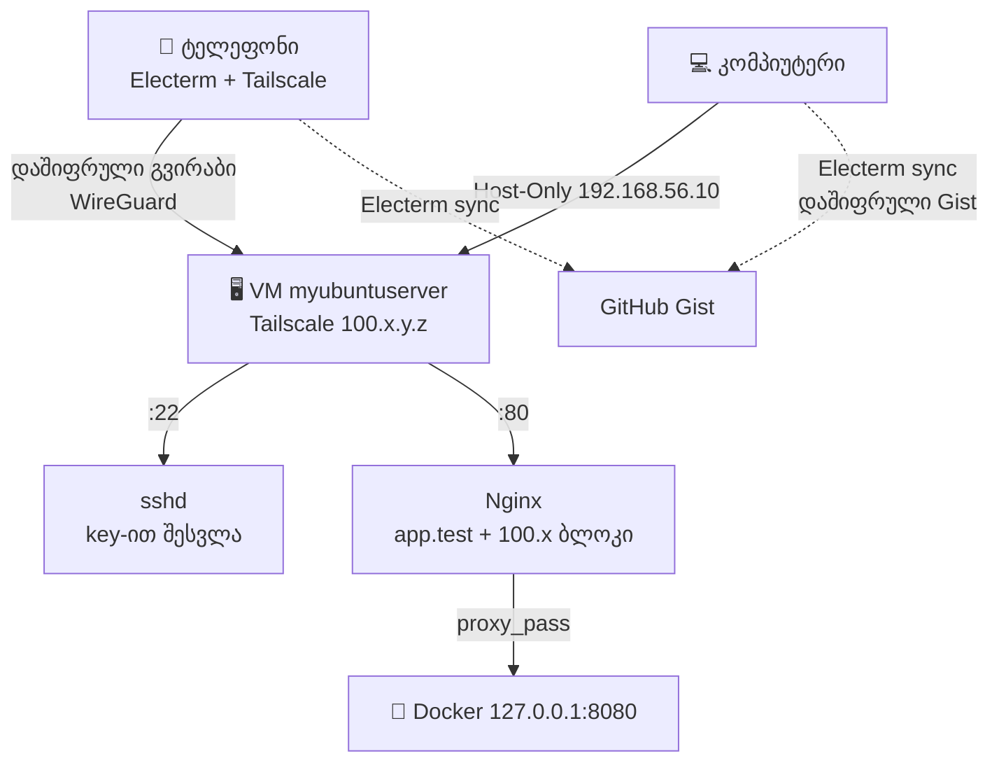

# ტელეფონიდან წვდომა VM-ზე (Tailscale + Electerm)

**მიზანი:** ტელეფონიდან (მობილური ინტერნეტით ან სხვა Wi-Fi-დან) ვუკავშირდებით VM-ს SSH-ით და ვხსნით მის ვებ-გვერდებს. ინტერნეტში არცერთი პორტი არ იხსნება.

## რატომ არ მუშაობს პირდაპირ
VM-ის მისამართი `192.168.56.10` Host-Only ქსელშია: ის მხოლოდ კომპიუტერის შიგნით არსებობს. ტელეფონს ამ ქსელთან კავშირი არ აქვს. გამოსავალი არის **Tailscale**: კერძო ქსელი (tailnet), რომელიც შენს მოწყობილობებს შორის დაშიფრულ გვირაბს ქმნის (WireGuard). VM-ზე Tailscale-ის დაყენებით VM ტელეფონისთვის ხილული ხდება მისამართზე `100.x.y.z`.



## ნაწილი 1: VM-ის ჩართვა tailnet-ში
VM-ში (`k@myubuntuserver`): <br>
```bash
curl -fsSL https://tailscale.com/install.sh | sh
sudo tailscale up
tailscale ip -4
```
`tailscale up` გამოიტანს ბმულს. გახსენი browser-ში და შედი **იმავე ანგარიშით**, რომლითაც ტელეფონზეა Tailscale. `tailscale ip -4` აჩვენებს მისამართს (ჩვენთან `100.x.y.z`). <br>

| ნაბიჯი | რატომ |
|--------|-------|
| Tailscale VM-ზე და არა კომპზე | კომპზე დაყენებისას `192.168.56.0/24`-ის გადაცემა ტელეფონისთვის subnet router-ს მოითხოვდა; VM-ზე ის პირდაპირ ხდება წევრი |
| იგივე ანგარიში | tailnet მხოლოდ ერთი ანგარიშის მოწყობილობებს აერთიანებს |
| ახალი firewall წესი არ არის | 22 და 80 უკვე ღიაა (Task 7), ტრაფიკი კი tailnet-ში მოდის და არა ინტერნეტიდან |

## ნაწილი 2: ვებ-გვერდი ტელეფონიდან
Nginx ბლოკს ირჩევს `Host` სათაურით, ხოლო ტელეფონი IP-ით შემოდის. ამიტომ Tailscale IP უნდა დაემატოს `app.test`-ის ბლოკის `server_name`-ს: <br>
```bash
sudo sed -i 's/server_name app.test;/server_name app.test 100.x.y.z;/' /etc/nginx/sites-available/mgawm
sudo nginx -t && sudo systemctl reload nginx
```
ტელეფონზე (Tailscale ჩართული) გახსენი `http://100.x.y.z/`: ჩანს „Docker App“. <br>

!!! tip "რატომ `http`, არა `https`"
    სერტიფიკატი (Task 17) `192.168.56.10`-ზეა გაცემული და 443 `mgawm`-ს აბრუნებს, ამიტომ Tailscale IP-ზე `https` გაფრთხილებას აჩვენებს და Docker-ის აპს არ გახსნის.

## ნაწილი 3: SSH ტელეფონიდან (Electerm)
პაროლით შესვლა გამორთულია (Task 4), ამიტომ იგივე SSH key გამოიყენება, რომელიც კომპზე გაქვს და რომლის public ნაწილი VM-ზე უკვე არის `authorized_keys`-ში. Electerm-ის **sync** ბუკმარკებს (key-ებთან ერთად) ტელეფონზე გადააქვს. <br>

### 3.1. Sync-ის მომზადება (GitHub Gist)
1. **Gist:** https://gist.github.com → ფაილი `electerm.json`, შიგთავსი `{}` → **Create secret gist**. მისამართის ბოლო გრძელი კოდი არის **Gist ID**.
2. **ტოკენი:** GitHub → Settings → Developer settings → Personal access tokens → **Tokens (classic)** → ახალი, scope **მხოლოდ `gist`**, ვადა მაგ. 90 დღე. fine-grained ტოკენები Gist-ს არ უჭერს მხარს.
3. **კომპზე:** Electerm → Settings → Sync → **github**: ტოკენი, Gist ID, **Encrypt Password** (გრძელი, 12+ სიმბოლო) → **Upload settings**.
4. **ტელეფონზე:** იგივე ტოკენი, იგივე Gist ID, **იგივე Encrypt Password** → **Download**.

!!! danger "უსაფრთხოება"
    - ტოკენი პაროლივით ეპყრობა: არავის გაუგზავნო და git-ში არ ატვირთო. გაჟონვისას წაშალე GitHub → Tokens-ში.
    - Gist-ში არ ჩაწერო ტოკენი: Gist-ის შიგთავსი ბმულით ხელმისაწვდომია, ტოკენი მხოლოდ Electerm-ის ველშია.
    - **Encrypt Password** იცავს Gist-ში ატვირთულ მონაცემებს (ბუკმარკები და პრივატული key). სუსტი პაროლი = სუსტი დაცვა. ორივე მოწყობილობაზე იგივე უნდა იყოს.
    - ტელეფონი დაბლოკე PIN/ბიომეტრიით: მასზე პრივატული key დევს. დაკარგვისას შეცვალე key და წაშალე ძველი public ხაზი `~/.ssh/authorized_keys`-იდან.

### 3.2. ახალი bookmark ტელეფონისთვის
კომპიდან ჩამოტვირთული bookmark-ი `192.168.56.10`-ზეა და ტელეფონზე არ იმუშავებს. შექმენი **ცალკე bookmark** (ძველი ხელუხლებელი დატოვე, რომ კომპზე არ დაგეკარგოს): <br>

| ველი | მნიშვნელობა |
|------|-------------|
| Host | `100.x.y.z` (VM-ის Tailscale IP) |
| Port | `22` |
| Username | `k` |
| Key | იგივე, რაც ჩამოიტვირთა sync-ით |

ტელეფონზე **Tailscale ჩართული უნდა იყოს**. კომპზე არ სჭირდება, რადგან `192.168.56.10` იქ პირდაპირ ჩანს. <br>

## რა პრობლემები შეგვხვდა
| სიმპტომი | მიზეზი | გამოსწორება |
|----------|--------|-------------|
| `Sync data error: status: 404 Not Found` | Gist ID არასწორია: ჩემი საილუსტრაციო მაგალითი ჩაიწერა და არა რეალური კოდი (ან ტოკენს არ აქვს `gist` scope) | ბრაუზერში გახსენი რეალური Gist, დააკოპირე მისამართიდან მხოლოდ ბოლო კოდი |
| Download-ზე 404, Upload ჯერ არ იყო | პირველად Upload ერთ მოწყობილობაზე უნდა გაკეთდეს | ჯერ კომპზე **Upload**, მერე ტელეფონზე **Download** |
| `timed out while waiting for handshake` | bookmark-ში `192.168.56.10` იყო (Host-Only ქსელი ტელეფონისთვის მიუწვდომელია) | ცალკე bookmark `100.x.y.z`-ზე, Tailscale ჩართული |
| `100.x` არ იხსნება ტელეფონზეც | ერთდროულად სხვა VPN მუშაობს და Tailscale გათიშულია (Android-ზე ერთი VPN) | გამორთე სხვა VPN, Tailscale ჩართე |

## სწრაფი შემოწმება
- ტელეფონის ბრაუზერში `http://100.x.y.z/` ხსნის Docker-ის აპს ✔
- Electerm-ის bookmark-იდან შედის ტერმინალში, `whoami` → `k`, `hostname` → `myubuntuserver` ✔
