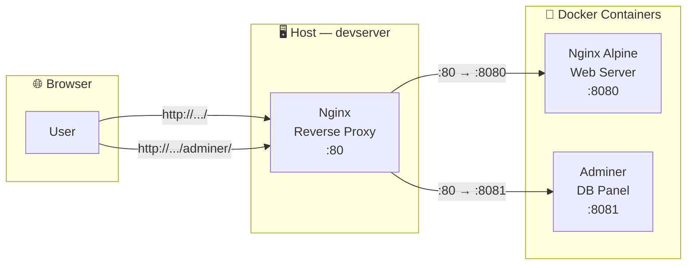
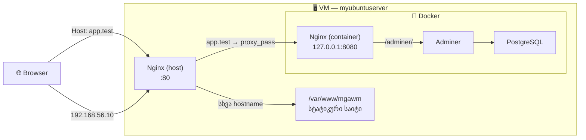
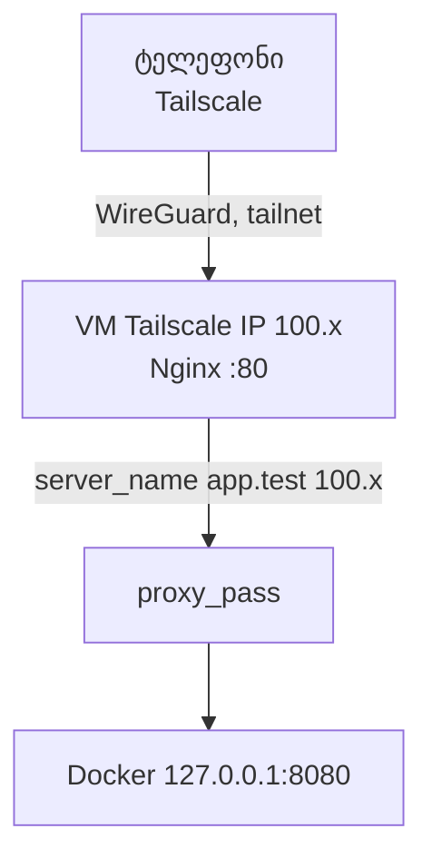

Task 16 — Reverse Proxy Configuration

!!! info "გვერდის ვერსიები"
    ქვემოთ ჯერ წინა ვერსიაა (ძველი VM, ერთი საიტი 80-ზე, Adminer 8081 პორტით). გვერდის ბოლოს არის **განახლებული ვერსია** ახალი სქემით: ცალკე hostname (`app.test`), `mgawm` საიტის შენარჩუნებით და დახურული Docker-ის პორტით.


## არქიტექტურა


ამ Task-მდე მომხმარებელს პორტის მითითება უწევდა (http://...:8080, http://...:8081). Reverse proxy-ით ყველაფერი სტანდარტულ 80 პორტზე ხელმისაწვდომია — URL path-ით განსხვავდება.

## წინაპირობა

Docker app უნდა იყოს გაშვებული:
```bash
cd ~/docker-app
docker compose ps
```
```console
NAME                   IMAGE                SERVICE   STATUS                   PORTS
docker-app-adminer-1   adminer:latest       adminer   Up 19 minutes            0.0.0.0:8081->8080/tcp
docker-app-db-1        postgres:16-alpine   db        Up 19 minutes (healthy)  5432/tcp
docker-app-web-1       nginx:alpine         web       Up 19 minutes            0.0.0.0:8080->80/tcp
```


> ✅ სამივე სერვისი `Up` სტატუსშია — შეგვიძლია გავაგრძელოთ.


## Reverse Proxy კონფიგურაციის შექმნა


ეს არის Host-ის Nginx-ის კონფიგურაცია (არა Docker-ის შიგნით არსებული Nginx-ის). Host-ის Nginx იღებს მოთხოვნებს 80 პორტზე და გადამისამართებს შესაბამის Docker კონტეინერზე.

```bash
sudo nano /etc/nginx/sites-available/docker-proxy
```


```nginx
server {
    listen 80;
    server_name _;

    location / {
        proxy_pass http://127.0.0.1:8080;
        proxy_set_header Host $host;
        proxy_set_header X-Real-IP $remote_addr;
        proxy_set_header X-Forwarded-For $proxy_add_x_forwarded_for;
        proxy_set_header X-Forwarded-Proto $scheme;
    }

    location /adminer/ {
        proxy_pass http://127.0.0.1:8081/;
        proxy_set_header Host $host;
        proxy_set_header X-Real-IP $remote_addr;
        proxy_set_header X-Forwarded-For $proxy_add_x_forwarded_for;
    }
}
```


### კონფიგურაციის განმარტება

**`server_name _;`** — ნებისმიერ hostname-ზე მოსულ მოთხოვნას დაამუშავებს (wildcard).

**`location /`** — მთავარ გვერდზე მოსული მოთხოვნა გადამისამართდება Docker-ის Nginx კონტეინერზე (`127.0.0.1:8080`).

**`location /adminer/`** — `/adminer/` path-ით მოსული მოთხოვნა გადამისამართდება Adminer კონტეინერზე (`127.0.0.1:8081`).

**`proxy_set_header` ჰედერები:**

| ჰედერი | დანიშნულება |
|--------|-------------|
| `Host` | ორიგინალი hostname გადაეცემა backend-ს |
| `X-Real-IP` | კლიენტის რეალური IP (არა proxy-ის) |
| `X-Forwarded-For` | მოთხოვნის მთელი გზა (proxy chain) |
| `X-Forwarded-Proto` | ორიგინალი პროტოკოლი (http/https) |

> 💡 **proxy_pass-ში trailing slash-ის მნიშვნელობა:** `http://127.0.0.1:8081/` (slash-ით) ნიშნავს რომ `/adminer/page` გადამისამართდება როგორც `/page` — ანუ path prefix-ი მოიჭრება. ეს Adminer-ის სწორად მუშაობისთვის აუცილებელია.


## საიტის ჩართვა

ძველი default კონფიგურაციის წაშლა და ახალის ჩართვა symbolic link-ით:

```bash
sudo rm /etc/nginx/sites-enabled/default
```
```bash
sudo ln -s /etc/nginx/sites-available/docker-proxy /etc/nginx/sites-enabled/
```

> 💡 Nginx-ის `sites-available` / `sites-enabled` სტრუქტურა Debian/Ubuntu-ს სპეციფიკაა. `sites-available`-ში ინახება ყველა კონფიგურაცია, `sites-enabled`-ში კი symlink-ები — მხოლოდ აქტიური საიტების.

---


## კონფიგურაციის შემოწმება და გამოყენება

ჯერ ვამოწმებთ სინტაქსს:

```bash
sudo nginx -t
```

```
nginx: the configuration file /etc/nginx/nginx.conf syntax is ok
nginx: configuration file /etc/nginx/nginx.conf test is successful
```

შემდეგ ვრესტარტავთ Nginx-ს:

```bash
sudo systemctl restart nginx
```

> ⚠️ **ყოველთვის გაუშვით `nginx -t` რესტარტამდე.** თუ კონფიგურაციაში შეცდომაა და პირდაპირ `restart`-ს გააკეთებთ, Nginx ვერ ჩაირთვება და საიტი დაეცემა.

```console
k@devserver:~/docker-app$ sudo nginx -t
nginx: the configuration file /etc/nginx/nginx.conf syntax is ok
nginx: configuration file /etc/nginx/nginx.conf test is successful
```


Nginx-ის გადატვირთვა
```bash
sudo systemctl restart nginx
```

Docker app რომ გაშვებულია, შეამოწმე:
```bash
bashcd ~/docker-app
docker compose ps
```

```console
k@devserver:~/docker-app$ cd ~/docker-app
k@devserver:~/docker-app$ docker compose ps
NAME                   IMAGE                COMMAND                  SERVICE   CREATED          STATUS                    PORTS
docker-app-adminer-1   adminer:latest       "entrypoint.sh docke…"   adminer   19 minutes ago   Up 19 minutes             0.0.0.0:8081->8080/tcp, [::]:8081->8080/tcp
docker-app-db-1        postgres:16-alpine   "docker-entrypoint.s…"   db        19 minutes ago   Up 19 minutes (healthy)   5432/tcp
docker-app-web-1       nginx:alpine         "/docker-entrypoint.…"   web       19 minutes ago   Up 19 minutes             0.0.0.0:8080->80/tcp, [::]:8080->80/tcp
k@devserver:~/docker-app$
```

Terminal-იდან (curl)

```bash
curl http://localhost
```

```html
<!DOCTYPE html>
<html lang="ka">
<head>
    <meta charset="UTF-8">
    <meta name="viewport" content="width=device-width, initial-scale=1.0">
    <title>Docker App</title>
    <style>
        * { margin: 0; padding: 0; box-sizing: border-box; }
        body {
            font-family: 'Segoe UI', sans-serif;
            background: #0f172a;
            color: #e2e8f0;
            min-height: 100vh;
            display: flex;
            align-items: center;
            justify-content: center;
        }
        .card {
            background: #1e293b;
            border-radius: 16px;
            padding: 2.5rem;
            max-width: 500px;
            width: 90%;
            box-shadow: 0 20px 60px rgba(0,0,0,0.5);
            text-align: center;
        }
        h1 { font-size: 1.8rem; margin-bottom: 0.5rem; }
        .emoji { font-size: 3rem; margin-bottom: 1rem; }
        .services {
            margin: 1.5rem 0;
            text-align: left;
        }
        .service {
            display: flex;
            align-items: center;
            gap: 0.75rem;
            padding: 0.8rem 1rem;
            margin: 0.5rem 0;
            background: #0f172a;
            border-radius: 10px;
        }
        .dot {
            width: 12px; height: 12px;
            background: #22c55e;
            border-radius: 50%;
            box-shadow: 0 0 8px rgba(34,197,94,0.5);
        }
        .btn {
            display: inline-block;
            margin-top: 1.5rem;
            padding: 0.7rem 1.5rem;
            background: #3b82f6;
            color: #fff;
            text-decoration: none;
            border-radius: 10px;
            font-weight: 600;
            transition: background 0.2s;
        }
        .btn:hover { background: #2563eb; }
        .footer { margin-top: 1.5rem; font-size: 0.8rem; color: #64748b; }
    </style>
</head>
<body>
    <div class="card">
        <div class="emoji">🐳</div>
        <h1>Docker App Running!</h1>
        <p>Nginx + PostgreSQL + Adminer</p>

        <div class="services">
            <div class="service">
                <div class="dot"></div>
                <span><strong>Nginx</strong> — Web Server (port 8080)</span>
            </div>
            <div class="service">
                <div class="dot"></div>
                <span><strong>PostgreSQL 16</strong> — Database</span>
            </div>
            <div class="service">
                <div class="dot"></div>
                <span><strong>Adminer</strong> — DB Management</span>
            </div>
        </div>

        <a href="/adminer/" class="btn">Open Adminer (DB Panel)</a>

        <div class="footer">
            Task 15 — Containerized Application ✅
        </div>
    </div>
</body>
</html>

```

> ✅ 80 პორტზე მოთხოვნამ Docker-ის Nginx კონტეინერიდან (8080) დააბრუნა HTML გვერდი.

### Browser-იდან

| URL | შედეგი |
|-----|--------|
| `http://192.168.56.101/` | Docker web app-ის გვერდი |
| `http://192.168.56.101/adminer/` | Adminer DB მართვის პანელი |

> ✅ ორივე მუშაობს სტანდარტულ 80 პორტზე — პორტის მითითება აღარ არის საჭირო.

---


## Reverse Proxy-ის კონცეფცია

Reverse proxy არის სერვერი რომელიც კლიენტის მოთხოვნებს იღებს და უკანა (backend) სერვერ(ებ)ზე ანაწილებს. კლიენტი არ იცის backend-ების არსებობის შესახებ — მხოლოდ proxy-ს ხედავს.

### რატომ გვჭირდება

- **პორტების დამალვა** — მომხმარებელი აღარ ხედავს `:8080`, `:8081` პორტებს
- **ერთიანი წვდომის წერტილი** — ყველაფერი ერთ მისამართზე, URL path-ით განსხვავებით
- **უსაფრთხოება** — backend სერვისები მხოლოდ `127.0.0.1`-ზე უსმენენ, გარედან პირდაპირ მიუწვდომელია
- **მომავალში** — SSL/TLS termination, load balancing, caching ყველაფერი proxy-ის დონეზე კეთდება

### ორი Nginx-ის თანაარსებობა

ამ კონფიგურაციაში ორი Nginx მუშაობს — ეს ხშირად დამაბნეველია:

```
Host Nginx (:80)  →  Docker Nginx (:8080)  →  Static files
                  →  Adminer (:8081)       →  DB Panel
```

**Host-ის Nginx** — reverse proxy-ის როლში, მოთხოვნებს ანაწილებს. **Docker-ის Nginx** — web server-ის როლში, სტატიკურ ფაილებს ასერვირებს. პროდაქშენში ეს ორი ხშირად ერთდება ერთ Nginx-ში, მაგრამ სასწავლო მიზნით ცალ-ცალკე კარგად აჩვენებს proxy-ისა და web server-ის განსხვავებას.

---

## განახლებული ვერსია: `app.test` virtual host და დახურული Docker-ის პორტი
ახალ VM-ზე (`myubuntuserver`, `192.168.56.10`) სიტუაცია შეიცვალა და ძველი სქემა აღარ გამოდგება: <br>
- VM-ის Nginx-ი 80-ზე უკვე ემსახურება `mgawm` საიტს (Task 9) და ძველი კონფიგურაცია, რომელიც `default`-ს ანაცვლებდა და `location /`-ს Docker-ზე გადამისამართებდა, ამ საიტს გააქრობდა
- Adminer-ს (Task 15-ის უსაფრთხო ვერსიაში) პორტი აღარ აქვს (`8081` აღარ არსებობს), `/adminer/`-ს Docker-ის Nginx თავად ამუშავებს

გამოსავალი: მოთხოვნებს Nginx **hostname-ით** ანაწილებს (name-based virtual host). `mgawm` რჩება ნაგულისხმევ საიტად, `app.test` კი Docker-ზე გადადის. <br>

### სქემა

ჯაჭვი: **browser → VM-ის Nginx → Docker-ის Nginx → Adminer → PostgreSQL**. VM-ის Nginx-ი ერთადერთი შესასვლელია. <br>

### 1. Proxy-ს კონფიგურაცია
```bash
sudo nano /etc/nginx/sites-available/docker-proxy
```
```nginx
server {
    listen 80;
    listen [::]:80;
    server_name app.test;

    location / {
        proxy_pass http://127.0.0.1:8080;
        proxy_set_header Host $host;
        proxy_set_header X-Real-IP $remote_addr;
        proxy_set_header X-Forwarded-For $proxy_add_x_forwarded_for;
        proxy_set_header X-Forwarded-Proto $scheme;
    }
}
```
| ხაზი | რატომ |
|------|-------|
| `server_name app.test` | Nginx ამ ბლოკს იყენებს მხოლოდ მაშინ, როცა მოთხოვნის `Host` ჰედერი `app.test`-ია. დანარჩენი მოთხოვნები (მაგალითად `192.168.56.10`) `mgawm`-ს მიდის |
| `proxy_pass http://127.0.0.1:8080` | Docker-ის კონტეინერი VM-ის შიგნით 8080-ზე უსმენს |
| `Host $host` | ორიგინალი hostname გადაეცემა backend-ს |
| `X-Real-IP`, `X-Forwarded-For` | backend-მა იცის კლიენტის რეალური IP (და არა proxy-ის) |
| `X-Forwarded-Proto` | backend-მა იცის, პირვანდელი პროტოკოლი http იყო თუ https |
| `/adminer/` ცალკე `location` არ გვაქვს | Docker-ის Nginx-ი `/adminer/`-ს თავად გადასცემს Adminer-ს, ამიტომ VM-ის Nginx-ს ორმაგი წესი არ სჭირდება |

### 2. ჩართვა
```bash
sudo ln -s /etc/nginx/sites-available/docker-proxy /etc/nginx/sites-enabled/
```
`mgawm` და სხვა ჩართული საიტი არ წაშალო. <br>
```bash
sudo nginx -t
```
უნდა დაწეროს `syntax is ok` და `test is successful`. <br>
```bash
sudo systemctl reload nginx
```
!!! note "რომელი საიტია ნაგულისხმევი"
    როცა `Host` არც ერთ `server_name`-ს არ ემთხვევა, Nginx პირველ ბლოკს იყენებს. `sites-enabled/` ანბანის რიგით იკითხება: `docker-proxy` ანბანით `mgawm`-მდეა, ამიტომ ის პირველი ბლოკი გამოდის. საიტის `server_name _;` ბლოკი (`mgawm`) რომ ნაგულისხმევი დარჩეს, ორივე `listen` ხაზში დაუმატე `default_server`: `listen 80 default_server;` და `listen [::]:80 default_server;`. ამის შემდეგ `192.168.56.10` ყოველთვის `mgawm`-ს აჩვენებს.

### 3. ტესტი VM-ში (`Host` ჰედერით, hostname-ის გარეშე)
```bash
curl -I -H "Host: app.test" http://localhost/
```
რეალური შედეგი: <br>
```text
$ curl -s -H "Host: app.test" http://localhost/ | head -n 5
<!DOCTYPE html>
<html lang="ka">
<head>
  <meta charset="UTF-8">
  <title>Docker App</title>
```
`<title>Docker App</title>` ნიშნავს, რომ პასუხი Docker-ის აპიდან მოდის (proxy მუშაობს). `mgawm`-ის სათაური განსხვავებულია. Adminer Adminer proxy-ით: <br>
```bash
curl -I -H "Host: app.test" http://localhost/adminer/
```
და `mgawm` არ გაფუჭებულა: <br>
```bash
curl -s -H "Host: 192.168.56.10" http://localhost/ | head -n 5
```

### 4. Hostname-ის მიბმა შენს კომპიუტერზე
browser-მა `app.test` უნდა გადაწყვიტოს VM-ის IP-ზე. host-ზე: <br>
```bash
echo "192.168.56.10 app.test" | sudo tee -a /etc/hosts
```
ახლა: <br>
- `http://app.test/` — Docker-ის აპლიკაცია, პორტის გარეშე
- `http://app.test/adminer/` — Adminer
- `http://192.168.56.10/` — `mgawm` (უცვლელი)

`.test` რეზერვირებული დომენია, რომელიც ინტერნეტში არასოდეს გამოიყენება, ამიტომ ლოკალური ტესტისთვის უსაფრთხოა. `.local` არ ავიღეთ, რადგან Linux-ზე mDNS-თან კონფლიქტობს და ნელა იხსნება. <br>

### 5. გამაგრება: Docker-ის პორტის დახურვა
ამჟამად აპლიკაცია ორი გზით ჩანს: proxy-ით და პირდაპირ `:8080`-ზე. რეალურ სერვერზე გარედან მხოლოდ proxy უნდა იყოს მისაწვდომი. `~/docker-app/docker-compose.yml`-ში `web`-ის `ports` შეცვალე: <br>
```yaml
    ports:
      - "127.0.0.1:8080:80"
```
```bash
cd ~/docker-app
docker compose up -d
```
`127.0.0.1:` პორტს მხოლოდ VM-ის შიგნით ტოვებს. ამის შემდეგ `http://192.168.56.10:8080/` აღარ უნდა პასუხობდეს, `http://app.test/` კი მუშაობს. <br>

რეალური შედეგი VM-ში (`docker compose ps`): <br>
```text
docker-app-web-1       nginx:alpine   ...   Up 16 seconds   127.0.0.1:8080->80/tcp
docker-app-adminer-1   adminer:latest ...   Up 4 minutes    8080/tcp
docker-app-db-1        postgres:16-alpine   Up 4 minutes (healthy)   5432/tcp
```
ჰოსტიდან: <br>
```text
$ curl -I http://app.test/
HTTP/1.1 200 OK
Content-Length: 599

$ curl -s http://app.test/ | grep -i "<title>"
  <title>Docker App</title>

$ curl -s http://192.168.56.10/ | grep -i "<title>"
    <title>მოდი! გეძახი ათას წლის მერე</title>

$ curl -I --max-time 3 http://192.168.56.10:8080/
curl: (28) Connection timed out after 3002 milliseconds
```
`app.test` პორტის გარეშე მუშაობს, პირდაპირი `:8080` კი დახურულია (timeout). ტესტი გაიარა. <br>

!!! warning "რატომ არ გვყოფნის UFW"
    Docker-ის გამოქვეყნებული პორტი UFW-ს წესებს გვერდს უვლის (Task 15), ამიტომ firewall-ით `8080` ვერ დაიხურება. ერთადერთი სწორი გზა პორტის `127.0.0.1`-ზე მიბმაა.

### თუ არ მუშაობს
| სიმპტომი | შესაძლო მიზეზი |
|----------|----------------|
| `502 Bad Gateway` | Docker კონტეინერი არ მუშაობს ან პორტი არასწორია: `docker compose ps` (ნაბიჯი 5-ის შემდეგ უნდა ჩანდეს `127.0.0.1:8080->80/tcp`) |
| `app.test` არ იხსნება browser-ში | `/etc/hosts`-ის ხაზი არ არის ან არასწორია: `ping app.test` |
| `app.test` გიჩვენებს `mgawm`-ს | `server_name` ან `Host` არ ემთხვევა: `sudo nginx -T \| grep server_name` |
| `app.test` პასუხობს, მაგრამ `Content-Length` და `<title>` `mgawm`-ისაა | proxy-ს `server` ბლოკი ფაქტობრივად არ არის ჩართულ ფაილში. შეამოწმე `cat -n /etc/nginx/sites-available/mgawm` და `ls -l /etc/nginx/sites-enabled/`; `curl -I` მარტო სტატუსს გვაჩვენებს და ამას ვერ გამოავლენს, ამიტომ შეადარე `<title>` |
| `nginx -t` ერორს წერს | სინტაქსი: `;`, `{}` ან `server_name` ხაზი |


## ბონუსი: წვდომა ტელეფონიდან Tailscale-ით

!!! success "სტატუსი"
    გატესტილია: ტელეფონიდან (Tailscale-ით) `http://100.x.y.z/` ხსნის Docker-ის აპს.

**რატომ:** `app.test` მხოლოდ ჰოსტზე მუშაობს (`/etc/hosts`), ხოლო `192.168.56.10` Host-Only ქსელია და ტელეფონისთვის მიუწვდომელია. Tailscale ქმნის კერძო ქსელს (tailnet) მოწყობილობებს შორის, ინტერნეტში პორტის გახსნის გარეშე.



### გზა A (არჩეული): Tailscale VM-ზე
VM თვითონ ხდება tailnet-ის წევრი, ამიტომ ჰოსტზე მარშრუტიზაცია არ გვჭირდება. <br>
```bash
curl -fsSL https://tailscale.com/install.sh | sh
sudo tailscale up
tailscale ip -4
```
`tailscale up` გამოიტანს ბმულს, ავტორიზაცია იმავე ანგარიშით, რაც ტელეფონზეა. <br>

Nginx-ში `app.test` ბლოკს დაუმატე VM-ის Tailscale IP: <br>
```nginx
server_name app.test 100.x.y.z;
```
```bash
sudo nginx -t && sudo systemctl reload nginx
```
ტელეფონზე ჩართე Tailscale და გახსენი `http://100.x.y.z/`. <br>

| გადაწყვეტილება | რატომ |
|----------------|-------|
| IP-ის დამატება `server_name`-ში | ტელეფონმა `app.test` არ იცის და Nginx-ი Host header-ით არჩევს ბლოკს; IP-ით მოსული მოთხოვნა სხვაგვარად `mgawm`-ზე მოხვდებოდა |
| Tailscale VM-ზე და არა ჰოსტზე | `192.168.56.0/24` tailnet-ში არ ჩანს; ჰოსტზე subnet router (`--advertise-routes`, IP forwarding, ადმინ-დამტკიცება) უფრო რთულია |
| ახალი ufw წესი არ არის | 80 უკვე ღიაა (Task 7), ინტერნეტში არაფერი იხსნება |

!!! warning "რეალური შეცდომა ტესტირებისას"
    პირველი ტესტი `200 OK`-ს აბრუნებდა და გავიფიქრეთ, რომ proxy მუშაობდა. სინამდვილეში `app.test`-ის ბლოკი `mgawm` ფაილში არ იყო და Nginx-ი ყველა Host-ზე `default` საიტს (`mgawm`) აბრუნებდა. განმასხვავებელი იყო `Content-Length` (3108 ნაცვლად 599) და `<title>`. გაკვეთილი: proxy-ს ტესტისას სტატუს კოდი არ კმარა, შეადარე გვერდის შიგთავსი.

### რეალური შედეგი
SSH ტელეფონიდან (Electerm-ის sync-ით) აღწერილია ცალკე: [ტელეფონიდან წვდომა](../setup/phone-access.md).

```text
$ tailscale ip -4
100.x.y.z

$ grep -n server_name /etc/nginx/sites-available/mgawm
4:    server_name _;
17:    server_name app.test 100.x.y.z;
31:    server_name _;

$ sudo nginx -t && sudo systemctl reload nginx
nginx: configuration file /etc/nginx/nginx.conf test is successful
```
ტელეფონზე Tailscale-ის ჩართვის შემდეგ `http://100.x.y.z/` აჩვენებს „Docker App“-ს, ანუ მოთხოვნა tailnet-ით VM-ის Nginx-ში მოდის და `app.test`-ის ბლოკზე მოხვდება. <br>

!!! tip "რატომ `http`"
    443-ის ბლოკი (Task 17) `mgawm`-ს აბრუნებს და სერტიფიკატი `192.168.56.10`-ზეა გაცემული, ამიტომ Tailscale IP-ზე `https` გაფრთხილებას აჩვენებს და Docker-ის აპს არ გახსნის. ამ ბონუსში გამოიყენე `http`.
