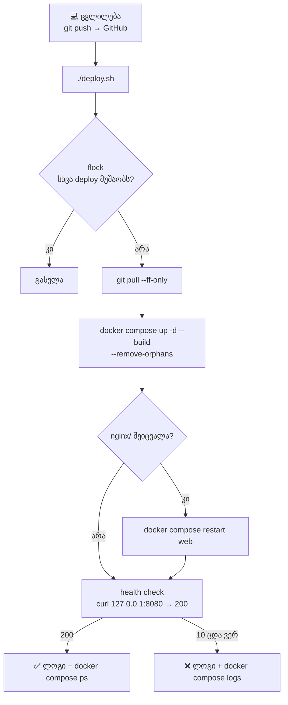

Task 19 — Deployment Script


სკრიპტის შექმნა:
```bash
nano ~/docker-app/deploy.sh
```

```bash
#!/bin/bash
set -euo pipefail

# ==============================
# CONFIG
# ==============================

APP_DIR="$HOME/docker-app"
LOG_FILE="$APP_DIR/deploy.log"

DATE=$(date "+%Y-%m-%d %H:%M:%S")

# Colors
RED="\033[0;31m"
GREEN="\033[0;32m"
YELLOW="\033[1;33m"
NC="\033[0m"

# ==============================
# FUNCTIONS
# ==============================

log() {
    local msg="$1"
    local file_msg="$2"

    echo -e "[$DATE] $msg"
    echo "[$DATE] $file_msg" >> "$LOG_FILE"
}

fail() {
    log "${RED}[ERROR]${NC} $1" "FAILED: $1"
    exit 1
}

# ==============================
# START
# ==============================

mkdir -p "$APP_DIR"
touch "$LOG_FILE"

cd "$APP_DIR" || fail "ვერ შევედი APP_DIR-ში"

log "${YELLOW}=== DEPLOY STARTED ===${NC}" "DEPLOY START"

# ==============================
# STEP 1: GIT PULL
# ==============================

log "${YELLOW}[1/4]${NC} Git pull..." "START: git pull"

if git remote | grep -q .; then
    git pull >> "$LOG_FILE" 2>&1 || fail "git pull ჩავარდა"
else
    log "${YELLOW}[SKIP]${NC} Git remote არ არის" "SKIP: no remote"
fi

log "${GREEN}[OK]${NC} კოდი განახლდა" "SUCCESS: git pull"

# ==============================
# STEP 2: STOP CONTAINERS
# ==============================

log "${YELLOW}[2/4]${NC} Containers stopping..." "START: docker down"

docker compose down >> "$LOG_FILE" 2>&1 || fail "docker down ჩავარდა"

log "${GREEN}[OK]${NC} გაჩერდა" "SUCCESS: containers stopped"

# ==============================
# STEP 3: BUILD / PULL
# ==============================

log "${YELLOW}[3/4]${NC} Pull & Build..." "START: build"

docker compose pull >> "$LOG_FILE" 2>&1 || fail "docker pull ჩავარდა"
docker compose build --no-cache >> "$LOG_FILE" 2>&1 || fail "docker build ჩავარდა"

log "${GREEN}[OK]${NC} Build დასრულდა" "SUCCESS: build complete"

# ==============================
# STEP 4: START
# ==============================

log "${YELLOW}[4/4]${NC} Starting containers..." "START: docker up"

docker compose up -d >> "$LOG_FILE" 2>&1 || fail "docker up ჩავარდა"

log "${GREEN}[OK]${NC} გაეშვა" "SUCCESS: containers started"

# ==============================
# STATUS
# ==============================

echo ""
echo "=========================================="
echo " Container Status"
echo "=========================================="
docker compose ps
echo ""

# ==============================
# DONE
# ==============================

log "${GREEN}=== DEPLOY FINISHED ===${NC}" "DEPLOY SUCCESS"

echo "=========================================="
echo -e " ${GREEN}DEPLOY COMPLETE${NC} — $DATE"
echo "=========================================="

```
## სკრიპტის ძირითადი ელემენტები

### `set -euo pipefail`

| ფლაგი | დანიშნულება |
|-------|-------------|
| `-e` | ნებისმიერი ბრძანების შეცდომისას სკრიპტი ჩერდება |
| `-u` | განუსაზღვრელი ცვლადის გამოყენებისას შეცდომა |
| `-o pipefail` | pipe-ში (`\|`) ნებისმიერი ბრძანების შეცდომა გადაეცემა |

ეს სამეული Bash სკრიპტების „უსაფრთხოების ქამარია" — ხელს უშლის ჩუმად ჩავარდნილ ბრძანებებს.

### `fail()` ფუნქცია

```bash
fail() {
    log "${RED}[ERROR]${NC} $1" "FAILED: $1"
    exit 1
}
```

ნებისმიერ ნაბიჯში `|| fail "..."` pattern-ით გამოიყენება. თუ ბრძანება ჩავარდა — ლოგში ჩაიწერება, ტერმინალში შეცდომა გამოჩნდება, სკრიპტი შეჩერდება.


### ლოგირება

სკრიპტი ორადგილას წერს output-ს: ტერმინალში ფერადი შეტყობინებებით, და `deploy.log` ფაილში timestamp-იანი ჩანაწერებით. `>> "$LOG_FILE" 2>&1` — stdout და stderr ორივე ლოგ ფაილში მიდის.

სკრიპტი რომ გახდეს გაშვებადი:
```bash
chmod +x ~/docker-app/deploy.sh
```

Git-ში დაამატე:
```bash
cd ~/docker-app
git add deploy.sh
git commit -m "Add deployment script"
```


```console
k@devserver:~/docker-app$ nano ~/docker-app/deploy.sh
k@devserver:~/docker-app$ chmod +x ~/docker-app/deploy.sh
k@devserver:~/docker-app$ cd ~/docker-app
k@devserver:~/docker-app$ git add deploy.sh
k@devserver:~/docker-app$ git commit -m "Add deployment script"
[master 7b45374] Add deployment script
 1 file changed, 77 insertions(+)
 create mode 100755 deploy.sh
k@devserver:~/docker-app$ ~/docker-app/deploy.sh
==========================================
 Deploy Started — 2026-02-10 19:53:25
==========================================
[1/4] Git pull...
k@devserver:~/docker-app$
```


## სკრიპტის გამოყენება

```bash
./deploy.sh
```

```console
k@devserver:~/docker-app$ chmod +x deploy.sh
k@devserver:~/docker-app$ ./deploy.sh
[2026-02-10 20:09:57] === DEPLOY STARTED ===
[2026-02-10 20:09:57] [1/4] Git pull...
[2026-02-10 20:09:57] [SKIP] Git remote არ არის
[2026-02-10 20:09:57] [OK] კოდი განახლდა
[2026-02-10 20:09:57] [2/4] Containers stopping...
[2026-02-10 20:09:57] [OK] გაჩერდა
[2026-02-10 20:09:57] [3/4] Pull & Build...
[2026-02-10 20:09:57] [OK] Build დასრულდა
[2026-02-10 20:09:57] [4/4] Starting containers...
[2026-02-10 20:09:57] [OK] გაეშვა

==========================================
 Container Status
==========================================
NAME                   IMAGE                COMMAND                  SERVICE   CREATED          STATUS                    PORTS
docker-app-adminer-1   adminer:latest       "entrypoint.sh docke…"   adminer   15 seconds ago   Up 7 seconds              0.0.0.0:8081->8080/tcp, [::]:8081->8080/tcp
docker-app-db-1        postgres:16-alpine   "docker-entrypoint.s…"   db        17 seconds ago   Up 10 seconds (healthy)   5432/tcp
docker-app-web-1       nginx:alpine         "/docker-entrypoint.…"   web       15 seconds ago   Up 2 seconds              0.0.0.0:8080->80/tcp, [::]:8080->80/tcp

[2026-02-10 20:09:57] === DEPLOY FINISHED ===
==========================================
 DEPLOY COMPLETE — 2026-02-10 20:09:57
==========================================
k@devserver:~/docker-app$
```

## ლოგების შემოწმება:
```bash
~/docker-app/deploy.log
```

შეგიძლია ნახო:
```bash
tail -f ~/docker-app/deploy.log
```

> 💡 `tail -f` real-time-ში აჩვენებს ლოგს. ახალი deploy-ის დროს მეორე ტერმინალში გაუშვით და მთელი პროცესი ცოცხლად დაინახავთ.

```console
k@devserver:~/docker-app$ tail -f ~/docker-app/deploy.log
 Container docker-app-db-1 Starting
 Container docker-app-db-1 Started
 Container docker-app-db-1 Waiting
 Container docker-app-adminer-1 Starting
 Container docker-app-adminer-1 Started
 Container docker-app-db-1 Healthy
 Container docker-app-web-1 Starting
 Container docker-app-web-1 Started
[2026-02-10 20:09:57] SUCCESS: containers started
[2026-02-10 20:09:57] DEPLOY SUCCESS
```


## შედეგები

### Deploy ავტომატიზაცია

ხელით deploy-ის დროს ყოველ ჯერზე 5-6 ბრძანების თანმიმდევრობით აკრეფა დაუშვებელია — ადვილია რომელიმე გამოტოვო ან არასწორი თანმიმდევრობით გაუშვა. სკრიპტი ამ პროცესს სტანდარტიზებულს და განმეორებადს ხდის.

### Error Handling pattern

`command || fail "message"` — Bash-ის იდიომატური pattern. ნიშნავს: „გაუშვი ბრძანება, თუ ჩავარდა — fail ფუნქცია გამოიძახე." `set -e`-სთან ერთად ეს ორმაგ დაცვას იძლევა.

### პირველი vs გაუმჯობესებული ვერსია

პირველი ვერსია ჩავარდა იმიტომ რომ `git pull` remote-ის გარეშე error-ს აბრუნებს და `set -e` სკრიპტს აჩერებს. ეს ტიპიური სიტუაციაა — სკრიპტი ყოველთვის „ბედნიერ გზას" ვერ გაივლის. გაუმჯობესებულ ვერსიაში defensive programming-ით (წინასწარი შემოწმებებით) ასეთი edge case-ები სწორად მუშავდება.

---

## განახლებული ვერსია: `deploy.sh` ახალ VM-ზე

ახალ VM-ზე ვიყენებთ უფრო მოკლე და უსაფრთხო სკრიპტს, რომელიც `~/docker-app`-ის repo-შია (`deploy.sh`). ის განსხვავდება ძველისგან: კონტეინერებს **არ ჩამოვხსნით**, არამედ `docker compose up -d` მხოლოდ შეცვლილს ქმნის თავიდან, ამიტომ საიტი ხელახლა გაშვებისას არ იკეტება. <br>

### სქემა


### რას აკეთებს ყველა ნაწილი და რატომ
| ნაწილი | რატომ |
|--------|-------|
| `set -euo pipefail` | სკრიპტი პირველივე შეცდომაზე ჩერდება: ცუდი `pull`-ის შემდეგ `docker compose up` აღარ გაეშვება |
| `flock -n` | ორი deploy ერთდროულად (ხელით + cron) ერთმანეთს არ დაუფუჭებს მდგომარეობას |
| `[ -f .env ] \|\| exit` | `.env` Git-ში არ არის (`.gitignore`); მის გარეშე DB-ს პაროლი ცარიელი იქნებოდა |
| `git pull --ff-only` | მხოლოდ სწორხაზოვანი განახლება; თუ სერვერზე ხელით ცვლილება გაკეთდა და კონფლიქტია, deploy ჩერდება და არ ქმნის უცნაურ merge-ს |
| `OLD`/`NEW` commit-ის შედარება | ლოგში ჩანს, რა იყო და რა გახდა; გამოიყენება იმის გასარკვევად, რა ფაილები შეიცვალა |
| `docker compose up -d --build --remove-orphans` | შეცვლილ სერვისს თავიდან ქმნის, დანარჩენს არ ეხება. `--build` მომავალში Dockerfile-ისთვის, `--remove-orphans` წაშლილ სერვისებს ასუფთავებს |
| `restart web` როცა `nginx/` შეიცვალა | `index.html` და `nginx.conf` კონტეინერში ფაილების სახით არის მიბმული (bind mount); compose მათი ცვლილების შიგთავსს ვერ ამჩნევს, ამიტომ `up -d` მარტო არ კმარა |
| health check (10 ცდა × 2წმ) | `up -d` ბრძანება წარმატებით დასრულდება მაშინაც, როცა აპი ვარდება. `curl` ამოწმებს, რომ რეალურად პასუხობს |
| ლოგი `~/deploy-docker-app.log` | deploy-ის ისტორია შეცდომის დროსაც ხელმისაწვდომია |

### მოთხოვნა: GitHub remote
`git pull`-ს remote სჭირდება. VM-ს ავუშვით **deploy key** (SSH გასაღები მხოლოდ ამ ერთი repo-სთვის):

```bash
ssh-keygen -t ed25519 -f ~/.ssh/github_docker_app -N "" -C "myubuntuserver-deploy"
```
საჯარო ნაწილი დავამატეთ GitHub-ზე: repo → Settings → Deploy keys (✔ Allow write access). `~/.ssh/config`-ში ალიასი: <br>
```text
Host github-docker-app
    HostName github.com
    User git
    IdentityFile ~/.ssh/github_docker_app
    IdentitiesOnly yes
```
| გადაწყვეტილება | რატომ |
|----------------|-------|
| deploy key და არა პირადი ტოკენი | გაჟონვისას მხოლოდ ეს ერთი repo დაზარალდება და არა მთელი GitHub ანგარიში |
| repo კერძოა | compose-ში კონფიგურაციის სტრუქტურა და სერვისები საჯარო არ უნდა იყოს |
| fingerprint-ის შემოწმება პირველ `ssh`-ზე | `SHA256:+DiY3wvv...CqU` ემთხვევა GitHub-ის ოფიციალურს, ე.ი. ნამდვილ GitHub-თან ვართ |

### რეალური შედეგები
**ტესტი 1: ცვლილება არ არის**
```text
$ ./deploy.sh
[2026-11-15 23:35:21] git pull origin/main (ახლა: 1e4d26a)
Already up to date.
[2026-11-15 23:35:23] ახალი commit არ არის
[2026-11-15 23:35:23] კონტეინერების rebuild/განახლება
 ✔ Container docker-app-web-1      Running
[2026-11-15 23:35:25] OK: http://127.0.0.1:8080/ -> 200 (1e4d26a)
```
კონტეინერები არ გადატვირთულა (`Running`), სკრიპტი უსაფრთხოდ გადის განმეორებით. <br>

**ტესტი 2: ცვლილება GitHub-იდან**
მეორე ასლიდან (`~/docker-app-edit`) `index.html`-ში დავამატეთ ხაზი და `git push`. შემდეგ: <br>
```text
$ ~/docker-app/deploy.sh
[2026-11-15 23:36:11] git pull origin/main (ახლა: ce2e325)
Updating ce2e325..e6fdfa1
Fast-forward
 nginx/index.html | 1 +
[2026-11-15 23:36:13] განახლდა: ce2e325 -> e6fdfa1
[2026-11-15 23:36:13] კონტეინერების rebuild/განახლება
[2026-11-15 23:36:14] nginx/ შეიცვალა -> web restart
 ✔ Container docker-app-web-1  Started
[2026-11-15 23:36:15] OK: http://127.0.0.1:8080/ -> 200 (e6fdfa1)

$ curl -s http://127.0.0.1:8080/ | grep "deploy test"
<p>deploy test</p>
```
`web` კონტეინერი ახალი შიგთავსით გადაიტვირთა, `curl` ახალ ხაზს აბრუნებს. სრული deploy ერთი ბრძანებით და ~4 წამში. <br>

!!! tip "რატომ არ გვეყო `docker compose up -d`"
    `up -d` კონტეინერს მხოლოდ მაშინ ქმნის თავიდან, როცა იცვლება compose ფაილი ან იმიჯი. bind-mount-ით მიბმული ფაილის ცვლილება ამას არ იწვევს, ამიტომ პირველი ცდისას გვერდი ძველად დარჩებოდა. სკრიპტი `git diff`-ით ამოწმებს, `nginx/` შეიცვალა თუ არა და მხოლოდ მაშინ აკეთებს `restart web`.

### შემდგომი გაუმჯობესებები
- **Rollback:** ჩავარდნისას `git reset --hard $OLD` და ხელახალი `up -d`, რომ საიტი ბოლო მუშა ვერსიაზე დაბრუნდეს.
- **ავტომატური გაშვება:** Task 9-ის მსგავსი polling (cron/systemd timer) ან GitHub webhook; VM ინტერნეტიდან მიუწვდომელია, ამიტომ polling უფრო რეალისტურია.
