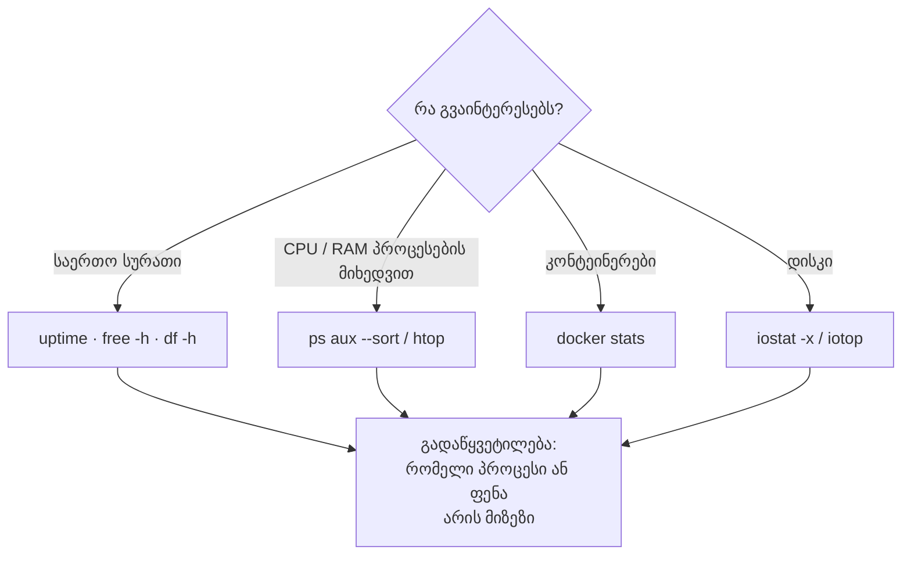

Task 20 — System Resource Monitoring


## htop-ის ინსტალაცია (რეკომენდებულია დამწყებთათვის):

### ინსტალაცია
```bash
sudo apt update
``
```bash
sudo apt install htop
```
### გამოყენება


```bash
htop
```

htop არის `top`-ის გაუმჯობესებული ვერსია — ფერადი, ინტერაქტიული ინტერფეისით.

### ძირითადი კლავიშები

| კლავიში | ფუნქცია |
|---------|---------|
| `F6` | სორტირება (CPU, MEM, TIME და სხვ.) |
| `F5` | ხის (tree) ხედი — parent/child პროცესები |
| `F9` | პროცესის kill |
| `F3` | პროცესის ძებნა |
| `F10` / `q` | გამოსვლა |

```console
k@devserver:~$ sudo apt update
Hit:1 https://download.docker.com/linux/ubuntu noble InRelease
Hit:2 http://ge.archive.ubuntu.com/ubuntu noble InRelease
Get:3 http://ge.archive.ubuntu.com/ubuntu noble-updates InRelease [126 kB]
Get:4 http://ge.archive.ubuntu.com/ubuntu noble-backports InRelease [126 kB]
Get:5 http://ge.archive.ubuntu.com/ubuntu noble-updates/main amd64 Packages [1,740 kB]
Get:6 http://ge.archive.ubuntu.com/ubuntu noble-updates/main amd64 Components [175 kB]
Get:7 http://ge.archive.ubuntu.com/ubuntu noble-updates/restricted amd64 Components [212 B]
Get:8 http://ge.archive.ubuntu.com/ubuntu noble-updates/universe amd64 Components [386 kB]
Get:9 http://ge.archive.ubuntu.com/ubuntu noble-updates/multiverse amd64 Components [940 B]
Get:10 http://ge.archive.ubuntu.com/ubuntu noble-backports/main amd64 Components [7,312 B]
Get:11 http://ge.archive.ubuntu.com/ubuntu noble-backports/restricted amd64 Components [216 B]
Get:12 http://ge.archive.ubuntu.com/ubuntu noble-backports/universe amd64 Components [10.5 kB]
Get:13 http://ge.archive.ubuntu.com/ubuntu noble-backports/multiverse amd64 Components [212 B]
Get:14 http://security.ubuntu.com/ubuntu noble-security InRelease [126 kB]
Get:15 http://security.ubuntu.com/ubuntu noble-security/main amd64 Components [21.5 kB]
Get:16 http://security.ubuntu.com/ubuntu noble-security/restricted amd64 Components [212 B]
Get:17 http://security.ubuntu.com/ubuntu noble-security/universe amd64 Components [74.2 kB]
Get:18 http://security.ubuntu.com/ubuntu noble-security/multiverse amd64 Components [212 B]
Fetched 2,795 kB in 6s (475 kB/s)
Reading package lists... Done
Building dependency tree... Done
Reading state information... Done
2 packages can be upgraded. Run 'apt list --upgradable' to see them.
k@devserver:~$ sudo apt install htop
Reading package lists... Done
Building dependency tree... Done
Reading state information... Done
htop is already the newest version (3.3.0-4build1).
0 upgraded, 0 newly installed, 0 to remove and 2 not upgraded.
```

### htop შედეგი

CPU-ს ყველაზე მეტად მოიხმარს Docker-ის daemon და containerd:
RAM-ის მიხედვით Docker daemon-ი ლიდერობს ~105MB-ით, containerd ~59MB-ით. სერვერის 7.76GB RAM-იდან მხოლოდ ~9.8% არის გამოყენებული — რესურსები საკმარისია.

```console
 72367 root        20   0 2511M  106M 65608 S   2.8  1.3  0:20.35 /usr/bin/dockerd -H fd:// --containerd=/run/containerd/containerd.sock
 123104 k           20   0 15288  8084  5888 S   2.8  0.1  0:29.07 sshd: k@pts/0
  75957 root        20   0 2257M 58800 35584 S   2.1  0.7  0:40.55 /usr/bin/containerd
 141499 k           20   0  9668  6148  4232 R   2.1  0.1  0:02.54 htop
  75861 root        20   0 2257M 58800 35584 S   1.4  0.7  0:37.86 /usr/bin/containerd
  78645 root        20   0 2511M  106M 65608 S   1.4  1.3  0:17.00 /usr/bin/dockerd -H fd:// --containerd=/run/containerd/containerd.sock
 123108 k           20   0  7340  3704  3444 S   1.4  0.0  0:20.80 bash -c while true; do sleep 1;head -v -n 8 /proc/meminfo; head -v -n 2 /proc/stat /proc/version /proc/uptime /proc/loadavg /proc/sys/fs/fi
 124538 root        20   0 1205M 12940  7732 S   1.4  0.2  0:04.60 /usr/bin/containerd-shim-runc-v2 -namespace moby -id 1470bd4e23f208e546b4a7f16bf87268c05472ee3d4a6017715b4654c6c10752 -address /run/contain
  72191 root        20   0 2257M 58800 35584 S   0.7  0.7  1:16.99 /usr/bin/containerd
  72193 root        20   0 2257M 58800 35584 S   0.7  0.7  0:32.06 /usr/bin/containerd
  72364 root        20   0 2511M  106M 65608 S   0.7  1.3  1:14.20 /usr/bin/dockerd -H fd:// --containerd=/run/containerd/containerd.sock
  75932 root        20   0 2257M 58800 35584 S   0.7  0.7  0:44.66 /usr/bin/containerd
 110379 root        20   0 1205M 12940  7732 S   0.7  0.2  0:17.77 /usr/bin/containerd-shim-runc-v2 -namespace moby -id 1470bd4e23f208e546b4a7f16bf87268c05472ee3d4a6017715b4654c6c10752 -address /run/contain
 110484 root        20   0 1204M 12480  7668 S   0.7  0.2  0:03.48 /usr/bin/containerd-shim-runc-v2 -namespace moby -id 31a8450ff79eb204df0c80f8fe4af0bcc11dd55c0ee4804e4c663a4c30119234 -address /run/contain
 110491 root        20   0 1204M 12480  7668 S   0.7  0.2  0:02.70 /usr/bin/containerd-shim-runc-v2 -namespace moby -id 31a8450ff79eb204df0c80f8fe4af0bcc11dd55c0ee4804e4c663a4c30119234 -address /run/contain
 110627 root        20   0 1204M 12184  7604 S   0.7  0.1  0:03.36 /usr/bin/containerd-shim-runc-v2 -namespace moby -id 8bb5ca247dfc9d93a817683d721b30aecede23aa4a1e98ef3ecdc697a807e31c -address /run/contain
 110630 root        20   0 1204M 12184  7604 S   0.7  0.1  0:03.54 /usr/bin/containerd-shim-runc-v2 -namespace moby -id 8bb5ca247dfc9d93a817683d721b30aecede23aa4a1e98ef3ecdc697a807e31c -address /run/contain
 110634 root        20   0 1204M 12184  7604 S   0.7  0.1  0:02.43 /usr/bin/containerd-shim-runc-v2 -namespace moby -id 8bb5ca247dfc9d93a817683d721b30aecede23aa4a1e98ef3ecdc697a807e31c -address /run/contain
 134282 root        20   0 2511M  106M 65608 S   0.7  1.3  0:05.42 /usr/bin/dockerd -H fd:// --containerd=/run/containerd/containerd.sock
      1 root        20   0 22832 14208  9768 S   0.0  0.2  0:42.28 /usr/lib/systemd/systemd --system --deserialize=59
    819 messagebus  20   0 10116  5884  4652 S   0.0  0.1  0:08.56 @dbus-daemon --system --address=systemd: --nofork --nopidfile --systemd-activation --syslog-only
    833 root        20   0 18160  8968  7840 S   0.0  0.1  0:02.85 /usr/lib/systemd/systemd-logind
    903 root        20   0  107M 23144 13688 S   0.0  0.3  0:00.59 /usr/bin/python3 /usr/share/unattended-upgrades/unattended-upgrade-shutdown --wait-for-signal
    958 root        20   0  107M 23144 13688 S   0.0  0.3  0:00.00 /usr/bin/python3 /usr/share/unattended-upgrades/unattended-upgrade-shutdown --wait-for-signal
    965 root        20   0  6824  2972  2728 S   0.0  0.0  0:00.26 /usr/sbin/cron -f -P
    975 root        20   0  6944  4884  4072 S   0.0  0.1  0:00.18 /bin/login -p --
   1006 k           20   0 20164 11124  9212 S   0.0  0.1  0:01.31 /usr/lib/systemd/systemd --user --deserialize=24
   1007 k           20   0 21152  3696  1972 S   0.0  0.0  0:00.00 (sd-pam)
   7361 root        20   0 12024  8264  7120 S   0.0  0.1  0:00.06 sshd: /usr/sbin/sshd -D [listener] 0 of 10-100 startups
  17839 root        20   0  306M  9500  7720 S   0.0  0.1  0:01.87 /usr/libexec/upowerd
```

htop გაჩვენებს F6 ის დახმარებით რა პროცესო მოიხმარს RAM მეტად. 

```console
 72363 root        20   0 2511M  105M 65608 S   0.0  1.3  0:00.67 /usr/bin/dockerd -H fd:// --containerd=/run/containerd/containerd.sock
  72364 root        20   0 2511M  105M 65608 S   0.7  1.3  1:15.44 /usr/bin/dockerd -H fd:// --containerd=/run/containerd/containerd.sock
  72365 root        20   0 2511M  105M 65608 S   0.0  1.3  0:27.24 /usr/bin/dockerd -H fd:// --containerd=/run/containerd/containerd.sock
  72366 root        20   0 2511M  105M 65608 S   0.0  1.3  0:17.02 /usr/bin/dockerd -H fd:// --containerd=/run/containerd/containerd.sock
  72367 root        20   0 2511M  105M 65608 S   0.7  1.3  0:21.11 /usr/bin/dockerd -H fd:// --containerd=/run/containerd/containerd.sock
  72368 root        20   0 2511M  105M 65608 S   0.0  1.3  0:00.00 /usr/bin/dockerd -H fd:// --containerd=/run/containerd/containerd.sock
  72369 root        20   0 2511M  105M 65608 S   0.0  1.3  0:00.04 /usr/bin/dockerd -H fd:// --containerd=/run/containerd/containerd.sock
  72370 root        20   0 2511M  105M 65608 S   0.0  1.3  0:00.01 /usr/bin/dockerd -H fd:// --containerd=/run/containerd/containerd.sock
  72371 root        20   0 2511M  105M 65608 S   0.0  1.3  0:09.09 /usr/bin/dockerd -H fd:// --containerd=/run/containerd/containerd.sock
  72392 root        20   0 2511M  105M 65608 S   1.4  1.3  0:18.52 /usr/bin/dockerd -H fd:// --containerd=/run/containerd/containerd.sock
  73467 root        20   0 2511M  105M 65608 S   0.0  1.3  0:14.61 /usr/bin/dockerd -H fd:// --containerd=/run/containerd/containerd.sock
  75860 root        20   0 2511M  105M 65608 S   0.0  1.3  0:28.56 /usr/bin/dockerd -H fd:// --containerd=/run/containerd/containerd.sock
  75887 root        20   0 2511M  105M 65608 S   0.0  1.3  0:12.73 /usr/bin/dockerd -H fd:// --containerd=/run/containerd/containerd.sock
  75888 root        20   0 2511M  105M 65608 S   0.0  1.3  0:24.33 /usr/bin/dockerd -H fd:// --containerd=/run/containerd/containerd.sock
  77158 root        20   0 2511M  105M 65608 S   0.0  1.3  0:16.42 /usr/bin/dockerd -H fd:// --containerd=/run/containerd/containerd.sock
  78645 root        20   0 2511M  105M 65608 S   0.0  1.3  0:17.64 /usr/bin/dockerd -H fd:// --containerd=/run/containerd/containerd.sock
 134282 root        20   0 2511M  105M 65608 S   1.4  1.3  0:06.37 /usr/bin/dockerd -H fd:// --containerd=/run/containerd/containerd.sock
  72189 root        20   0 2257M 58800 35584 S   0.0  0.7  0:00.12 /usr/bin/containerd
  72191 root        20   0 2257M 58800 35584 S   0.7  0.7  1:18.16 /usr/bin/containerd
  72192 root        20   0 2257M 58800 35584 S   1.4  0.7  0:29.87 /usr/bin/containerd
  72193 root        20   0 2257M 58800 35584 S   1.4  0.7  0:32.99 /usr/bin/containerd
  72195 root        20   0 2257M 58800 35584 S   0.0  0.7  0:00.02 /usr/bin/containerd
  72196 root        20   0 2257M 58800 35584 S   0.0  0.7  0:00.00 /usr/bin/containerd
```


## glances — სისტემის სრული გადახედვა


```bash
sudo apt install glances -y
```

> 💡 glances-ი Python-ზეა დაწერილი და ბევრ დამოკიდებულებას ითხოვს (~105 პაკეტი, ~464MB). htop-თან შედარებით მძიმეა, მაგრამ სამაგიეროდ გაცილებით მეტ ინფორმაციას აჩვენებს.


### გამოყენება

```bash
glances
```

### რას აჩვენებს glances (htop-თან შედარებით)

| მეტრიკა | htop | glances |
|---------|------|---------|
| CPU/RAM/Swap | ✅ | ✅ |
| პროცესების სია | ✅ | ✅ |
| Disk I/O | ❌ | ✅ |
| Network traffic | ❌ | ✅ |
| Docker containers | ❌ | ✅ |
| File system usage | ❌ | ✅ |
| Sensors (ტემპერატურა) | ❌ | ✅ |


glances-ის Docker სექციაში ჩვენი სამი კონტეინერი ჩანს:

```
CONTAINERS 3

Name                    Status   CPU%    MEM/MAX
docker-app-db-1        running   25.9   19.4M/7.76G
docker-app-adminer-1   running    0.0    8.35M/7.76G
docker-app-web-1       running    0.0    4.61M/7.76G
```

სისტემის ზოგადი სურათი:
- **CPU:** 28.4% დატვირთვა, 71.5% idle
- **RAM:** 781MB გამოყენებული 7.76GB-დან (9.8%)
- **Disk:** 8.37GB / 23.4GB (35.7%)
- **Load Average:** 0.50 / 0.54 / 0.54 (4 core-ზე — დაბალი დატვირთვა)


```console
k@devserver:~$ sudo apt install glances
Reading package lists... Done
Building dependency tree... Done
Reading state information... Done
The following additional packages will be installed:
  binutils binutils-common binutils-x86-64-linux-gnu blt cpp cpp-13 cpp-13-x86-64-linux-gnu cpp-x86-64-linux-gnu fonts-lyx g++ g++-13 g++-13-x86-64-linux-gnu g++-x86-64-linux-gnu gcc gcc-13 gcc-13-base
  gcc-13-x86-64-linux-gnu gcc-x86-64-linux-gnu isympy-common isympy3 javascript-common libasan8 libatomic1 libbinutils libblas3 libcc1-0 libctf-nobfd0 libctf0 libdouble-conversion3 libgcc-13-dev
  libgfortran5 libgomp1 libgprofng0 libgraphite2-3 libharfbuzz0b libhwasan0 libimagequant0 libisl23 libitm1 libjs-jquery libjs-jquery-ui liblapack3 liblbfgsb0 liblcms2-2 liblsan0 libmpc3 libopenjp2-7
  libqhull-r8.0 libquadmath0 libraqm0 libsframe1 libstdc++-13-dev libtk8.6 libtsan2 libubsan1 libwebpdemux2 libwebpmux3 libxft2 libxrender1 libxss1 lm-sensors python-matplotlib-data python3-appdirs
  python3-bottle python3-brotli python3-bs4 python3-contourpy python3-cssselect python3-cycler python3-decorator python3-defusedxml python3-docker python3-fonttools python3-fs python3-html5lib
  python3-influxdb python3-kiwisolver python3-lxml python3-lz4 python3-matplotlib python3-mpmath python3-msgpack python3-numpy python3-olefile python3-pil python3-pil.imagetk python3-ply python3-psutil
  python3-pycryptodome python3-pysmi python3-pysnmp4 python3-pystache python3-scipy python3-soupsieve python3-sympy python3-tk python3-ufolib2 python3-ujson python3-unicodedata2 python3-webencodings
  python3-websocket tk8.6-blt2.5 unicode-data x11-common
Suggested packages:
  binutils-doc gprofng-gui blt-demo cpp-doc gcc-13-locales cpp-13-doc g++-multilib g++-13-multilib gcc-13-doc gcc-multilib make autoconf automake libtool flex bison gdb gcc-doc gcc-13-multilib
  gdb-x86-64-linux-gnu glances-doc python3-pynvml libjs-jquery-ui-docs liblcms2-utils libstdc++-13-doc tk8.6 fancontrol read-edid i2c-tools python-cycler-doc python3-genshi python-lxml-doc
  cm-super-minimal dvipng ffmpeg fonts-staypuft ghostscript gir1.2-gtk-3.0 inkscape ipython3 librsvg2-common python3-cairocffi python3-gi-cairo python3-gobject python3-pyqt5 python3-sip python3-tornado
  texlive-extra-utils texlive-latex-extra python-mpmath-doc python3-gmpy2 gfortran python3-dev python3-pytest python-pil-doc python-ply-doc python-scipy-doc texlive-fonts-extra python-sympy-doc tix
  python3-tk-dbg
The following NEW packages will be installed:
  binutils binutils-common binutils-x86-64-linux-gnu blt cpp cpp-13 cpp-13-x86-64-linux-gnu cpp-x86-64-linux-gnu fonts-lyx g++ g++-13 g++-13-x86-64-linux-gnu g++-x86-64-linux-gnu gcc gcc-13 gcc-13-base
  gcc-13-x86-64-linux-gnu gcc-x86-64-linux-gnu glances isympy-common isympy3 javascript-common libasan8 libatomic1 libbinutils libblas3 libcc1-0 libctf-nobfd0 libctf0 libdouble-conversion3 libgcc-13-dev
  libgfortran5 libgomp1 libgprofng0 libgraphite2-3 libharfbuzz0b libhwasan0 libimagequant0 libisl23 libitm1 libjs-jquery libjs-jquery-ui liblapack3 liblbfgsb0 liblcms2-2 liblsan0 libmpc3 libopenjp2-7
  libqhull-r8.0 libquadmath0 libraqm0 libsframe1 libstdc++-13-dev libtk8.6 libtsan2 libubsan1 libwebpdemux2 libwebpmux3 libxft2 libxrender1 libxss1 lm-sensors python-matplotlib-data python3-appdirs
  python3-bottle python3-brotli python3-bs4 python3-contourpy python3-cssselect python3-cycler python3-decorator python3-defusedxml python3-docker python3-fonttools python3-fs python3-html5lib
  python3-influxdb python3-kiwisolver python3-lxml python3-lz4 python3-matplotlib python3-mpmath python3-msgpack python3-numpy python3-olefile python3-pil python3-pil.imagetk python3-ply python3-psutil
  python3-pycryptodome python3-pysmi python3-pysnmp4 python3-pystache python3-scipy python3-soupsieve python3-sympy python3-tk python3-ufolib2 python3-ujson python3-unicodedata2 python3-webencodings
  python3-websocket tk8.6-blt2.5 unicode-data x11-common
0 upgraded, 105 newly installed, 0 to remove and 2 not upgraded.
Need to get 122 MB of archives.
After this operation, 464 MB of additional disk space will be used.
Do you want to continue? [Y/n] Y
Get:1 http://ge.archive.ubuntu.com/ubuntu noble/main amd64 python3-defusedxml all 0.7.1-2 [42.0 kB]
Get:2 http://ge.archive.ubuntu.com/ubuntu noble/main amd64 python3-psutil amd64 5.9.8-2build2 [195 kB]
Get:3 http://ge.archive.ubuntu.com/ubuntu noble/universe amd64 libdouble-conversion3 amd64 3.3.0-1build1 [40.3 kB]
Get:4 http://ge.archive.ubuntu.com/ubuntu noble/universe amd64 python3-ujson amd64 5.9.0-1build1 [25.3 kB]
Get:5 http://ge.archive.ubuntu.com/ubuntu noble/universe amd64 glances all 3.4.0.3+dfsg-1 [294 kB]
Get:6 http://ge.archive.ubuntu.com/ubuntu noble-updates/main amd64 binutils-common amd64 2.42-4ubuntu2.8 [240 kB]
Get:7 http://ge.archive.ubuntu.com/ubuntu noble-updates/main amd64 libsframe1 amd64 2.42-4ubuntu2.8 [15.6 kB]
Get:8 http://ge.archive.ubuntu.com/ubuntu noble-updates/main amd64 libbinutils amd64 2.42-4ubuntu2.8 [576 kB]
Get:9 http://ge.archive.ubuntu.com/ubuntu noble-updates/main amd64 libctf-nobfd0 amd64 2.42-4ubuntu2.8 [97.9 kB]
Get:10 http://ge.archive.ubuntu.com/ubuntu noble-updates/main amd64 libctf0 amd64 2.42-4ubuntu2.8 [94.5 kB]
Get:11 http://ge.archive.ubuntu.com/ubuntu noble-updates/main amd64 libgprofng0 amd64 2.42-4ubuntu2.8 [849 kB]
Get:12 http://ge.archive.ubuntu.com/ubuntu noble-updates/main amd64 binutils-x86-64-linux-gnu amd64 2.42-4ubuntu2.8 [2,463 kB]
Get:13 http://ge.archive.ubuntu.com/ubuntu noble-updates/main amd64 binutils amd64 2.42-4ubuntu2.8 [18.1 kB]
Get:14 http://ge.archive.ubuntu.com/ubuntu noble/main amd64 libxrender1 amd64 1:0.9.10-1.1build1 [19.0 kB]
Get:15 http://ge.archive.ubuntu.com/ubuntu noble/main amd64 libxft2 amd64 2.3.6-1build1 [45.3 kB]
Get:16 http://ge.archive.ubuntu.com/ubuntu noble/main amd64 x11-common all 1:7.7+23ubuntu3 [21.7 kB]
Get:17 http://ge.archive.ubuntu.com/ubuntu noble/main amd64 libxss1 amd64 1:1.2.3-1build3 [7,204 B]
Get:18 http://ge.archive.ubuntu.com/ubuntu noble/main amd64 libtk8.6 amd64 8.6.14-1build1 [779 kB]
Ign:18 http://ge.archive.ubuntu.com/ubuntu noble/main amd64 libtk8.6 amd64 8.6.14-1build1
Get:19 http://ge.archive.ubuntu.com/ubuntu noble/main amd64 tk8.6-blt2.5 amd64 2.5.3+dfsg-7build1 [630 kB]
Get:20 http://ge.archive.ubuntu.com/ubuntu noble/main amd64 blt amd64 2.5.3+dfsg-7build1 [4,840 B]
Get:21 http://ge.archive.ubuntu.com/ubuntu noble-updates/main amd64 gcc-13-base amd64 13.3.0-6ubuntu2~24.04 [51.5 kB]
Get:22 http://ge.archive.ubuntu.com/ubuntu noble-updates/main amd64 libisl23 amd64 0.26-3build1.1 [680 kB]
Get:23 http://ge.archive.ubuntu.com/ubuntu noble-updates/main amd64 libmpc3 amd64 1.3.1-1build1.1 [54.6 kB]
Get:24 http://ge.archive.ubuntu.com/ubuntu noble-updates/main amd64 cpp-13-x86-64-linux-gnu amd64 13.3.0-6ubuntu2~24.04 [10.7 MB]
Get:25 http://ge.archive.ubuntu.com/ubuntu noble-updates/main amd64 cpp-13 amd64 13.3.0-6ubuntu2~24.04 [1,038 B]
Get:26 http://ge.archive.ubuntu.com/ubuntu noble/main amd64 cpp-x86-64-linux-gnu amd64 4:13.2.0-7ubuntu1 [5,326 B]
Get:27 http://ge.archive.ubuntu.com/ubuntu noble/main amd64 cpp amd64 4:13.2.0-7ubuntu1 [22.4 kB]
Get:28 http://ge.archive.ubuntu.com/ubuntu noble/universe amd64 fonts-lyx all 2.4.0~RC3-1build4 [171 kB]
Get:29 http://ge.archive.ubuntu.com/ubuntu noble-updates/main amd64 libcc1-0 amd64 14.2.0-4ubuntu2~24.04 [48.0 kB]
Get:30 http://ge.archive.ubuntu.com/ubuntu noble-updates/main amd64 libgomp1 amd64 14.2.0-4ubuntu2~24.04 [148 kB]
Get:31 http://ge.archive.ubuntu.com/ubuntu noble-updates/main amd64 libitm1 amd64 14.2.0-4ubuntu2~24.04 [29.7 kB]
Get:32 http://ge.archive.ubuntu.com/ubuntu noble-updates/main amd64 libatomic1 amd64 14.2.0-4ubuntu2~24.04 [10.5 kB]
Get:33 http://ge.archive.ubuntu.com/ubuntu noble-updates/main amd64 libasan8 amd64 14.2.0-4ubuntu2~24.04 [3,031 kB]
Get:34 http://ge.archive.ubuntu.com/ubuntu noble-updates/main amd64 liblsan0 amd64 14.2.0-4ubuntu2~24.04 [1,322 kB]
Get:35 http://ge.archive.ubuntu.com/ubuntu noble-updates/main amd64 libtsan2 amd64 14.2.0-4ubuntu2~24.04 [2,772 kB]
Get:36 http://ge.archive.ubuntu.com/ubuntu noble-updates/main amd64 libubsan1 amd64 14.2.0-4ubuntu2~24.04 [1,184 kB]
Ign:36 http://ge.archive.ubuntu.com/ubuntu noble-updates/main amd64 libubsan1 amd64 14.2.0-4ubuntu2~24.04
Get:37 http://ge.archive.ubuntu.com/ubuntu noble-updates/main amd64 libhwasan0 amd64 14.2.0-4ubuntu2~24.04 [1,641 kB]
Get:38 http://ge.archive.ubuntu.com/ubuntu noble-updates/main amd64 libquadmath0 amd64 14.2.0-4ubuntu2~24.04 [153 kB]
Get:39 http://ge.archive.ubuntu.com/ubuntu noble-updates/main amd64 libgcc-13-dev amd64 13.3.0-6ubuntu2~24.04 [2,681 kB]
Get:40 http://ge.archive.ubuntu.com/ubuntu noble-updates/main amd64 gcc-13-x86-64-linux-gnu amd64 13.3.0-6ubuntu2~24.04 [21.1 MB]
Get:41 http://ge.archive.ubuntu.com/ubuntu noble-updates/main amd64 gcc-13 amd64 13.3.0-6ubuntu2~24.04 [494 kB]
Get:42 http://ge.archive.ubuntu.com/ubuntu noble/main amd64 gcc-x86-64-linux-gnu amd64 4:13.2.0-7ubuntu1 [1,212 B]
Get:43 http://ge.archive.ubuntu.com/ubuntu noble/main amd64 gcc amd64 4:13.2.0-7ubuntu1 [5,018 B]
Get:44 http://ge.archive.ubuntu.com/ubuntu noble-updates/main amd64 libstdc++-13-dev amd64 13.3.0-6ubuntu2~24.04 [2,420 kB]
Get:45 http://ge.archive.ubuntu.com/ubuntu noble-updates/main amd64 g++-13-x86-64-linux-gnu amd64 13.3.0-6ubuntu2~24.04 [12.2 MB]
Get:46 http://ge.archive.ubuntu.com/ubuntu noble-updates/main amd64 g++-13 amd64 13.3.0-6ubuntu2~24.04 [16.1 kB]
Get:47 http://ge.archive.ubuntu.com/ubuntu noble/main amd64 g++-x86-64-linux-gnu amd64 4:13.2.0-7ubuntu1 [964 B]
Get:48 http://ge.archive.ubuntu.com/ubuntu noble/main amd64 g++ amd64 4:13.2.0-7ubuntu1 [1,100 B]
Get:49 http://ge.archive.ubuntu.com/ubuntu noble/universe amd64 isympy-common all 1.12-7 [109 kB]
Get:50 http://ge.archive.ubuntu.com/ubuntu noble/universe amd64 python3-mpmath all 1.2.1-3 [421 kB]
Get:51 http://ge.archive.ubuntu.com/ubuntu noble/universe amd64 python3-sympy all 1.12-7 [3,966 kB]
Get:52 http://ge.archive.ubuntu.com/ubuntu noble/universe amd64 isympy3 all 1.12-7 [3,136 B]
Get:53 http://ge.archive.ubuntu.com/ubuntu noble/main amd64 javascript-common all 11+nmu1 [5,936 B]
Get:54 http://ge.archive.ubuntu.com/ubuntu noble-updates/main amd64 libblas3 amd64 3.12.0-3build1.1 [238 kB]
Get:55 http://ge.archive.ubuntu.com/ubuntu noble-updates/main amd64 libgfortran5 amd64 14.2.0-4ubuntu2~24.04 [916 kB]
Ign:55 http://ge.archive.ubuntu.com/ubuntu noble-updates/main amd64 libgfortran5 amd64 14.2.0-4ubuntu2~24.04
Get:56 http://ge.archive.ubuntu.com/ubuntu noble/main amd64 libgraphite2-3 amd64 1.3.14-2build1 [73.0 kB]
Get:57 http://ge.archive.ubuntu.com/ubuntu noble/main amd64 libharfbuzz0b amd64 8.3.0-2build2 [469 kB]
Get:58 http://ge.archive.ubuntu.com/ubuntu noble/main amd64 libimagequant0 amd64 2.18.0-1build1 [36.3 kB]
Get:59 http://ge.archive.ubuntu.com/ubuntu noble/main amd64 libjs-jquery all 3.6.1+dfsg+~3.5.14-1 [328 kB]
Get:60 http://ge.archive.ubuntu.com/ubuntu noble/universe amd64 libjs-jquery-ui all 1.13.2+dfsg-1 [252 kB]
Get:61 http://ge.archive.ubuntu.com/ubuntu noble-updates/main amd64 liblapack3 amd64 3.12.0-3build1.1 [2,646 kB]
Get:62 http://ge.archive.ubuntu.com/ubuntu noble/universe amd64 liblbfgsb0 amd64 3.0+dfsg.4-1build1 [29.9 kB]
Get:63 http://ge.archive.ubuntu.com/ubuntu noble/main amd64 liblcms2-2 amd64 2.14-2build1 [161 kB]
Get:64 http://ge.archive.ubuntu.com/ubuntu noble/universe amd64 libqhull-r8.0 amd64 2020.2-6build1 [193 kB]
Get:65 http://ge.archive.ubuntu.com/ubuntu noble/main amd64 libraqm0 amd64 0.10.1-1build1 [15.0 kB]
Get:66 http://ge.archive.ubuntu.com/ubuntu noble/main amd64 libwebpdemux2 amd64 1.3.2-0.4build3 [12.4 kB]
Get:67 http://ge.archive.ubuntu.com/ubuntu noble/main amd64 libwebpmux3 amd64 1.3.2-0.4build3 [25.7 kB]
Get:68 http://ge.archive.ubuntu.com/ubuntu noble/universe amd64 python-matplotlib-data all 3.6.3-1ubuntu5 [2,936 kB]
Get:69 http://ge.archive.ubuntu.com/ubuntu noble/main amd64 python3-appdirs all 1.4.4-4 [10.9 kB]
Get:70 http://ge.archive.ubuntu.com/ubuntu noble/universe amd64 python3-bottle all 0.12.25-1 [42.4 kB]
Get:71 http://ge.archive.ubuntu.com/ubuntu noble/universe amd64 python3-brotli amd64 1.1.0-2build2 [332 kB]
Get:72 http://ge.archive.ubuntu.com/ubuntu noble/main amd64 python3-soupsieve all 2.5-1 [33.0 kB]
Get:73 http://ge.archive.ubuntu.com/ubuntu noble/main amd64 python3-bs4 all 4.12.3-1 [109 kB]
Get:74 http://ge.archive.ubuntu.com/ubuntu noble/main amd64 python3-numpy amd64 1:1.26.4+ds-6ubuntu1 [4,437 kB]
Ign:74 http://ge.archive.ubuntu.com/ubuntu noble/main amd64 python3-numpy amd64 1:1.26.4+ds-6ubuntu1
Get:75 http://ge.archive.ubuntu.com/ubuntu noble/universe amd64 python3-contourpy amd64 1.0.7-2build1 [181 kB]
Get:76 http://ge.archive.ubuntu.com/ubuntu noble/universe amd64 python3-cycler all 0.11.0-2 [8,202 B]
Get:77 http://ge.archive.ubuntu.com/ubuntu noble/main amd64 python3-decorator all 5.1.1-5 [10.1 kB]
Get:78 http://ge.archive.ubuntu.com/ubuntu noble/universe amd64 python3-websocket all 1.7.0-1 [38.1 kB]
Get:79 http://ge.archive.ubuntu.com/ubuntu noble-updates/universe amd64 python3-docker all 5.0.3-1ubuntu1.1 [89.1 kB]
Get:80 http://ge.archive.ubuntu.com/ubuntu noble/universe amd64 python3-scipy amd64 1.11.4-6build1 [15.5 MB]
Get:81 http://ge.archive.ubuntu.com/ubuntu noble/universe amd64 python3-ufolib2 all 0.16.0+dfsg1-1 [33.5 kB]
Get:82 http://ge.archive.ubuntu.com/ubuntu noble/universe amd64 python3-fs all 2.4.16-3 [91.1 kB]
Get:83 http://ge.archive.ubuntu.com/ubuntu noble/main amd64 python3-lxml amd64 5.2.1-1 [1,243 kB]
Get:84 http://ge.archive.ubuntu.com/ubuntu noble/universe amd64 python3-lz4 amd64 4.0.2+dfsg-1build4 [26.2 kB]
Get:85 http://ge.archive.ubuntu.com/ubuntu noble/universe amd64 python3-unicodedata2 amd64 15.1.0+ds-1build1 [362 kB]
Get:86 http://ge.archive.ubuntu.com/ubuntu noble/universe amd64 unicode-data all 15.1.0-1 [8,878 kB]
Get:87 http://ge.archive.ubuntu.com/ubuntu noble/universe amd64 python3-fonttools amd64 4.46.0-1build2 [1,436 kB]
Ign:87 http://ge.archive.ubuntu.com/ubuntu noble/universe amd64 python3-fonttools amd64 4.46.0-1build2
Get:88 http://ge.archive.ubuntu.com/ubuntu noble/main amd64 python3-webencodings all 0.5.1-5 [11.5 kB]
Get:89 http://ge.archive.ubuntu.com/ubuntu noble/main amd64 python3-html5lib all 1.1-6 [88.8 kB]
Get:90 http://ge.archive.ubuntu.com/ubuntu noble/main amd64 python3-msgpack amd64 1.0.3-3build2 [80.1 kB]
Get:91 http://ge.archive.ubuntu.com/ubuntu noble/universe amd64 python3-influxdb all 5.3.1-6 [52.6 kB]
Get:92 http://ge.archive.ubuntu.com/ubuntu noble/universe amd64 python3-kiwisolver amd64 1.4.4-2build1 [50.6 kB]
Get:93 http://ge.archive.ubuntu.com/ubuntu noble-updates/main amd64 libopenjp2-7 amd64 2.5.0-2ubuntu0.4 [173 kB]
Get:94 http://ge.archive.ubuntu.com/ubuntu noble-updates/main amd64 python3-pil amd64 10.2.0-1ubuntu1 [452 kB]
Get:95 http://ge.archive.ubuntu.com/ubuntu noble/main amd64 python3-tk amd64 3.12.3-0ubuntu1 [102 kB]
Get:96 http://ge.archive.ubuntu.com/ubuntu noble-updates/universe amd64 python3-pil.imagetk amd64 10.2.0-1ubuntu1 [9,238 B]
Get:97 http://ge.archive.ubuntu.com/ubuntu noble/universe amd64 python3-matplotlib amd64 3.6.3-1ubuntu5 [6,079 kB]
Get:98 http://ge.archive.ubuntu.com/ubuntu noble/main amd64 python3-olefile all 0.46-3 [33.8 kB]
Get:99 http://ge.archive.ubuntu.com/ubuntu noble/main amd64 python3-ply all 3.11-6 [46.5 kB]
Get:100 http://ge.archive.ubuntu.com/ubuntu noble/universe amd64 python3-pycryptodome amd64 3.20.0+dfsg-1 [1,089 kB]
Get:101 http://ge.archive.ubuntu.com/ubuntu noble/universe amd64 python3-pysmi all 0.3.4-1 [61.2 kB]
Get:102 http://ge.archive.ubuntu.com/ubuntu noble/universe amd64 python3-pysnmp4 all 4.4.12-2 [159 kB]
Get:103 http://ge.archive.ubuntu.com/ubuntu noble/universe amd64 python3-pystache all 0.6.0-1 [33.9 kB]
Get:104 http://ge.archive.ubuntu.com/ubuntu noble/universe amd64 lm-sensors amd64 1:3.6.0-9build1 [90.1 kB]
Get:105 http://ge.archive.ubuntu.com/ubuntu noble/main amd64 python3-cssselect all 1.2.0-2 [18.5 kB]
Get:18 http://ge.archive.ubuntu.com/ubuntu noble/main amd64 libtk8.6 amd64 8.6.14-1build1 [779 kB]
Get:36 http://ge.archive.ubuntu.com/ubuntu noble-updates/main amd64 libubsan1 amd64 14.2.0-4ubuntu2~24.04 [1,184 kB]
Ign:36 http://ge.archive.ubuntu.com/ubuntu noble-updates/main amd64 libubsan1 amd64 14.2.0-4ubuntu2~24.04
Get:55 http://ge.archive.ubuntu.com/ubuntu noble-updates/main amd64 libgfortran5 amd64 14.2.0-4ubuntu2~24.04 [916 kB]
Get:74 http://ge.archive.ubuntu.com/ubuntu noble/main amd64 python3-numpy amd64 1:1.26.4+ds-6ubuntu1 [4,437 kB]
Get:87 http://ge.archive.ubuntu.com/ubuntu noble/universe amd64 python3-fonttools amd64 4.46.0-1build2 [1,436 kB]
Get:36 http://ge.archive.ubuntu.com/ubuntu noble-updates/main amd64 libubsan1 amd64 14.2.0-4ubuntu2~24.04 [1,184 kB]
Fetched 117 MB in 1min 10s (1,663 kB/s)
Extracting templates from packages: 100%
Selecting previously unselected package python3-defusedxml.
(Reading database ... 89824 files and directories currently installed.)
Preparing to unpack .../000-python3-defusedxml_0.7.1-2_all.deb ...
Unpacking python3-defusedxml (0.7.1-2) ...
Selecting previously unselected package python3-psutil.
Preparing to unpack .../001-python3-psutil_5.9.8-2build2_amd64.deb ...
Unpacking python3-psutil (5.9.8-2build2) ...
Selecting previously unselected package libdouble-conversion3:amd64.
Preparing to unpack .../002-libdouble-conversion3_3.3.0-1build1_amd64.deb ...
Unpacking libdouble-conversion3:amd64 (3.3.0-1build1) ...
Selecting previously unselected package python3-ujson:amd64.
Preparing to unpack .../003-python3-ujson_5.9.0-1build1_amd64.deb ...
Unpacking python3-ujson:amd64 (5.9.0-1build1) ...
Selecting previously unselected package glances.
Preparing to unpack .../004-glances_3.4.0.3+dfsg-1_all.deb ...
Unpacking glances (3.4.0.3+dfsg-1) ...
Selecting previously unselected package binutils-common:amd64.
Preparing to unpack .../005-binutils-common_2.42-4ubuntu2.8_amd64.deb ...
Unpacking binutils-common:amd64 (2.42-4ubuntu2.8) ...
Selecting previously unselected package libsframe1:amd64.
Preparing to unpack .../006-libsframe1_2.42-4ubuntu2.8_amd64.deb ...
Unpacking libsframe1:amd64 (2.42-4ubuntu2.8) ...
Selecting previously unselected package libbinutils:amd64.
Preparing to unpack .../007-libbinutils_2.42-4ubuntu2.8_amd64.deb ...
Unpacking libbinutils:amd64 (2.42-4ubuntu2.8) ...
Selecting previously unselected package libctf-nobfd0:amd64.
Preparing to unpack .../008-libctf-nobfd0_2.42-4ubuntu2.8_amd64.deb ...
Unpacking libctf-nobfd0:amd64 (2.42-4ubuntu2.8) ...
Selecting previously unselected package libctf0:amd64.
Preparing to unpack .../009-libctf0_2.42-4ubuntu2.8_amd64.deb ...
Unpacking libctf0:amd64 (2.42-4ubuntu2.8) ...
Selecting previously unselected package libgprofng0:amd64.
Preparing to unpack .../010-libgprofng0_2.42-4ubuntu2.8_amd64.deb ...
Unpacking libgprofng0:amd64 (2.42-4ubuntu2.8) ...
Selecting previously unselected package binutils-x86-64-linux-gnu.
Preparing to unpack .../011-binutils-x86-64-linux-gnu_2.42-4ubuntu2.8_amd64.deb ...
Unpacking binutils-x86-64-linux-gnu (2.42-4ubuntu2.8) ...
Selecting previously unselected package binutils.
Preparing to unpack .../012-binutils_2.42-4ubuntu2.8_amd64.deb ...
Unpacking binutils (2.42-4ubuntu2.8) ...
Selecting previously unselected package libxrender1:amd64.
Preparing to unpack .../013-libxrender1_1%3a0.9.10-1.1build1_amd64.deb ...
Unpacking libxrender1:amd64 (1:0.9.10-1.1build1) ...
Selecting previously unselected package libxft2:amd64.
Preparing to unpack .../014-libxft2_2.3.6-1build1_amd64.deb ...
Unpacking libxft2:amd64 (2.3.6-1build1) ...
Selecting previously unselected package x11-common.
Preparing to unpack .../015-x11-common_1%3a7.7+23ubuntu3_all.deb ...
Unpacking x11-common (1:7.7+23ubuntu3) ...
Selecting previously unselected package libxss1:amd64.
Preparing to unpack .../016-libxss1_1%3a1.2.3-1build3_amd64.deb ...
Unpacking libxss1:amd64 (1:1.2.3-1build3) ...
Selecting previously unselected package libtk8.6:amd64.
Preparing to unpack .../017-libtk8.6_8.6.14-1build1_amd64.deb ...
Unpacking libtk8.6:amd64 (8.6.14-1build1) ...
Selecting previously unselected package tk8.6-blt2.5.
Preparing to unpack .../018-tk8.6-blt2.5_2.5.3+dfsg-7build1_amd64.deb ...
Unpacking tk8.6-blt2.5 (2.5.3+dfsg-7build1) ...
Selecting previously unselected package blt.
Preparing to unpack .../019-blt_2.5.3+dfsg-7build1_amd64.deb ...
Unpacking blt (2.5.3+dfsg-7build1) ...
Selecting previously unselected package gcc-13-base:amd64.
Preparing to unpack .../020-gcc-13-base_13.3.0-6ubuntu2~24.04_amd64.deb ...
Unpacking gcc-13-base:amd64 (13.3.0-6ubuntu2~24.04) ...
Selecting previously unselected package libisl23:amd64.
Preparing to unpack .../021-libisl23_0.26-3build1.1_amd64.deb ...
Unpacking libisl23:amd64 (0.26-3build1.1) ...
Selecting previously unselected package libmpc3:amd64.
Preparing to unpack .../022-libmpc3_1.3.1-1build1.1_amd64.deb ...
Unpacking libmpc3:amd64 (1.3.1-1build1.1) ...
Selecting previously unselected package cpp-13-x86-64-linux-gnu.
Preparing to unpack .../023-cpp-13-x86-64-linux-gnu_13.3.0-6ubuntu2~24.04_amd64.deb ...
Unpacking cpp-13-x86-64-linux-gnu (13.3.0-6ubuntu2~24.04) ...
Selecting previously unselected package cpp-13.
Preparing to unpack .../024-cpp-13_13.3.0-6ubuntu2~24.04_amd64.deb ...
Unpacking cpp-13 (13.3.0-6ubuntu2~24.04) ...
Selecting previously unselected package cpp-x86-64-linux-gnu.
Preparing to unpack .../025-cpp-x86-64-linux-gnu_4%3a13.2.0-7ubuntu1_amd64.deb ...
Unpacking cpp-x86-64-linux-gnu (4:13.2.0-7ubuntu1) ...
Selecting previously unselected package cpp.
Preparing to unpack .../026-cpp_4%3a13.2.0-7ubuntu1_amd64.deb ...
Unpacking cpp (4:13.2.0-7ubuntu1) ...
Selecting previously unselected package fonts-lyx.
Preparing to unpack .../027-fonts-lyx_2.4.0~RC3-1build4_all.deb ...
Unpacking fonts-lyx (2.4.0~RC3-1build4) ...
Selecting previously unselected package libcc1-0:amd64.
Preparing to unpack .../028-libcc1-0_14.2.0-4ubuntu2~24.04_amd64.deb ...
Unpacking libcc1-0:amd64 (14.2.0-4ubuntu2~24.04) ...
Selecting previously unselected package libgomp1:amd64.
Preparing to unpack .../029-libgomp1_14.2.0-4ubuntu2~24.04_amd64.deb ...
Unpacking libgomp1:amd64 (14.2.0-4ubuntu2~24.04) ...
Selecting previously unselected package libitm1:amd64.
Preparing to unpack .../030-libitm1_14.2.0-4ubuntu2~24.04_amd64.deb ...
Unpacking libitm1:amd64 (14.2.0-4ubuntu2~24.04) ...
Selecting previously unselected package libatomic1:amd64.
Preparing to unpack .../031-libatomic1_14.2.0-4ubuntu2~24.04_amd64.deb ...
Unpacking libatomic1:amd64 (14.2.0-4ubuntu2~24.04) ...
Selecting previously unselected package libasan8:amd64.
Preparing to unpack .../032-libasan8_14.2.0-4ubuntu2~24.04_amd64.deb ...
Unpacking libasan8:amd64 (14.2.0-4ubuntu2~24.04) ...
Selecting previously unselected package liblsan0:amd64.
Preparing to unpack .../033-liblsan0_14.2.0-4ubuntu2~24.04_amd64.deb ...
Unpacking liblsan0:amd64 (14.2.0-4ubuntu2~24.04) ...
Selecting previously unselected package libtsan2:amd64.
Preparing to unpack .../034-libtsan2_14.2.0-4ubuntu2~24.04_amd64.deb ...
Unpacking libtsan2:amd64 (14.2.0-4ubuntu2~24.04) ...
Selecting previously unselected package libubsan1:amd64.
Preparing to unpack .../035-libubsan1_14.2.0-4ubuntu2~24.04_amd64.deb ...
Unpacking libubsan1:amd64 (14.2.0-4ubuntu2~24.04) ...
Selecting previously unselected package libhwasan0:amd64.
Preparing to unpack .../036-libhwasan0_14.2.0-4ubuntu2~24.04_amd64.deb ...
Unpacking libhwasan0:amd64 (14.2.0-4ubuntu2~24.04) ...
Selecting previously unselected package libquadmath0:amd64.
Preparing to unpack .../037-libquadmath0_14.2.0-4ubuntu2~24.04_amd64.deb ...
Unpacking libquadmath0:amd64 (14.2.0-4ubuntu2~24.04) ...
Selecting previously unselected package libgcc-13-dev:amd64.
Preparing to unpack .../038-libgcc-13-dev_13.3.0-6ubuntu2~24.04_amd64.deb ...
Unpacking libgcc-13-dev:amd64 (13.3.0-6ubuntu2~24.04) ...
Selecting previously unselected package gcc-13-x86-64-linux-gnu.
Preparing to unpack .../039-gcc-13-x86-64-linux-gnu_13.3.0-6ubuntu2~24.04_amd64.deb ...
Unpacking gcc-13-x86-64-linux-gnu (13.3.0-6ubuntu2~24.04) ...
Selecting previously unselected package gcc-13.
Preparing to unpack .../040-gcc-13_13.3.0-6ubuntu2~24.04_amd64.deb ...
Unpacking gcc-13 (13.3.0-6ubuntu2~24.04) ...
Selecting previously unselected package gcc-x86-64-linux-gnu.
Preparing to unpack .../041-gcc-x86-64-linux-gnu_4%3a13.2.0-7ubuntu1_amd64.deb ...
Unpacking gcc-x86-64-linux-gnu (4:13.2.0-7ubuntu1) ...
Selecting previously unselected package gcc.
Preparing to unpack .../042-gcc_4%3a13.2.0-7ubuntu1_amd64.deb ...
Unpacking gcc (4:13.2.0-7ubuntu1) ...
Selecting previously unselected package libstdc++-13-dev:amd64.
Preparing to unpack .../043-libstdc++-13-dev_13.3.0-6ubuntu2~24.04_amd64.deb ...
Unpacking libstdc++-13-dev:amd64 (13.3.0-6ubuntu2~24.04) ...
Selecting previously unselected package g++-13-x86-64-linux-gnu.
Preparing to unpack .../044-g++-13-x86-64-linux-gnu_13.3.0-6ubuntu2~24.04_amd64.deb ...
Unpacking g++-13-x86-64-linux-gnu (13.3.0-6ubuntu2~24.04) ...
Selecting previously unselected package g++-13.
Preparing to unpack .../045-g++-13_13.3.0-6ubuntu2~24.04_amd64.deb ...
Unpacking g++-13 (13.3.0-6ubuntu2~24.04) ...
Selecting previously unselected package g++-x86-64-linux-gnu.
Preparing to unpack .../046-g++-x86-64-linux-gnu_4%3a13.2.0-7ubuntu1_amd64.deb ...
Unpacking g++-x86-64-linux-gnu (4:13.2.0-7ubuntu1) ...
Selecting previously unselected package g++.
Preparing to unpack .../047-g++_4%3a13.2.0-7ubuntu1_amd64.deb ...
Unpacking g++ (4:13.2.0-7ubuntu1) ...
Selecting previously unselected package isympy-common.
Preparing to unpack .../048-isympy-common_1.12-7_all.deb ...
Unpacking isympy-common (1.12-7) ...
Selecting previously unselected package python3-mpmath.
Preparing to unpack .../049-python3-mpmath_1.2.1-3_all.deb ...
Unpacking python3-mpmath (1.2.1-3) ...
Selecting previously unselected package python3-sympy.
Preparing to unpack .../050-python3-sympy_1.12-7_all.deb ...
Unpacking python3-sympy (1.12-7) ...
Selecting previously unselected package isympy3.
Preparing to unpack .../051-isympy3_1.12-7_all.deb ...
Unpacking isympy3 (1.12-7) ...
Selecting previously unselected package javascript-common.
Preparing to unpack .../052-javascript-common_11+nmu1_all.deb ...
Unpacking javascript-common (11+nmu1) ...
Selecting previously unselected package libblas3:amd64.
Preparing to unpack .../053-libblas3_3.12.0-3build1.1_amd64.deb ...
Unpacking libblas3:amd64 (3.12.0-3build1.1) ...
Selecting previously unselected package libgfortran5:amd64.
Preparing to unpack .../054-libgfortran5_14.2.0-4ubuntu2~24.04_amd64.deb ...
Unpacking libgfortran5:amd64 (14.2.0-4ubuntu2~24.04) ...
Selecting previously unselected package libgraphite2-3:amd64.
Preparing to unpack .../055-libgraphite2-3_1.3.14-2build1_amd64.deb ...
Unpacking libgraphite2-3:amd64 (1.3.14-2build1) ...
Selecting previously unselected package libharfbuzz0b:amd64.
Preparing to unpack .../056-libharfbuzz0b_8.3.0-2build2_amd64.deb ...
Unpacking libharfbuzz0b:amd64 (8.3.0-2build2) ...
Selecting previously unselected package libimagequant0:amd64.
Preparing to unpack .../057-libimagequant0_2.18.0-1build1_amd64.deb ...
Unpacking libimagequant0:amd64 (2.18.0-1build1) ...
Selecting previously unselected package libjs-jquery.
Preparing to unpack .../058-libjs-jquery_3.6.1+dfsg+~3.5.14-1_all.deb ...
Unpacking libjs-jquery (3.6.1+dfsg+~3.5.14-1) ...
Selecting previously unselected package libjs-jquery-ui.
Preparing to unpack .../059-libjs-jquery-ui_1.13.2+dfsg-1_all.deb ...
Unpacking libjs-jquery-ui (1.13.2+dfsg-1) ...
Selecting previously unselected package liblapack3:amd64.
Preparing to unpack .../060-liblapack3_3.12.0-3build1.1_amd64.deb ...
Unpacking liblapack3:amd64 (3.12.0-3build1.1) ...
Selecting previously unselected package liblbfgsb0:amd64.
Preparing to unpack .../061-liblbfgsb0_3.0+dfsg.4-1build1_amd64.deb ...
Unpacking liblbfgsb0:amd64 (3.0+dfsg.4-1build1) ...
Selecting previously unselected package liblcms2-2:amd64.
Preparing to unpack .../062-liblcms2-2_2.14-2build1_amd64.deb ...
Unpacking liblcms2-2:amd64 (2.14-2build1) ...
Selecting previously unselected package libqhull-r8.0:amd64.
Preparing to unpack .../063-libqhull-r8.0_2020.2-6build1_amd64.deb ...
Unpacking libqhull-r8.0:amd64 (2020.2-6build1) ...
Selecting previously unselected package libraqm0:amd64.
Preparing to unpack .../064-libraqm0_0.10.1-1build1_amd64.deb ...
Unpacking libraqm0:amd64 (0.10.1-1build1) ...
Selecting previously unselected package libwebpdemux2:amd64.
Preparing to unpack .../065-libwebpdemux2_1.3.2-0.4build3_amd64.deb ...
Unpacking libwebpdemux2:amd64 (1.3.2-0.4build3) ...
Selecting previously unselected package libwebpmux3:amd64.
Preparing to unpack .../066-libwebpmux3_1.3.2-0.4build3_amd64.deb ...
Unpacking libwebpmux3:amd64 (1.3.2-0.4build3) ...
Selecting previously unselected package python-matplotlib-data.
Preparing to unpack .../067-python-matplotlib-data_3.6.3-1ubuntu5_all.deb ...
Unpacking python-matplotlib-data (3.6.3-1ubuntu5) ...
Selecting previously unselected package python3-appdirs.
Preparing to unpack .../068-python3-appdirs_1.4.4-4_all.deb ...
Unpacking python3-appdirs (1.4.4-4) ...
Selecting previously unselected package python3-bottle.
Preparing to unpack .../069-python3-bottle_0.12.25-1_all.deb ...
Unpacking python3-bottle (0.12.25-1) ...
Selecting previously unselected package python3-brotli.
Preparing to unpack .../070-python3-brotli_1.1.0-2build2_amd64.deb ...
Unpacking python3-brotli (1.1.0-2build2) ...
Selecting previously unselected package python3-soupsieve.
Preparing to unpack .../071-python3-soupsieve_2.5-1_all.deb ...
Unpacking python3-soupsieve (2.5-1) ...
Selecting previously unselected package python3-bs4.
Preparing to unpack .../072-python3-bs4_4.12.3-1_all.deb ...
Unpacking python3-bs4 (4.12.3-1) ...
Selecting previously unselected package python3-numpy.
Preparing to unpack .../073-python3-numpy_1%3a1.26.4+ds-6ubuntu1_amd64.deb ...
Unpacking python3-numpy (1:1.26.4+ds-6ubuntu1) ...
Selecting previously unselected package python3-contourpy.
Preparing to unpack .../074-python3-contourpy_1.0.7-2build1_amd64.deb ...
Unpacking python3-contourpy (1.0.7-2build1) ...
Selecting previously unselected package python3-cycler.
Preparing to unpack .../075-python3-cycler_0.11.0-2_all.deb ...
Unpacking python3-cycler (0.11.0-2) ...
Selecting previously unselected package python3-decorator.
Preparing to unpack .../076-python3-decorator_5.1.1-5_all.deb ...
Unpacking python3-decorator (5.1.1-5) ...
Selecting previously unselected package python3-websocket.
Preparing to unpack .../077-python3-websocket_1.7.0-1_all.deb ...
Unpacking python3-websocket (1.7.0-1) ...
Selecting previously unselected package python3-docker.
Preparing to unpack .../078-python3-docker_5.0.3-1ubuntu1.1_all.deb ...
Unpacking python3-docker (5.0.3-1ubuntu1.1) ...
Selecting previously unselected package python3-scipy.
Preparing to unpack .../079-python3-scipy_1.11.4-6build1_amd64.deb ...
Unpacking python3-scipy (1.11.4-6build1) ...
Selecting previously unselected package python3-ufolib2.
Preparing to unpack .../080-python3-ufolib2_0.16.0+dfsg1-1_all.deb ...
Unpacking python3-ufolib2 (0.16.0+dfsg1-1) ...
Selecting previously unselected package python3-fs.
Preparing to unpack .../081-python3-fs_2.4.16-3_all.deb ...
Unpacking python3-fs (2.4.16-3) ...
Selecting previously unselected package python3-lxml:amd64.
Preparing to unpack .../082-python3-lxml_5.2.1-1_amd64.deb ...
Unpacking python3-lxml:amd64 (5.2.1-1) ...
Selecting previously unselected package python3-lz4.
Preparing to unpack .../083-python3-lz4_4.0.2+dfsg-1build4_amd64.deb ...
Unpacking python3-lz4 (4.0.2+dfsg-1build4) ...
Selecting previously unselected package python3-unicodedata2.
Preparing to unpack .../084-python3-unicodedata2_15.1.0+ds-1build1_amd64.deb ...
Unpacking python3-unicodedata2 (15.1.0+ds-1build1) ...
Selecting previously unselected package unicode-data.
Preparing to unpack .../085-unicode-data_15.1.0-1_all.deb ...
Unpacking unicode-data (15.1.0-1) ...
Selecting previously unselected package python3-fonttools.
Preparing to unpack .../086-python3-fonttools_4.46.0-1build2_amd64.deb ...
Unpacking python3-fonttools (4.46.0-1build2) ...
Selecting previously unselected package python3-webencodings.
Preparing to unpack .../087-python3-webencodings_0.5.1-5_all.deb ...
Unpacking python3-webencodings (0.5.1-5) ...
Selecting previously unselected package python3-html5lib.
Preparing to unpack .../088-python3-html5lib_1.1-6_all.deb ...
Unpacking python3-html5lib (1.1-6) ...
Selecting previously unselected package python3-msgpack.
Preparing to unpack .../089-python3-msgpack_1.0.3-3build2_amd64.deb ...
Unpacking python3-msgpack (1.0.3-3build2) ...
Selecting previously unselected package python3-influxdb.
Preparing to unpack .../090-python3-influxdb_5.3.1-6_all.deb ...
Unpacking python3-influxdb (5.3.1-6) ...
Selecting previously unselected package python3-kiwisolver.
Preparing to unpack .../091-python3-kiwisolver_1.4.4-2build1_amd64.deb ...
Unpacking python3-kiwisolver (1.4.4-2build1) ...
Selecting previously unselected package libopenjp2-7:amd64.
Preparing to unpack .../092-libopenjp2-7_2.5.0-2ubuntu0.4_amd64.deb ...
Unpacking libopenjp2-7:amd64 (2.5.0-2ubuntu0.4) ...
Selecting previously unselected package python3-pil:amd64.
Preparing to unpack .../093-python3-pil_10.2.0-1ubuntu1_amd64.deb ...
Unpacking python3-pil:amd64 (10.2.0-1ubuntu1) ...
Selecting previously unselected package python3-tk:amd64.
Preparing to unpack .../094-python3-tk_3.12.3-0ubuntu1_amd64.deb ...
Unpacking python3-tk:amd64 (3.12.3-0ubuntu1) ...
Selecting previously unselected package python3-pil.imagetk:amd64.
Preparing to unpack .../095-python3-pil.imagetk_10.2.0-1ubuntu1_amd64.deb ...
Unpacking python3-pil.imagetk:amd64 (10.2.0-1ubuntu1) ...
Selecting previously unselected package python3-matplotlib.
Preparing to unpack .../096-python3-matplotlib_3.6.3-1ubuntu5_amd64.deb ...
Unpacking python3-matplotlib (3.6.3-1ubuntu5) ...
Selecting previously unselected package python3-olefile.
Preparing to unpack .../097-python3-olefile_0.46-3_all.deb ...
Unpacking python3-olefile (0.46-3) ...
Selecting previously unselected package python3-ply.
Preparing to unpack .../098-python3-ply_3.11-6_all.deb ...
Unpacking python3-ply (3.11-6) ...
Selecting previously unselected package python3-pycryptodome.
Preparing to unpack .../099-python3-pycryptodome_3.20.0+dfsg-1_amd64.deb ...
Unpacking python3-pycryptodome (3.20.0+dfsg-1) ...
Selecting previously unselected package python3-pysmi.
Preparing to unpack .../100-python3-pysmi_0.3.4-1_all.deb ...
Unpacking python3-pysmi (0.3.4-1) ...
Selecting previously unselected package python3-pysnmp4.
Preparing to unpack .../101-python3-pysnmp4_4.4.12-2_all.deb ...
Unpacking python3-pysnmp4 (4.4.12-2) ...
Selecting previously unselected package python3-pystache.
Preparing to unpack .../102-python3-pystache_0.6.0-1_all.deb ...
Unpacking python3-pystache (0.6.0-1) ...
Selecting previously unselected package lm-sensors.
Preparing to unpack .../103-lm-sensors_1%3a3.6.0-9build1_amd64.deb ...
Unpacking lm-sensors (1:3.6.0-9build1) ...
Selecting previously unselected package python3-cssselect.
Preparing to unpack .../104-python3-cssselect_1.2.0-2_all.deb ...
Unpacking python3-cssselect (1.2.0-2) ...
Setting up javascript-common (11+nmu1) ...
Setting up libgraphite2-3:amd64 (1.3.14-2build1) ...
Setting up liblcms2-2:amd64 (2.14-2build1) ...
Setting up libdouble-conversion3:amd64 (3.3.0-1build1) ...
Setting up python3-bottle (0.12.25-1) ...
Setting up libxrender1:amd64 (1:0.9.10-1.1build1) ...
Setting up python3-lz4 (4.0.2+dfsg-1build4) ...
Setting up python3-defusedxml (0.7.1-2) ...
Setting up python3-unicodedata2 (15.1.0+ds-1build1) ...
Setting up fonts-lyx (2.4.0~RC3-1build4) ...
Setting up python3-pycryptodome (3.20.0+dfsg-1) ...
Setting up python3-olefile (0.46-3) ...
Setting up libwebpdemux2:amd64 (1.3.2-0.4build3) ...
Setting up python3-ply (3.11-6) ...
Setting up binutils-common:amd64 (2.42-4ubuntu2.8) ...
Setting up x11-common (1:7.7+23ubuntu3) ...
Setting up isympy-common (1.12-7) ...
Setting up libctf-nobfd0:amd64 (2.42-4ubuntu2.8) ...
Setting up libqhull-r8.0:amd64 (2020.2-6build1) ...
Setting up libgomp1:amd64 (14.2.0-4ubuntu2~24.04) ...
Setting up python3-webencodings (0.5.1-5) ...
Setting up python3-ujson:amd64 (5.9.0-1build1) ...
Setting up python3-psutil (5.9.8-2build2) ...
Setting up libsframe1:amd64 (2.42-4ubuntu2.8) ...
Setting up unicode-data (15.1.0-1) ...
Setting up python3-decorator (5.1.1-5) ...
Setting up libblas3:amd64 (3.12.0-3build1.1) ...
update-alternatives: using /usr/lib/x86_64-linux-gnu/blas/libblas.so.3 to provide /usr/lib/x86_64-linux-gnu/libblas.so.3 (libblas.so.3-x86_64-linux-gnu) in auto mode
Setting up gcc-13-base:amd64 (13.3.0-6ubuntu2~24.04) ...
Setting up python3-brotli (1.1.0-2build2) ...
Setting up libquadmath0:amd64 (14.2.0-4ubuntu2~24.04) ...
Setting up python3-cycler (0.11.0-2) ...
Setting up libimagequant0:amd64 (2.18.0-1build1) ...
Setting up python3-kiwisolver (1.4.4-2build1) ...
Setting up libmpc3:amd64 (1.3.1-1build1.1) ...
Setting up libatomic1:amd64 (14.2.0-4ubuntu2~24.04) ...
Setting up python3-html5lib (1.1-6) ...
Setting up libgfortran5:amd64 (14.2.0-4ubuntu2~24.04) ...
Setting up lm-sensors (1:3.6.0-9build1) ...
Created symlink /etc/systemd/system/multi-user.target.wants/lm-sensors.service → /usr/lib/systemd/system/lm-sensors.service.
Setting up libubsan1:amd64 (14.2.0-4ubuntu2~24.04) ...
Setting up python3-pysmi (0.3.4-1) ...
/usr/lib/python3/dist-packages/pysmi/codegen/jsondoc.py:935: SyntaxWarning: invalid escape sequence '\s'
  self.textFilter = kwargs.get('textFilter') or (lambda symbol, text: re.sub('\s+', ' ', text))
/usr/lib/python3/dist-packages/pysmi/codegen/pysnmp.py:1152: SyntaxWarning: invalid escape sequence '\s'
  self.textFilter = kwargs.get('textFilter') or (lambda symbol, text: re.sub('\s+', ' ', text))
Setting up libhwasan0:amd64 (14.2.0-4ubuntu2~24.04) ...
Setting up python3-lxml:amd64 (5.2.1-1) ...
Setting up libasan8:amd64 (14.2.0-4ubuntu2~24.04) ...
Setting up libopenjp2-7:amd64 (2.5.0-2ubuntu0.4) ...
Setting up libharfbuzz0b:amd64 (8.3.0-2build2) ...
Setting up python3-msgpack (1.0.3-3build2) ...
Setting up libxss1:amd64 (1:1.2.3-1build3) ...
Setting up libtsan2:amd64 (14.2.0-4ubuntu2~24.04) ...
Setting up libjs-jquery (3.6.1+dfsg+~3.5.14-1) ...
Setting up libbinutils:amd64 (2.42-4ubuntu2.8) ...
Setting up python3-mpmath (1.2.1-3) ...
Setting up libisl23:amd64 (0.26-3build1.1) ...
Setting up python3-cssselect (1.2.0-2) ...
Setting up python-matplotlib-data (3.6.3-1ubuntu5) ...
Setting up libwebpmux3:amd64 (1.3.2-0.4build3) ...
Setting up python3-appdirs (1.4.4-4) ...
Setting up python3-soupsieve (2.5-1) ...
Setting up python3-websocket (1.7.0-1) ...
Setting up libcc1-0:amd64 (14.2.0-4ubuntu2~24.04) ...
Setting up python3-pystache (0.6.0-1) ...
Setting up liblsan0:amd64 (14.2.0-4ubuntu2~24.04) ...
Setting up libitm1:amd64 (14.2.0-4ubuntu2~24.04) ...
Setting up libctf0:amd64 (2.42-4ubuntu2.8) ...
Setting up python3-sympy (1.12-7) ...
Setting up liblapack3:amd64 (3.12.0-3build1.1) ...
update-alternatives: using /usr/lib/x86_64-linux-gnu/lapack/liblapack.so.3 to provide /usr/lib/x86_64-linux-gnu/liblapack.so.3 (liblapack.so.3-x86_64-linux-gnu) in auto mode
Setting up libxft2:amd64 (2.3.6-1build1) ...
Setting up python3-pysnmp4 (4.4.12-2) ...
/usr/lib/python3/dist-packages/pysnmp/hlapi/asyncio/cmdgen.py:61: SyntaxWarning: invalid escape sequence '\*'
  """Creates a generator to perform SNMP GET query.
/usr/lib/python3/dist-packages/pysnmp/hlapi/asyncio/cmdgen.py:168: SyntaxWarning: invalid escape sequence '\*'
  """Creates a generator to perform SNMP SET query.
/usr/lib/python3/dist-packages/pysnmp/hlapi/asyncio/cmdgen.py:275: SyntaxWarning: invalid escape sequence '\*'
  """Creates a generator to perform SNMP GETNEXT query.
/usr/lib/python3/dist-packages/pysnmp/hlapi/asyncio/cmdgen.py:388: SyntaxWarning: invalid escape sequence '\*'
  """Creates a generator to perform SNMP GETBULK query.
/usr/lib/python3/dist-packages/pysnmp/hlapi/asyncio/ntforg.py:36: SyntaxWarning: invalid escape sequence '\*'
  """Creates a generator to send SNMP notification.
/usr/lib/python3/dist-packages/pysnmp/hlapi/asyncore/cmdgen.py:25: SyntaxWarning: invalid escape sequence '\*'
  """Performs SNMP GET query.
/usr/lib/python3/dist-packages/pysnmp/hlapi/asyncore/cmdgen.py:138: SyntaxWarning: invalid escape sequence '\*'
  """Performs SNMP SET query.
/usr/lib/python3/dist-packages/pysnmp/hlapi/asyncore/cmdgen.py:249: SyntaxWarning: invalid escape sequence '\*'
  """Performs SNMP GETNEXT query.
/usr/lib/python3/dist-packages/pysnmp/hlapi/asyncore/cmdgen.py:362: SyntaxWarning: invalid escape sequence '\*'
  """Performs SNMP GETBULK query.
/usr/lib/python3/dist-packages/pysnmp/hlapi/asyncore/sync/cmdgen.py:26: SyntaxWarning: invalid escape sequence '\*'
  """Creates a generator to perform one or more SNMP GET queries.
/usr/lib/python3/dist-packages/pysnmp/hlapi/asyncore/sync/cmdgen.py:131: SyntaxWarning: invalid escape sequence '\*'
  """Creates a generator to perform one or more SNMP SET queries.
/usr/lib/python3/dist-packages/pysnmp/hlapi/asyncore/sync/cmdgen.py:237: SyntaxWarning: invalid escape sequence '\*'
  """Creates a generator to perform one or more SNMP GETNEXT queries.
/usr/lib/python3/dist-packages/pysnmp/hlapi/asyncore/sync/cmdgen.py:422: SyntaxWarning: invalid escape sequence '\*'
  """Creates a generator to perform one or more SNMP GETBULK queries.
/usr/lib/python3/dist-packages/pysnmp/hlapi/asyncore/sync/ntforg.py:22: SyntaxWarning: invalid escape sequence '\*'
  """Creates a generator to send one or more SNMP notifications.
/usr/lib/python3/dist-packages/pysnmp/hlapi/twisted/cmdgen.py:29: SyntaxWarning: invalid escape sequence '\*'
  """Performs SNMP GET query.
/usr/lib/python3/dist-packages/pysnmp/hlapi/twisted/cmdgen.py:147: SyntaxWarning: invalid escape sequence '\*'
  """Performs SNMP SET query.
/usr/lib/python3/dist-packages/pysnmp/hlapi/twisted/cmdgen.py:265: SyntaxWarning: invalid escape sequence '\*'
  """Performs SNMP GETNEXT query.
/usr/lib/python3/dist-packages/pysnmp/hlapi/twisted/cmdgen.py:397: SyntaxWarning: invalid escape sequence '\*'
  """Performs SNMP GETBULK query.
/usr/lib/python3/dist-packages/pysnmp/hlapi/twisted/ntforg.py:27: SyntaxWarning: invalid escape sequence '\*'
  """Sends SNMP notification.
Setting up glances (3.4.0.3+dfsg-1) ...
Creating system user 'glances'.
Created symlink /etc/systemd/system/multi-user.target.wants/glances.service → /usr/lib/systemd/system/glances.service.
Setting up cpp-13-x86-64-linux-gnu (13.3.0-6ubuntu2~24.04) ...
Setting up python3-influxdb (5.3.1-6) ...
/usr/lib/python3/dist-packages/influxdb/tests/client_test.py:527: SyntaxWarning: invalid escape sequence '\('
  "\(use 'n', 'u', 'ms', 's', 'm' or 'h'\)"
/usr/lib/python3/dist-packages/influxdb/tests/influxdb08/client_test.py:309: SyntaxWarning: invalid escape sequence '\('
  "Invalid time precision is given. \(use 's', 'm', 'ms' or 'u'\)"
/usr/lib/python3/dist-packages/influxdb/tests/influxdb08/client_test.py:453: SyntaxWarning: invalid escape sequence '\('
  "Invalid time precision is given. \(use 's', 'm', 'ms' or 'u'\)"
/usr/lib/python3/dist-packages/influxdb/tests/influxdb08/client_test.py:737: SyntaxWarning: invalid escape sequence '\('
  "'permissions' must be \(readFrom, writeTo\) tuple"
Setting up libtk8.6:amd64 (8.6.14-1build1) ...
Setting up python3-docker (5.0.3-1ubuntu1.1) ...
Setting up python3-bs4 (4.12.3-1) ...
Setting up python3-fs (2.4.16-3) ...
Setting up libgprofng0:amd64 (2.42-4ubuntu2.8) ...
Setting up libjs-jquery-ui (1.13.2+dfsg-1) ...
Setting up isympy3 (1.12-7) ...
Setting up libraqm0:amd64 (0.10.1-1build1) ...
Setting up python3-numpy (1:1.26.4+ds-6ubuntu1) ...
Setting up libgcc-13-dev:amd64 (13.3.0-6ubuntu2~24.04) ...
Setting up python3-contourpy (1.0.7-2build1) ...
Setting up libstdc++-13-dev:amd64 (13.3.0-6ubuntu2~24.04) ...
Setting up liblbfgsb0:amd64 (3.0+dfsg.4-1build1) ...
Setting up binutils-x86-64-linux-gnu (2.42-4ubuntu2.8) ...
Setting up cpp-x86-64-linux-gnu (4:13.2.0-7ubuntu1) ...
Setting up tk8.6-blt2.5 (2.5.3+dfsg-7build1) ...
Setting up python3-scipy (1.11.4-6build1) ...
Setting up cpp-13 (13.3.0-6ubuntu2~24.04) ...
Setting up gcc-13-x86-64-linux-gnu (13.3.0-6ubuntu2~24.04) ...
Setting up blt (2.5.3+dfsg-7build1) ...
Setting up python3-tk:amd64 (3.12.3-0ubuntu1) ...
Setting up binutils (2.42-4ubuntu2.8) ...
Setting up python3-pil:amd64 (10.2.0-1ubuntu1) ...
Setting up python3-pil.imagetk:amd64 (10.2.0-1ubuntu1) ...
Setting up gcc-13 (13.3.0-6ubuntu2~24.04) ...
Setting up cpp (4:13.2.0-7ubuntu1) ...
Setting up g++-13-x86-64-linux-gnu (13.3.0-6ubuntu2~24.04) ...
Setting up gcc-x86-64-linux-gnu (4:13.2.0-7ubuntu1) ...
Setting up gcc (4:13.2.0-7ubuntu1) ...
Setting up g++-x86-64-linux-gnu (4:13.2.0-7ubuntu1) ...
Setting up g++-13 (13.3.0-6ubuntu2~24.04) ...
Setting up g++ (4:13.2.0-7ubuntu1) ...
update-alternatives: using /usr/bin/g++ to provide /usr/bin/c++ (c++) in auto mode
Setting up python3-fonttools (4.46.0-1build2) ...
Setting up python3-ufolib2 (0.16.0+dfsg1-1) ...
Setting up python3-matplotlib (3.6.3-1ubuntu5) ...
Processing triggers for libc-bin (2.39-0ubuntu8.7) ...
Processing triggers for man-db (2.12.0-4build2) ...
Scanning processes...
Scanning candidates...
Scanning linux images...

Running kernel seems to be up-to-date.

Restarting services...

Service restarts being deferred:
 /etc/needrestart/restart.d/dbus.service
 systemctl restart systemd-logind.service
 systemctl restart unattended-upgrades.service

No containers need to be restarted.

User sessions running outdated binaries:
 k @ user manager service: systemd[1006]

No VM guests are running outdated hypervisor (qemu) binaries on this host.
```

```console
glances 
devserver (Ubuntu 24.04 64bit / Linux 6.8.0-100-generic)                                                                                                                                       Uptime: 5:31:02

Intel(R) Core(TM) i7-3740QM CPU @ 2.70GHz                                CPU      28.4%  idle    71.5%  ctx_sw     3K           MEM      9.8%  active    417M           SWAP     0.0%           LOAD    4core
CPU  [||||||||||||||||                                          28.4%]   user      8.1%  irq      0.0%  inter      3K           total   7.76G  inacti   2.62G           total   4.00G           1 min    0.50
MEM  [|||||                                                      9.8%]   system   16.2%  nice     0.0%  sw_int     2K           used     781M  buffer    103M           used        0           5 min    0.54
SWAP [                                                           0.0%]   iowait    0.1%  steal    0.0%                          free    6.99G  cached   2.87G           free    4.00G           15 min   0.54

NETWORK                  Rx/s   Tx/s   CONTAINERS 3 sorted by CPU consumption
br-7e76e27304c6            0b     0b
enp0s3                   11Kb   43Kb    Name                    Status    Uptime  CPU%    MEM/MAX      IOR/s IOW/s     Rx/s Tx/s    Command
enp0s8                     0b     0b    docker-app-db-1        running  10 hours  25.9  19.4M/7.76G       0B 0B          0b 0b      docker-entrypoint.sh postgres
lo                        3Kb    3Kb    docker-app-adminer-1   running  10 hours   0.0  8.35M/7.76G        _ _           0b 0b      entrypoint.sh docker-php-entrypoint php -S [::]:8080 -t /var/www/html
veth0c812ea                0b     0b    docker-app-web-1       running  10 hours   0.0  4.61M/7.76G       0B 0B          0b 0b      /docker-entrypoint.sh nginx -g daemon off;
vethdb3594b                0b     0b
vethf4aaa25                0b     0b   TASKS 192 (316 thr), 1 run, 104 slp, 87 oth Threads sorted automatically by CPU consumption

DefaultGateway                  11ms   CPU%   MEM%  VIRT  RES       PID USER          TIME+ THR  NI S  R/s W/s  Command ('e' to pin | 'k' to kill)
                                       >43.4  1.3   2.45G 105M    72363 root           4:58 17    0 S    ? ?    dockerd -H fd:// --containerd=/run/containerd/containerd.sock
DISK I/O                  R/s    W/s    43.2  0.8   2.20G 64.2M   72189 root           6:23 15    0 S    ? ?    containerd
dm-0                        0     9K    5.0   0.6   344M  44.7M  144188 k              0:01 4     0 R    0 0    python3 /usr/bin/glances
dm-1                        0     9K    2.8   0.2   1.18G 12.6M  110378 root           1:21 12    0 S    ? ?    containerd-shim-runc-v2 -namespace moby -id 1470bd4e23f208e546b4a7f16bf87268c05472ee3d4a601771
sda                         0     9K    1.7   0.2   1.18G 12.2M  110482 root           0:19 11    0 S    ? ?    containerd-shim-runc-v2 -namespace moby -id 31a8450ff79eb204df0c80f8fe4af0bcc11dd55c0ee4804e4c
sda1                        0      0    1.5   0.2   1.18G 12.0M  110625 root           0:21 11    0 S    ? ?    containerd-shim-runc-v2 -namespace moby -id 8bb5ca247dfc9d93a817683d721b30aecede23aa4a1e98ef3e
sda2                        0      0    1.5   0.0   0     0      138840 root           0:01 1     0 I    ? ?    [kworker/3:1-events]
sda3                        0     9K    1.1   0.1   14.9M 7.94M  123104 k              0:31 1     0 S    ? ?    sshd: k@pts/0
sr0                         0      0    0.9   0.0   7.17M 3.62M  123108 k              0:23 1     0 S    0 0    bash -c while true; do sleep 1;head -v -n 8 /proc/meminfo; head -v -n 2 /proc/stat /proc/versi
                                        0.9   0.0   0     0      143532 root           0:00 1     0 I    ? ?    [kworker/2:0-events]
FILE SYS                 Used  Total    0.4   0.6   342M  43.7M  132757 root           0:08 4     0 S    ? ?    python3 /usr/bin/glances -s -B 127.0.0.1
/                       8.37G  23.4G    0.4   0.0   0     0          17 root           0:55 1     0 I    ? ?    [rcu_preempt]
                                        0.4   0.0   0     0          30 root           0:31 1     0 S    ? ?    [ksoftirqd/2]
SENSORS                                 0.4   0.0   0     0          36 root           0:11 1     0 S    ? ?    [ksoftirqd/3]
Battery                        100%↑    0.4   0.0   0     0      135890 root           0:05 1     0 I    ? ?    [kworker/0:0-events]
                                        0.2   0.0   0     0      141508 root           0:00 1     0 I    ? ?    [kworker/1:0-mm_percpu_wq]
                                        0.0   0.5   467M  41.0M   71278 root           0:02 6     0 S    ? ?    fwupd
                                        0.0   0.4   218M  30.9M   43966 postgres       0:01 1     0 S    ? ?    postgres -D /var/lib/postgresql/16/main -c config_file=/etc/postgresql/16/main/postgresql.conf
                                        0.0   0.3   218M  26.7M   19353 root           0:13 7     0 S    ? ?    multipathd -d -s
                                        0.0   0.3   170M  26.4M  110401 70             0:02 1     0 S    ? ?    postgres
                                        0.0   0.3   81.5M 24.5M   18157 root           0:02 1    -1 S    ? ?    systemd-journald
                                        0.0   0.3   107M  22.6M     903 root           0:00 2     0 S    ? ?    python3 /usr/share/unattended-upgrades/unattended-upgrade-shutdown --wait-for-signal
                                        0.0   0.3   172M  20.6M  110513 dhcpcd         0:01 1     0 S    ? ?    php -S [::]:8080 -t /var/www/html
                                        0.0   0.2   458M  16.5M   24468 root           0:01 6     0 S    ? ?    udisksd
                                        0.0   0.2   22.3M 13.9M       1 root           0:42 1     0 S    ? ?    systemd --system --deserialize=59

```

## Netdata — Web Dashboard

Netdata არის real-time მონიტორინგის სისტემა ბრაუზერზე დაფუძნებული dashboard-ით. htop-ისა და glances-ისგან განსხვავებით, Netdata ისტორიულ მონაცემებსაც ინახავს და გრაფიკებით აჩვენებს.

### ინსტალაცია

```bash
wget -O /tmp/netdata-kickstart.sh https://get.netdata.cloud/kickstart.sh && \
  sh /tmp/netdata-kickstart.sh
```

ინსტალაციის პროცესი ავტომატურად:
- დაამატებს Netdata-ს რეპოზიტორიას
- დააინსტალირებს Netdata-ს და მის plugin-ებს
- შექმნის `netdata` სისტემურ მომხმარებელს
- ჩართავს და გაუშვებს systemd სერვისს
- დააყენებს ავტომატურ განახლებას (cron)


# მონიტორინგი ბრაუზერიდან სწრაფად ხელსაწყოს დახმარებით
wget -O /tmp/netdata-kickstart.sh https://get.netdata.cloud/kickstart.sh && sh /tmp/netdata-kickstart.sh

```console
k@devserver:~$ # ინსტალაციის სწრაფი მეთოდი
wget -O /tmp/netdata-kickstart.sh https://get.netdata.cloud/kickstart.sh && sh /tmp/netdata-kickstart.sh
--2026-02-11 06:26:13--  https://get.netdata.cloud/kickstart.sh
Resolving get.netdata.cloud (get.netdata.cloud)... 104.20.22.2, 172.66.170.216, 2606:4700:10::6814:1602, ...
Connecting to get.netdata.cloud (get.netdata.cloud)|104.20.22.2|:443... connected.
HTTP request sent, awaiting response... 200 OK
Length: 99638 (97K) [application/octet-stream]
Saving to: ‘/tmp/netdata-kickstart.sh’

/tmp/netdata-kickstart.sh                           100%[=================================================================================================================>]  97.30K   628KB/s    in 0.2s

2026-02-11 06:26:13 (628 KB/s) - ‘/tmp/netdata-kickstart.sh’ saved [99638/99638]


 --- Using /tmp/netdata-kickstart-51cwzA6KDS as a temporary directory. ---
 --- Checking for existing installations of Netdata... ---
 --- No existing installations of netdata found, assuming this is a fresh install. ---
 --- Attempting to install using native packages... ---
 --- Checking if native packages are being published for this platform. ---
 --- Checking for availability of repository configuration package. ---
[/tmp/netdata-kickstart-51cwzA6KDS]$ /usr/bin/curl --fail -q -sSL --connect-timeout 10 --retry 3 --output /tmp/netdata-kickstart-51cwzA6KDS/netdata-repo-edge_5-1+ubuntu24.04_all.deb https://repository.netdata.cloud/repos/repoconfig/ubuntu/noble/netdata-repo-edge_5-1+ubuntu24.04_all.deb
 OK

Root privileges required to run find /var/cache/apt/archives -type f -name netdata*.deb -delete
[/tmp/netdata-kickstart-51cwzA6KDS]$ sudo find /var/cache/apt/archives -type f -name netdata*.deb -delete
[sudo] password for k:
 OK

Root privileges required to run env apt-get update
[/tmp/netdata-kickstart-51cwzA6KDS]$ sudo env apt-get update
Hit:1 http://security.ubuntu.com/ubuntu noble-security InRelease
Hit:2 https://download.docker.com/linux/ubuntu noble InRelease
Hit:3 http://ge.archive.ubuntu.com/ubuntu noble InRelease
Hit:4 http://ge.archive.ubuntu.com/ubuntu noble-updates InRelease
Hit:5 http://ge.archive.ubuntu.com/ubuntu noble-backports InRelease
Reading package lists... Done
 OK

Root privileges required to run env apt-get install /tmp/netdata-kickstart-51cwzA6KDS/netdata-repo-edge_5-1+ubuntu24.04_all.deb
[/tmp/netdata-kickstart-51cwzA6KDS]$ sudo env apt-get install /tmp/netdata-kickstart-51cwzA6KDS/netdata-repo-edge_5-1+ubuntu24.04_all.deb
Reading package lists... Done
Building dependency tree... Done
Reading state information... Done
Note, selecting 'netdata-repo-edge' instead of '/tmp/netdata-kickstart-51cwzA6KDS/netdata-repo-edge_5-1+ubuntu24.04_all.deb'
The following additional packages will be installed:
  debian-keyring
The following NEW packages will be installed:
  debian-keyring netdata-repo-edge
0 upgraded, 2 newly installed, 0 to remove and 2 not upgraded.
Need to get 31.3 MB/31.3 MB of archives.
After this operation, 33.1 MB of additional disk space will be used.
Do you want to continue? [Y/n]
Get:1 /tmp/netdata-kickstart-51cwzA6KDS/netdata-repo-edge_5-1+ubuntu24.04_all.deb netdata-repo-edge all 5-1 [4,634 B]
Get:2 http://ge.archive.ubuntu.com/ubuntu noble/universe amd64 debian-keyring all 2023.12.24 [31.3 MB]
Fetched 31.3 MB in 5s (6,112 kB/s)
Selecting previously unselected package debian-keyring.
(Reading database ... 98945 files and directories currently installed.)
Preparing to unpack .../debian-keyring_2023.12.24_all.deb ...
Unpacking debian-keyring (2023.12.24) ...
Selecting previously unselected package netdata-repo-edge.
Preparing to unpack .../netdata-repo-edge_5-1+ubuntu24.04_all.deb ...
Unpacking netdata-repo-edge (5-1) ...
Setting up debian-keyring (2023.12.24) ...
Setting up netdata-repo-edge (5-1) ...
Scanning processes...
Scanning candidates...
Scanning linux images...

Running kernel seems to be up-to-date.

Restarting services...

Service restarts being deferred:
 /etc/needrestart/restart.d/dbus.service
 systemctl restart systemd-logind.service
 systemctl restart unattended-upgrades.service

No containers need to be restarted.

User sessions running outdated binaries:
 k @ user manager service: systemd[1006]

No VM guests are running outdated hypervisor (qemu) binaries on this host.
N: Download is performed unsandboxed as root as file '/tmp/netdata-kickstart-51cwzA6KDS/netdata-repo-edge_5-1+ubuntu24.04_all.deb' couldn't be accessed by user '_apt'. - pkgAcquire::Run (13: Permission denied)
 OK

Root privileges required to run env apt-get update
[/tmp/netdata-kickstart-51cwzA6KDS]$ sudo env apt-get update
Hit:1 http://security.ubuntu.com/ubuntu noble-security InRelease
Get:2 http://repository.netdata.cloud/repos/edge/ubuntu noble/ InRelease [2,054 B]
Hit:3 http://ge.archive.ubuntu.com/ubuntu noble InRelease
Hit:4 http://ge.archive.ubuntu.com/ubuntu noble-updates InRelease
Get:5 http://repository.netdata.cloud/repos/repoconfig/ubuntu noble/ InRelease [2,048 B]
Hit:6 http://ge.archive.ubuntu.com/ubuntu noble-backports InRelease
Hit:7 https://download.docker.com/linux/ubuntu noble InRelease
Get:8 http://repository.netdata.cloud/repos/edge/ubuntu noble/ Packages [29.5 kB]
Get:9 http://repository.netdata.cloud/repos/repoconfig/ubuntu noble/ Packages [2,696 B]
Fetched 36.3 kB in 3s (10.9 kB/s)
Reading package lists... Done
 OK

Root privileges required to run env apt-get install netdata
[/tmp/netdata-kickstart-51cwzA6KDS]$ sudo env apt-get install netdata
Reading package lists... Done
Building dependency tree... Done
Reading state information... Done
The following additional packages will be installed:
  libnetfilter-acct1 libsnappy1v5 netdata-dashboard netdata-plugin-apps netdata-plugin-chartsd netdata-plugin-debugfs netdata-plugin-ebpf netdata-plugin-go netdata-plugin-journal-viewer
  netdata-plugin-network-viewer netdata-plugin-nfacct netdata-plugin-otel netdata-plugin-perf netdata-plugin-pythond netdata-plugin-slabinfo netdata-plugin-systemd-units netdata-user
Suggested packages:
  netdata-plugin-cups netdata-plugin-freeipmi netdata-plugin-ibm apcupsd iw nvme-cli
Recommended packages:
  netdata-ebpf-code-legacy
The following NEW packages will be installed:
  libnetfilter-acct1 libsnappy1v5 netdata netdata-dashboard netdata-plugin-apps netdata-plugin-chartsd netdata-plugin-debugfs netdata-plugin-ebpf netdata-plugin-go netdata-plugin-journal-viewer
  netdata-plugin-network-viewer netdata-plugin-nfacct netdata-plugin-otel netdata-plugin-perf netdata-plugin-pythond netdata-plugin-slabinfo netdata-plugin-systemd-units netdata-user
0 upgraded, 18 newly installed, 0 to remove and 3 not upgraded.
Need to get 141 MB of archives.
After this operation, 496 MB of additional disk space will be used.
Do you want to continue? [Y/n] Y
Get:1 http://repository.netdata.cloud/repos/edge/ubuntu noble/ netdata-user 2.8.0-372-nightly [1,108 B]
Get:2 http://repository.netdata.cloud/repos/edge/ubuntu noble/ netdata-dashboard 2.8.0-372-nightly [13.4 MB]
Get:3 http://ge.archive.ubuntu.com/ubuntu noble/universe amd64 libnetfilter-acct1 amd64 1.0.3-4 [7,318 B]
Get:4 http://ge.archive.ubuntu.com/ubuntu noble/main amd64 libsnappy1v5 amd64 1.1.10-1build1 [28.6 kB]
Get:5 http://repository.netdata.cloud/repos/edge/ubuntu noble/ netdata-plugin-otel 2.8.0-372-nightly [27.3 MB]
Get:6 http://repository.netdata.cloud/repos/edge/ubuntu noble/ netdata-plugin-journal-viewer 2.8.0-372-nightly [23.3 MB]
Get:7 http://repository.netdata.cloud/repos/edge/ubuntu noble/ netdata-plugin-chartsd 2.8.0-372-nightly [15.3 kB]
Get:8 http://repository.netdata.cloud/repos/edge/ubuntu noble/ netdata-plugin-pythond 2.8.0-372-nightly [177 kB]
Get:9 http://repository.netdata.cloud/repos/edge/ubuntu noble/ netdata-plugin-apps 2.8.0-372-nightly [442 kB]
Get:10 http://repository.netdata.cloud/repos/edge/ubuntu noble/ netdata-plugin-go 2.8.0-372-nightly [32.6 MB]
Get:11 http://repository.netdata.cloud/repos/edge/ubuntu noble/ netdata-plugin-debugfs 2.8.0-372-nightly [345 kB]
Get:12 http://repository.netdata.cloud/repos/edge/ubuntu noble/ netdata-plugin-nfacct 2.8.0-372-nightly [279 kB]
Get:13 http://repository.netdata.cloud/repos/edge/ubuntu noble/ netdata-plugin-slabinfo 2.8.0-372-nightly [1,145 kB]
Get:14 http://repository.netdata.cloud/repos/edge/ubuntu noble/ netdata-plugin-perf 2.8.0-372-nightly [281 kB]
Get:15 http://repository.netdata.cloud/repos/edge/ubuntu noble/ netdata-plugin-ebpf 2.8.0-372-nightly [891 kB]
Get:16 http://repository.netdata.cloud/repos/edge/ubuntu noble/ netdata 2.8.0-372-nightly [38.2 MB]
Get:17 http://repository.netdata.cloud/repos/edge/ubuntu noble/ netdata-plugin-network-viewer 2.8.0-372-nightly [395 kB]
Get:18 http://repository.netdata.cloud/repos/edge/ubuntu noble/ netdata-plugin-systemd-units 2.8.0-372-nightly [2,319 kB]
Fetched 141 MB in 19s (7,324 kB/s)
Selecting previously unselected package netdata-user.
(Reading database ... 98955 files and directories currently installed.)
Preparing to unpack .../netdata-user_2.8.0-372-nightly_amd64.deb ...
Unpacking netdata-user (2.8.0-372-nightly) ...
Setting up netdata-user (2.8.0-372-nightly) ...
Creating group 'netdata' with GID 987.
Creating user 'netdata' (Netdata Agent user) with UID 987 and GID 987.
Selecting previously unselected package netdata-dashboard.
(Reading database ... 98956 files and directories currently installed.)
Preparing to unpack .../00-netdata-dashboard_2.8.0-372-nightly_amd64.deb ...
Unpacking netdata-dashboard (2.8.0-372-nightly) ...
Selecting previously unselected package netdata-plugin-otel.
Preparing to unpack .../01-netdata-plugin-otel_2.8.0-372-nightly_amd64.deb ...
Unpacking netdata-plugin-otel (2.8.0-372-nightly) ...
Selecting previously unselected package netdata-plugin-journal-viewer.
Preparing to unpack .../02-netdata-plugin-journal-viewer_2.8.0-372-nightly_amd64.deb ...
Unpacking netdata-plugin-journal-viewer (2.8.0-372-nightly) ...
Selecting previously unselected package netdata-plugin-chartsd.
Preparing to unpack .../03-netdata-plugin-chartsd_2.8.0-372-nightly_all.deb ...
Unpacking netdata-plugin-chartsd (2.8.0-372-nightly) ...
Selecting previously unselected package netdata-plugin-pythond.
Preparing to unpack .../04-netdata-plugin-pythond_2.8.0-372-nightly_all.deb ...
Unpacking netdata-plugin-pythond (2.8.0-372-nightly) ...
Selecting previously unselected package netdata-plugin-apps.
Preparing to unpack .../05-netdata-plugin-apps_2.8.0-372-nightly_amd64.deb ...
Unpacking netdata-plugin-apps (2.8.0-372-nightly) ...
Selecting previously unselected package netdata-plugin-go.
Preparing to unpack .../06-netdata-plugin-go_2.8.0-372-nightly_amd64.deb ...
Unpacking netdata-plugin-go (2.8.0-372-nightly) ...
Selecting previously unselected package netdata-plugin-debugfs.
Preparing to unpack .../07-netdata-plugin-debugfs_2.8.0-372-nightly_amd64.deb ...
Unpacking netdata-plugin-debugfs (2.8.0-372-nightly) ...
Selecting previously unselected package libnetfilter-acct1:amd64.
Preparing to unpack .../08-libnetfilter-acct1_1.0.3-4_amd64.deb ...
Unpacking libnetfilter-acct1:amd64 (1.0.3-4) ...
Selecting previously unselected package netdata-plugin-nfacct.
Preparing to unpack .../09-netdata-plugin-nfacct_2.8.0-372-nightly_amd64.deb ...
Unpacking netdata-plugin-nfacct (2.8.0-372-nightly) ...
Selecting previously unselected package netdata-plugin-slabinfo.
Preparing to unpack .../10-netdata-plugin-slabinfo_2.8.0-372-nightly_amd64.deb ...
Unpacking netdata-plugin-slabinfo (2.8.0-372-nightly) ...
Selecting previously unselected package netdata-plugin-perf.
Preparing to unpack .../11-netdata-plugin-perf_2.8.0-372-nightly_amd64.deb ...
Unpacking netdata-plugin-perf (2.8.0-372-nightly) ...
Selecting previously unselected package netdata-plugin-ebpf.
Preparing to unpack .../12-netdata-plugin-ebpf_2.8.0-372-nightly_amd64.deb ...
Unpacking netdata-plugin-ebpf (2.8.0-372-nightly) ...
Selecting previously unselected package libsnappy1v5:amd64.
Preparing to unpack .../13-libsnappy1v5_1.1.10-1build1_amd64.deb ...
Unpacking libsnappy1v5:amd64 (1.1.10-1build1) ...
Selecting previously unselected package netdata.
Preparing to unpack .../14-netdata_2.8.0-372-nightly_amd64.deb ...
Unpacking netdata (2.8.0-372-nightly) ...
Selecting previously unselected package netdata-plugin-network-viewer.
Preparing to unpack .../15-netdata-plugin-network-viewer_2.8.0-372-nightly_amd64.deb ...
Unpacking netdata-plugin-network-viewer (2.8.0-372-nightly) ...
Selecting previously unselected package netdata-plugin-systemd-units.
Preparing to unpack .../16-netdata-plugin-systemd-units_2.8.0-372-nightly_amd64.deb ...
Unpacking netdata-plugin-systemd-units (2.8.0-372-nightly) ...
Setting up libsnappy1v5:amd64 (1.1.10-1build1) ...
Setting up libnetfilter-acct1:amd64 (1.0.3-4) ...
Setting up netdata-plugin-perf (2.8.0-372-nightly) ...
Setting up netdata (2.8.0-372-nightly) ...
Created symlink /etc/systemd/system/multi-user.target.wants/netdata.service → /usr/lib/systemd/system/netdata.service.
Setting up netdata-plugin-pythond (2.8.0-372-nightly) ...
Setting up netdata-dashboard (2.8.0-372-nightly) ...
Setting up netdata-plugin-debugfs (2.8.0-372-nightly) ...
Setting up netdata-plugin-otel (2.8.0-372-nightly) ...
Setting up netdata-plugin-journal-viewer (2.8.0-372-nightly) ...
Setting up netdata-plugin-network-viewer (2.8.0-372-nightly) ...
Setting up netdata-plugin-chartsd (2.8.0-372-nightly) ...
Setting up netdata-plugin-systemd-units (2.8.0-372-nightly) ...
Setting up netdata-plugin-ebpf (2.8.0-372-nightly) ...
Setting up netdata-plugin-nfacct (2.8.0-372-nightly) ...
Setting up netdata-plugin-apps (2.8.0-372-nightly) ...
Setting up netdata-plugin-go (2.8.0-372-nightly) ...
Setting up netdata-plugin-slabinfo (2.8.0-372-nightly) ...
Processing triggers for libc-bin (2.39-0ubuntu8.7) ...
Scanning processes...
Scanning candidates...
Scanning linux images...

Running kernel seems to be up-to-date.

Restarting services...

Service restarts being deferred:
 /etc/needrestart/restart.d/dbus.service
 systemctl restart systemd-logind.service
 systemctl restart unattended-upgrades.service

No containers need to be restarted.

User sessions running outdated binaries:
 k @ user manager service: systemd[1006]

No VM guests are running outdated hypervisor (qemu) binaries on this host.
 OK

Root privileges required to run test -x //usr/libexec/netdata/netdata-updater.sh
[/tmp/netdata-kickstart-51cwzA6KDS]$ sudo test -x //usr/libexec/netdata/netdata-updater.sh
 OK

Root privileges required to run grep -q \--enable-auto-updates //usr/libexec/netdata/netdata-updater.sh
[/tmp/netdata-kickstart-51cwzA6KDS]$ sudo grep -q \--enable-auto-updates //usr/libexec/netdata/netdata-updater.sh
 OK

Root privileges required to run //usr/libexec/netdata/netdata-updater.sh --enable-auto-updates
[/tmp/netdata-kickstart-51cwzA6KDS]$ sudo //usr/libexec/netdata/netdata-updater.sh --enable-auto-updates
Wed Feb 11 06:29:30 AM UTC 2026 : INFO: netdata-updater.sh:  Auto-updating has been ENABLED through cron, updater script linked to /etc/cron.daily/netdata-updater

Wed Feb 11 06:29:30 AM UTC 2026 : INFO: netdata-updater.sh:  If the update process fails and you have email notifications set up correctly for cron on this system, you should receive an email notification of the failure.
Wed Feb 11 06:29:30 AM UTC 2026 : INFO: netdata-updater.sh:  Successful updates will not send an email.
 OK

Successfully installed the Netdata Agent.

To view the dashboard, open your web browser and enter http://NODE:19999.
Replace NODE with the IP address or hostname of your Netdata server.

Official documentation can be found online at https://learn.netdata.cloud/docs/.

Looking to monitor all of your infrastructure with Netdata? Check out Netdata Cloud at https://app.netdata.cloud.

Join our community and connect with us on:
  - GitHub: https://github.com/netdata/netdata/discussions
  - Discord: https://discord.gg/5ygS846fR6
  - Our community forums: https://community.netdata.cloud/
Root privileges required to run rm -rf /tmp/netdata-kickstart-51cwzA6KDS
[/home/k]$ sudo rm -rf /tmp/netdata-kickstart-51cwzA6KDS
 OK
```

### სერვისის შემოწმება


```bash
sudo systemctl status netdata
```

```console
k@devserver:~$ sudo systemctl status netdata
● netdata.service - Netdata, X-Ray Vision for your infrastructure!
     Loaded: loaded (/usr/lib/systemd/system/netdata.service; enabled; preset: enabled)
     Active: active (running) since Wed 2026-02-11 06:29:18 UTC; 7min ago
   Main PID: 147776 (netdata)
      Tasks: 126 (limit: 9436)
     Memory: 146.1M (peak: 148.0M)
        CPU: 1min 52.350s
     CGroup: /system.slice/netdata.service
             ├─147776 /usr/sbin/netdata -P /run/netdata/netdata.pid -D
             ├─147816 "spawn-plugins    " "  " "                        " "  "
             ├─148290 /usr/libexec/netdata/plugins.d/debugfs.plugin 1
             ├─148292 /usr/libexec/netdata/plugins.d/otel-plugin 1
             ├─148293 bash /usr/libexec/netdata/plugins.d/tc-qos-helper.sh 1
             ├─148294 /usr/libexec/netdata/plugins.d/nfacct.plugin 1
             ├─148296 /usr/libexec/netdata/plugins.d/journal-viewer-plugin 1
             ├─148331 /usr/libexec/netdata/plugins.d/apps.plugin 1
             ├─148333 /usr/libexec/netdata/plugins.d/go.d.plugin 1
             ├─148346 /usr/libexec/netdata/plugins.d/network-viewer.plugin 1
             ├─148354 /usr/libexec/netdata/plugins.d/systemd-units.plugin 1
             ├─148356 /usr/libexec/netdata/plugins.d/ebpf.plugin 1
             └─148367 "spawn-setns                                         " " "

Feb 11 06:36:38 devserver netdata[148333]: level=info msg="skipping data collection: previous run is still in progress for 988.449191ms (interval 1s)" plugin=go.d collector=docker job=local
Feb 11 06:36:39 devserver netdata[148333]: level=info msg="data collection resumed after 1.699364997s (skipped 1 times)" plugin=go.d collector=docker job=local
Feb 11 06:36:40 devserver netdata[148333]: level=info msg="skipping data collection: previous run is still in progress for 994.129484ms (interval 1s)" plugin=go.d collector=docker job=local
Feb 11 06:36:41 devserver netdata[148333]: level=info msg="data collection resumed after 1.67120398s (skipped 1 times)" plugin=go.d collector=docker job=local
Feb 11 06:36:42 devserver netdata[148333]: level=info msg="skipping data collection: previous run is still in progress for 999.428226ms (interval 1s)" plugin=go.d collector=docker job=local
Feb 11 06:36:43 devserver netdata[148333]: level=info msg="data collection resumed after 1.686752852s (skipped 1 times)" plugin=go.d collector=docker job=local
Feb 11 06:36:44 devserver netdata[148333]: level=info msg="skipping data collection: previous run is still in progress for 1.000132762s (interval 1s)" plugin=go.d collector=docker job=local
Feb 11 06:36:45 devserver netdata[148333]: level=info msg="data collection resumed after 1.666846261s (skipped 1 times)" plugin=go.d collector=docker job=local
Feb 11 06:36:46 devserver netdata[148333]: level=info msg="skipping data collection: previous run is still in progress for 1.002465818s (interval 1s)" plugin=go.d collector=docker job=local
Feb 11 06:36:47 devserver netdata[148333]: level=info msg="data collection resumed after 1.982229167s (skipped 1 times)" plugin=go.d collector=docker job=local
```

> ✅ Netdata `active (running)` სტატუსშია და `enabled` — სერვერის რებუტის შემდეგაც ავტომატურად ჩაირთვება.


| Plugin | დანიშნულება |
|--------|-------------|
| `netdata-plugin-apps` | აპლიკაციების/პროცესების მონიტორინგი |
| `netdata-plugin-go` | Go-ზე დაწერილი კოლექტორები (Docker, Nginx, PostgreSQL...) |
| `netdata-plugin-ebpf` | Kernel-level მონიტორინგი (eBPF) |
| `netdata-plugin-pythond` | Python-ზე დაწერილი კოლექტორები |
| `netdata-plugin-chartsd` | Bash-ზე დაწერილი კოლექტორები |
| `netdata-plugin-systemd-units` | systemd სერვისების სტატუსი |
| `netdata-plugin-journal-viewer` | systemd journal-ის ნახვა |
| `netdata-plugin-network-viewer` | ქსელის კავშირების ვიზუალიზაცია |

### Firewall-ში პორტის გახსნა


```bash
sudo ufw allow 19999/tcp
sudo ufw reload
```

```console
k@devserver:~$ sudo ufw reload
Firewall reloaded
k@devserver:~$ sudo ufw status
Status: active

To                         Action      From
--                         ------      ----
22/tcp                     ALLOW       Anywhere
80/tcp                     ALLOW       Anywhere
443                        ALLOW       Anywhere
Nginx HTTP                 ALLOW       Anywhere
Nginx Full                 ALLOW       Anywhere
19999/tcp                  ALLOW       Anywhere
22/tcp (v6)                ALLOW       Anywhere (v6)
80/tcp (v6)                ALLOW       Anywhere (v6)
443 (v6)                   ALLOW       Anywhere (v6)
Nginx HTTP (v6)            ALLOW       Anywhere (v6)
Nginx Full (v6)            ALLOW       Anywhere (v6)
19999/tcp (v6)             ALLOW       Anywhere (v6)
```


### ბრაუზერში წვდომა

```
http://192.168.56.101:19999/
```

Netdata dashboard აჩვენებს real-time გრაფიკებს: CPU, RAM, Disk I/O, Network, Docker კონტეინერების მეტრიკები, PostgreSQL სტატისტიკა, Nginx request-ები და ბევრი სხვა — ყველაფერი ავტომატურად ამოიცნობა.

---

## 4. სამი ინსტრუმენტის შედარება

| მახასიათებელი | htop | glances | Netdata |
|--------------|------|---------|---------|
| ინტერფეისი | Terminal (TUI) | Terminal (TUI) | Browser (Web) |
| ინსტალაციის ზომა | ~1MB | ~464MB | ~496MB |
| ისტორია | ❌ | ❌ | ✅ (გრაფიკები) |
| Docker monitoring | ❌ | ✅ | ✅ |
| Network monitoring | ❌ | ✅ | ✅ |
| Alerts / Alarms | ❌ | ❌ | ✅ |
| Remote access | ❌ | ❌ | ✅ (ბრაუზერი) |
| რესურსის მოხმარება | მინიმალური | საშუალო | მაღალი (~146MB RAM) |
| საუკეთესო გამოყენება | სწრაფი debug | სერვერის overview | მუდმივი monitoring |


## შედეგი

### რატომ გვჭირდება მონიტორინგი

სერვერის პრობლემების დიაგნოსტირება მონიტორინგის გარეშე ბრმად მუშაობის ტოლფასია. „საიტი ნელა მუშაობს" — CPU-ა? RAM-ი? Disk I/O? ქსელი? მონიტორინგის ინსტრუმენტები ამ კითხვებზე სწრაფად პასუხობენ.

### CLI vs Web მონიტორინგი

**htop/glances** — SSH-ით სერვერზე შესვლისას სწრაფი დიაგნოსტიკისთვის. ინტერნეტი არ სჭირდება, მსუბუქია, ყოველთვის ხელმისაწვდომია.

**Netdata** — მუდმივი მონიტორინგისთვის. გრაფიკებით ჩანს ტრენდები — მაგალითად, RAM-ის მოხმარება თანდათან იზრდება თუ სტაბილურია? რომელ დროს არის CPU-ს პიკი? ისტორიული მონაცემები debugging-ს ბევრად აადვილებს.

### Load Average

glances-ში ვნახეთ `LOAD 1min: 0.50, 5min: 0.54, 15min: 0.54`. Load average აჩვენებს რამდენი პროცესი ელოდება CPU-ს. 4-core სისტემაზე load 4.0 ნიშნავს 100% დატვირთვას. ჩვენი 0.50 ნიშნავს რომ CPU-ს მხოლოდ ~12.5% ტვირთავენ — სისტემა თავისუფალია.

---

## განახლებული ვერსია: რესურსების მონიტორინგი ახალ VM-ზე

**მიზანი:** გავიგოთ, რომელი პროცესი რამდენ CPU-ს, RAM-ს და დისკს იყენებს. VM-ს აქვს 4 CPU და 7.1 GiB RAM.

### რას ვიყენებთ და რისთვის


```bash
sudo apt update && sudo apt install -y htop iotop sysstat
```
| პაკეტი | რისთვის |
|--------|---------|
| `htop` | ინტერაქტიული ხედი CPU/RAM-ისთვის: სორტირება, ხე, ფილტრი, kill |
| `iotop` | დისკის გამოყენება პროცესების მიხედვით (`sudo` სჭირდება) |
| `sysstat` | `iostat` (დისკი/CPU სტატისტიკა), `pidstat` |

### 1. საერთო სურათი
```text
$ uptime
 23:42:17 up 15 min,  1 user,  load average: 0.14, 0.20, 0.13

$ free -h
               total        used        free      shared  buff/cache   available
Mem:           7.1Gi       675Mi       5.6Gi        31Mi       1.1Gi       6.5Gi
Swap:             0B          0B          0B

$ df -h /
Filesystem                         Size  Used Avail Use% Mounted on
/dev/mapper/ubuntu--vg-ubuntu--lv   12G  4.3G  6.4G  40% /
```
| გამოტანა | როგორ წავიკითხოთ |
|----------|------------------|
| `load average: 0.14, 0.20, 0.13` | საშუალო ამოცანების რაოდენობა რიგში 1, 5 და 15 წუთზე. 4 CPU-ზე 4.0 ნიშნავს სრულ დატვირთვას, ამიტომ 0.14 ძალიან დაბალია |
| `used 675Mi` | პროცესების მიერ დაკავებული მეხსიერება |
| `buff/cache 1.1Gi` | Linux-ის ქეში: საჭიროებისას თავისუფლდება |
| **`available 6.5Gi`** | **სწორედ ეს არის რეალურად ხელმისაწვდომი** (`free` სვეტს არ დაეყრდნო, ის ქეშს არ ითვლის) |
| `Swap 0B` | swap-ი არ არის: მეხსიერების ამოწურვისას OOM killer პროცესს დახოცავს |
| `df -h /` — `40%` | დისკი ეტევა, 6.4G თავისუფალია |

### 2. Top მომხმარებლები
```text
$ ps aux --sort=-%mem | head -n 6
USER   PID %CPU %MEM    VSZ   RSS COMMAND
root  1698  0.6  1.3 2276736 97540 /usr/bin/dockerd -H fd:// --containerd=...
root  1326  0.5  0.9 1942928 68876 /usr/bin/containerd
root  4536  0.1  0.6 365968  46228 /usr/libexec/fwupd/fwupd
root  1175  0.0  0.5 2037088 44408 /usr/lib/snapd/snapd
root  1190  0.2  0.5 1290144 39936 /usr/sbin/tailscaled ...
```
RAM-ით ყველაზე დიდია `dockerd` (~97 MB), შემდეგ `containerd` და `tailscaled`. CPU-ს მხრივ ყველა 1%-ზე ნაკლებს ხარჯავს, VM უქმია. <br>

!!! warning "`ps`-ის არტეფაქტი"
    `ps aux --sort=-%cpu` პირველ ხაზზე თავად `ps`-ს აჩვენებდა (`150% CPU`). `ps` პროცენტს პროცესის სიცოცხლის განმავლობაში ითვლის და ახლადგაშვებული პროცესისთვის ეს მნიშვნელობა მცდარია. ამიტომ ამ ხაზს უყურადღებოდ ვტოვებთ და რეალური პროცესები მეორე ხაზიდან იწყება. გრძელვადიანი სურათისთვის `htop` ან `pidstat 1 5` უფრო სანდოა.

### 3. Docker-ის კონტეინერები
```text
$ docker stats --no-stream
NAME                   CPU %   MEM USAGE / LIMIT     MEM %   NET I/O          BLOCK I/O        PIDS
docker-app-web-1       0.00%   4.641MiB / 7.111GiB   0.06%   1.5kB / 1.39kB   0B / 8.19kB      5
docker-app-adminer-1   0.01%   41.7MiB / 7.111GiB    0.57%   1.97kB / 126B    70.3MB / 0B      70
docker-app-db-1        0.00%   46.22MiB / 7.111GiB   0.63%   2.16kB / 126B    59MB / 614kB     6
```
`htop`-ში ეს სამი კონტეინერი `docker`/`containerd` პროცესებში იკარგება. `docker stats` სერვისების მიხედვით ანაწილებს: Postgres ~46 MB, Adminer ~42 MB, Nginx ~5 MB. `BLOCK I/O` აჩვენებს, რომ Adminer-მა და DB-მ დაწყებისას დისკიდან ~70 და ~59 MB წაიკითხეს, ჩაწერა თითქმის არ ხდება (`614kB`).

### 4. დისკი (`iostat -x 1 3`)
```text
avg-cpu:  %user %nice %system %iowait %steal  %idle
          0.83  0.07   1.33    0.42    0.00   97.35        (პირველი ბლოკი: საშუალო ჩატვირთვიდან მოყოლებული)

Device   r/s    rkB/s   w/s    wkB/s   %util
sda     11.05  1075.43  6.77  299.90    1.68
...
avg-cpu: ...  %idle 99.75                                 (მომდევნო ბლოკები: ბოლო 1 წამი)
sda      0.00   0.00    0.00   0.00     0.00
```
| ველი | რას ნიშნავს |
|------|-------------|
| `%iowait` | CPU-ს რამდენ ხანს უწევს დისკის მოლოდინი. მაღალი მნიშვნელობა დისკის ბოთლისყელს ნიშნავს |
| `%util` | რამდენად დატვირთულია დისკი (100% = გაჯერებულია) |
| `r/s`, `w/s`, `rkB/s`, `wkB/s` | წაკითხვა/ჩაწერა წამში |
| `%idle` | CPU-ს რამდენი უქმია: 97-99% |

!!! tip "პირველი ბლოკი განსხვავებულია"
    `iostat`-ის პირველი ბლოკი საშუალოა სისტემის ჩატვირთვიდან მოყოლებული და არა ბოლო წამის მონაცემები. რეალურ დროს მომდევნო ბლოკები ასახავს, ამიტომ `iostat -x 1 3` მინიმუმ ორ მნიშვნელობას გვაჩვენებს.

### 5. ტესტი: დავტვირთოთ და ვიპოვოთ დამნაშავე
```bash
yes > /dev/null &
sleep 3; ps aux --sort=-%cpu | head -n 4; kill %1
```
```text
USER   PID %CPU %MEM  COMMAND
k     7670  100  0.1  yes
root    11  0.7  0.0  [kworker/0:1-events]
root  1698  0.6  1.3  /usr/bin/dockerd ...
[1]+  Terminated   yes > /dev/null
```
`yes` ერთ CPU ბირთვს 100%-ით ტვირთავს, ამიტომ პირველ ადგილზე ჩანს. 4 CPU-იან სისტემაში ეს მთლიანი დატვირთვის 25%-ია. ძიების გზა ასეთია: `ps --sort=-%cpu` → PID → `kill PID`. ტესტის ბოლოს პროცესი `kill %1`-ით გავაჩერეთ, რომ ბირთვი არ დარჩეს დატვირთული.

### ხშირი სიტუაციები: სიმპტომი → ბრძანება
| სიმპტომი | პირველი ბრძანება |
|----------|------------------|
| სერვერი ნელია | `uptime`, შემდეგ `htop` (სორტირება F6) |
| მეხსიერება გაქრა | `free -h` (`available`), `ps aux --sort=-%mem` |
| ერთი კონტეინერი აჭმევს | `docker stats --no-stream` |
| დისკი ივსება | `df -h`, მერე Task 21 (`du`) |
| დისკი ნელია | `iostat -x 1 3` (`%iowait`, `%util`) |
| პროცესი უნდა მოვაშოროთ | `kill PID` (ან `kill -9 PID`, თუ არ გაჩერდა) |
