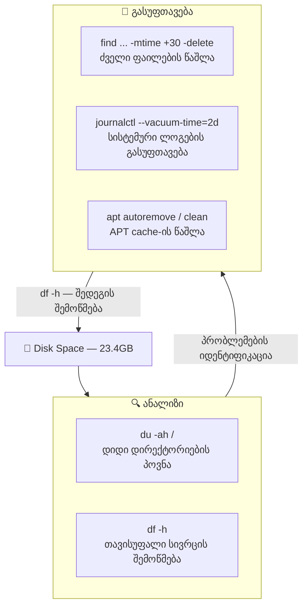
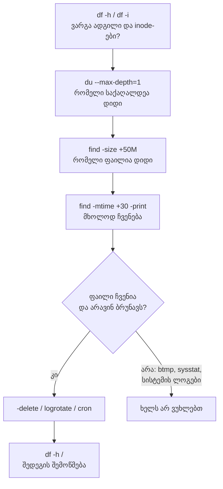

Task 21 — Disk Space Management


## არქიტექტურა




## დისკის მოხმარების ანალიზი

### ტოპ 10 ყველაზე დიდი დირექტორია/ფაილი

ყველაზე დიდი დირექტორიების პოვნა
სანამ რამეს წაშლი, უნდა გაარკვიო, სად არის "დამალული" დიდი მოცულობის ფაილები. ამისთვის გამოიყენება du (Disk Usage) ბრძანება.

```bash
sudo du -ah / | sort -rh | head -n 10
```

| ფლაგი | დანიშნულება |
|-------|-------------|
| `-a` | ყველა ფაილი და დირექტორია (არამხოლოდ დირექტორიები) |
| `-h` | ადამიანისთვის გასაგები ფორმატი (GB, MB, KB) |
| `sort -rh` | დახარისხება ზომის მიხედვით, დიდიდან პატარისკენ |
| `head -n 10` | მხოლოდ პირველი 10 შედეგი |

```
9.6G    /
4.1G    /swap.img
3.7G    /usr
2.1G    /usr/lib
1.8G    /var
1.4G    /var/lib
606M    /var/lib/containerd
557M    /usr/lib/firmware
556M    /usr/libexec
497M    /var/lib/docker
```

### რას გვეუბნება ეს მონაცემები

სერვერის 23.4GB დისკიდან 9.6GB არის გამოყენებული. აი როგორ ნაწილდება:

| რა | ზომა | განმარტება |
|----|------|-----------|
| `/swap.img` | 4.1G | Swap ფაილი — RAM-ის „გაფართოება" დისკზე |
| `/usr/lib` | 2.1G | სისტემური ბიბლიოთეკები და პაკეტები |
| `/var/lib/containerd` | 606M | Docker container runtime-ის მონაცემები |
| `/usr/lib/firmware` | 557M | Hardware firmware ფაილები |
| `/var/lib/docker` | 497M | Docker images, volumes, layers |

> 💡 `/proc/...` შეცდომები ნორმალურია — ეს ვირტუალური ფაილური სისტემაა და პროცესები იცვლება `du`-ს მუშაობის დროს.

ყველაზე დიდი დირექტორიების მოცულობა
```console
k@devserver:~$ sudo du -ah / | sort -rh | head -n 10
du: cannot access '/proc/147776/task/148287/fd/120': No such file or directory
du: cannot access '/proc/147776/task/148287/fdinfo/122': No such file or directory
du: cannot access '/proc/147776/task/148298/fd/133': No such file or directory
du: cannot access '/proc/158262/task/158262/fd/4': No such file or directory
du: cannot access '/proc/158262/task/158262/fdinfo/4': No such file or directory
du: cannot access '/proc/158262/fd/3': No such file or directory
du: cannot access '/proc/158262/fdinfo/3': No such file or directory
du: cannot access '/proc/158332': No such file or directory
9.6G    /
4.1G    /swap.img
3.7G    /usr
2.1G    /usr/lib
1.8G    /var
1.4G    /var/lib
606M    /var/lib/containerd
557M    /usr/lib/firmware
556M    /usr/libexec
497M    /var/lib/docker
```


## ძველი ფაილების პოვნა და წაშლა

### ჯერ ნახვა (უსაფრთხოებისთვის)

```bash
sudo find /var/log -type f -mtime +30
```

```
/var/log/bootstrap.log
/var/log/btmp
/var/log/faillog
/var/log/landscape/sysinfo.log
```

| ფლაგი | დანიშნულება |
|-------|-------------|
| `-type f` | მხოლოდ ფაილები (არა დირექტორიები) |
| `-mtime +30` | ფაილები რომლებიც 30 დღეზე მეტია არ შეცვლილა |

### შემდეგ წაშლა

```bash
sudo find /var/log -type f -mtime +30 -delete
```

> ⚠️ **ყოველთვის ჯერ `-delete`-ის გარეშე გაუშვით** რომ ნახოთ რა წაიშლება. `-delete` ფლაგი შეუქცევადია — Recycle Bin არ არსებობს.

```console
k@devserver:~$ sudo find /var/log -type f -mtime +30
/var/log/bootstrap.log
/var/log/btmp
/var/log/faillog
/var/log/landscape/sysinfo.log
```

```bash
sudo find /var/log -type f -mtime +30 -delete
```

## სისტემური ლოგების (Journald) გასუფთავება

systemd-journald არის Ubuntu-ს ლოგირების სისტემა. დროთა განმავლობაში ლოგები დიდ ადგილს იკავებს.

### დროის მიხედვით

```bash
sudo journalctl --vacuum-time=2d
```

ტოვებს მხოლოდ ბოლო 2 დღის ლოგებს, დანარჩენს შლის.

### ზომის მიხედვით

```bash
sudo journalctl --vacuum-size=500M
```

ლოგებს ამცირებს 500MB-მდე, ძველიდან იწყებს წაშლას.

> 💡 ლოგების მიმდინარე ზომის სანახავად: `journalctl --disk-usage`

---


## APT Cache-ის გასუფთავება

პაკეტების ინსტალაციის შემდეგ `.deb` ფაილები cache-ში რჩება. ასევე, dependency-ად დაინსტალირებული პაკეტები შეიძლება აღარ იყოს საჭირო.

```bash
sudo apt-get autoremove    # გამოუყენებელი პაკეტების წაშლა
sudo apt-get clean         # გადმოწერილი .deb ფაილების წაშლა
```

| ბრძანება | რას აკეთებს |
|----------|-------------|
| `autoremove` | შლის პაკეტებს რომლებიც სხვა პაკეტის dependency-ად დაინსტალირდა და აღარ არის საჭირო |
| `clean` | შლის `/var/cache/apt/archives/`-დან ყველა გადმოწერილ `.deb` ფაილს |

> 💡 `apt-get autoclean` — `clean`-ის „რბილი" ვერსია: შლის მხოლოდ მოძველებულ `.deb` ფაილებს, აქტუალურს ტოვებს.

---


## შედეგის შემოწმება

```bash
df -h
```

| ფლაგი | დანიშნულება |
|-------|-------------|
| `-h` | ადამიანისთვის გასაგები ფორმატი |

`df` აჩვენებს თითოეული mounted ფაილური სისტემის სრულ/გამოყენებულ/თავისუფალ სივრცეს.

---

## სასარგებლო ბრძანებების შეჯამება

| ამოცანა | ბრძანება |
|---------|----------|
| თავისუფალი სივრცე | `df -h` |
| დიდი დირექტორიების პოვნა | `sudo du -ah / \| sort -rh \| head -n 10` |
| კონკრეტული დირექტორიის ზომა | `du -sh /var/log` |
| ძველი ფაილების პოვნა | `sudo find /path -type f -mtime +30` |
| ძველი ფაილების წაშლა | `sudo find /path -type f -mtime +30 -delete` |
| ლოგების გასუფთავება (დრო) | `sudo journalctl --vacuum-time=2d` |
| ლოგების გასუფთავება (ზომა) | `sudo journalctl --vacuum-size=500M` |
| ლოგების ზომის ნახვა | `journalctl --disk-usage` |
| APT cache წაშლა | `sudo apt-get clean` |
| გამოუყენებელი პაკეტები | `sudo apt-get autoremove` |

---

## საბოლოოდ

### „ჯერ ნახე, მერე წაშალე" პრინციპი

Linux-ში წაშლა შეუქცევადია. `find ... -delete`, `rm -rf` — არცერთს Recycle Bin არ აქვს. ამიტომ ყოველთვის ორ ნაბიჯად ვმოქმედებთ: ჯერ ვნახულობთ რა წაიშლება, შემდეგ ვშლით.

### Swap ფაილი

ჩვენს სერვერზე ყველაზე დიდი ფაილი `/swap.img` (4.1GB) არის. Swap არის დისკის ნაწილი რომელსაც სისტემა RAM-ის ნაცვლად იყენებს როცა მეხსიერება არ ყოფნის. 7.76GB RAM-ით და 9.8% მოხმარებით swap-ი ფაქტიურად არ გამოიყენება, მაგრამ მისი წაშლა რეკომენდებული არ არის.

### პროაქტიული vs რეაქტიული მენეჯმენტი

ამ Task-ში ხელით გავწმინდეთ დისკი. პროდაქშენ სერვერზე ეს ავტომატიზებული უნდა იყოს — მაგალითად cron job-ით რომელიც ძველ ლოგებს პერიოდულად წაშლის, ან logrotate-ით რომელიც ლოგ ფაილების ზომას აკონტროლებს. Netdata-ს (Task 20) შეუძლია alert-ის გაგზავნა როცა დისკის მოცულობა კრიტიკულ ზღვარს მიუახლოვდება.

---

## განახლებული ვერსია: დისკის გასუფთავება ახალ VM-ზე

**მიზანი:** ვიპოვოთ ყველაზე დიდი საქაღალდეები და უსაფრთხოდ გავწმინდოთ ძველი ლოგები/ფაილები. წესი: **ჯერ ვხედავთ, მერე ვშლით.**



### 1. რამდენია დაკავებული
```text
$ df -h /
/dev/mapper/ubuntu--vg-ubuntu--lv   12G  4.3G  6.4G  40% /

$ df -i /
Inodes  IUsed  IFree IUse%
753664 123401 630263   17%
```
`df -h` ადგილს ითვლის, `df -i` კი inode-ებს (ფაილების რაოდენობის ლიმიტი). დისკი შეიძლება „სავსე“ იყოს ადგილის დარჩენის დროსაც, თუ ძალიან ბევრი პატარა ფაილია. აქ ორივე წესრიგშია.

### 2. ვინ იკავებს ადგილს
```text
$ sudo du -xh / --max-depth=1 2>/dev/null | sort -rh | head -n 10
4.3G    /
3.0G    /usr
1.3G    /var
6.8M    /etc
500K    /home

$ sudo du -xh /var/lib --max-depth=1 2>/dev/null | sort -rh | head -n 6
1.1G    /var/lib
625M    /var/lib/containerd
157M    /var/lib/apt
121M    /var/lib/snapd
63M     /var/lib/postgresql
47M     /var/lib/docker
```
| ბრძანება | რატომ |
|----------|-------|
| `du -xh / --max-depth=1` | `-x` სხვა დისკებზე არ გადადის, `--max-depth=1` აჩვენებს მხოლოდ პირველი დონის საქაღალდეებს |
| `sort -rh` | `-h` ადამიანისთვის წაკითხვად ზომებს (`4.3G`, `47M`) სწორად ალაგებს, `-r` კი დიდიდან პატარისკენ |
| ჩაღრმავება დიდ საქაღალდეში | `/` → `/var` → `/var/lib` → `containerd`: ორი-სამი ბრძანებით ვპოულობთ მიზეზს |

`/usr` (3.0G) სისტემის პროგრამებია და ხელს არ ვუხლებთ. `/var/lib/containerd` (625M) Docker-ის იმიჯებია. `/var/log` მხოლოდ 46M-ია, ამიტომ ლოგები პრობლემა არ არის.

### 3. ყველაზე დიდი ფაილები
```bash
sudo find / -xdev -type f -size +50M -exec ls -lh {} \; 2>/dev/null | awk '{print $5, $9}' | sort -rh | head
```
Top: `libLLVM.so` (133-171M), `dockerd` (81M), apt-ის პაკეტების სიები (74M). ეს ყველაფერი სისტემის ნორმალური ფაილებია.

### 4. „30 დღეზე ძველი“: ჯერ ჩვენება
```text
$ sudo find /var/log -type f -mtime +30 -print
/var/log/btmp
/var/log/bootstrap.log
/var/log/landscape/sysinfo.log
/var/log/sysstat/sa26
```
**ეს ფაილები არ წავშალეთ**, რადგან „ძველი“ ყოველთვის „არასაჭიროს“ არ ნიშნავს:
| ფაილი | რატომ არ ვშლით |
|-------|----------------|
| `btmp` | წარუმატებელი შესვლების ჟურნალია (Task 13/23-ის აუდიტისთვის). ჩვენთან 0 ბაიტია, ანუ წარუმატებელი შესვლა არ ყოფილა |
| `bootstrap.log` | ინსტალაციის ჩანაწერი (86K), დიაგნოსტიკისთვის სასარგებლოა |
| `sysstat/sa26` | `sysstat` ამ ფაილებს თავად ბრუნავს |
| `landscape/sysinfo.log` | `logrotate` უვლის |

!!! warning "წესი"
    30 დღეზე ძველი ≠ უსაფრთხოდ წასაშლელი. ვშლით მხოლოდ იმას, რაც ჩვენი სკრიპტების შედეგია და რისი ჭრაც ავტომატურად არავის ევალება.

### 5. უსაფრთხო ტესტი ხელოვნურ ფაილებზე
```text
$ mkdir -p ~/disk-test
$ touch -d "45 days ago" ~/disk-test/old1.log ~/disk-test/old2.log
$ touch ~/disk-test/new.log
$ ls -l ~/disk-test
-rw-rw-r-- 1 k k 0 Nov 15 23:47 new.log
-rw-rw-r-- 1 k k 0 Oct  1 23:47 old1.log
-rw-rw-r-- 1 k k 0 Oct  1 23:47 old2.log

$ find ~/disk-test -type f -mtime +30 -print
/home/k/disk-test/old1.log
/home/k/disk-test/old2.log

$ find ~/disk-test -type f -mtime +30 -delete
$ ls -l ~/disk-test
-rw-rw-r-- 1 k k 0 Nov 15 23:47 new.log
```
`touch -d "45 days ago"` ფაილს ხელოვნურად „ძველს“ ხდის. პირველი `find ... -print` აჩვენებს, რა წაიშლება, მეორე იგივე ფილტრით `-delete`-ს გვიკეთებს: მხოლოდ `new.log` დარჩა.

### 6. რეალური გასუფთავება
| ბრძანება | შედეგი |
|----------|--------|
| `sudo journalctl --vacuum-time=30d` | `freed 0B`: journal მხოლოდ 40M-ია და 30 დღეზე ძველი არ არის |
| `sudo apt clean` | 4.3G → **4.1G** (~200 MB გათავისუფლდა) |
| `sudo apt autoremove --dry-run` | `Removing: 0`: ზედმეტი პაკეტი არ არის |
| `docker system df` | `RECLAIMABLE 653.3MB (99%)` მცდარ შთაბეჭდილებას ტოვებს: 4 იმიჯიდან 3 გამოიყენება და ციფრი თითქმის ყველას ითვლის |
| `docker images` → `docker rmi hello-world` | გამოუყენებელი ერთადერთი იმიჯი წაიშალა (25.9 kB) |

!!! danger "რატომ არ გავუშვით `docker system prune -a`"
    `prune -a` ყველა გამოუყენებელ იმიჯს შლის, `volume prune` კი volume-ებსაც (ჩვენი DB `pgdata` მათ შორის, თუ კონტეინერი გაჩერებულია). ამიტომ ვშლით მხოლოდ კონკრეტულს (`docker rmi სახელი`).

### 7. ავტომატური გასუფთავება
**ლოგების ბრუნვა (`logrotate`)** ჩვენი ლოგებისთვის: <br>
```text
/home/k/deploy-docker-app.log /home/k/backups/cron.log {
    su k k
    weekly
    rotate 4
    compress
    missingok
    notifempty
}
```
| დირექტივა | რატომ |
|-----------|-------|
| `su k k` | ფაილები `k` მომხმარებლისაა, `logrotate` კი root-ით მუშაობს და სხვანაირად უარს იტყოდა |
| `weekly` + `rotate 4` | ყოველკვირეულად ახალი ფაილი, 4 ძველი არქივი რჩება და ხუთეულიდან ყველაზე ძველი იშლება |
| `compress` | ძველი ლოგები იკუმშება |
| `missingok` | `cron.log` ჯერ არ არსებობს, ამიტომ ეს შეცდომას არ იძლევა |
| `notifempty` | ცარიელ ლოგს არ ბრუნავს |

`sudo logrotate -d /etc/logrotate.d/mydevops` (debug, არაფერს ცვლის) უჩვენებს `considering log /home/k/deploy-docker-app.log` და `cron.log does not exist -- skipping`, შეცდომების გარეშე. <br>

**30 დღეზე ძველი backup-ების წაშლა** (cron, ყოველდღე 03:30, backup-ის (03:00) შემდეგ): <br>
```text
30 3 * * * find /home/k/backups -name 'app_db_*.tar.gz' -type f -mtime +30 -delete
```
სახელის ნიმუში `'app_db_*.tar.gz'` ზღუდავს წაშლას მხოლოდ ჩვენი backup-ებით. წინასწარი `find ... -print` ახლა ცარიელია (ჩვენი backup-ები 5 დღისაა). ორივე cron ხაზი ჩანს `crontab -l`-ში. <br>

### შედეგი
| | ადრე | მერე |
|--|------|------|
| `df -h /` Used | 4.3G | 4.1G |
| Avail | 6.4G | 6.6G |
| Use% | 40% | 39% |
