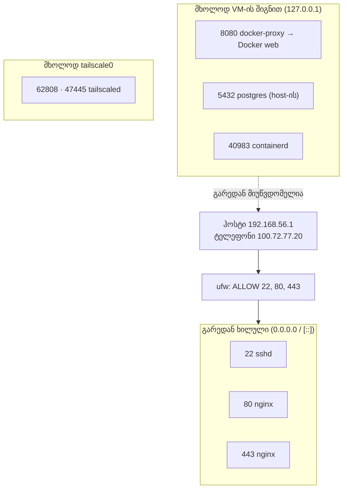

Task 22 — Network Diagnostics

🔍 Listening Ports — ღია პორტების ნახვა

იმისთვის, რომ ნახო რომელი სერვისი ელოდება კავშირს
(მაგალითად: SSH → 22, Netdata → 19999), გამოიყენე ss ბრძანება
(netstat-ის თანამედროვე და სწრაფი ალტერნატივა):

sudo ss -tunlp

📖 ფლაგების განმარტება

-t — TCP კავშირები

-u — UDP კავშირები

-n — ციფრული მისამართები (პორტის ნომრები)

-l — მხოლოდ Listening პორტები

-p — პროცესის სახელი და PID რომელიც ამ პორტს იყენებს

- აქტიური კავშირების ნახვა (Active Connections)თუ გსურს ნახო, ვინ არის ამ წუთას შენს სერვერთან დაკავშირებული (მაგალითად, შენივე ბრაუზერი Netdata-ზე), გამოიყენე იგივე ბრძანება l (listening) ფლაგის გარეშე: <br>
```Bash
sudo ss -tunp
``` 
ეს გამოგიჩენს Established კავშირებს. სვეტში Foreign Address დაინახავ იმ კომპიუტერის IP-ს, რომელიც შენს სერვერს უკავშირდება.

- ალტერნატივა: lsof (List Open Files)Linux-ში "ყველაფერი ფაილია", მათ შორის ქსელური სოკეტებიც. lsof დაგეხმარება დაინახო, რომელ პროგრამას აქვს გახსნილი ინტერნეტ კავშირი:
```Bash
sudo lsof -i -P -n
```
-i: მხოლოდ ინტერნეტ (ქსელური) ფაილები.-P: პორტების ნომრებად ჩვენება (და არა სერვისის სახელებად).-n: IP მისამართების ჩვენება (DNS-ის გარეშე).

- netstat-ს გამოყენება (კლასიკური მეთოდი)ბევრი ადმინისტრატორი კვლავ იყენებს netstat-ს. თუ ის დაინსტალირებული გაქვს (sudo apt install net-tools), შეგიძლია გაუშვა:
```Bash
sudo netstat -plntu
```
შეჯამება დავალებისთვის:ბრძანებარას გვაჩვენებს?ss -tlpnრომელი სერვისები უსმენენ პორტებს (TCP).ss -tanაბსოლუტურად ყველა (Active + Listening) კავშირი.lsof -i :80კონკრეტულ პორტზე (მაგ. 80) რომელი პროცესი ზის.

```console
k@devserver:~$ sudo ss -tunlp
Netid State  Recv-Q Send-Q         Local Address:Port  Peer Address:PortProcess
udp   UNCONN 0      0                  127.0.0.1:8125       0.0.0.0:*    users:(("netdata",pid=147776,fd=57))
udp   UNCONN 0      0                 127.0.0.54:53         0.0.0.0:*    users:(("systemd-resolve",pid=18791,fd=16))
udp   UNCONN 0      0              127.0.0.53%lo:53         0.0.0.0:*    users:(("systemd-resolve",pid=18791,fd=14))
udp   UNCONN 0      0      192.168.56.101%enp0s3:68         0.0.0.0:*    users:(("systemd-network",pid=18146,fd=23))
udp   UNCONN 0      0           10.0.3.15%enp0s8:68         0.0.0.0:*    users:(("systemd-network",pid=18146,fd=26))
tcp   LISTEN 0      4096                 0.0.0.0:8080       0.0.0.0:*    users:(("docker-proxy",pid=110692,fd=8))
tcp   LISTEN 0      4096                 0.0.0.0:8081       0.0.0.0:*    users:(("docker-proxy",pid=110561,fd=8))
tcp   LISTEN 0      4096               127.0.0.1:8125       0.0.0.0:*    users:(("netdata",pid=147776,fd=61))
tcp   LISTEN 0      5                  127.0.0.1:61209      0.0.0.0:*    users:(("glances",pid=132757,fd=4))
tcp   LISTEN 0      4096                 0.0.0.0:19999      0.0.0.0:*    users:(("netdata",pid=147776,fd=6))
tcp   LISTEN 0      511                  0.0.0.0:443        0.0.0.0:*    users:(("nginx",pid=91368,fd=6),("nginx",pid=91367,fd=6),("nginx",pid=91366,fd=6),("nginx",pid=91365,fd=6),("nginx",pid=91364,fd=6))
tcp   LISTEN 0      128                127.0.0.1:4317       0.0.0.0:*    users:(("otel-plugin",pid=148292,fd=10))
tcp   LISTEN 0      4096           127.0.0.53%lo:53         0.0.0.0:*    users:(("systemd-resolve",pid=18791,fd=15))
tcp   LISTEN 0      4096                 0.0.0.0:22         0.0.0.0:*    users:(("sshd",pid=7361,fd=3),("systemd",pid=1,fd=225))
tcp   LISTEN 0      511                  0.0.0.0:80         0.0.0.0:*    users:(("nginx",pid=91368,fd=5),("nginx",pid=91367,fd=5),("nginx",pid=91366,fd=5),("nginx",pid=91365,fd=5),("nginx",pid=91364,fd=5))
tcp   LISTEN 0      4096              127.0.0.54:53         0.0.0.0:*    users:(("systemd-resolve",pid=18791,fd=17))
tcp   LISTEN 0      200                127.0.0.1:5432       0.0.0.0:*    users:(("postgres",pid=43966,fd=6))
tcp   LISTEN 0      128                127.0.0.1:6010       0.0.0.0:*    users:(("sshd",pid=123104,fd=8))
tcp   LISTEN 0      4096                    [::]:8080          [::]:*    users:(("docker-proxy",pid=110699,fd=8))
tcp   LISTEN 0      4096                    [::]:8081          [::]:*    users:(("docker-proxy",pid=110567,fd=8))
tcp   LISTEN 0      4096                    [::]:19999         [::]:*    users:(("netdata",pid=147776,fd=8))
tcp   LISTEN 0      4096                    [::]:22            [::]:*    users:(("sshd",pid=7361,fd=4),("systemd",pid=1,fd=227))
tcp   LISTEN 0      128                    [::1]:6010          [::]:*    users:(("sshd",pid=123104,fd=7))
```

🔗 Active Connections — აქტიური კავშირები

თუ გინდა ნახო ვინ არის ამჟამად დაკავშირებული სერვერთან:

აქტიური კავშირები
```console
k@devserver:~$ sudo ss -tunp
Netid          State          Recv-Q          Send-Q                    Local Address:Port                    Peer Address:Port           Process
tcp            ESTAB          0               0                        192.168.56.101:22                      192.168.56.1:63218           users:(("sshd",pid=34219,fd=4),("sshd",pid=34097,fd=4))
tcp            ESTAB          0               0                        192.168.56.101:22                      192.168.56.1:55940           users:(("sshd",pid=123173,fd=4),("sshd",pid=122987,fd=4))
tcp            ESTAB          0               0                        192.168.56.101:22                      192.168.56.1:55939           users:(("sshd",pid=123104,fd=4),("sshd",pid=122985,fd=4))
k@devserver:~$
```


📂 ალტერნატივა — lsof (List Open Files)

Linux-ში "ყველაფერი ფაილია", მათ შორის ქსელური სოკეტებიც.
```bash
sudo lsof -i -P -n
```
📖 ფლაგები

-i — მხოლოდ ქსელური ფაილები

-P — პორტების ნომრები

-n — DNS-ის გარეშე

```console
k@devserver:~$ sudo lsof -i -P -n
COMMAND      PID            USER   FD   TYPE DEVICE SIZE/OFF NODE NAME
systemd        1            root  225u  IPv4   8390      0t0  TCP *:22 (LISTEN)
systemd        1            root  227u  IPv6   8392      0t0  TCP *:22 (LISTEN)
sshd        7361            root    3u  IPv4   8390      0t0  TCP *:22 (LISTEN)
sshd        7361            root    4u  IPv6   8392      0t0  TCP *:22 (LISTEN)
systemd-n  18146 systemd-network   23u  IPv4 410498      0t0  UDP 192.168.56.101:68
systemd-n  18146 systemd-network   26u  IPv4 156213      0t0  UDP 10.0.3.15:68
systemd-r  18791 systemd-resolve   14u  IPv4  27531      0t0  UDP 127.0.0.53:53
systemd-r  18791 systemd-resolve   15u  IPv4  27532      0t0  TCP 127.0.0.53:53 (LISTEN)
systemd-r  18791 systemd-resolve   16u  IPv4  27533      0t0  UDP 127.0.0.54:53
systemd-r  18791 systemd-resolve   17u  IPv4  27534      0t0  TCP 127.0.0.54:53 (LISTEN)
sshd       34097            root    4u  IPv4  51768      0t0  TCP 192.168.56.101:22->192.168.56.1:63218 (ESTABLISHED)
sshd       34219               k    4u  IPv4  51768      0t0  TCP 192.168.56.101:22->192.168.56.1:63218 (ESTABLISHED)
postgres   43966        postgres    6u  IPv4  63802      0t0  TCP 127.0.0.1:5432 (LISTEN)
nginx      91364            root    5u  IPv4 119330      0t0  TCP *:80 (LISTEN)
nginx      91364            root    6u  IPv4 119331      0t0  TCP *:443 (LISTEN)
nginx      91365        www-data    5u  IPv4 119330      0t0  TCP *:80 (LISTEN)
nginx      91365        www-data    6u  IPv4 119331      0t0  TCP *:443 (LISTEN)
nginx      91366        www-data    5u  IPv4 119330      0t0  TCP *:80 (LISTEN)
nginx      91366        www-data    6u  IPv4 119331      0t0  TCP *:443 (LISTEN)
nginx      91367        www-data    5u  IPv4 119330      0t0  TCP *:80 (LISTEN)
nginx      91367        www-data    6u  IPv4 119331      0t0  TCP *:443 (LISTEN)
nginx      91368        www-data    5u  IPv4 119330      0t0  TCP *:80 (LISTEN)
nginx      91368        www-data    6u  IPv4 119331      0t0  TCP *:443 (LISTEN)
docker-pr 110561            root    8u  IPv4 152359      0t0  TCP *:8081 (LISTEN)
docker-pr 110567            root    8u  IPv6 153741      0t0  TCP *:8081 (LISTEN)
docker-pr 110692            root    8u  IPv4 152486      0t0  TCP *:8080 (LISTEN)
docker-pr 110699            root    8u  IPv6 152487      0t0  TCP *:8080 (LISTEN)
sshd      122985            root    4u  IPv4 190143      0t0  TCP 192.168.56.101:22->192.168.56.1:55939 (ESTABLISHED)
sshd      122987            root    4u  IPv4 190156      0t0  TCP 192.168.56.101:22->192.168.56.1:55940 (ESTABLISHED)
sshd      123104               k    4u  IPv4 190143      0t0  TCP 192.168.56.101:22->192.168.56.1:55939 (ESTABLISHED)
sshd      123104               k    7u  IPv6 190988      0t0  TCP [::1]:6010 (LISTEN)
sshd      123104               k    8u  IPv4 190989      0t0  TCP 127.0.0.1:6010 (LISTEN)
sshd      123173               k    4u  IPv4 190156      0t0  TCP 192.168.56.101:22->192.168.56.1:55940 (ESTABLISHED)
glances   132757            root    4u  IPv4 209344      0t0  TCP 127.0.0.1:61209 (LISTEN)
netdata   147776         netdata    6u  IPv4 241528      0t0  TCP *:19999 (LISTEN)
netdata   147776         netdata    8u  IPv6 241529      0t0  TCP *:19999 (LISTEN)
netdata   147776         netdata   57u  IPv4 248938      0t0  UDP 127.0.0.1:8125
netdata   147776         netdata   61u  IPv4 248939      0t0  TCP 127.0.0.1:8125 (LISTEN)
otel-plug 148292         netdata   10u  IPv4 249003      0t0  TCP 127.0.0.1:4317 (LISTEN)
k@devserver:~$
```

📡 ალტერნატივა — netstat (კლასიკური მეთოდი)
```bash
sudo apt install net-tools
```
```bash
sudo netstat -plntu
```

ალტერნატივა netstat

```console
k@devserver:~$ sudo netstat -plntu
Active Internet connections (only servers)
Proto Recv-Q Send-Q Local Address           Foreign Address         State       PID/Program name
tcp        0      0 0.0.0.0:8080            0.0.0.0:*               LISTEN      110692/docker-proxy
tcp        0      0 0.0.0.0:8081            0.0.0.0:*               LISTEN      110561/docker-proxy
tcp        0      0 127.0.0.1:8125          0.0.0.0:*               LISTEN      147776/netdata
tcp        0      0 127.0.0.1:61209         0.0.0.0:*               LISTEN      132757/python3
tcp        0      0 0.0.0.0:19999           0.0.0.0:*               LISTEN      147776/netdata
tcp        0      0 0.0.0.0:443             0.0.0.0:*               LISTEN      91364/nginx: master
tcp        0      0 127.0.0.1:4317          0.0.0.0:*               LISTEN      148292/otel-plugin
tcp        0      0 127.0.0.53:53           0.0.0.0:*               LISTEN      18791/systemd-resol
tcp        0      0 0.0.0.0:22              0.0.0.0:*               LISTEN      1/systemd
tcp        0      0 0.0.0.0:80              0.0.0.0:*               LISTEN      91364/nginx: master
tcp        0      0 127.0.0.54:53           0.0.0.0:*               LISTEN      18791/systemd-resol
tcp        0      0 127.0.0.1:5432          0.0.0.0:*               LISTEN      43966/postgres
tcp        0      0 127.0.0.1:6010          0.0.0.0:*               LISTEN      123104/sshd: k@pts/
tcp6       0      0 :::8080                 :::*                    LISTEN      110699/docker-proxy
tcp6       0      0 :::8081                 :::*                    LISTEN      110567/docker-proxy
tcp6       0      0 :::19999                :::*                    LISTEN      147776/netdata
tcp6       0      0 :::22                   :::*                    LISTEN      1/systemd
tcp6       0      0 ::1:6010                :::*                    LISTEN      123104/sshd: k@pts/
udp        0      0 127.0.0.1:8125          0.0.0.0:*                           147776/netdata
udp        0      0 127.0.0.54:53           0.0.0.0:*                           18791/systemd-resol
udp        0      0 127.0.0.53:53           0.0.0.0:*                           18791/systemd-resol
udp        0      0 192.168.56.101:68       0.0.0.0:*                           18146/systemd-netwo
udp        0      0 10.0.3.15:68            0.0.0.0:*                           18146/systemd-netwo
k@devserver:~$
```

---

## განახლებული ვერსია: ქსელის დიაგნოსტიკა ახალ VM-ზე

**მიზანი:** ზუსტად ვიცოდეთ, რომელი პორტი ღიაა, რომელი სერვისი უსმენს და რა კავშირებია აქტიური. ყველა ბრძანება მხოლოდ კითხულობს.



### 1. ვინ უსმენს რას (`sudo ss -tlnp`)
```text
LISTEN  127.0.0.1:5432     postgres
LISTEN  0.0.0.0:22         sshd
LISTEN  0.0.0.0:80         nginx
LISTEN  0.0.0.0:443        nginx
LISTEN  127.0.0.1:8080     docker-proxy
LISTEN  127.0.0.53%lo:53   systemd-resolve   (ადგილობრივი DNS)
LISTEN  127.0.0.1:40983    containerd
LISTEN  100.x.y.z%tailscale0:62808   tailscaled
LISTEN  [::]:22 / [::]:80 / [::]:443     იგივე სერვისები IPv6-ზე
```
| მისამართი | რას ნიშნავს |
|-----------|-------------|
| `0.0.0.0:22` / `[::]:22` | **ყველა** ინტერფეისზე უსმენს: გარედან ჩანს (IPv4 და IPv6). ufw გადაწყვეტს, ვინ შეუშვას |
| `127.0.0.1:8080` | მხოლოდ **VM-ის შიგნით**: გარედან მიუწვდომელია (Task 16-ის გამაგრება) |
| `100.x.y.z%tailscale0:...` | მხოლოდ Tailscale ინტერფეისზე |
| `127.0.0.53%lo:53` | `systemd-resolved`-ის ლოკალური DNS ქეში |

| ფლაგი | რატომ |
|-------|-------|
| `-t` / `-u` | TCP / UDP |
| `-l` | მხოლოდ მოსასმენი (listening) სოკეტები |
| `-n` | ციფრები სახელების ნაცვლად (სწრაფია და DNS არ სჭირდება) |
| `-p` | რომელი პროცესი (`sudo` სჭირდება სხვისი პროცესების სანახავად) |

!!! info "მნიშვნელოვანი აღმოჩენა: ორი PostgreSQL"
    `127.0.0.1:5432`-ზე უსმენს `postgres` პროცესი, რომელიც **host-ზე** დავაყენეთ (Task 10). Docker-ის `db` კონტეინერს პორტი გარეთ არ აქვს გამოქვეყნებული (`docker compose ps`-ში `5432/tcp` მხოლოდ შიგა ქსელშია). ანუ ორი დამოუკიდებელი DB გვაქვს, ორივე გარედან დახურული. host-ის Postgres მხოლოდ `127.0.0.1`-ზეა მიბმული, ამიტომ ქსელიდან არ ჩანს.

### 2. UDP და სისტემური პორტები
```text
udp  127.0.0.53%lo:53       systemd-resolve
udp  10.0.2.15%enp0s3:68    systemd-network (DHCP კლიენტი)
udp  127.0.0.1:323          chronyd (დროის სინქრონიზაცია, NTP)
udp  0.0.0.0:41641          tailscaled (WireGuard)
```
`41641/udp` ღიაა `0.0.0.0`-ზე, ეს Tailscale-ის გვირაბია და ufw-ში ცალკე წესი არ სჭირდება.

### 3. აქტიური კავშირები (`ss -tn state established`)
```text
10.0.2.15:52326        → 192.200.0.112:443     (გარე HTTPS, Tailscale/განახლებები)
10.0.2.15:54284        → 199.165.136.101:443   (გარე HTTPS)
192.168.56.10:22       ← 192.168.56.1:52772    (SSH ჰოსტიდან)
192.168.56.10:22       ← 192.168.56.1:48200    (SSH ჰოსტიდან)
100.x.y.z:22       ← 100.72.77.20:56654    (SSH ტელეფონიდან, Tailscale-ით)
10.0.2.15:40722        → 185.40.234.176:443    (გარე HTTPS)
```
ექვსივე კავშირი ცნობილია: სამი SSH სესია (ორი ჰოსტიდან, ერთი ტელეფონიდან) და სამი გამავალი HTTPS (Tailscale-ის საკონტროლო სერვერი და სისტემური განახლებები). უცნობი კავშირი არ არის. `ss -s` მთლიანად: `TCP: 26 (estab 6, closed 7 ...)`. <br>

!!! tip "როგორ შევამოწმოთ, ვინ არის ვინ"
    ტელეფონის სესიას ამოვიცნობთ მისამართით `100.72.77.20` (Tailscale-ის IP), ჰოსტის სესიებს კი `192.168.56.1`-ით (Host-Only ქსელის gateway). უცნობი გარე IP-ისას `whois IP` ან `last`/`journalctl -u ssh` დაგვეხმარება.

### 4. firewall (`sudo ufw status numbered`)
```text
[ 1] 22/tcp   ALLOW IN  Anywhere        [ 4] 22/tcp (v6)  ALLOW IN  Anywhere (v6)
[ 2] 80/tcp   ALLOW IN  Anywhere        [ 5] 80/tcp (v6)  ALLOW IN  Anywhere (v6)
[ 3] 443/tcp  ALLOW IN  Anywhere        [ 6] 443/tcp (v6) ALLOW IN  Anywhere (v6)
```
სამი ღია პორტი (22, 80, 443) IPv4-ზეც და IPv6-ზეც, დანარჩენი დახურულია. ეს ემთხვევა `ss`-ის სიას: ყველა `0.0.0.0` პორტი ufw-შია დაშვებული.

### 5. პორტების შემოწმება `nc`-ით
ორი ადგილიდან: **ჰოსტიდან** (გარედან, რეალური სურათი) და **VM-იდან** (საკუთარი თავიდან). <br>

```text
k@k-M4700:~$ nc -zv -w 2 192.168.56.10 22 80 443 8080 5432
Connection to 192.168.56.10 22 port [tcp/ssh] succeeded!
Connection to 192.168.56.10 80 port [tcp/http] succeeded!
Connection to 192.168.56.10 443 port [tcp/https] succeeded!
nc: connect to 192.168.56.10 port 8080 (tcp) timed out: Operation now in progress
nc: connect to 192.168.56.10 port 5432 (tcp) timed out: Operation now in progress
```
ჰოსტიდან ღიაა მხოლოდ 22, 80, 443. 8080 და 5432 **timed out**: `ufw` პაკეტს ჩუმად აგდებს, ამიტომ პასუხი საერთოდ არ მოდის და შეტევის მცდელობას პორტის არსებობაც არ ეცოდინება. <br>

```text
k@myubuntuserver:~$ nc -zv -w 2 192.168.56.10 22 80 443 8080 5432
Connection to 192.168.56.10 22 port [tcp/ssh] succeeded!
Connection to 192.168.56.10 80 port [tcp/http] succeeded!
Connection to 192.168.56.10 443 port [tcp/https] succeeded!
nc: connect to 192.168.56.10 port 8080 (tcp) failed: Connection refused
nc: connect to 192.168.56.10 port 5432 (tcp) failed: Connection refused
```
VM-იდან იგივე ორი პორტი **refused**-ს აბრუნებს: VM თავის თავზე `ufw`-ის გარეშე ახორციელებს კავშირს და პასუხობს ბირთვი, რომ ამ მისამართზე არავინ უსმენს (8080 და 5432 მხოლოდ `127.0.0.1`-ზეა). <br>

| შედეგი | რას ნიშნავს |
|--------|-------------|
| `succeeded` | პორტი ღიაა და სერვისი პასუხობს |
| `Connection refused` | მისამართზე **არავინ უსმენს**, პასუხი მაშინვე მოდის (ლოკალური შემოწმება) |
| `timed out` | **firewall აგდებს** პაკეტს ან მისამართი მიუწვდომელია: გარედან 8080/5432 ასეთია |

!!! tip "რატომ არის ორი ადგილიდან შემოწმება მნიშვნელოვანი"
    ერთი და იგივე პორტი VM-იდან და გარედან სხვადასხვა პასუხს იძლევა. გარე დამკვირვებლისთვის ტრაფიკი ჯერ firewall-ს გადის, ამიტომ მხოლოდ გარედან გაშვებული ტესტი აჩვენებს რეალურ უსაფრთხოებას. აქედან დასკვნა: **გარედან ღიაა მხოლოდ 22, 80, 443**, როგორც `ufw`-ში გვინდოდა.

### 6. ინტერფეისები, მარშრუტი, DNS
```text
$ ip -br a
lo          UNKNOWN  127.0.0.1/8
enp0s3      UP       10.0.2.15/24        (NAT: ინტერნეტი)
enp0s8      UP       192.168.56.10/24    (Host-Only: ჰოსტთან კავშირი)
tailscale0  UNKNOWN  100.x.y.z/32    (Tailscale)
br-15eb0478a22f UP   172.18.0.1/16       (Docker Compose ქსელი)
docker0     DOWN     172.17.0.1/16       (ნაგულისხმევი Docker ხიდი, არ გამოიყენება)
veth...     UP       (კონტეინერების ქსელის კაბელები, სამი)

$ ip route
default via 10.0.2.2 dev enp0s3 proto dhcp src 10.0.2.15 metric 100
192.168.56.0/24 dev enp0s8 proto kernel scope link src 192.168.56.10
172.18.0.0/16 dev br-15eb0478a22f ...
```
| ხაზი | რას ნიშნავს |
|------|-------------|
| `default via 10.0.2.2` | ინტერნეტზე გასასვლელი VirtualBox NAT-ის gateway-ით |
| `192.168.56.0/24 dev enp0s8` | ჰოსტთან პირდაპირი ქსელი (SSH, ბრაუზერი) |
| `br-... 172.18.0.1/16` | `docker compose`-ის შიგა ქსელი: web, db და adminer აქ ხედავენ ერთმანეთს სახელით |
| სამი `veth` | თითო კონტეინერი = ერთი ვირტუალური კაბელი |

```text
$ ping -c 3 1.1.1.1
3 packets transmitted, 3 received, 0% packet loss, rtt avg 3.2 ms

$ ping -c 3 ubuntu.com
PING ubuntu.com (185.125.190.20) ...
3 packets transmitted, 3 received, 0% packet loss, rtt avg 80.9 ms

$ resolvectl status | head
Link 2 (enp0s3)  Current DNS Server: 10.0.2.3   DNS Servers: 10.0.2.3 fd17:625c:f037:2::3
Link 3 (enp0s8)  Current Scopes: none   Default Route: no
```
| ტესტი | რას ამოწმებს |
|-------|--------------|
| `ping 1.1.1.1` | ინტერნეტი სახელის გარეშე (IP-ით): მარშრუტი და NAT |
| `ping ubuntu.com` | **DNS**: სახელი IP-ად ითარგმნა (`185.125.190.20`) |
| `resolvectl status` | DNS სერვერი `10.0.2.3` (VirtualBox NAT-ის DNS); `enp0s8` DNS-ს არ იყენებს (`Scopes: none`) |

თუ პირველი მუშაობს და მეორე არა, პრობლემა DNS-შია, და პირიქით: ორივე ვარდება = არ არის ინტერნეტი ან gateway.

### დიაგნოსტიკა: სიმპტომი → ბრძანება
| სიმპტომი | ბრძანება |
|----------|----------|
| „პორტი არ იხსნება“ | `ss -tlnp 'sport = :PORT'`: უსმენს თუ არა სერვისი და რომელ მისამართზე |
| უსმენს, მაგრამ გარედან ვერ ვწვდები | `sudo ufw status numbered` და მისამართი (`127.0.0.1` თუ `0.0.0.0`) |
| ინტერნეტი არ არის | `ip route` (გაქვს default), `ping 1.1.1.1`, შემდეგ `ping ubuntu.com` (DNS) |
| ვინ არის დაკავშირებული | `ss -tn state established` |
| რომელი პროცესი უჭირავს პორტს | `sudo ss -tlnp 'sport = :80'` |
