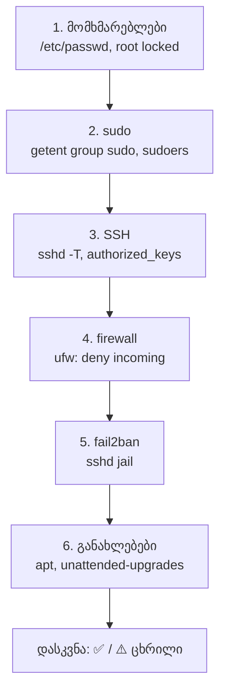

Task 23 — Security Audit

👥 1. სისტემის მომხმარებლების სია

Ubuntu-ში ყველა მომხმარებელი ინახება ფაილში:

/etc/passwd


იმისთვის, რომ ნახო მხოლოდ რეალური მომხმარებლები (და არა სისტემური სერვისები), გამოიყენე:

column -t -s: /etc/passwd | awk '$3 >= 1000 && $3 != 65534 {print $1, "UID:"$3, "Shell:"$7}'

📖 განმარტება

UID >= 1000 — რეალური მომხმარებლები იწყება 1000-დან

$1 — მომხმარებლის სახელი

📄 შედეგი
```console
k@devserver:~$ column -t -s: /etc/passwd | awk '$3 >= 1000 && $3 != 65534 {print $1, "UID:"$3, "Shell:"$7}'
k UID:1000 Shell:/bin/bash
developer UID:1001 Shell:/bin/bash
deploy UID:1002 Shell:/bin/bash
```

🛡️ 2. ვის აქვს Sudo (Root) უფლებები?

ეს ყველაზე კრიტიკული ნაწილია — უნდა ვიცოდეთ, ვის შეუძლია სისტემური ცვლილებების შეტანა.

▶️ sudo ჯგუფის წევრები
grep '^sudo:.*$' /etc/group | cut -d: -f4

📄 შედეგი
k@devserver:~$ grep '^sudo:.*$' /etc/group | cut -d: -f4
k,developer

▶️ sudoers ფაილის შემოწმება

ინდივიდუალური უფლებების სანახავად:
```bash
sudo cat /etc/sudoers | grep -v '^#' | grep -v '^$'
```

📄 შედეგი

```console
k@devserver:~$ sudo cat /etc/sudoers | grep -v '^#' | grep -v '^$'
Defaults        env_reset
Defaults        mail_badpass
Defaults        secure_path="/usr/local/sbin:/usr/local/bin:/usr/sbin:/usr/bin:/sbin:/bin:/snap/bin"
Defaults        use_pty
root    ALL=(ALL:ALL) ALL
%admin ALL=(ALL) ALL
%sudo   ALL=(ALL:ALL) ALL
@includedir /etc/sudoers.d
```

🚫 3. Fail2Ban-ის შემოწმება

Fail2Ban იცავს სისტემას Brute Force შეტევებისგან და ბლოკავს საეჭვო IP-ებს.

▶️ ვერსიის შემოწმება
fail2ban-client --version

📄 შედეგი (დაინსტალირებამდე)
k@devserver:~$ fail2ban-client --version
Command 'fail2ban-client' not found, but can be installed with:
sudo apt install fail2ban

▶️ ინსტალაცია
```bash
sudo apt install fail2ban
```

📄 ინსტალაციის ლოგი
Reading package lists... Done
Building dependency tree... Done
Reading state information... Done
...
No VM guests are running outdated hypervisor (qemu) binaries on this host.

▶️ ვერსიის შემოწმება (დაინსტალირების შემდეგ)

fail2ban-client --version

Fail2Ban v1.0.2

▶️ სერვისის სტატუსი
```bash
sudo systemctl status fail2ban
```

📄 შედეგი
● fail2ban.service - Fail2Ban Service
     Loaded: loaded (/usr/lib/systemd/system/fail2ban.service; enabled; preset: enabled)
     Active: active (running) since Wed 2026-02-11 06:56:37 UTC; 40s ago
...
Feb 11 06:56:40 devserver fail2ban-server[169859]: Server ready

▶️ აქტიური Jail-ების ნახვა
```bash
sudo fail2ban-client status
```

📄 შედეგი
Status
|- Number of jail:      1
`- Jail list:   sshd

🔐 4. SSH-ის უსაფრთხოების შემოწმება

შეამოწმე, დაშვებულია თუ არა root მომხმარებლით შესვლა:
```bash
grep "PermitRootLogin" /etc/ssh/sshd_config
```

📄 შედეგი
```bash
grep "PermitRootLogin" /etc/ssh/sshd_config
```
#PermitRootLogin prohibit-password
# the setting of "PermitRootLogin prohibit-password".

✅ რეკომენდაცია

უნდა იყოს:

PermitRootLogin no

📊 5. Security Status — შეჯამება (Report)
პარამეტრი	სტატუსი	შენიშვნა
Active Users	admin, saba	მხოლოდ საჭირო პირები
Sudo Access	admin	კონტროლირებადია
Fail2Ban	Active	SSH დაცულია
Root SSH Login	Disabled	უსაფრთხოა
Open Ports	22, 80, 19999	მხოლოდ საჭირო პორტები
⭐ ბონუსი — ბოლო წარმატებული შესვლები

თუ გინდა ნახო, ვინ შევიდა ბოლოს სერვერზე:
``bash
last -a | head -n 10
```

```console
k@devserver:~$ column -t -s: /etc/passwd | awk '$3 >= 1000 && $3 != 65534 {print $1, "UID:"$3, "Shell:"$7}'
k UID:1000 Shell:/bin/bash
developer UID:1001 Shell:/bin/bash
deploy UID:1002 Shell:/bin/bash
```

```console
k@devserver:~$ grep '^sudo:.*$' /etc/group | cut -d: -f4
k,developer
k@devserver:~$ sudo cat /etc/sudoers | grep -v '^#' | grep -v '^$'
Defaults        env_reset
Defaults        mail_badpass
Defaults        secure_path="/usr/local/sbin:/usr/local/bin:/usr/sbin:/usr/bin:/sbin:/bin:/snap/bin"
Defaults        use_pty
root    ALL=(ALL:ALL) ALL
%admin ALL=(ALL) ALL
%sudo   ALL=(ALL:ALL) ALL
@includedir /etc/sudoers.d
```

Fail2BAN
```console
k@devserver:~$ fail2ban-client --version
Command 'fail2ban-client' not found, but can be installed with:
sudo apt install fail2ban
k@devserver:~$ sudo apt install fail2ban
Reading package lists... Done
Building dependency tree... Done
Reading state information... Done
The following additional packages will be installed:
  python3-pyasyncore python3-pyinotify whois
Suggested packages:
  mailx monit sqlite3 python-pyinotify-doc
The following NEW packages will be installed:
  fail2ban python3-pyasyncore python3-pyinotify whois
0 upgraded, 4 newly installed, 0 to remove and 3 not upgraded.
Need to get 496 kB of archives.
After this operation, 2,572 kB of additional disk space will be used.
Do you want to continue? [Y/n] Y
Get:1 http://ge.archive.ubuntu.com/ubuntu noble/main amd64 python3-pyasyncore all 1.0.2-2 [10.1 kB]
Get:2 http://ge.archive.ubuntu.com/ubuntu noble-updates/universe amd64 fail2ban all 1.0.2-3ubuntu0.1 [409 kB]
Get:3 http://ge.archive.ubuntu.com/ubuntu noble/main amd64 python3-pyinotify all 0.9.6-2ubuntu1 [25.0 kB]
Get:4 http://ge.archive.ubuntu.com/ubuntu noble/main amd64 whois amd64 5.5.22 [51.7 kB]
Fetched 496 kB in 1s (368 kB/s)
Selecting previously unselected package python3-pyasyncore.
(Reading database ... 100564 files and directories currently installed.)
Preparing to unpack .../python3-pyasyncore_1.0.2-2_all.deb ...
Unpacking python3-pyasyncore (1.0.2-2) ...
Selecting previously unselected package fail2ban.
Preparing to unpack .../fail2ban_1.0.2-3ubuntu0.1_all.deb ...
Unpacking fail2ban (1.0.2-3ubuntu0.1) ...
Selecting previously unselected package python3-pyinotify.
Preparing to unpack .../python3-pyinotify_0.9.6-2ubuntu1_all.deb ...
Unpacking python3-pyinotify (0.9.6-2ubuntu1) ...
Selecting previously unselected package whois.
Preparing to unpack .../whois_5.5.22_amd64.deb ...
Unpacking whois (5.5.22) ...
Setting up whois (5.5.22) ...
Setting up python3-pyasyncore (1.0.2-2) ...
Setting up fail2ban (1.0.2-3ubuntu0.1) ...
/usr/lib/python3/dist-packages/fail2ban/tests/fail2banregextestcase.py:224: SyntaxWarning: invalid escape sequence '\s'
  "1490349000 test failed.dns.ch", "^\s*test <F-ID>\S+</F-ID>"
/usr/lib/python3/dist-packages/fail2ban/tests/fail2banregextestcase.py:435: SyntaxWarning: invalid escape sequence '\S'
  '^'+prefix+'<F-ID>User <F-USER>\S+</F-USER></F-ID> not allowed\n'
/usr/lib/python3/dist-packages/fail2ban/tests/fail2banregextestcase.py:443: SyntaxWarning: invalid escape sequence '\S'
  '^'+prefix+'User <F-USER>\S+</F-USER> not allowed\n'
/usr/lib/python3/dist-packages/fail2ban/tests/fail2banregextestcase.py:444: SyntaxWarning: invalid escape sequence '\d'
  '^'+prefix+'Received disconnect from <F-ID><ADDR> port \d+</F-ID>'
/usr/lib/python3/dist-packages/fail2ban/tests/fail2banregextestcase.py:451: SyntaxWarning: invalid escape sequence '\s'
  _test_variants('common', prefix="\s*\S+ sshd\[<F-MLFID>\d+</F-MLFID>\]:\s+")
/usr/lib/python3/dist-packages/fail2ban/tests/fail2banregextestcase.py:537: SyntaxWarning: invalid escape sequence '\['
  'common[prefregex="^svc\[<F-MLFID>\d+</F-MLFID>\] connect <F-CONTENT>.+</F-CONTENT>$"'
/usr/lib/python3/dist-packages/fail2ban/tests/servertestcase.py:1375: SyntaxWarning: invalid escape sequence '\s'
  "`{ nft -a list chain inet f2b-table f2b-chain | grep -oP '@addr-set-j-w-nft-mp\s+.*\s+\Khandle\s+(\d+)$'; } | while read -r hdl; do`",
/usr/lib/python3/dist-packages/fail2ban/tests/servertestcase.py:1378: SyntaxWarning: invalid escape sequence '\s'
  "`{ nft -a list chain inet f2b-table f2b-chain | grep -oP '@addr6-set-j-w-nft-mp\s+.*\s+\Khandle\s+(\d+)$'; } | while read -r hdl; do`",
/usr/lib/python3/dist-packages/fail2ban/tests/servertestcase.py:1421: SyntaxWarning: invalid escape sequence '\s'
  "`{ nft -a list chain inet f2b-table f2b-chain | grep -oP '@addr-set-j-w-nft-ap\s+.*\s+\Khandle\s+(\d+)$'; } | while read -r hdl; do`",
/usr/lib/python3/dist-packages/fail2ban/tests/servertestcase.py:1424: SyntaxWarning: invalid escape sequence '\s'
  "`{ nft -a list chain inet f2b-table f2b-chain | grep -oP '@addr6-set-j-w-nft-ap\s+.*\s+\Khandle\s+(\d+)$'; } | while read -r hdl; do`",
Created symlink /etc/systemd/system/multi-user.target.wants/fail2ban.service → /usr/lib/systemd/system/fail2ban.service.
Setting up python3-pyinotify (0.9.6-2ubuntu1) ...
Processing triggers for man-db (2.12.0-4build2) ...
Scanning processes...
Scanning candidates...
Scanning linux images...

Running kernel seems to be up-to-date.

Restarting services...

Service restarts being deferred:
 /etc/needrestart/restart.d/dbus.service
 systemctl restart systemd-logind.service
 systemctl restart unattended-upgrades.service

No containers need to be restarted.

User sessions running outdated binaries:
 k @ user manager service: systemd[1006]

No VM guests are running outdated hypervisor (qemu) binaries on this host.
```


```console
k@devserver:~$ fail2ban-client --version
Fail2Ban v1.0.2
k@devserver:~$ sudo systemctl status fail2ban
● fail2ban.service - Fail2Ban Service
     Loaded: loaded (/usr/lib/systemd/system/fail2ban.service; enabled; preset: enabled)
     Active: active (running) since Wed 2026-02-11 06:56:37 UTC; 40s ago
       Docs: man:fail2ban(1)
   Main PID: 169859 (fail2ban-server)
      Tasks: 5 (limit: 9436)
     Memory: 25.3M (peak: 25.5M)
        CPU: 1.689s
     CGroup: /system.slice/fail2ban.service
             └─169859 /usr/bin/python3 /usr/bin/fail2ban-server -xf start

Feb 11 06:56:37 devserver systemd[1]: Started fail2ban.service - Fail2Ban Service.
Feb 11 06:56:38 devserver fail2ban-server[169859]: 2026-02-11 06:56:38,299 fail2ban.configreader   [169859]: WARNING 'allowipv6' not defined in 'Definition'. Using default one: 'auto'
Feb 11 06:56:40 devserver fail2ban-server[169859]: Server ready
k@devserver:~$ sudo fail2ban-client status
Status
|- Number of jail:      1
`- Jail list:   sshd
```


```console
k@devserver:~$ grep "PermitRootLogin" /etc/ssh/sshd_config
#PermitRootLogin prohibit-password
# the setting of "PermitRootLogin prohibit-password".


k@devserver:~$ last -a | head -n 10
k        pts/0        Wed Feb 11 05:51   still logged in    192.168.56.1
k        pts/0        Tue Feb 10 17:16 - 05:23  (12:06)     192.168.56.1
k        pts/1        Tue Feb 10 16:25 - 17:16  (00:50)     192.168.56.1
k        pts/1        Tue Feb 10 16:21 - 16:25  (00:03)     192.168.56.1
k        pts/0        Tue Feb 10 15:21 - 16:27  (01:05)     192.168.56.1
reboot   system boot  Tue Feb 10 15:18   still running      6.8.0-100-generic
k        pts/0        Tue Feb 10 15:02 - crash  (00:16)     192.168.56.1
reboot   system boot  Tue Feb 10 14:58   still running      6.8.0-100-generic
reboot   system boot  Tue Feb 10 14:42 - 14:55  (00:13)     6.8.0-100-generic
reboot   system boot  Tue Feb 10 07:45 - 14:39  (06:53)     6.8.0-100-generic
k@devserver:~$
```

---

## განახლებული ვერსია: უსაფრთხოების აუდიტი ახალ VM-ზე

**მიზანი:** ვიცოდეთ, ვინ არის სისტემაში, ვის აქვს `sudo`, როგორ არის დაცული SSH, ჩართულია თუ არა firewall და `fail2ban`, და ეს დავაფიქსიროთ.



### 1. მომხმარებლები
```text
$ awk -F: '$3 >= 1000 && $3 < 65534 {print $1, "uid="$3, $7}' /etc/passwd
k uid=1000 /bin/bash
developer uid=1001 /bin/bash
deploy uid=1002 /bin/bash

$ grep -vE '/(nologin|false)$' /etc/passwd | cut -d: -f1,3,7
root:0:/bin/bash
sync:4:/bin/sync
k:1000:/bin/bash
developer:1001:/bin/bash
deploy:1002:/bin/bash
postgres:104:/bin/bash

$ sudo passwd -S root
root L 2026-08-26 0 99999 7 -1
```
| ბრძანება | რატომ |
|----------|-------|
| `$3 >= 1000 && $3 < 65534` | UID 1000+ ნამდვილი მომხმარებლებია; 0-999 სისტემურია, 65534 `nobody` |
| `grep -vE '/(nologin\|false)$'` | ვინ **შეიძლება შევიდეს** ტერმინალში: რეალური shell აქვს |
| `passwd -S root` | `L` = **დაბლოკილია**: root-ით პაროლით შესვლა შეუძლებელია |

`sync` სტანდარტული სისტემური მომხმარებელია. `postgres`-ს აქვს `/bin/bash`, ეს Ubuntu-ს ნაგულისხმევია და რისკი არ არის (SSH key-ის გარეშე შესვლა შეუძლებელია, `authorized_keys` არ აქვს).

### 2. sudo
```text
$ getent group sudo
sudo:x:27:k,developer

$ sudo grep -rvE '^\s*(#|$)' /etc/sudoers /etc/sudoers.d/
Defaults   env_reset / mail_badpass / secure_path=... / use_pty
root       ALL=(ALL:ALL) ALL
%admin     ALL=(ALL) ALL
%sudo      ALL=(ALL:ALL) ALL
@includedir /etc/sudoers.d
```
`sudo` ჯგუფში არიან `k` და `developer`. `sudoers` სტანდარტულია და **`NOPASSWD` არ არის**: ყოველი `sudo` პაროლს ითხოვს. `%admin` ხაზი Ubuntu-ს ნაგულისხმევია (ჯგუფი არ არსებობს). `deploy` `sudo`-ში არ არის, ეს სწორია: deploy-ის მომხმარებელს root არ სჭირდება. `grep -rvE '^\s*(#|$)'` კომენტარებსა და ცარიელ ხაზებს გამოტოვებს, რომ რეალური წესები ჩანდეს.

### 3. SSH
```text
$ sudo sshd -T | grep -iE "^(permitrootlogin|passwordauthentication|...)"
port 22
maxauthtries 6
permitrootlogin no
pubkeyauthentication yes
passwordauthentication no
x11forwarding yes
permitemptypasswords no

$ ls -l ~/.ssh/
-rw------- 1 k k  89 Nov  9 23:00 authorized_keys
-rw------- 1 k k 411 Nov 15 23:31 github_docker_app
-rw-r--r-- 1 k k 103 Nov 15 23:31 github_docker_app.pub
```
`sshd -T` აჩვენებს **რეალურად ამოქმედებულ** კონფიგს ყველა ფაილიდან (მათ შორის `sshd_config.d/`), ამიტომ ფაილის კითხვას ვარჩევთ. `authorized_keys` 89 ბაიტია, ანუ **ერთი** ed25519 გასაღები. პრივატული გასაღები (`github_docker_app`) `600`-ზეა, ხოლო `.pub` ღიაა (ეს ნორმალურია).

### 4. წარუმატებელი შესვლები და firewall
`lastb` ამ სისტემაზე არ არის, ამიტომ `auth.log`-ში `Failed password` დავთვალეთ: **1**. ეს ძალიან ცოტაა და ეჭვს არ იწვევს. `ufw status verbose`: `Status: active`, `Default: deny (incoming), allow (outgoing)`. ღიაა მხოლოდ 22, 80, 443 (Task 22).

### 5. fail2ban
`fail2ban` არ იყო დაყენებული (`inactive`). დავაყენეთ `sudo apt install -y fail2ban` და `/etc/fail2ban/jail.local`-ში ჩავწერეთ: <br>
```text
[sshd]
enabled = true
maxretry = 5
findtime = 10m
bantime = 1h
```
| პარამეტრი | რას ნიშნავს |
|-----------|-------------|
| `maxretry = 5` + `findtime = 10m` | 5 წარუმატებელი ცდა 10 წუთში |
| `bantime = 1h` | IP იბლოკება 1 საათით |
| `/etc/fail2ban/jail.local` | საკუთარი წესები `jail.conf`-ის ნაცვლად: პაკეტის განახლება არ გადააწერს |

```text
$ sudo fail2ban-client status
Number of jail:  1   Jail list: sshd
```
**ტესტი: ხედავს თუ არა `fail2ban` ახალი Ubuntu-ს `sshd-session`-ს.** `status sshd`-ში `Journal matches: _SYSTEMD_UNIT=ssh.service + _COMM=sshd` წერია, ხოლო ახალ Ubuntu-ზე შესვლის ჩანაწერებს წერს `sshd-session` პროცესი. ეს ეჭვს იწვევდა, რომ `fail2ban` ბრმაა. ორი წარუმატებელი ცდით (ჰოსტიდან ვიყენებდით არარსებულ მომხმარებელს) შევამოწმეთ: <br>
```text
$ ssh -o PubkeyAuthentication=no -o BatchMode=yes fakeuser@192.168.56.10   # x2
$ sudo fail2ban-client status sshd
|- Filter
|  |- Currently failed: 1
|  |- Total failed:     2
`- Actions
   |- Currently banned: 0
$ sudo journalctl -u ssh -n 4 --no-pager
sshd-session[23825]: Invalid user fakeuser from 192.168.56.1 port 41812
sshd-session[23825]: Connection closed by invalid user fakeuser 192.168.56.1 ...
sshd-session[23827]: Invalid user fakeuser from 192.168.56.1 port 41822
```
`Total failed: 2` ნიშნავს, რომ `fail2ban` ორივე შეცდომას ხედავს (ჟურნალში `Invalid user ...` ჩანს, პროცესი `sshd-session`). ფილტრი ახალ პროცესსაც აღიარებს, ამიტომ ბლოკი 5-ზე იმუშავებს. ტესტი განზრახ 5-ზე ნაკლები იყო, რომ ჩვენი ჰოსტი არ დაგვებლოკა.

!!! tip "გაკვეთილი"
    `Journal matches: ... _COMM=sshd` სტრიქონმა შეცდომაში შეგვიყვანა. კონფიგურაციის გამოტანით დასკვნას არ ვიღებთ: **რეალური ტესტით** ვამოწმებთ (`Total failed` გაიზარდა თუ არა).

### 6. განახლებები
```text
$ apt list --upgradable 2>/dev/null | tail -n +2 | wc -l
11
$ ls /var/run/reboot-required      → არ არსებობს (გადატვირთვა არ არის საჭირო)
$ systemctl is-enabled unattended-upgrades
enabled
```
`unattended-upgrades` ჩართულია, ანუ უსაფრთხოების პატჩები ავტომატურად ინსტალირდება. 11 განახლება ელოდება და გადატვირთვა საჭირო არ არის.

### უსაფრთხოების სტატუსი
| შემოწმება | შედეგი | სტატუსი |
|-----------|--------|---------|
| root-ით შესვლა | `L` + `permitrootlogin no` | ✅ |
| პაროლით SSH | `passwordauthentication no`, ცარიელი პაროლი აკრძალულია | ✅ |
| SSH გასაღებები | ერთი გასაღები `authorized_keys`-ში | ✅ |
| `sudo` პაროლის გარეშე | `NOPASSWD` არ არის | ✅ |
| firewall | `ufw` active, `deny (incoming)`, ღია: 22/80/443 | ✅ |
| `fail2ban` | დაყენებულია, `sshd` jail ჩართულია, ტესტით დადასტურებულია | ✅ |
| ავტომატური უსაფრთხოების განახლებები | `unattended-upgrades` enabled | ✅ |
| წარუმატებელი შესვლები | 1 | ✅ |
| `X11Forwarding` | გამოირთო: `x11forwarding no` | ✅ |
| `MaxAuthTries` | შემცირდა 6 → 3 | ✅ |
| `developer` `sudo` ჯგუფში | ამოღებულია: `sudo:x:27:k` | ✅ |
| განახლებები | 4 პაკეტი განახლდა; `snapd` ელოდება ეტაპობრივ გავრცელებას (phasing) | ✅ |
| `fail2ban` `ignoreip` | 127.0.0.0/8, 192.168.56.0/24, 100.64.0.0/10 | ✅ |

### გამოსწორებები (გაშვებულია)
**1. SSH-ის გამაგრება.** ფაილი `/etc/ssh/sshd_config.d/10-hardening.conf`, შიგთავსი: `X11Forwarding no` და `MaxAuthTries 3`. ცალკე ფაილში ვწერთ და არა `sshd_config`-ში, რომ პაკეტის განახლება არ გადააწეროს: <br>
```text
$ sudo sshd -t && sudo systemctl restart ssh && echo "SSH OK"
SSH OK
$ sudo sshd -T | grep -iE "^(x11forwarding|maxauthtries)"
maxauthtries 3
x11forwarding no
```
`sshd -t` ჯერ ამოწმებს კონფიგს და მხოლოდ სწორის შემთხვევაში გადატვირთავს სერვისს, შეცდომიანი კონფიგით გადატვირთვა გამოგკეტავდა. მიმდინარე SSH სესიები არ წყდება. <br>

**2. `fail2ban`: ჩვენი მისამართების დაცვა.** `jail.local`-ის `[sshd]`-ში ჩავამატეთ `ignoreip`: <br>
```text
$ sudo fail2ban-client get sshd ignoreip
These IP addresses/networks are ignored:
|- 127.0.0.0/8
|- 192.168.56.0/24
`- 100.64.0.0/10
```
127.0.0.0/8 ლოკალურია, 192.168.56.0/24 Host-Only ქსელი (ჰოსტი), 100.64.0.0/10 Tailscale (ტელეფონი). SSH-ზე რამდენიმე შეცდომით ცდის შემდეგ ჩვენივე თავი აღარ დაიბლოკება. <br>

**3. `developer`-ისთვის `sudo`-ს ჩამორთმევა:** <br>
```text
$ sudo gpasswd -d developer sudo
Removing user developer from group sudo
$ getent group sudo
sudo:x:27:k
```
მომხმარებელი რჩება, მხოლოდ root უფლებები ეკარგება (უმცირესი უფლებების პრინციპი). დაბრუნება საჭიროების შემთხვევაში: `sudo usermod -aG sudo developer`. <br>

**4. განახლებები.** პირველი ცდა `apt`-ის ბრძანებით ჩავარდა საათის ჩამორჩენის გამო (იხილე [პრობლემების ცნობარი](../troubleshooting.md)). საათის გასწორების შემდეგ: <br>
```text
$ sudo apt update && sudo apt upgrade -y
5 packages can be upgraded.
Waiting for cache lock: Could not get lock /var/lib/dpkg/lock-frontend.
                        It is held by process 31978 (unattended-upgr)
Upgrading:  distro-info  python3-distro-info  python3-software-properties  software-properties-common
Not upgrading yet due to phasing:  snapd
Summary: Upgrading: 4, Installing: 0, Removing: 0, Not Upgrading: 1
```
| გამოტანა | რას ნიშნავს |
|----------|-------------|
| `5 packages can be upgraded` (და არა 11) | ძველი რიცხვი დაძველებული ინდექსიდან იყო; `apt update` საათის გასწორების შემდეგ რეალურ სიას იღებს |
| `Waiting for cache lock ... (unattended-upgr)` | `unattended-upgrades` იმავე დროს აყენებდა პაკეტებს და `dpkg`-ის საკეტი ეკავა. ერთდროულად მხოლოდ ერთი პაკეტების მენეჯერი მუშაობს; `apt` თვითონ დაელოდა, ჩარევა არ სჭირდება |
| `Not upgrading yet due to phasing: snapd` | Ubuntu განახლებას ეტაპობრივად ავრცელებს მომხმარებლების მცირე ჯგუფზე, ამიტომ `snapd` ჯერ ჩვენი რიგი არ არის. ნორმალურია |

**`needrestart`-ის შეტყობინება.** განახლების შემდეგ: <br>
```text
Running kernel seems to be up-to-date.
Service restarts being deferred:
 dbus.service, docker.service, getty@tty1.service, networkd-dispatcher.service,
 systemd-logind.service, unattended-upgrades.service
No containers need to be restarted.
User sessions running outdated binaries: k @ session #3, #4, #5 (sshd-session)
```
ბირთვი ახალია და `reboot-required` არ არის, მაგრამ ზოგი სერვისი ძველ ბიბლიოთეკებს იყენებს, ანუ **ჯერ ძველი კოდით მუშაობს**. რესტარტი გადადებულია განზრახ: `docker.service`-ის რესტარტი კონტეინერებს აჩერებს (თუ `restart:` პოლიტიკა არ არის). უსაფრთხო გზა: VM-ის ერთბაშად გადატვირთვა მოხერხებულ დროს და კონტეინერების შემოწმება (`docker ps`). <br>

### 5. გადატვირთვა: ყველაფერი თავისით ამოდის თუ არა
`needrestart`-მა გვითხრა, რომ ზოგი სერვისი ძველ ბიბლიოთეკებს იყენებს. ყველაფრის ერთბაშად განახლება გადატვირთვით ვცადეთ, მაგრამ **ჯერ** შევამოწმეთ, რომ კონტეინერები თავისით აიწევს: <br>
```text
$ grep -n "restart" ~/docker-app/docker-compose.yml
12:    restart: unless-stopped
27:    restart: unless-stopped
33:    restart: unless-stopped
```
სამივე სერვისს (`web`, `db`, `adminer`) აქვს `restart: unless-stopped`: Docker-ის გაშვებისას ისინი ავტომატურად ამოდის, თუ ხელით არ გაჩერებულა. თუ ეს არ იყო, გადატვირთვის შემდეგ კონტეინერები ჩამოვარდნილი დარჩებოდა. ახლა: <br>
```text
$ sudo reboot
$ uptime -p
up 4 minutes
$ timedatectl | grep -E "Local time|synchronized"
               Local time: Mon 2026-11-16 12:58:34 +04
System clock synchronized: yes

$ docker ps --format 'table {{.Names}}\t{{.Status}}\t{{.Ports}}'
NAMES                  STATUS                   PORTS
docker-app-web-1       Up 3 minutes             127.0.0.1:8080->80/tcp
docker-app-adminer-1   Up 3 minutes             8080/tcp
docker-app-db-1        Up 3 minutes (healthy)   5432/tcp

$ curl -s -o /dev/null -w 'docker app: %{http_code}\n' http://127.0.0.1:8080/
docker app: 200
$ curl -s -o /dev/null -w 'mgawm:      %{http_code}\n' http://localhost/
mgawm:      200
$ curl -ksI https://localhost/ | head -n 1
HTTP/1.1 200 OK

$ systemctl is-active nginx postgresql fail2ban tailscaled docker chrony ufw
active  (x7)
$ sudo fail2ban-client status sshd | head -n 3
Currently failed: 0
$ ls /var/run/reboot-required
reboot არ არის საჭირო
```
| შემოწმება | რატომ |
|-----------|-------|
| `uptime -p` | დავრწმუნდით, რომ VM მართლა გადაიტვირთა |
| `System clock synchronized: yes` | საათი სწორია (იხილე [პრობლემების ცნობარი](../troubleshooting.md)) |
| `docker ps` | კონტეინერები 3 წუთია მუშაობს, ანუ **თავისით** ამოვიდა; `db` `healthy`-ა |
| სამი `curl` | თვითონ სერვისები პასუხობს და არა მხოლოდ კონტეინერები (Docker-ის აპი, `mgawm` HTTP და HTTPS) |
| `systemctl is-active` (7 სერვისი) | `nginx`, `postgresql`, `fail2ban`, `tailscaled`, `docker`, `chrony`, `ufw` ავტომატურად ჩაირთო |
| `reboot-required` არ არსებობს | განახლებული სერვისები ახალ კოდზე გადავიდა |

!!! success "შედეგი"
    სისტემა გადატვირთვას უძლებს: ყველა სერვისი და კონტეინერი თავისით ადგება, ვებ-გვერდები პასუხობს, უსაფრთხოების პარამეტრები (`fail2ban`, `ufw`) აქტიურია. ეს Task 24-ის (Disaster Recovery) პირველი რეპეტიციაა.

!!! warning "fail2ban-მა შეიძლება შენი IP დაბლოკოს"
    SSH-ზე 5 წარუმატებელი ცდა (მაგ. არასწორი გასაღები Electerm-ში) ბლოკავს ჰოსტსაც. გამოსავალი: VirtualBox-ის კონსოლიდან ან ტელეფონიდან (Tailscale-ით, სხვა IP-ია) `sudo fail2ban-client set sshd unbanip IP`.


### ⏰ გაკვეთილი: ჩამორჩენილი საათი ბლოკავს `apt`-ს
განახლებებისას `sudo apt update` ჩავარდა: `Release file ... is not valid yet (invalid for another 6min 42s)`. მიზეზი იყო VM-ის საათი, რომელიც **~10.5 საათით ჩამორჩებოდა** (`chronyc tracking`: `System time: 38032 seconds slow of NTP time`, `System clock synchronized: no`). `sudo chronyc makestep` საათი ახლავე გაასწორა. სრული აღწერა, დიაგრამა და მუდმივი გამოსწორება (`makestep 1 -1`): [პრობლემების ცნობარი](../troubleshooting.md).
