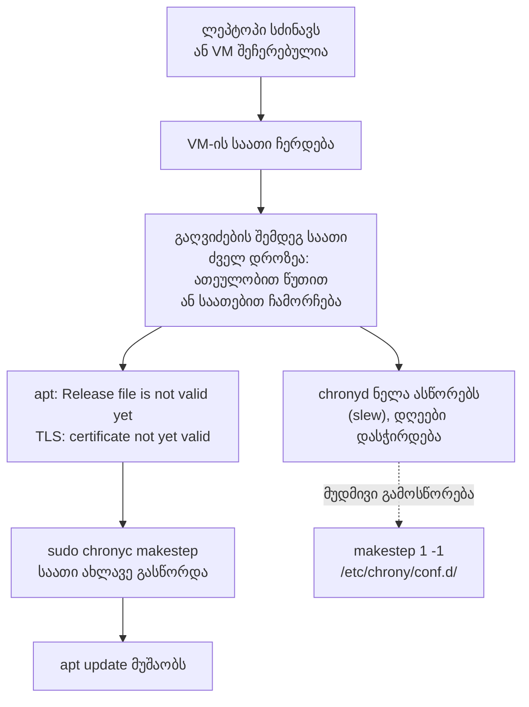

# პრობლემების ცნობარი

რეალური პრობლემები, რომლებიც კურსის განმავლობაში შეგვხვდა: სიმპტომი, მიზეზი და გამოსწორება. პირველი ჩანაწერი ყველაზე ხშირად დაგვჭირდება, ამიტომ დეტალურად არის აღწერილი.

## ⏰ VM-ის საათი ჩამორჩება: `apt`-ის შეცდომა „not valid yet“

**ეს განმეორდება**, როცა ლეპტოპს დააძინებ ან VirtualBox-ის VM შეჩერდება და მერე გააგრძელებ. თუ `apt update` უცნაურ შეცდომას წერს ან სერტიფიკატები „ჯერ არ არის ვალიდური“, **პირველ რიგში საათი შეამოწმე**.



### სიმპტომი
```text
$ sudo apt update
Get:2 http://ge.archive.ubuntu.com/ubuntu resolute-updates InRelease [137 kB]
Error: Release file for http://ge.archive.ubuntu.com/ubuntu/dists/resolute-updates/InRelease
       is not valid yet (invalid for another 6min 42s). Updates for this repository will not be applied.
Error: Release file for http://security.ubuntu.com/ubuntu/dists/resolute-security/InRelease
       is not valid yet (invalid for another 6min 12s). ...
```
`apt` უარს ამბობს იმ ფაილზე, რომლის თარიღი VM-ის საათზე **წინ არის**: უსაფრთხოების მიზნით „მომავლიდან“ მოსულ ხელმოწერებს არ ენდობა. შედეგად პაკეტები არ განახლდება (`apt upgrade` 11 განახლებას ვერ იღებდა).

### დიაგნოზი
```text
$ timedatectl
               Local time: Mon 2026-11-16 01:18:42 +04
           Universal time: Sun 2026-11-15 21:18:42 UTC
                 RTC time: Sun 2026-11-15 21:12:37
System clock synchronized: no
              NTP service: active

$ chronyc tracking | head -n 6
Reference ID    : B97DBE7A (ntp-nts-2.ps5.canonical.com)
Stratum         : 3
Ref time (UTC)  : Mon Nov 16 07:52:11 2026
System time     : 38032.199218750 seconds slow of NTP time
```
| ხაზი | რას ნიშნავს |
|------|-------------|
| `System clock synchronized: no` | საათი NTP-სთან სინქრონიზებული **არ არის**, თუმცა `NTP service: active` ჩართულია |
| `System time: 38032 seconds slow` | VM-ის საათი **~10.5 საათით ჩამორჩება** რეალურ დროს (ამ დროს `Local time` 01:18 იყო, რეალურად კი 11:52) |
| `RTC time` | ვირტუალური აპარატის „აპარატული“ საათიც ჩამორჩებოდა |

!!! warning "„6 წუთი“ ≠ ჩამორჩენის ზომა"
    `apt` წერს, რომ ფაილი „ჯერ არ არის ვალიდური (6min 42s)“, მაგრამ ეს რიცხვი მხოლოდ იმას ზომავს, რამდენით უსწრებს **სარკის ბოლო განახლების დრო** VM-ის საათს. რეალური ჩამორჩენა გაცილებით დიდი იყო (38032 წამი). ზუსტი სიდიდე `chronyc tracking`-ში (`System time`) ჩანს, `apt`-ის შეტყობინებას მასზე არ ვენდობით.

### მიზეზი
1. ლეპტოპის ძილის ან VM-ის პაუზის დროს VM-ის საათი **არ მიდის**. გაღვიძებისას ის ძველ დროზე დგას.
2. `chronyd` დიდ გადახრას თავისით ასწორებს მხოლოდ **ნელა** (დროის სიჩქარის მცირე ცვლილებით), 10 საათის გასწორებას დღეები მოუნდებოდა. ნაგულისხმევად საათს ერთბაშად „გადახტუნებს“ მხოლოდ დაწყებისას, პირველი სამი განახლებისას (`makestep 1 3`).

### გამოსწორება
```bash
sudo chronyc makestep
```
```text
$ sudo chronyc makestep
200 OK
$ date
Mon Nov 16 11:52:46 AM +04 2026
```
`makestep` ბრძანებას `chronyd`-ს ეუბნება: **ახლავე** გაასწორე საათი. ამის შემდეგ `sudo apt update` მუშაობს.

### მუდმივი გამოსწორება (გაშვებულია)
```bash
echo "makestep 1 -1" | sudo tee /etc/chrony/conf.d/makestep.conf
sudo systemctl restart chrony
```
`makestep 1 -1` ნიშნავს: თუ გადახრა 1 წამზე მეტია, **ყოველთვის** ახლავე გასწორდეს (მეორე რიცხვი არის ასეთი მცდელობების ლიმიტი, `-1` = შეუზღუდავი; ნაგულისხმევი `3` მხოლოდ პირველ სამ განახლებას ითვალისწინებს). VM-ისთვის, რომელიც ხშირად ჩერდება, ეს უსაფრთხოა. შემოწმება: <br>
```bash
chronyc tracking | grep -E "System time|Leap"
timedatectl | grep synchronized
```

რეალური შედეგი: <br>
```text
$ cat /etc/chrony/conf.d/makestep.conf
makestep 1 -1
```
VM-ის გადატვირთვის შემდეგ: `System clock synchronized: yes`. ფაილი `conf.d/`-შია და არა `chrony.conf`-ში, ამიტომ `chrony`-ის პაკეტის განახლება მას არ გადააწერს.

### რას აზიანებს ჩამორჩენილი საათი
| რა | შედეგი |
|----|--------|
| `apt update` / `upgrade` | არ მუშაობს („not valid yet“) |
| TLS სერტიფიკატები | შეიძლება „ჯერ არ არის ვალიდური“ გამოჩნდეს |
| ლოგების და ფაილების დრო | ჩანაწერებს არასწორი დრო აქვს (ჩვენს ზოგ გამოტანაში `2026-11-15 23:xx` რეალურად ~10 საათით უფრო გვიანია) |
| `cron` | ამოცანა მაშინ გაეშვება, როცა **VM-ის** საათი მიაღწევს დროს, ამიტომ 03:00 backup შეიძლება გამოგვრჩეს |
| `fail2ban`, `find -mtime`, `journalctl --since` | დროზე დამოკიდებული ლოგიკა არასწორად მუშაობს |
| საათის უცებ წინ გადახტომა | cron-ის დაგვიანებულ ამოცანებს შეიძლება ერთბაშად გაუშვას |

### პროფილაქტიკა
- ლეპტოპის ძილიდან გაღვიძების შემდეგ, თუ `apt`-ის ან TLS-ის უცნაური შეცდომა ჩანს: `timedatectl` და `chronyc tracking`.
- `makestep 1 -1` კონფიგში (ზემოთ), რომ საათი თავისით გასწორდეს.

---

## სხვა რეალური პრობლემები (ერთ ადგილას)
| სიმპტომი | მიზეზი და გამოსწორება | სად არის აღწერილი |
|----------|----------------------|-------------------|
| `Permission denied` ან პაროლს ითხოვს SSH-ზე | Electerm `~/.ssh/`-ს არ კითხულობს, key ხელით უნდა მიეთითოს; `sshd_config.d/50-cloud-init.conf` შეიძლება პაროლით შესვლას აბრუნებდეს | [Task 4](tasks/task4.md) |
| backup სკრიპტი პაროლს ითხოვს (cron-ში) | `~/.pgpass` (`chmod 600`) და `pg_dump -w` | [Task 11](tasks/task11.md) |
| `journalctl _COMM=sshd` ცარიელია | ახალ Ubuntu-ზე პროცესი `sshd-session`-ია; `lastb` არ არსებობს | [Task 13](tasks/task13.md) |
| `no configuration file provided` | `docker compose` უნდა გაეშვას `~/docker-app`-იდან ან `-f` დროშით | [Task 15](tasks/task15.md) |
| Adminer: `password authentication failed` | Postgres პაროლს მხოლოდ volume-ის პირველად შექმნაზე იღებს | [Task 15](tasks/task15.md) |
| `app.test` `200 OK`-ს აბრუნებს, მაგრამ `mgawm`-ს აჩვენებს | proxy-ს `server` ბლოკი არ იყო ჩართულ ფაილში; შეადარე `<title>` და `Content-Length` | [Task 16](tasks/task16.md) |
| `curl: (7)` 443-ზე, `ss` ცარიელი | `ssl_certificate` ხაზები არასწორ `server` ბლოკში ჩაჯდა | [Task 17](tasks/task17.md) |
| `unknown directive "sudo"` / `"EOFserver"` nginx-ში | `sudo tee ... <<EOF` ბრძანება nano-ში ჩაიწერა ტექსტად | [Task 17](tasks/task17.md) |
| `Author identity unknown`; ბრენჩი `master` | `git config` `git init`-მდე უნდა გაეშვას | [Task 18](tasks/task18.md) |
| `deploy.sh`-ის შემდეგ გვერდი ძველია | bind-mount ფაილის ცვლილებას `up -d` ვერ ამჩნევს: `restart web` | [Task 19](tasks/task19.md) |
| `ps aux`-ის პირველი ხაზი თავად `ps`-ია (150% CPU) | ახლადგაშვებული პროცესის პროცენტი მცდარია | [Task 20](tasks/task20.md) |
| `docker system df`: `RECLAIMABLE 99%` | შეცდომაში შემყვანია; წაშალე კონკრეტული იმიჯი, `prune -a` არა | [Task 21](tasks/task21.md) |
| `fail2ban`: `Journal matches ... _COMM=sshd` | კონფიგის გამოტანა საკმარისი არ არის, `Total failed`-ით ვამოწმებთ რეალურად | [Task 23](tasks/task23.md) |
| `apt`: `Waiting for cache lock ... held by unattended-upgr` | `unattended-upgrades` ფონზე აყენებს პაკეტებს და `dpkg`-ის საკეტი ეკავა: `apt` თვითონ დაელოდება, არ გააჩერო | [Task 23](tasks/task23.md) |
| Electerm sync: `404 Not Found`; `handshake timeout` | Gist ID არასწორი; ტელეფონზე `100.x`, არა `192.168.56.10` | [ტელეფონიდან წვდომა](setup/phone-access.md) |
