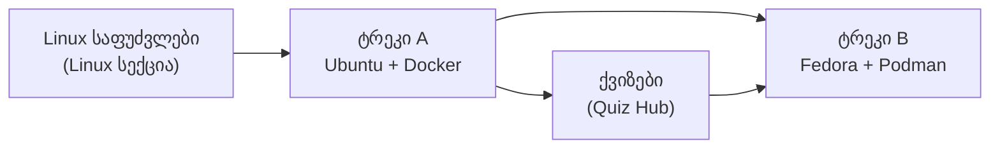

# Dev Ops

Dev Ops სექცია გასწავლით, როგორ გავუშვათ, დავიცვათ და შევინარჩუნოთ სერვერები და სერვისები: Linux-ის ადმინისტრირება, ქსელი და უსაფრთხოება, Web სერვერი, კონტეინერები, ავტომატიზაცია, მონიტორინგი და backup.

სექციას ორი ერთმანეთისგან **განცალკევებული** ტრეკი აქვს. ისინი სხვადასხვა ოპერაციულ სისტემასა და კონტეინერულ ხელსაწყოს ეფუძნება, ამიტომ ერთი ტრეკის ბრძანებები მეორეში არ გადაიტანოთ.

## ორი ტრეკი

=== "ტრეკი A: DevOps საფუძვლები"

    **Ubuntu Server + Docker.** ზოგადი გზა ნულიდან: ვირტუალური მანქანა, Linux, ქსელი და SSH, Bash და cron, Git, Nginx, Docker, CI/CD, მონიტორინგი, backup და production არქიტექტურა. წყარო: MyDevOps ლაბორატორია, 27 პრაქტიკული ამოცანა.

    - [ტრეკი A: მთავარი გვერდი](Fundamentals/index.md)
    - [რესურსები და სერტიფიკაციები](Fundamentals/resources.md)

=== "ტრეკი B: GIS ინფრასტრუქტურა"

    **Fedora Server + Podman.** GIS სერვისებისთვის განკუთვნილი ინფრასტრუქტურა: GeoServer, PostGIS, MapStore, Web სერვერი და ღრუბლოვანი გამოთვლები. ეს არის OSDoc-ის არსებული Dev Ops მასალა, რომელიც უცვლელია.

    - [მოდულების გეგმა (Fedora Server, Podman, PostGIS, GeoServer)](Other/Steps.md)

## ტრეკების შედარება

| | **ტრეკი A: DevOps საფუძვლები** | **ტრეკი B: GIS ინფრასტრუქტურა** |
|---|---|---|
| ოპერაციული სისტემა | Ubuntu Server | Fedora Server |
| კონტეინერები | Docker, Docker Compose | Podman (rootless), Podman-Compose |
| პაკეტების მენეჯერი | `apt` | `dnf` |
| Firewall | `ufw` | `firewalld` |
| უსაფრთხოება | SSH key, `fail2ban`, `ufw` | SELinux, `firewalld`, `fail2ban` |
| ფოკუსი | ზოგადი Linux და DevOps უნარები | GIS სერვისების განთავსება და მართვა |
| ვისთვისაა | დამწყებისთვის, ნულიდან | ვისაც Linux-ის საბაზისო ცოდნა უკვე აქვს |

დეტალური შედარებისთვის იხილეთ [სასწავლო ტრეკები](Tracks.md).

!!! warning "ბრძანებები ოპერაციული სისტემის მიხედვით"
    თითოეული ტრეკის ბრძანებები მიბმულია თავის ოპერაციულ სისტემასა და კონტეინერულ ხელსაწყოზე. მაგალითად, პაკეტებს Ubuntu-ზე `apt` აყენებს, Fedora-ზე `dnf`; firewall-ს Ubuntu-ზე `ufw` მართავს, Fedora-ზე `firewalld`; კონტეინერებს ტრეკ A-ში Docker, ტრეკ B-ში Podman. ამიტომ ერთ ტრეკში ბოლომდე იმუშავეთ ერთსა და იმავე სისტემაზე და მეორე ტრეკის ბრძანებები პირდაპირ არ გადაიტანოთ.

## ტრეკი A: მასალები

ყველა გვერდი ეკუთვნის [ტრეკ A](Fundamentals/index.md)-ს.

| თემა | სად |
|---|---|
| გარემო | [Virtualbox ინსტალაცია](Fundamentals/setup/setup-virtualbox.md), [Ubuntu ინსტალაცია](Fundamentals/setup/setup-ubuntu.md), [Virtual Machine (Task 1)](Fundamentals/tasks/task1.md) |
| Linux | [Linux Academy](Fundamentals/academy/linux/index.md), [ფაილური სისტემის იერარქია](Fundamentals/linux/filesystem-hierarchy.md), [Linux Cheat Sheet](Fundamentals/linux/cheatsheet.md), [User and Permission Management](Fundamentals/tasks/task6.md) |
| ქსელი და უსაფრთხოება | [Network Setup](Fundamentals/tasks/task2.md), [SSH Configuration](Fundamentals/tasks/task4.md), [Firewall Setup](Fundamentals/tasks/task7.md), [Network Diagnostics](Fundamentals/tasks/task22.md), [Security Audit](Fundamentals/tasks/task23.md) |
| Web სერვერი | [Web Server Installation](Fundamentals/tasks/task8.md), [Reverse Proxy Configuration](Fundamentals/tasks/task16.md), [SSL Certificate](Fundamentals/tasks/task17.md) |
| Docker | [Docker Installation](Fundamentals/tasks/task14.md), [Containerized Application](Fundamentals/tasks/task15.md), [Docker ინფრასტრუქტურა](Fundamentals/production/docker-infrastructure.md) |
| Production | [Production არქიტექტურა](Fundamentals/production/index.md), [Nginx](Fundamentals/production/nginx.md), [CI/CD](Fundamentals/production/cicd.md), [მონიტორინგი](Fundamentals/production/monitoring.md), [Backup და აღდგენა](Fundamentals/production/backup-recovery.md) |
| ცნობარი | [ბრძანებების ცნობარი](Fundamentals/commands.md), [პრობლემების ცნობარი](Fundamentals/troubleshooting.md) |
| შემოწმება | [DevOps ქვიზები](Fundamentals/quiz.md) |

## ტრეკი B: მასალები

| თემა | სად |
|---|---|
| გეგმა | [მოდულების გეგმა (Fedora Server, Podman, PostGIS, GeoServer)](Other/Steps.md) |
| GeoServer | [Java Heap და Dump](GeoServer/Theory/Java_Heap_and_Dump_GeoServer.md) |
| Web სერვერი | [HTTP მეთოდები GIS სტეკში](Web_server/http.md) |
| Cloud | [ღრუბლოვანი გამოთვლები GIS-ში](Cloud/cloud-computing-gis.md) |
| ხელსაწყოები | [curl](Other/curl.md) |

!!! note "ტრეკი B ფართოვდება"
    ტრეკ B-ის გვერდები ჯერ ტრეკ A-ზე მცირეა. ახალი მასალა დაემატება მოდულების გეგმის მიხედვით.

## რეკომენდებული თანმიმდევრობა

1. **Linux-ის საფუძვლები.** თუ Linux ახალია თქვენთვის, ჯერ გაიარეთ [Linux სექცია](../Linux/intro.md).
2. **ტრეკი A, თანმიმდევრობით.** დაიწყეთ [მთავარი გვერდიდან](Fundamentals/index.md): გარემო, Linux, ქსელი, Web სერვერი, Docker, ავტომატიზაცია, ბოლოს Production არქიტექტურა.
3. **გამოცდა ქვიზებით.** ყოველი თემის შემდეგ შეამოწმეთ ცოდნა [DevOps ქვიზებში](Fundamentals/quiz.md) ან [Quiz Hub](../Quiz/index.md)-ზე, სადაც GIS და DevOps ქვიზები ერთადაა.
4. **ტრეკი B.** მხოლოდ ამის შემდეგ გადადით GIS ინფრასტრუქტურაზე (Fedora, Podman, GeoServer): ტრეკ A-ში ნასწავლი Linux, ქსელის და უსაფრთხოების იდეები იქაც მოქმედებს, მაგრამ ბრძანებები და ხელსაწყოები განსხვავებულია.

რომელიმე ტრეკის დაწყებამდე ნახეთ [სასწავლო ტრეკების შედარება](Tracks.md).
