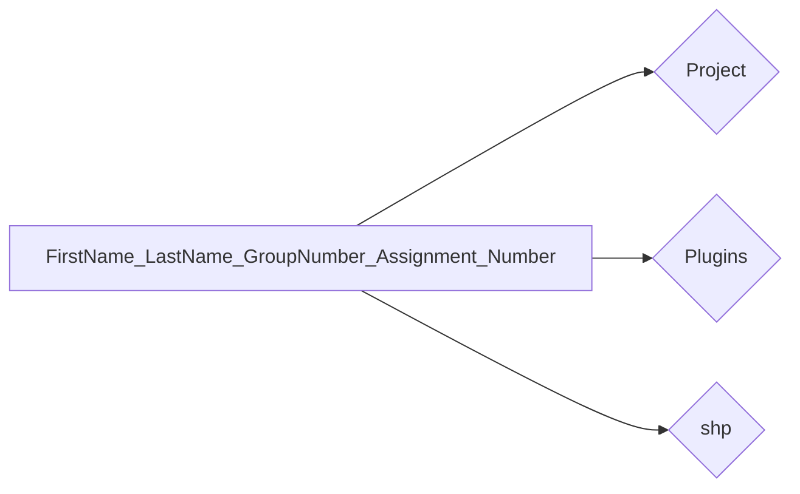

# Digitization

You can watch the video recordings [here](#)  

Official documentation  

QGIS Documentation - [Editing](https://docs.qgis.org/3.40/en/docs/user_manual/working_with_vector/editing_geometry_attributes.html)  

Window - The Browser [panel](https://docs.qgis.org/3.40/en/docs/user_manual/introduction/browser.html#resources-that-can-be-opened-run-from-the-browser)  

### ⚙️ Processing Toolbox

Attribute and [spatial](https://docs.qgis.org/3.40/en/docs/user_manual/processing_algs/qgis/vectorgeneral.html#create-spatial-index) indexing

Additional links  
The theory part is kept [here](https://gtu.qgis.ge/GIS_SKA/Theory/Digitization/)  
More on the same [topics](https://gtu.qgis.ge/GIS_SKA/Theory/Project_file/)  
[About](https://gtu.qgis.ge/GIS_SKA/Theory/Shapefile/) Shapefile  
Theory part [about](https://gtu.qgis.ge/GIS_SKA/Theory/Path/) paths  

---
## Assignment instructions

⚠️ **Working environment**

On university computers, work in this folder:  
`C:\Users\Public\` or `C:\Users\Public\Documents`  
*(recommended on personal computers too, because the program may have trouble processing files located elsewhere.)*

📦 **Required programs**

* QGIS – required ✅  
* Google Earth – optional (depending on the assignment) ✅  

---

!!!warning
    Do not delete the finished material until the end of the semester.
    
---

!!!danger 
    **File naming rules**

    ❌ **Wrong:**  

    Giorgi Kapanadze.Group/1$ work1  

    ❌ Do not use:

    - Georgian letters (ა, ბ, გ, დ, etc.)  
    - special characters (except the underscore `_`)

    ✅ **Correct:**  

    Giorgi_Kapanadze_Group_1_work_1  

!!!tip
    Use only Latin letters, digits and the underscore (`_`) for:  
    archive names, folder and file names, table column names.

---

## 📘 Step-by-step guide

!!!note
    To download the data and upload the assignment, you need to sign in to Google Classroom
     : [classroom.google.com](https://classroom.google.com/)

=== "Stage I: setting up the folder"
* In QGIS, install the plugins [HCMGIS](https://plugins.qgis.org/plugins/HCMGIS/) and 
[QuickMapServices](https://plugins.qgis.org/plugins/quick_map_services/) for basemaps.
* Create a folder using your first and last name. Follow the naming rules above.  
 
++left-control+left-shift+"N"++
 
* Inside it, create these subfolders:  
  - Project  
  - Plugins
  - shp  

Connect QGIS to your main folder (from the Browser window, in Favorites).

---

=== "Stage II: creating the shapefiles"

- Create a new project in QGIS  
 
++left-control+"N"++
 

**Additional information**

* **Digitizing the Tbilisi municipality is not allowed.** Please choose another town or village.  
After choosing a settlement, if you are right on a zone boundary and it is unclear which zone you belong to:

    If most of the objects you plan to digitize are in zone 37 — choose 37.

    If most of them are in zone 38 — choose 38.

    If the location is in between and the objects are split evenly — choose 38.

    Zone 38 takes priority.

**Basic information**

* Give the layers exact names and save them in the right folder. The layer template is below:
    - **Point geometry**: houses, schools, stations, buildings, stadiums
    - **Line geometry**: rivers, railways, roads, cable cars
    - **Polygon geometry**: parcels, houses, buildings, stadiums, forests

* Each layer must have at least **10 features**; there is no upper limit.  
If a layer does not have enough data, move to another layer and fill it in.

* The colour or shape of the symbols is up to you — use your own judgement.  
However, a blue forest or a green river will be considered irrelevant.

* Choose the correct **UTM zone** for the data.

* Save the digitized data in the layers correctly.

* Arrange the layers in the project in an organized way.

* Save the compressed project file as: `"Digitalization_project.qgz"`.  
Save the uncompressed project file as: `"Digitalization_project.qgs"`.  
 
++left-control+left-shift+"S"++

---

=== "Stage III: checking and submitting"
* Make an archive of your folder. 💾
* Use the `.rar` or `.zip` format.
* Name the archive in this format:  
  `FirstName_LastName_GroupNumber_Assignment_Number`

* Upload the work to Google Classroom

---

!!!warning
    If you have any problem while submitting, contact us:  
    g.kapanadze1908@gmail.com  
    or use any file transfer service.  

    https://www.swisstransfer.com/en-gb

    https://wetransfer.com/

    https://www.filemail.com/

    https://dropmefiles.com/

    https://www.swisstransfer.com/en-gb

    https://www.sendgb.com/

    https://workupload.com/ 

!!!info
    📌 If anything is unclear, feel free to ask! 😊  
    If something is done incorrectly, I will fix it — or create a pull request yourself.
