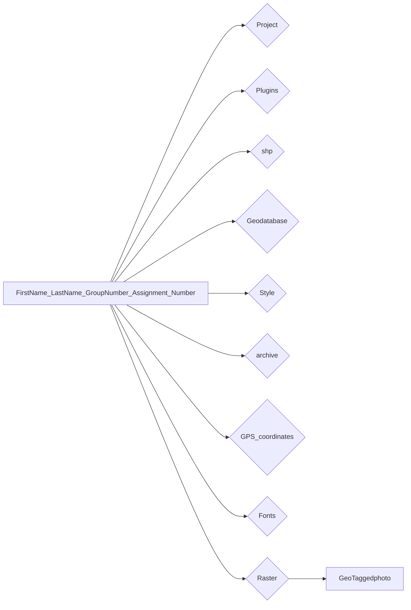

# Global positioning systems

You can watch the video recordings [here](https://gtu.qgis.ge/GIS_SKA/Videos/)  

Official documentation  

Temporary layer - Creating a new Temporary Scratch [Layer](https://docs.qgis.org/3.40/en/docs/user_manual/managing_data_source/create_layers.html#creating-a-new-temporary-scratch-layer)  
Window - The Browser [panel](https://docs.qgis.org/3.40/en/docs/user_manual/introduction/browser.html#resources-that-can-be-opened-run-from-the-browser)  

### ⚙️ Processing Toolbox  

Tool [Import geotagged photos](https://docs.qgis.org/3.40/en/docs/user_manual/processing_algs/qgis/vectorcreation.html#import-geotagged-photos)  
Tool [Add geometry attributes](https://docs.qgis.org/3.40/en/docs/user_manual/processing_algs/qgis/vectorgeometry.html#qgisexportaddgeometrycolumns)  
Tool [Reproject layer](https://docs.qgis.org/3.40/en/docs/user_manual/processing_algs/qgis/vectorgeneral.html#qgisreprojectlayer)  

Additional links  
SVG [markers](https://www.svgrepo.com/)  
Saving a vector [layer](https://gtu.qgis.ge/GIS_SKA/Theory/Save_vector_layer/)  
Temporary layer - Creating a new Temporary Scratch [Layer](https://gtu.qgis.ge/GIS_SKA/Theory/Scratch_layer/)  
Styles [QML&SLD](https://gtu.qgis.ge/GIS_SKA/Theory/QML_SLD/)  

Plugins  
Plugin [ImportPhotos](https://plugins.qgis.org/plugins/ImportPhotos/)  

Some materials are kept in Google [Classroom](https://classroom.google.com/c/Nzg3MzAxMDU4MzEy/m/Nzg3NTk5MzU2OTYw/details) ⚠️  

---
## Assignment instructions

⚠️ **Working environment**

On university computers, work in this folder:  
`C:\Users\Public\` or `C:\Users\Public\Documents`  
*(recommended on personal computers too, because the program may have trouble processing files located elsewhere.)*

📦 **Required programs**

* QGIS – required ✅  
* Google Earth – optional (depending on the assignment) ✅  

---

!!!warning
    Do not delete the finished material until the end of the semester.
    
---

!!!danger 
    **File naming rules**

    ❌ **Wrong:**  

    Giorgi Kapanadze.Group/1$ work1  

    ❌ Do not use:

    - Georgian letters (ა, ბ, გ, დ, etc.)  
    - special characters (except the underscore `_`)

    ✅ **Correct:**  

    Giorgi_Kapanadze_Group_1_work_1  

!!!tip
    Use only Latin letters, digits and the underscore (`_`) for:  
    archive names, folder and file names, table column names.

---

## 📘 Step-by-step guide

!!!note
    To download the data and upload the assignment, you need to sign in to Google Classroom
     : [classroom.google.com](https://classroom.google.com/)

=== "Stage I: organizing the folder"
* We use the previous assignment, **Geodatabases [task](https://gtu.qgis.ge/GIS_SKA/Lab/Geodatabase/)**

* Inside it, create these subfolders:  
    - archive
    - GPS_coordinates 
    - Fonts
    - GeoTaggedphoto 

Connect QGIS to your main folder (from the Browser window).

---

=== "Step II: practical tasks"

* Open the `"Chiatura_Geodatabase_project.qgz"` file from the folder, save a copy named `"Chiatura_GPS_project.qgz"`, and also save another `.qgs` file, `"Chiatura_GPS_project.qgs"`
* Fonts: installing them, why they matter, using them in labels.
* Convert the GPS coordinates from the material to the right format, bring them into the program, place them in the right coordinate system,
and export each of them as a shapefile or as a geodatabase feature class.  
* Import the geotagged photos as a shapefile, or as a geodatabase feature class.  
* Transform the photos layer from the ellipsoid to a UTM zone (PT Assign projection) and calculate the XY coordinates in the layer's table with Add geometry attributes.  
* Take a photo without coordinates and give it a location with additional tools: [geoimgr](https://tool.geoimgr.com/), [GEOSETTER](https://geosetter.de/en/main-en/).  
* SVG markers: download them with free access, save them and use them as icons on point geometry.  
* Save the layer style both in the QGIS qml format and as an SLD file.  
* Save the project file as `"Chiatura_GPS_project.qgz"`. Also save it in the `"Chiatura_GPS_project.qgs"` format.  

---

=== "Stage IV: checking and submitting"
* Make an archive of your folder. 💾
* Use the `.rar` or `.zip` format.
* Name the archive in this format:  
  `FirstName_LastName_GroupNumber_Assignment_Number`

* Upload the work to Google Classroom

---

!!!warning
    If you have any problem while submitting, contact us:  
    g.kapanadze1908@gmail.com  
    or use any file transfer service.  

    https://www.swisstransfer.com/en-gb

    https://wetransfer.com/

    https://www.filemail.com/

    https://dropmefiles.com/

    https://www.swisstransfer.com/en-gb

    https://www.sendgb.com/

    https://workupload.com/ 

!!!info
    📌 If anything is unclear, feel free to ask! 😊  
    If something is done incorrectly, I will fix it — or create a pull request yourself.
