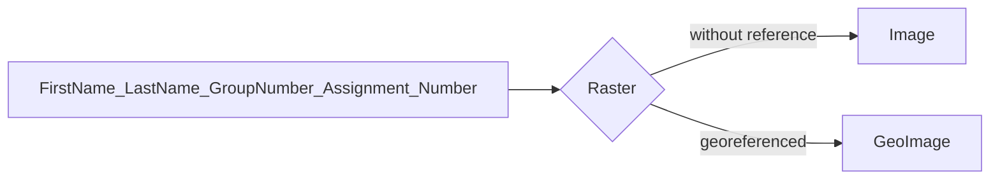

# Georeferencing

You can watch the video recordings [here](#)  

### Official documentation  
QGIS Documentation - [Georeferencer](https://docs.qgis.org/3.40/en/docs/user_manual/managing_data_source/georeferencer.html#index-0)  
Window - The Browser [panel](https://docs.qgis.org/3.40/en/docs/user_manual/introduction/browser.html#resources-that-can-be-opened-run-from-the-browser)  

### Additional links  
The theory part is kept [here](https://osdoc.qgis.ge/GIS_Basic/Theory/Georeferencing/)  
More on the same [topics](https://osdoc.qgis.ge/GIS_Basic/Theory/Base_Theory/Ellipsoid_Geoid_intro/)  

Some materials are kept in Google [Classroom](https://classroom.google.com/) ⚠️  

---
## Assignment instructions

⚠️ **Working environment**

On university computers, work in this folder:  
`C:\Users\Public\` or `C:\Users\Public\Documents`  
*(recommended on personal computers too, because the program may have trouble processing files located elsewhere.)*

📦 **Required programs**

* QGIS – required ✅  
* Google Earth – optional (depending on the assignment) ✅  

---

!!!warning
    Do not delete the finished material until the end of the semester.
    
---

!!!danger 
    **File naming rules**

    ❌ **Wrong:**  

    Giorgi Kapanadze.Group/1$ work1  

    ❌ Do not use:

    - Georgian letters (ა, ბ, გ, დ, etc.)  
    - special characters (except the underscore `_`)

    ✅ **Correct:**  

    Giorgi_Kapanadze_Group_1_work_1  

!!!tip
    Use only Latin letters, digits and the underscore (`_`) for:  
    archive names, folder and file names, table column names.

---

## 📘 Step-by-step guide

!!!note
    To download the data and upload the assignment, you need to sign in to Google Classroom
     : [classroom.google.com](https://classroom.google.com/)

=== "Stage I: organizing the folder"
* In QGIS, install the plugins [HCMGIS](https://plugins.qgis.org/plugins/HCMGIS/) and 
[QuickMapServices](https://plugins.qgis.org/plugins/quick_map_services/) for basemaps.
* Download the topographic map
* Create a new folder based on your first and last name. Use the naming rules above. E.g.: `"Giorgi_Kapanadze_Group_1_work_1_georeferencing"`  
* Inside it, create these subfolders:  
  - Raster  
  - Image  
  - Geoimage  

Connect QGIS to your main folder (from the Browser window).

---

=== "Stage II: preparing the map"
* The assignment folder contains one topographic map.
* Download it and put it in the right subfolder.
* Georeference it with rectangular coordinates (in meters).
* Georeference it with spherical coordinates (Degrees, Minutes, Seconds).

---

=== "Stage III: checking and submitting"
* After georeferencing, check the map's position with any available method — you can use Google Earth 
or QGIS, and don't forget to first import some basemap. 🌍
* Make sure the map lines up correctly with the target area. 🗺
* Make an archive of your folder. 💾
* Use the `.rar` or `.zip` format. Prefer the ZIP format ⚠️
* Name the archive in this format:  
  `FirstName_LastName_GroupNumber_Assignment_Number`

* Upload the work to Google Classroom

---

!!!warning
    If you have any problem while submitting, contact us:  
    g.kapanadze1908@gmail.com  
    or use any file transfer service.  

    https://www.swisstransfer.com/en-gb

    https://wetransfer.com/

    https://www.filemail.com/

    https://dropmefiles.com/

    https://www.swisstransfer.com/en-gb

    https://www.sendgb.com/

    https://workupload.com/ 

!!!info
    📌 If anything is unclear, feel free to ask! 😊  
    If something is done incorrectly, I will fix it — or create a pull request yourself.
