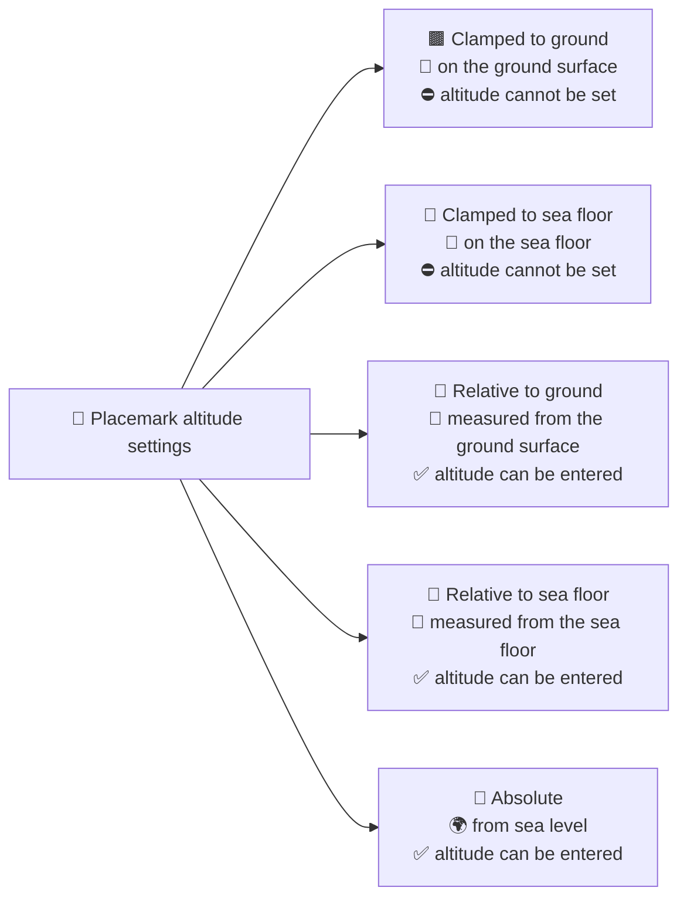

# Placemark altitude settings

**A placemark's altitude settings define the reference level from which height is measured on a 3D map (e.g. in Google Earth).**

## Placemark altitude settings as a diagram

---

## 1. `Clamped to ground`

- 📌 **Description:** the point sticks directly to the ground surface.
- ⛔ Entering an altitude by hand is **not possible**.
- 🧭 **Example:** mark a tree on a hill — it appears on the ground, on top of the hill.

---

## 2. `Clamped to sea floor`

- 📌 **Description:** the point is placed on the sea floor, not on the water surface.
- ⛔ Entering an altitude is **not possible**.
- 🧭 **Example:** if you want to show where a submarine sank, it appears on the sea floor.

---

## 3. `Relative to ground`

- 📌 **Description:** the altitude is measured from the ground surface.
- ✅ You can give a specific number of meters/feet.
- 🧭 **Example:** "100 m" means the point appears 100 meters above the surface — for example, a drone or a tower.

---

## 4. `Relative to sea floor`

- 📌 **Description:** the altitude is measured from the sea floor.
- ✅ You can say how many meters above the sea floor it is.
- 🧭 **Example:** an underwater robot 20 meters above the sea floor.

---

## 5. `Absolute` (from sea level)

- 📌 **Description:** the altitude is defined from sea level (Mean Sea Level - MSL).
- ✅ The value in meters is an absolute height, as on the global model of the map.
- 🧭 **Example:** "2000 m" means the point is at the same height as Bakhmaro or Gudauri.

---

📎 **Note:**  
In Google Earth these settings are especially important for correctly defining 3D objects, visibility and animations.
