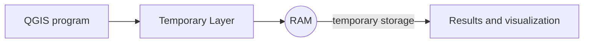

# 📘 What is RAM, and the QGIS temporary layer

## 💡 What is RAM?

**RAM (Random Access Memory)** is the computer's short-term memory.  
It temporarily stores the data of the programs and files that are currently running.

- Like a work desk — the bigger it is, the more things can be spread out at once.
- Programs such as **QGIS** use RAM to process data and store temporary results.
- When the computer or program shuts down, **the contents of RAM are erased**.

> 📌 **Example**: when you create a new project in QGIS and load a map into it, the map is held in RAM temporarily until you save the file to disk.

---

## 📍 Why is RAM important for QGIS?

- QGIS works with spatial data, which can be quite large.
- Sometimes you need a **temporary layer** that is not saved on your computer, only in RAM.
- Such a layer is the **Temporary Scratch Layer**.

---

## 🧪 The Temporary Scratch Layer in QGIS

A **Temporary Scratch Layer** is a temporary layer that:
- is stored only in the computer's RAM
- disappears when you close the project (if you have not saved it)
- is used for quick testing, drawing, or even for temporarily storing the results of calculations

> 🧠 **Analogy**: a temporary layer is like a note on a scrap of paper that gets thrown away when you leave the room — unless you copy it into a permanent notebook.

---

## ✅ When should you use a scratch layer?

- when you want to quickly draw a new object (e.g. a point or polygon) to try something
- when you need the data only for this session
- when you are doing spatial analysis and the result is temporary

---

## ❗ Remember:

- A temporary layer **is not saved automatically** — you have to save it yourself (Export → Save Features As…) if you want to keep it as a file.
- If you close QGIS, the layer **is deleted**.

---

## 🔁 How RAM and the scratch layer relate

| Component       | Function                                                         |
|------------------|------------------------------------------------------------------|
| RAM              | Storing temporary data in the computer                         |
| Scratch Layer     | A temporary spatial layer stored in RAM while QGIS is running |

---

## 📷 A visual example:

---

## 📎 Additional resources:
- [GeeksForGeeks: What is RAM?](https://www.geeksforgeeks.org/computer-science-fundamentals/random-access-memory-ram/)
- [QGIS Documentation: Temporary Layers](https://docs.qgis.org/3.40/en/docs/user_manual/managing_data_source/create_layers.html#creating-a-new-temporary-scratch-layer)
