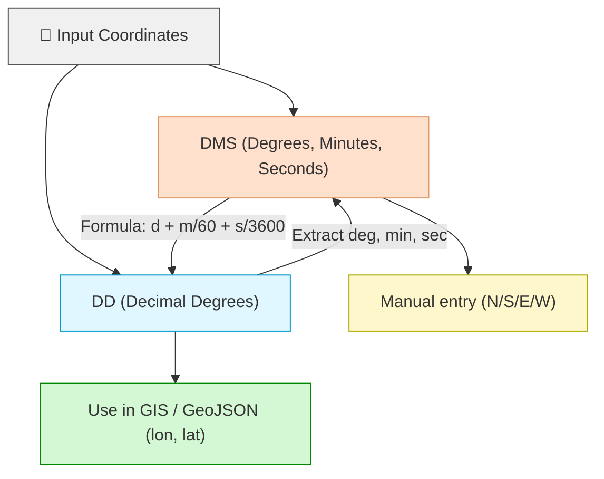

# Coordinate conversion

Coordinates often come in two formats:

- **DMS** - Degrees, Minutes, Seconds
- **DD** - Decimal Degrees

On this page you will find conversion functions for both directions, parsing a coordinate from text, processing a list, and using the results in QGIS.

!!! note "Coordinate order"
    Always keep the order in mind. People say "latitude, longitude" (lat, lon), while in QGIS `QgsPointXY(x, y)` means **`QgsPointXY(longitude, latitude)`**.

---

## 1) DMS → DD

**Formula:**

\[
\text{DD} = d + \frac{m}{60} + \frac{s}{3600}
\]

In the southern and western hemispheres DD is negative (N/E = +, S/W = −).

**Example:** Kotia Cave, Chiatura-Perevisa-Sveri-Tvalueti-Gezruli, Georgia. <br>
Coordinates [from Google Earth](https://www.google.com/maps/place/42%C2%B012'47.8%22N+43%C2%B019'27.7%22E/@42.2058273,43.2713168,21099m/data=!3m1!1e3!4m4!3m3!8m2!3d42.213286!4d43.324367?entry=ttu&g_ep=EgoyMDI0MTIxMS4wIKXMDSoASAFQAw%3D%3D) <br>
`42°12'47.83"N 43°19'27.72"E` > `42.213286° 43.324367°`

```py title="dms_to_dd.py" linenums="1"
def dms_to_dd(deg, minutes, seconds, ref=None):
    """DMS -> DD. ref: 'N', 'S', 'E' or 'W' (optional)"""
    dd = abs(deg) + minutes / 60 + seconds / 3600
    if ref in ('S', 'W') or deg < 0:
        dd = -dd
    return dd

print(dms_to_dd(42, 12, 47.83, 'N'))
print(dms_to_dd(43, 19, 27.72, 'E'))

# result: 42.21328611111112
#         43.32436666666667
```

---

## 2) DD → DMS

```py title="dd_to_dms.py" linenums="1"
def dd_to_dms(dd, precision=2):
    """DD -> (degrees, minutes, seconds). The sign goes on the degrees."""
    sign = -1 if dd < 0 else 1

    # first convert everything to seconds and round,
    # so that we never get 60.0 seconds
    total = round(abs(dd) * 3600, precision)
    minutes_total, seconds = divmod(total, 60)
    degrees, minutes = divmod(int(minutes_total), 60)

    return sign * degrees, minutes, round(seconds, precision)

print(dd_to_dms(41.688554))
print(dd_to_dms(44.693789))
print(dd_to_dms(-12.5))

# result: (41, 41, 18.79)
#         (44, 41, 37.64)
#         (-12, 30, 0.0)
```

!!! warning "Rounding the seconds"
    If we compute the degrees, then the minutes and finally the seconds separately, rounding can give `59.99999` or `60.0` seconds. That is why the function above first converts everything to seconds and only then divides.

---

## 3) DMS text to DD

A coordinate from Google Maps or a document is often text, for example `42°12'47.83"N`. With a regular expression we can convert it straight to DD.

```py title="parse_dms.py" linenums="1"
import re

DMS_PATTERN = re.compile(
    r"""(?P<deg>\d+)\s*[°ºd]\s*
        (?P<min>\d+)\s*['′m]\s*
        (?P<sec>\d+(?:[.,]\d+)?)\s*(?:["″s]|'')?\s*
        (?P<ref>[NSEW])?""",
    re.IGNORECASE | re.VERBOSE
)

def parse_dms(text):
    """'42°12'47.83"N' -> 42.213286..."""
    m = DMS_PATTERN.search(text)
    if not m:
        raise ValueError(f'Could not recognize the format: {text}')

    ref = m.group('ref').upper() if m.group('ref') else None
    return dms_to_dd(int(m.group('deg')),
                     int(m.group('min')),
                     float(m.group('sec').replace(',', '.')),
                     ref)

print(parse_dms('''42°12'47.83"N'''))
print(parse_dms('''43°19'27.72"E'''))
print(parse_dms('''12°30'0"W'''))

# result: 42.21328611111112
#         43.32436666666667
#         -12.5
```

`parse_dms()` uses the `dms_to_dd()` function from the first section, so run both in the same session.

---

## 4) Converting a list and saving it to CSV

Instead of one point we often have a whole list. Below, each point is stored with its name, latitude and longitude. The result is written so that QGIS can open it directly.

```py title="batch_convert_to_csv.py" linenums="1"
import csv

# (name, latitude(d, m, s), longitude(d, m, s))
points_dms = [
    ('Kotia Cave', (42, 12, 47.83), (43, 19, 27.72)),
    ('Tbilisi',    (41, 41, 55.00), (44, 47, 59.00)),
    ('Batumi',     (41, 38, 55.00), (41, 38, 24.00)),
]

rows = []
for name, lat, lon in points_dms:
    rows.append({
        'Name': name,
        'lat': round(dms_to_dd(*lat, 'N'), 6),
        'lon': round(dms_to_dd(*lon, 'E'), 6),
    })

with open('converted_coordinates.csv', 'w', newline='', encoding='utf-8') as f:
    writer = csv.DictWriter(f, fieldnames=['Name', 'lat', 'lon'])
    writer.writeheader()
    writer.writerows(rows)

print(f'Saved {len(rows)} points: converted_coordinates.csv')
```

Result `converted_coordinates.csv`:

```text
Name,lat,lon
Kotia Cave,42.213286,43.324367
Tbilisi,41.698611,44.799722
Batumi,41.648611,41.64
```

---

## 5) Using it in QGIS

### Opening a CSV as points

```py title="csv_to_layer.py" linenums="1"
uri = ('file:///C:/Users/Public/Documents/GIS/converted_coordinates.csv'
       '?delimiter=,&xField=lon&yField=lat&crs=EPSG:4326')

layer = QgsVectorLayer(uri, 'converted_points', 'delimitedtext')
QgsProject.instance().addMapLayer(layer)
```

If you want the layer as a file (Shapefile or GeoPackage), see [creating a layer from a CSV](PyQGIS_Create_layer.md).

### Converting to another coordinate system

In Georgia, geographic coordinates (`EPSG:4326`) often have to be converted to a projected system, for example `EPSG:32638` (UTM 38N).

```py title="transform_point.py" linenums="1"
src = QgsCoordinateReferenceSystem('EPSG:4326')
dst = QgsCoordinateReferenceSystem('EPSG:32638')

transform = QgsCoordinateTransform(src, dst, QgsProject.instance())

lon, lat = 43.324367, 42.213286
point = transform.transform(QgsPointXY(lon, lat))   # x = longitude, y = latitude

print(round(point.x(), 2), round(point.y(), 2))
```

### In the Field Calculator

QGIS has a built-in function for converting DD → DMS:

```sql
-- latitude in DMS format
to_dms(y($geometry), 'y', 2)

-- longitude in DMS format
to_dms(x($geometry), 'x', 2)

-- decimal degrees
x($geometry)   -- longitude
y($geometry)   -- latitude
```

!!! info "Note"
    The `to_dms()` function works on geographic coordinates. If the layer is in a projected system, first convert it with `transform($geometry, 'EPSG:32638', 'EPSG:4326')`.

---

## 🗺️ Diagram



---

## ✅ Exercise

1. Find the coordinates of your school on Google Maps (in DMS format).
2. Convert them to **DD format** with the `parse_dms()` function.
3. Write them to a CSV with `Name, lat, lon` columns.
4. Load it in QGIS with `Add Delimited Text Layer` or the `csv_to_layer.py` script and check it on the map.
5. **Extra:** convert the point to `EPSG:32638` and compare the resulting X, Y values with the result of the QGIS `Identify` tool.
